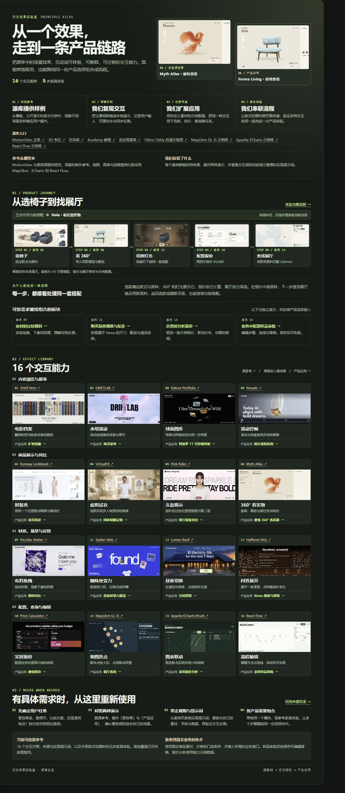

# GitHub 项目研究总库

整理值得深入研究的 GitHub 项目，记录它们解决的问题、值得借鉴的做法和复现中的发现。按编号浏览研究摘要，再进入子项目查看原仓库、详细笔记、截图和可用的 Web 演示。

## 研究索引

| 编号 | 子项目 | 原库 | 研究摘要 | 图片导览 | Web 演示 |
| --- | --- | --- | --- | --- | --- |
| 001 | [交互效果实验室](projects/001-interaction-effects-lab/README.md) | [MotionSites](https://motionsites.ai/) · [MapLibre GL JS](https://github.com/maplibre/maplibre-gl-js) · [Apache ECharts](https://github.com/apache/echarts) · [React Flow](https://github.com/xyflow/xyflow) | 汇总 16 个源参考、可操作复现与产品扩展，覆盖内容浏览、商品展示、材质反馈和业务交互。以共享款式与面料串联五步家具体验，沉淀原理、提示词与可继续组合的模块。 | [原理引导图](#interaction-effects-guide) | [在线总览与演示](https://yydshly.github.io/20261104_codex_project/001-interaction-effects-lab/) |
| 002 | [电梯叙事与工具能力研究](projects/002-capability-elevator/README.md) | [nicco 原帖](https://x.com/0xnicc0/status/2117961453722354173) · [Three.js](https://github.com/mrdoob/three.js) · [Playwright](https://github.com/microsoft/playwright) · [FFmpeg](https://github.com/FFmpeg/FFmpeg) | 借鉴角色乘电梯、逐层停靠介绍主题、片尾拉远全景的呈现方式，将一组工具或产品能力串成导览。包含四层互动样板、22 秒成片、13 个工具仓库与跨项目复用说明，验证数据驱动时间轴、浏览器逐帧采集和视频导出。 | [研究引导图](#capability-elevator-guide) | [在线研究与互动导览](https://yydshly.github.io/20261104_codex_project/002-capability-elevator/) |

项目按收录顺序从 `001` 开始编号。新条目按编号追加，已分配的编号保持固定。索引摘要用一两句话写清研究对象和关注点。完成验证后，可补上一条主要发现。

## 项目引导图

### 001 · 交互效果实验室

这张图汇总了从源库参考、本地复现到产品扩展的探索过程。16 个案例分为内容浏览与叙事、商品展示与对比、材质与场景反馈、配置查询与编辑四类，每项保留源参考、可操作演示和实现提示词。

图中的家具链路依次为选椅子、360° 查看、切换灯光、配置报价和查找展厅，用同一份款式与面料选择串联多个交互。可以单独取用一个效果，也可以参考这条链路组合自己的产品流程。

后续可接入真实商品、价格与展厅库存，并按需求组合面料比较、规格帮助、报价分析和样品审批。当前报价与库存使用示例数据，分析和审批保留独立演示入口。[进入在线体验](https://yydshly.github.io/20261104_codex_project/001-interaction-effects-lab/) · [查看详细研究与扩展方向](projects/001-interaction-effects-lab/README.md)

### 002 · 电梯叙事与工具能力研究

核心价值是用角色乘电梯逐层介绍主题，再以建筑全景展示整体关系。工具清单、产品功能或知识步骤都可以采用这类空间叙事。我们的样板用「AI 为什么会答错？」串起找入口、理解生成、对照证据和跨域阅读四层，支持播放、拖动进度和楼层直达。

引导图沿用本轮生成的版本，包含效果实帧、仓库路径和价值说明。图中的本机地址供本地运行时使用，公开入口见[在线研究与互动导览](https://yydshly.github.io/20261104_codex_project/002-capability-elevator/)。

网页收录四层 3D 互动演示、22 秒有声成片、研究归纳、13 个工具的能力说明与 GitHub 入口，以及跨项目复用例子。已验证的制作路径为内容配置与时间轴 → Three.js 场景 → Playwright 逐帧采集 → FFmpeg 编码与混音。

可复用的是逐层导览的呈现方法、网页预览与视频共用时间轴、浏览器自动操作与验证，以及按模板更新素材后重新导出。13 个仓库按任务选择，原片具体调用哪些工具尚未核实。「见全」完整案例需要另行在本机运行。[详细研究与来源](projects/002-capability-elevator/README.md)

## 收录新项目

1. 复制[子项目模板](projects/_template/README.md)到 `projects/<编号>-<英文短名>/README.md`，写明上游仓库、研究问题和复现记录。
2. 把封面和截图放在子项目的 `assets/`，用相对路径引用。填写替代文字，并用一句图注说明读者应关注的细节。根索引可链接封面。
3. 在上方索引补上对应条目，「原库」列填写上游仓库或官方入口。在索引下方添加引导图、案例范围、复用价值与扩展方向的说明。有在线演示时，再填入可访问的地址。

## Web 演示

首个静态演示就绪后，可将 GitHub Pages 的发布源设为 `main` 分支的 `/docs`。每个演示使用自己的 `docs/<编号>-<英文短名>/index.html`，把构建产物与静态资源放在该目录内。资源使用相对路径，或将构建基路径设为 `/20261104_codex_project/<编号>-<英文短名>/`。

启用后，演示地址的格式为 `https://yydshly.github.io/20261104_codex_project/<编号>-<英文短名>/`。[GitHub Pages 发布源说明](https://docs.github.com/en/pages/getting-started-with-github-pages/configuring-a-publishing-source-for-your-github-pages-site)
