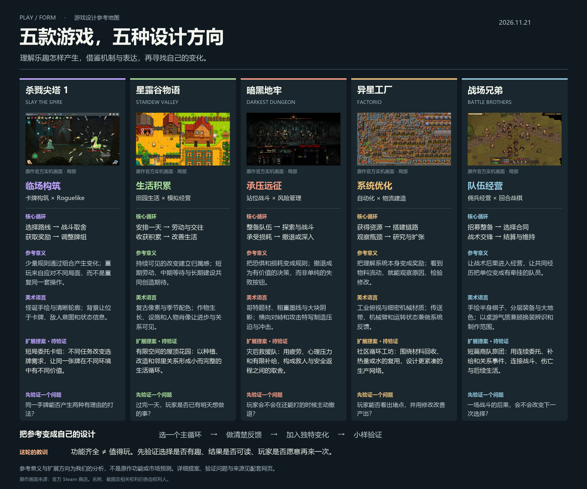
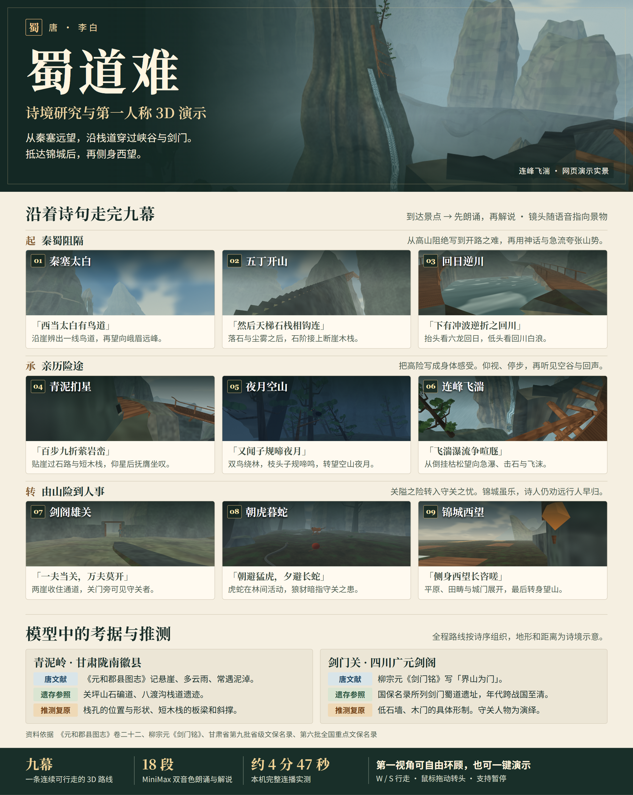
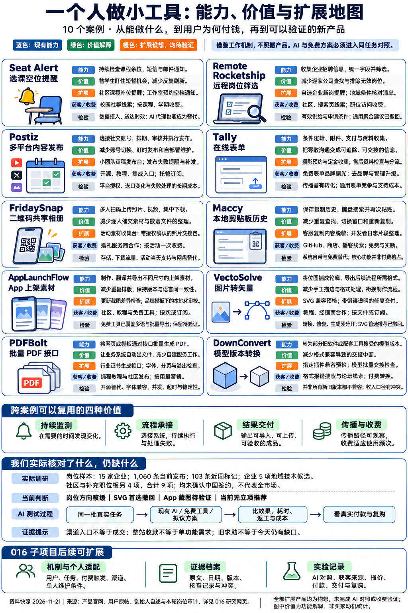
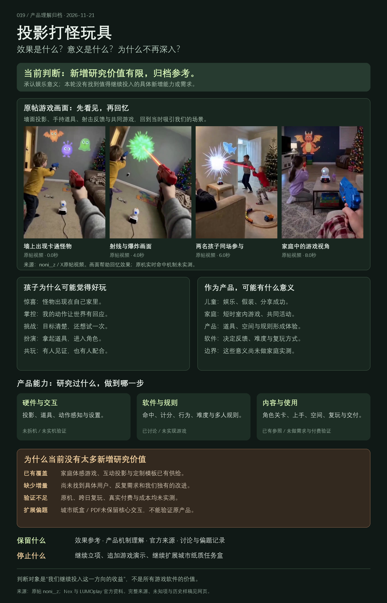
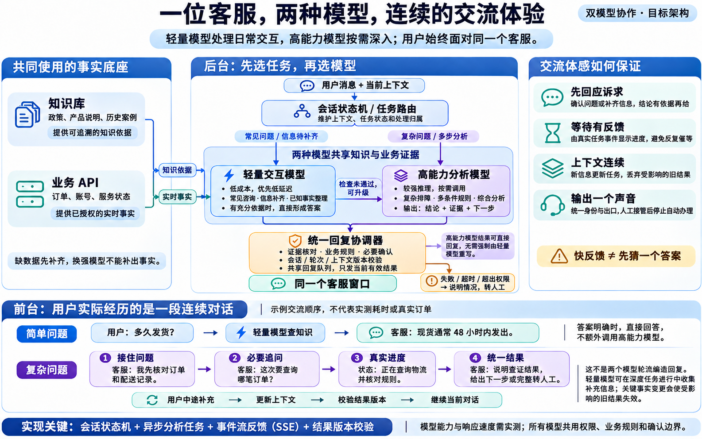
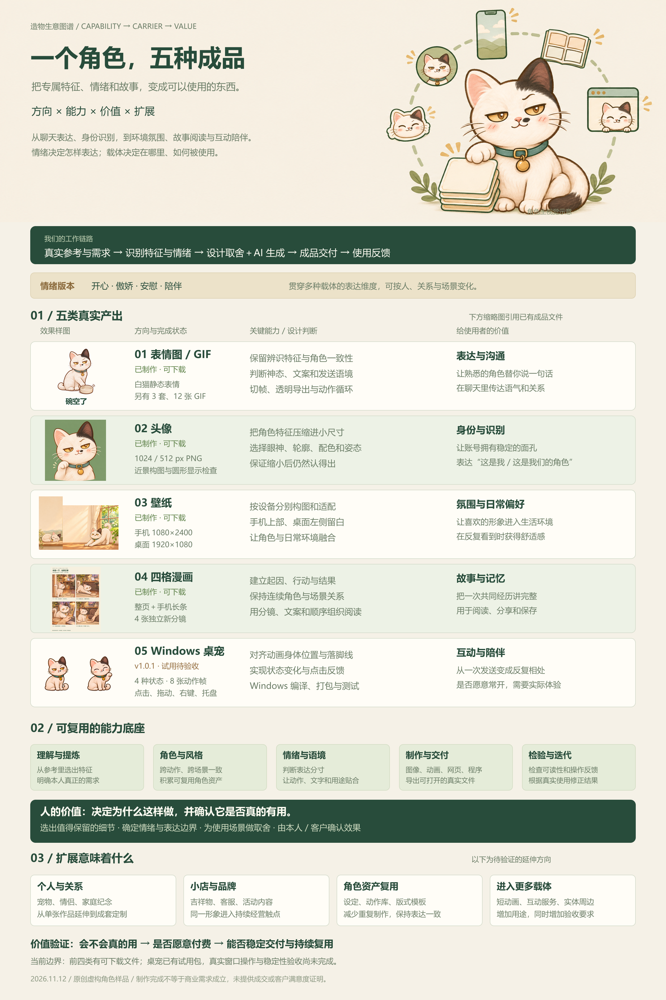
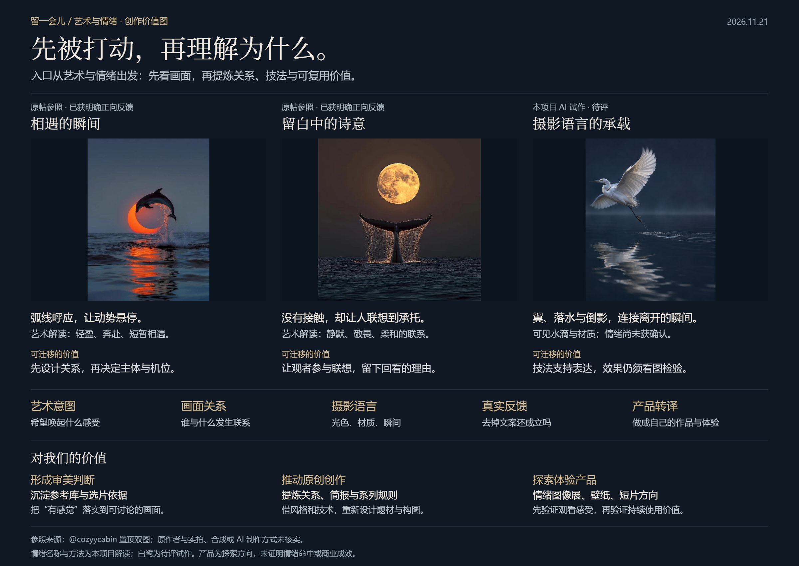
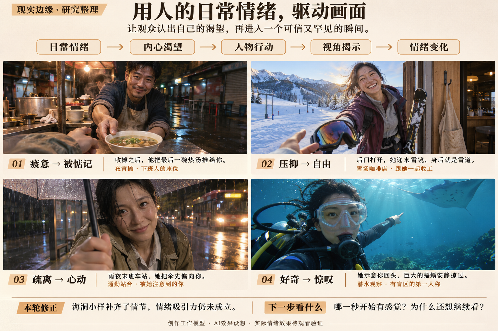
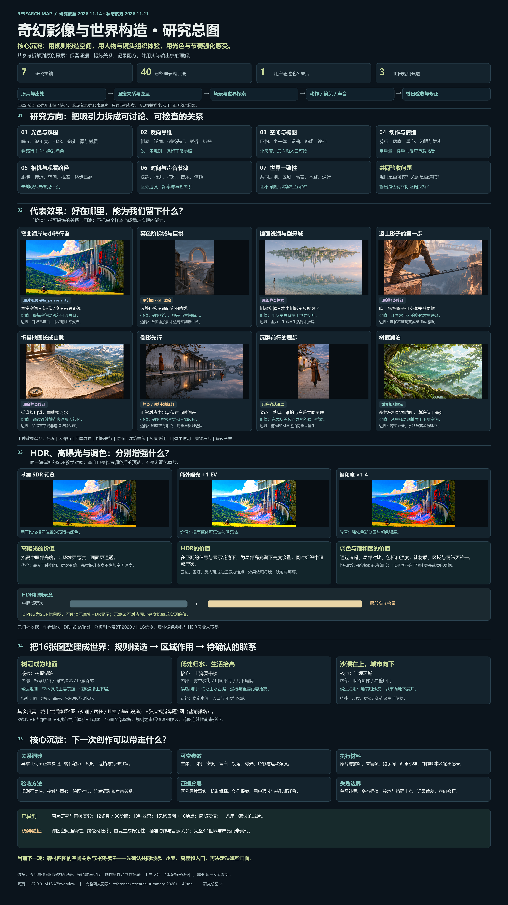
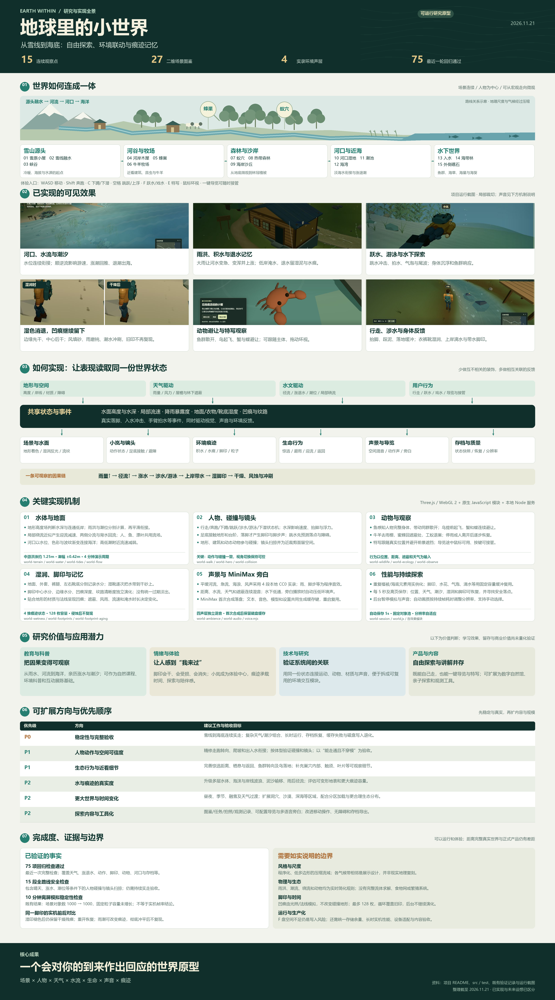

# GitHub 项目研究总库

整理值得深入研究的 GitHub 项目，记录它们解决的问题、值得借鉴的做法和复现中的发现。按编号浏览研究摘要，再进入子项目查看原仓库、详细笔记、截图和可用的 Web 演示。

## 研究索引

| 编号 | 子项目 | 原库 | 研究摘要 | 图片导览 | Web 演示 |
| --- | --- | --- | --- | --- | --- |
| 001 | [交互效果实验室](projects/001-interaction-effects-lab/README.md) | [MotionSites](https://motionsites.ai/) · [MapLibre GL JS](https://github.com/maplibre/maplibre-gl-js) · [Apache ECharts](https://github.com/apache/echarts) · [React Flow](https://github.com/xyflow/xyflow) | 汇总 16 个源参考、可操作复现与产品扩展，覆盖内容浏览、商品展示、材质反馈和业务交互。以共享款式与面料串联五步家具体验，沉淀原理、提示词与可继续组合的模块。 | [原理引导图](#interaction-effects-guide) | [在线总览与演示](https://yydshly.github.io/20261104_codex_project/001-interaction-effects-lab/) |
| 002 | [电梯叙事与工具能力研究](projects/002-capability-elevator/README.md) | [nicco 原帖](https://x.com/0xnicc0/status/2117961453722354173) · [Three.js](https://github.com/mrdoob/three.js) · [Playwright](https://github.com/microsoft/playwright) · [FFmpeg](https://github.com/FFmpeg/FFmpeg) | 借鉴角色乘电梯、逐层停靠介绍主题、片尾拉远全景的呈现方式，将一组工具或产品能力串成导览。包含四层互动样板、22 秒成片、13 个工具仓库与跨项目复用说明，验证数据驱动时间轴、浏览器逐帧采集和视频导出。 | [研究引导图](#capability-elevator-guide) | [在线研究与互动导览](https://yydshly.github.io/20261104_codex_project/002-capability-elevator/) |
| 003 | [风吹信封与付费前检查](projects/003-eian-seedance-workflow/README.md) | [Eian 原帖](https://x.com/EianLu/status/2118317430665613741) · [八步制作长文](https://x.com/i/article/2118298893238845441) | 用三条五秒原片区分模型基线、加入首尾帧与七段式提示词后的实际变化。最大可保留价值是付费前叠帧与局部合成，已修正四处输入图意外变化，稳定性与整片省成本仍待验证。 | [研究引导图](#wind-envelope-guide) | [在线研究与三组原片](https://yydshly.github.io/20261104_codex_project/003-eian-seedance-workflow/) |
| 004 | [Tesseract 的能力与价值](projects/004-tesseract-capabilities/README.md) | [Tesseract 官方库](https://github.com/mirage-hq/Tesseract) · [功能目录](https://mirage.app/tesseract/features) | 核心研究 Tesseract 如何以可编辑工程组织剪辑、二维动画、三维场景和音轨，以及对讲解制作和后续修改的价值。四部成片验证本机制作、路径追踪与 MiniMax 配音交付，保留能力边界，复用省时与教学收益仍待验证。 | [本轮研究引导图](#tesseract-guide) | [在线能力研究与实测作品](https://yydshly.github.io/20261104_codex_project/004-tesseract-capabilities/) |
| 005 | [见全 · 跨领域认知导航](projects/005-jianquan-cognition/README.md) | 自主产品探索 · [资料来源与覆盖](https://yydshly.github.io/20261104_codex_project/005-jianquan-cognition/#study/sources) | 研究大众怎样从社会全景进入陌生行业，发现认知盲区，找到所需基础和逐层深入的道路。用行业、技能与思维地图连接图解、案例和练习，保留 AI 深入样板；学习效果与多模型事实、覆盖互补审核仍待验证。 | [已有研究引导图](#jianquan-guide) | [在线探索与研究共识](https://yydshly.github.io/20261104_codex_project/005-jianquan-cognition/) |
| 006 | [六个优秀产品的效果与复用研究](projects/006-claude-showcase/README.md) | [Claude 原始作品串](https://x.com/claudeai/status/2111177834127601902) · [字体源码](https://github.com/harshpreet931/harshpreet-hand) · [电磁实验源码](https://github.com/thebuggeddev/electromagnetism) | 研究山火分析、Ballpoint Gambit、Harshpreet Hand、Induction Bench、AngioView 与 Twenty Haiku 六个优秀产品，从实际效果理解规则、数据与风格的配合。六个演示、绘画与短片提炼回放、主题化、字形资产、实验联动、空间教学和程序叙事的复用价值，并标明扩展范围。 | [已有研究引导图](#claude-showcase-guide) | [在线研究与六个演示](https://yydshly.github.io/20261104_codex_project/006-claude-showcase/) |
| 007 | [一个人的网页 3D 效果合集](projects/007-creative-webgpu-showcase/README.md) | [Codevember](https://github.com/acher249/codevember-2026) · [作者实验目录](https://adamwebsite.com/experiments/) · [4DGS 示例](https://github.com/acher249/4dgs-world-foundation-model-demo) | 整理 Adam Chernick 个人制作并基于开源示例扩展的 37 项网页 3D 实验，覆盖折叠、液态金属、布料、产品拆解、反射与高斯场景。以效果选型为主，保留共享引擎和 4DGS 的研究价值，说明源码二次开发、产品化、多设备验证与后续作品尚未扩展。 | [已有研究引导图](#creative-webgpu-guide) | [在线研究与原版效果](https://yydshly.github.io/20261104_codex_project/007-creative-webgpu-showcase/) |
| 008 | [16 个链接的能力与价值解析](projects/008-link-capability-atlas/README.md) | [15 条原帖与 Gitruck 补充](projects/008-link-capability-atlas/README.md#十六个链接的范围) | 解析 16 个链接，覆盖生图与 GIF、镜头剪辑、共享 3D、Agent 流程和知识库。用成片、交互与实际验收说明能力、个人应用价值与未接入边界，沉淀短片交付和证据记忆两条可复用链路。 | [本轮理解引导图](#link-capability-atlas-guide) | [在线解析与实际效果](https://yydshly.github.io/20261104_codex_project/008-link-capability-atlas/) |
| 009 | [GPT-6.2 的 3D 生成能力探索](projects/009-gpt62-3d-capability/README.md) | 自主实践 · [Three.js](https://github.com/mrdoob/three.js) · [Blender](https://www.blender.org/) | 研究 GPT-6.2 如何把自然语言需求转成可编辑的 3D 角色、动作、特效与故事场景，并通过实机观察和反馈继续修改。16 个角色、三类场景与 Blender 造型对照展示原型制作、视觉讲解和跨场景复用价值，玩家决策与长期游戏循环继续验证。 | [本轮生成的引导图](#gpt62-3d-guide) | [在线研究与能力价值](https://yydshly.github.io/20261104_codex_project/009-gpt62-3d-capability/journey.html) |
| 010 | [未来社会叙事与 AI 价值研究](projects/010-future-society-study/README.md) | 自主实践 · [Three.js](https://github.com/mrdoob/three.js) · [MiniMax](https://www.minimax.io/) | 研究怎样从人物的小事呈现五年、十年后的社会，比较 AI 在协调负担、资源调度和劳动记录中的作用。五个可操作 3D 原型、三年代同幕对照与 MiniMax 配音形成可复用的讲解方式，世界规则、年代差异和观众理解仍待深化。 | [已有研究引导图](#future-society-guide) | [在线研究与五个原型](https://yydshly.github.io/20261104_codex_project/010-future-society-study/) |
| 011 | [云隙行 · 3D 骑行世界研究](projects/011-yunxi-ride/README.md) | 自主实践 · 浏览器 WebGL 原型 | 研究怎样把 3D 鹈鹕骑车做成可游历的修仙世界。程序化天路、轮脚同步与承载、自游避障、三处秘境、双曲目跟拍和完整界面实录，沉淀可复用的关卡原型、状态驱动动画、导览与验收方法。 | [本轮生成的引导图](#yunxi-ride-guide) | [在线研究与试玩](https://yydshly.github.io/20261104_codex_project/011-yunxi-ride/) |
| 012 | [暮色之堡与知识世界探索](projects/012-castle-knowledge-world/README.md) | 自主实践 · [Three.js](https://github.com/mrdoob/three.js) · [从零造物](https://github.com/bluesky-rgb/cong-ling-zao-wu) | 用 Three.js + HTML 实现第一人称从渔屋码头渡湖、入堡与螺旋登塔，研究怎样把科普、历史、音乐和农业融入可漫游世界。沉淀可复用的场景、通行与操作基础，并提出器物学习与生活联动方案，知识模型和学习成效继续验证。 | [已有研究全景图](#castle-knowledge-world-guide) | [在线研究与原型试玩](https://yydshly.github.io/20261104_codex_project/012-castle-knowledge-world/) |
| 013 | [视差窗口与微缩交互研究](projects/013-spatial-window/README.md) | [Doui Lab 原帖](https://x.com/DouiLabApps/status/2119414517126107169) · [Parapeek Clock](https://www.doui-lab.com/en/apps/parapeek-clock/) · [Three.js](https://github.com/mrdoob/three.js) | 研究普通摄像头与观看位置如何驱动屏幕内的空间，用 11 个场景实现视差出框、嵌套桌面、日常信息、双机位列车与齿轮修复。沉淀可复用的投影、场景状态和操作反馈，服务互动展示、氛围桌面与修复原型，实机稳定性和长期收益继续验证。 | [已有三栏引导图](#spatial-window-guide) | [在线研究与交互效果](https://yydshly.github.io/20261104_codex_project/013-spatial-window/) |
| 014 | [五款游戏的玩法、美术与设计取舍](projects/014-game-design-lab/README.md) | [五款原作与官方资料](https://yydshly.github.io/20261104_codex_project/014-game-design-lab/#sources) | 对照五款原作的玩法、美术与持续动机，整理五条设计方向。结合样片反馈，沉淀核心体验选型、美术投入取舍与先验证乐趣再扩系统的方法，供后续设计回查；扩展提案尚未验证。 | [已有设计总览图](#game-design-lab-guide) | [在线研究与我们的理解](https://yydshly.github.io/20261104_codex_project/014-game-design-lab/) |
| 015 | [《蜀道难》第一人称诗境研究](projects/015-shu-road/README.md) | [李白《蜀道难》](https://zh.wikisource.org/zh-hans/蜀道难_(李白)) · 自主 WebGL 实践 | 实现一条可走的九幕 3D 蜀道，用双音色语音和镜头把诗句对准景物。探索怎样用旅人站位表达高险，并在模型上标明史料与推测，为古诗教学展示和文化导览提供可复用原型。 | [已有九幕引导图](#shu-road-guide) | [研究与解读](https://yydshly.github.io/20261104_codex_project/015-shu-road/research.html) · [在线演示](https://yydshly.github.io/20261104_codex_project/015-shu-road/) |
| 016 | [小工具商业机制与个人 AI 协作研究](projects/016-solo-business-study/README.md) | [Feng_YQ](https://x.com/Feng_YQ) · [闷声发大财](https://msfdcszhd.com/) · 逐项官网与用户原帖 | 拆解 10 个工具的能力、获客和收费，保留 20 种扩展设想、15 家企业岗位抽样及 AI 替代核对。价值在理解持续监测、流程承接与结果交付，帮助个人减少误投，并通过样例和反馈形成 AI 协作目标；当前无立项推荐。 | [已有研究引导图](#solo-business-study-guide) | [在线研究与当前理解](https://yydshly.github.io/20261104_codex_project/016-solo-business-study/) |
| 017 | [观源 · 创作者信息的价值与产品化研究](projects/017-creator-value-atlas/README.md) | 自主研究 · [Monid](https://docs.monid.ai/) · [逐项来源](https://yydshly.github.io/20261104_codex_project/017-creator-value-atlas/#sources) | 研究平台、领域与博主信息怎样帮助找人、选资料、学习和判断合作。以独立游戏为样板，沉淀作者作品、中文发行复盘与行动模板，为我们的学习选型和产品机会判断提供可回查依据；推广匹配、付费与盈利待验证。 | [研究目标与成果关系图](#creator-value-atlas-guide) | [在线研究与我们的理解](https://yydshly.github.io/20261104_codex_project/017-creator-value-atlas/#overview) |
| 018 | [潮光 · 游戏 Skill 能力与价值研究](projects/018-game-skill-product/README.md) | [asset-maker](https://github.com/Be1l-ai/asset-maker) · [threejs-Skills](https://github.com/zafmy/threejs-Skills) · [八项清单来源](harbor-skill-demo/skill-sources/manifest.json) | 研究 game-design-theory 等八项选型与两轮采用，在《潮光》三章动作游戏中实际调用 create-3d-assets、create-vfx、create-sfx 和 3d-ultra-realistic-water，展示低模 CSG/AO、24 帧特效、材质音效与动态海面，保留来源、配方、实录和验证。确认资源与代码复用；新增玩法单独归属，同模型 A/B、开发提速、返工减少与玩家偏好增益尚未证实。 | [已有研究总览图](#game-skill-product-guide) | [在线研究与效果](https://yydshly.github.io/20261104_codex_project/018-game-skill-product/research.html#overview) · [完整游戏](https://yydshly.github.io/20261104_codex_project/018-game-skill-product/) |
| 019 | [投影打怪玩具：效果、意义与研究判断](projects/019-projection-play-study/README.md) | [noni__z 原帖](https://x.com/noni__z/status/2120168976135209223) · Nex / LUMOplay 官方资料 | 归档可见效果、童趣解释、产品能力与家庭意义，保留城市扩展和偏题纸样。当前新增研究价值有限，停止继续立项与演示；原机、复玩和付费未实测。 | [一图汇总](#projection-play-guide) | [研究归档网页](https://yydshly.github.io/20261104_codex_project/019-projection-play-study/) |
| 020 | [知识库与客服业务闭环研究](projects/020-knowledge-service/README.md) | 自主架构探索 · [工作流与路由参考](https://www.anthropic.com/research/building-effective-agents) | 研究知识库怎样支撑可信回答、按需分析和客服跟进。以共享证据、模型路由、统一交流、规则确认与人工闭环构成架构，用包裹延迟原型和30项能力对照说明实现边界；双模型与真实收益待试点验证。 | [已有双模型引导图](#knowledge-service-guide) | [在线研究与演示](https://yydshly.github.io/20261104_codex_project/020-knowledge-service/) |
| 021 | [公开产品信息与获客研究库](projects/021-growth-casebook/README.md) | [研究起点](https://x.com/yihui_indie/status/2119973315745812674) · GitHub、BetaList、Show HN 与 Product Hunt 公开来源 | 研究免费公开资料怎样成为带来源的中文报告与可比较案例。通过官网核对、固定结构与版本保存积累研究资产，为我们的选题、竞品学习和小实验假设提供依据；真实省时、获客成效与付费价值待验证。 | [已有研究全景图](#growth-casebook-guide) | [在线研究与案例快照](https://yydshly.github.io/20261104_codex_project/021-growth-casebook/) |
| 022 | [角色、情绪与多载体产品化研究](projects/022-visual-business-atlas/README.md) | [AYi 原帖](https://x.com/AYi_AInotes/status/2120089714749263956) · 自主角色与交付实践 | 研究专属特征、情绪与故事怎样转成表情、头像、壁纸、漫画和桌宠。真实文件与模拟需求对照呈现角色一致性、场景适配和人的设计判断，延伸个人定制、小店经营及角色资产复用；桌宠实机稳定性与真实商业结果待验证。 | [已有研究引导图](#visual-business-atlas-guide) | [在线研究与成品](https://yydshly.github.io/20261104_codex_project/022-visual-business-atlas/) |
| 023 | [角色素材与游戏质感研究](projects/023-character-forge-lab/README.md) | [Lucca Cerf原帖](https://x.com/luccacerf/status/2120305718939021566) · [Quaternius](https://quaternius.com/packs/universalbasecharacters.html) | 制作原创重戟战士赤霄、13段动作与Three.js／Godot战斗原型，公开13.9秒实录、提示词和实现记录。研究人物资产与游戏系统的独立制作和验收，复用接入流程；现有美术仍未达到商业英雄水准，三条素材升级路线待验证。 | [已有研究引导图](#character-forge-guide) | [在线研究与实际战斗](https://yydshly.github.io/20261104_codex_project/023-character-forge-lab/) |
| 024 | [日常元素与沉浸式循环研究](projects/024-immersive-loop-research/README.md) | [JenPanepinto](https://x.com/JenPanepinto) · 本轮独立实验 | 研究怎样从自己的日常素材形成统一情绪、个人风格与整体循环，以十八轮实验比较花朵接续、全幅水光、秋林事件及光影。保留三个代表、反馈与方法，积累原创系列和有依据的返修能力；舒适、真实感、原生 GIF 与后续用途仍待验证。 | [已有理解总览图](#immersive-loop-guide) | [在线研究与代表效果](https://yydshly.github.io/20261104_codex_project/024-immersive-loop-research/) |
| 025 | [留一会儿 · 艺术与情绪图像研究](projects/025-cozy-emotion-lab/README.md) | [@cozyycabin](https://x.com/cozyycabin) · [置顶双图](https://x.com/cozyycabin/status/2084009202192949678) | 以艺术与情绪作为图像入口，从形体呼应、瞬间与留白理解停留感。29幅图、三图对照、实时调色、八秒静态镜头及导出，沉淀审美判断、原创简报和系列表达方法；当前仅原帖双图获明确正向反馈，原创迁移与体验产品价值待验证。 | [沿用本轮引导图](#cozy-emotion-guide) | [在线艺术入口与效果](https://yydshly.github.io/20261104_codex_project/025-cozy-emotion-lab/) |
| 026 | [日常情绪与 AI 短视频效果研究](projects/026-emotion-led-video/README.md) | [用户分享帖](https://x.com/billtheinvestor/status/2120217438533066946) · [TechHalla原帖](https://x.com/techhalla/status/2110686996049883550) | 从人的日常情绪出发，把渴望变成一个想亲历的瞬间。用四种情绪效果图、六个故事和两轮海洞小样，研究人物回应、创意视角与真实质感怎样承载欲望、代入和观看期待；沉淀选题、镜头与反馈方法，情绪效果仍待验证。 | [本次生成的引导图](#emotion-led-video-guide) | [在线研究与效果](https://yydshly.github.io/20261104_codex_project/026-emotion-led-video/) |
| 027 | [奇幻影像与世界构造研究](projects/027-surreal-motion-study/README.md) | [@hi_personality原帖](https://x.com/hi_personality/status/2115567493565825244) · [巨构参考](https://x.com/EiiKwesiKay/status/2120958808789029021) | 从奇幻骑行原片提炼光色、反向规则、空间构图、主体情绪、相机、音乐节律和世界一致性七条主轴。以原创关键帧、十种效果、局部预演、一条用户通过的AI舞步和三个世界候选，沉淀关系、参数、提示词与验收方法；区分HDR与高曝光，连续3D、稳定生成与产品价值仍待验证。 | [已有研究总图](#surreal-motion-guide) | [在线研究与效果](https://yydshly.github.io/20261104_codex_project/027-surreal-motion-study/) |
| 028 | [地球里的小世界：连续生态世界与痕迹记忆](projects/028-earth-within/README.md) | 自主实践 · [Three.js](https://github.com/mrdoob/three.js) · [MiniMax](https://www.minimax.io/) | 研究怎样以小岚为中心，把雪山、河谷、森林、河口与海底接成可自由行走的世界，让天气、水流、动物、声音和足迹共同回应人的行动。15个观察点、27幕图鉴、雨洪潮汐、游泳跃水、干湿脚印与MiniMax导览构成可操作原型；沉淀共享状态、触地事件、环境记忆和连续导览的复用方法，服务自然科普、数字展陈与探索体验。流体和生态为简化模型，动作真实度、长时性能与学习/商业收益仍需验证。 | [本轮全景引导图](#earth-within-guide) | [在线研究与自由探索](https://yydshly.github.io/20261104_codex_project/028-earth-within/) |

项目按收录顺序从 `001` 开始编号。新条目按编号追加，已分配的编号保持固定。索引摘要用一两句话写清研究对象和关注点。完成验证后，可补上一条主要发现。

## 项目引导图

### 001 · 交互效果实验室

这张图汇总了从源库参考、本地复现到产品扩展的探索过程。16 个案例分为内容浏览与叙事、商品展示与对比、材质与场景反馈、配置查询与编辑四类，每项保留源参考、可操作演示和实现提示词。

图中的家具链路依次为选椅子、360° 查看、切换灯光、配置报价和查找展厅，用同一份款式与面料选择串联多个交互。可以单独取用一个效果，也可以参考这条链路组合自己的产品流程。

后续可接入真实商品、价格与展厅库存，并按需求组合面料比较、规格帮助、报价分析和样品审批。当前报价与库存使用示例数据，分析和审批保留独立演示入口。[进入在线体验](https://yydshly.github.io/20261104_codex_project/001-interaction-effects-lab/) · [查看详细研究与扩展方向](projects/001-interaction-effects-lab/README.md)

### 002 · 电梯叙事与工具能力研究

核心价值是用角色乘电梯逐层介绍主题，再以建筑全景展示整体关系。工具清单、产品功能或知识步骤都可以采用这类空间叙事。我们的样板用「AI 为什么会答错？」串起找入口、理解生成、对照证据和跨域阅读四层，支持播放、拖动进度和楼层直达。

引导图沿用本轮生成的版本，包含效果实帧、仓库路径和价值说明。图中的本机地址供本地运行时使用，公开入口见[在线研究与互动导览](https://yydshly.github.io/20261104_codex_project/002-capability-elevator/)。

网页收录四层 3D 互动演示、22 秒有声成片、研究归纳、13 个工具的能力说明与 GitHub 入口，以及跨项目复用例子。已验证的制作路径为内容配置与时间轴 → Three.js 场景 → Playwright 逐帧采集 → FFmpeg 编码与混音。

可复用的是逐层导览的呈现方法、网页预览与视频共用时间轴、浏览器自动操作与验证，以及按模板更新素材后重新导出。13 个仓库按任务选择，原片具体调用哪些工具尚未核实。「见全」完整案例需要另行在本机运行。[详细研究与来源](projects/002-capability-elevator/README.md)

### 003 · 风吹信封与付费前检查

本轮最值得保留的做法，是在付费生成视频前叠看首尾帧、检查固定区域，再只合成需要变化的部分。局部改图同时改动了窗户、头发、手和桌面，检查与局部合成实际修正了这四处输入图问题。

沿用本轮生成的长图。A 用短提示词已经拍出窗帘先动、信封后滑。B 加首尾帧后构图和道具落点更贴近设定。C 改七段式后起动拉开约半秒，人物仍提前追看并多出斜光。每组只生成一次，未固定相同随机种子。原文八步保留并标明本次范围，整片一致性、稳定通过率和返工成本仍待验证。[在线研究与原片](https://yydshly.github.io/20261104_codex_project/003-eian-seedance-workflow/) · [完整摘要与来源](projects/003-eian-seedance-workflow/README.md)

### 004 · Tesseract 的能力与价值

研究核心是 Tesseract 的能力、运行方式和制作价值。它以可编辑工程组织普通剪辑、二维图层、三维场景和音轨，代理可以按文档修改工程、预览并渲染。机械讲解是本轮选择的验证场景，保留了从素材、动作和机位到配音成片的制作过程。

引导图使用本轮已经生成的版本，包含齿轮、车床、发动机和见全案例。图中的本机路径是当时的制作记录，公开入口见[在线能力研究与实测作品](https://yydshly.github.io/20261104_codex_project/004-tesseract-capabilities/)。

本轮使用 Windows Tesseract 0.5.0，完成齿轮 4 秒、见全 39.3 秒、车床 62.5 秒和发动机 67.2 秒四部成片。MiniMax 生成旁白，Tesseract 组织工程与渲染，FFmpeg 处理最终音轨、字幕和封装。发动机网页使用 Three.js 实时交互，和视频工程分别维护。

已经拿到的价值是让结构、运动和讲解形成可修改、可重渲染的作品，并交付通用视频与原始工程。网页区分已实测、官方支持和待验证，列出十二类能力、制作中的修正，以及普通视频精剪、纯二维动画、复杂导入等后续试验。复用能省多少工时、真实观众是否更容易理解，仍需测量。[研究摘要与验证范围](projects/004-tesseract-capabilities/README.md)

### 005 · 见全 · 跨领域认知导航

研究的起点是：持续学习仍会遇到“自己不知道自己不知道”的问题，进入一个新领域时，缺少能告诉自己“包含什么、需要什么基础、下一步往哪里走”的地图。目标是面向大众的跨行业技能与思维普及，以科普、图解和可操作案例提供认识方向与继续深入的入口。

沿用本次已生成的长图。没有明确想法时，从世界全景进入社会板块、行业和工作方向；已有问题时，从搜索进入概念与学习路线。两者连接同一套基础、讲解、跨领域关系和返回导航。三条样板进一步串起初次判断、反馈、补基础、换例与解释记录。

当前包含 7 个社会板块、20 个行业门类、60 个代表性工作方向和 14 个通用概念；AI、信息组织、软件与计算、教育与传播提供深入内容，公司知识库助手连接检索、核验、评估和运行监控。行业门类不等于岗位和专业知识已穷尽，已有路线也不等于学习效果已验证。

核心思考包括：怎样统一宏观与细节的入口，怎样让图解真正指明深入方向，怎样跨领域而不迷路，以及怎样区分原始资料、编辑归纳与虚构练习。后续按知识缺口扩展，先试点不同模型独立核对事实与查找覆盖缺口，再对照原文修订；多模型一致不自动代表正确。[在线探索](https://yydshly.github.io/20261104_codex_project/005-jianquan-cognition/) · [研究与共识](https://yydshly.github.io/20261104_codex_project/005-jianquan-cognition/#research) · [完整研究摘要](projects/005-jianquan-cognition/README.md)

### 006 · 六个优秀产品的效果与复用研究

本轮研究的是六个优秀产品与交互创作案例：**山火分析、Ballpoint Gambit 手绘国际象棋、Harshpreet Hand 手写字体、Induction Bench 电磁感应实验、AngioView 冠脉造影教学，以及 Twenty Haiku 俳句动画**。目标是从实际产品效果理解规则、数据、风格与操作如何配合，再提炼能用于自己产品的机制。

沿用已经生成的引导图。网页保留作者原站与原片、六个研究演示、原理与源码对照、原画与创作比较，以及两部完成短片。每个演示下方写明操作方式、本地实现、可复用能力和后续方向。[进入公开网页](https://yydshly.github.io/20261104_codex_project/006-claude-showcase/)

我们的理解是：用共同时间轴组织回放，把稳定规则与可变风格分开，将字形转成可安装素材，让实验参数与反馈联动，建立三维与二维的对应，并让 AI 在明确画法内编排诗和镜头。当前山火是模拟数据，电磁与冠脉使用教学模型；绘画是独立的画风参考实验，字体原库不提供任意图像生成。公开版提供示例操作与作品回看，新主题 AI 生成需本机服务。[完整研究摘要与六个产品入口](projects/006-claude-showcase/README.md)

### 007 · 一个人的网页 3D 效果合集

Adam Chernick 个人制作、扩展和组合的网页 3D 实验，部分基于 Three.js 与 React Three Fiber 开源示例。本轮收录 37 项，覆盖折叠、碎裂、液态金属、绳索、苔藓、布料、跑车拆解、反射、3DGS / 4DGS，以及三项交互科普。

沿用本轮已生成的引导图和 2026 年 11 月 6 日的收录范围。网页将原版效果放进对应模块，集中展示每项操作、原理、用途设想和已知源码入口。[完整效果清单](projects/007-creative-webgpu-showcase/README.md#已收录的效果) · [在线研究与原版效果](https://yydshly.github.io/20261104_codex_project/007-creative-webgpu-showcase/)

主要价值是作为效果索引和参考实现，按项目需求挑选研究。共享引擎可参考系列场景的公共能力组织，4DGS 可专题研究动态人物与环境重打光。源码二次开发、真实业务样板、独立组件、多设备性能评估及作者后续新增作品保留为扩展方向。公开页对两项需要隔离环境的 4DGS 提供原站播放入口。[详细研究与当前范围](projects/007-creative-webgpu-showcase/README.md)

### 008 · 16 个链接的能力与价值解析

这组研究解析 **15 条 X 原帖与 1 个 Gitruck 有声剪辑补充案例，共 16 个链接**。能力覆盖生图与角色一致性、GIF 状态动作、镜头与口播配画、共享 3D 教学、Agent 工作流、引文核查与持久知识索引，用实际作品判断怎样迁移到自己的项目。

引导图沿用已经生成的版本，十五条原始编号保持不变。第 16 条将此前已展示的 Gitruck 有声口播前后对照单独解析，补充语义配画、图解特写和可继续精修的视频工程。[在线解析与效果](https://yydshly.github.io/20261104_codex_project/008-link-capability-atlas/) · [完整研究摘要与十六项来源](projects/008-link-capability-atlas/README.md)

原生拼贴、三种表情、眨眼点头、温室横竖片、气孔 3D 与讲解片、银河对照、电台和微课均有可查看产物。字幕、八种配置比较、审批、模板交接、引文核查、跨窗口笔记与排期仿真提供可操作入口。已走通温室镜头到口播字幕、审阅报告到核查笔记两条链路。

第 07–08、11–14 条保留原理适配范围，原库训练、自改 Agent、外部服务和上游采集继续按需求接入。原生 GIF 接缝、局部身份变化、规则语义误拦和真实使用收益仍需继续验证。[逐项验收与下载](https://yydshly.github.io/20261104_codex_project/008-link-capability-atlas/acceptance.html)

### 009 · GPT-6.2 的 3D 生成能力探索

本轮以 GPT-6.2 的 3D 代码生成与迭代能力为研究对象，观察自然语言需求怎样变成可编辑、可运行的角色与现场。覆盖几何与材质构建、层级关节动画、可辨认的技能特效、时间轴叙事、多角色接力，以及 Blender 脚本生成和 GLB 资产复用。

沿用已经生成的这张引导图。项目包含 16 个角色身份、异种竞技场、缆车救援与轨道拦截三类场景。磁极对照把程序原型、Blender 原型精修和磁翼重设计放在同一镜头与动作进度下，便于区分表面细化与轮廓、结构、展开方式的变化。[在线研究与能力价值](https://yydshly.github.io/20261104_codex_project/009-gpt62-3d-capability/journey.html) · [进入英雄档案与演示](https://yydshly.github.io/20261104_codex_project/009-gpt62-3d-capability/) · [完整研究摘要](projects/009-gpt62-3d-capability/README.md)

可保留的价值是让原型能被旋转检查、让能力在同一问题中比较、让动作与反馈可暂停核对，以及把角色与动作复用到多个现场。对决的三段伤害、回放链接、纯画面模式和 5.2 秒造型演示都来自观看反馈后的修正。当前浏览器执行已生成的代码与资产，救援和轨道路径由代码编排。真实玩家决策、通用物理交互、长期游戏循环，以及实际节省工时和学习收益仍需继续验证。

### 010 · 未来社会叙事与 AI 价值研究

研究怎样先建立有规则与社会关系的世界，再从人物的小事侧面呈现五年、十年后的生活。探索从停电调度、设备接入、复诊重排走向城市热浪与《晚一点到家》，逐步把资源、授权、照护与额外劳动放进可观察的情景。

引导图沿用已经生成的这张图，以本轮原型实帧为参考。网页集中五个互动原型、三年代同幕对照、分幕与时间轴、有约束的程序模拟及 MiniMax 讲解，方便回看效果、定位差异和继续修改。[在线研究与效果](https://yydshly.github.io/20261104_codex_project/010-future-society-study/) · [能力与价值](https://yydshly.github.io/20261104_codex_project/010-future-society-study/#capabilities) · [完整研究摘要](projects/010-future-society-study/README.md)

可复用价值在故事原型、互动讲解和同条件方案对照。作品研究减少沟通负担、协调已有资源、避免部分连锁后果与记录额外劳动，同时追问成本和责任。年份与制度为情景假设，服务由程序模拟，语音预先生成。用户曾指出场景尺度小、年代差异弱、价值不清楚，真实观众的理解与世界规则仍需继续验证。

### 011 · 云隙行 · 3D 骑行世界研究

从“3D 鹈鹕骑自行车”出发，研究角色怎样进入可操作、可观察的修仙世界。天路只在行进方向有限生成，车轮和脚踏共享运动状态，鹈鹕能自主避障、起降并到访捕鱼、采草和点灯三处秘境。两首配乐可以切换，平稳自游时按曲目参考轻调踏频。

可复用价值在于把空间生成、动作状态、目的地引导和可见反馈组合成可试玩的 3D 原型，也能用实时读数和连续实录发现步频、碰撞或引路问题。网页保留完整界面实录、能力与证据、12 条整理版提示词和 X 发布草稿。碰撞与承载属于游戏化近似，跟拍基于预设曲目，复杂路径及设备性能仍可继续测量。

[在线研究与能力价值](https://yydshly.github.io/20261104_codex_project/011-yunxi-ride/#capabilities) · [直接试玩](https://yydshly.github.io/20261104_codex_project/011-yunxi-ride/play.html) · [完整研究摘要](projects/011-yunxi-ride/README.md)

### 012 · 暮色之堡与知识世界探索

从 Three.js 城堡画面出发，完成可以渡湖、入堡和登塔的连续 3D 原型。场景覆盖城堡、湖岸、林地、渔屋和旧塔遗迹；第一人称从渔屋码头登船，靠岸后经石阶、吊桥、城门和大厅，沿 60 级螺旋石阶抵达塔顶。对闪烁、起点和登船位置的反馈，推动我们核对视觉、路线与操作逻辑。

已经获得的价值是可编辑的程序化场景、连续通行和水陆切换基础，可用于探索关卡、互动展示与知识章节原型。进一步的方向是连接《从零造物》的选题、原理与资料出处，让玩家在同一个生活世界中发现科学、历史、音乐和农业的兴趣。网页用“暮湖秋集”的六处候选地点，说明从好奇、操作与反馈走向解释和迁移的设想。

引导图沿用本轮已经生成的版本。网页提供研究摘要、可点击地点提案、实景截图和原型试玩，区分已实现能力、讨论提案与待验证成效。载重、水车、作物等学习模型尚待制作，时代地域与首批体验者仍需确定，真实学习收益需要观察验证。

[在线研究与价值](https://yydshly.github.io/20261104_codex_project/012-castle-knowledge-world/#summary) · [直接试玩](https://yydshly.github.io/20261104_codex_project/012-castle-knowledge-world/play.html) · [已有研究引导图](https://yydshly.github.io/20261104_codex_project/012-castle-knowledge-world/#guide-image) · [完整研究摘要](projects/012-castle-knowledge-world/README.md)

### 013 · 视差窗口与微缩交互研究

研究普通摄像头、观看位置与三维场景怎样配合，让人左右挪动时像透过窗口看进屏幕里的空间。我们实现 11 个可切换场景，包括平板里的房间、带实时墨水屏的窗边与雨夜、远近机位共享的列车到站，以及可以装回齿轮的独立修复工坊。人物、设备比例、近景主次、灯光与事件后续都来自多轮观看反馈后的修正。

已有价值是形成可编辑、可运行的视点、投影、遮挡、嵌套相机、共享状态与射线拾取基础，可复用到互动展示、氛围桌面、连续事件与修复练习。日常信息提供查看用途，暖灯与低频动作探索陪伴，齿轮归位提供可见的操作结果；真实使用便利性、追踪稳定性、学习收益与长期留存仍需验证。

引导图沿用本轮已生成的三栏版本，公开网页提供 15 个研究主题、场景直达、交互原理、来源与 8 个扩展方向。公开演示使用已有 VRoid 样例作为举钟人物，引导图与历史截图记录的是本机 MMD 版本。天气湿度为室外数据，车站为有限编排，机芯为演示性运动，网页逐项说明范围。

[在线研究与价值](https://yydshly.github.io/20261104_codex_project/013-spatial-window/#summary) · [直接体验工坊](https://yydshly.github.io/20261104_codex_project/013-spatial-window/play.html?scene=workshop) · [已有引导图](https://yydshly.github.io/20261104_codex_project/013-spatial-window/#guide-image) · [完整研究摘要](projects/013-spatial-window/README.md)

### 014 · 五款游戏的玩法、美术与设计取舍

对照《杀戮尖塔1》《星露谷物语》《暗黑地牢》《异星工厂》《战场兄弟》，研究核心选择、美术表达、持续投入理由与制作重点，归纳临场构筑、生活积累、承压远征、系统优化和队伍经营五条方向。

网页用原作官方实机画面、循环节点和横向比较解释规则如何产生体验；每款保留一份扩展提案与验证问题。先前的五个简化实验和佣兵任务作为复盘资料保留，同时记录卖点、画面反馈和持续投入理由不足。

对我们的意义是建立下一次设计的判断依据：先选清核心体验，按辨识、情绪和反馈安排美术投入，再用短体验检验玩家是否愿意继续，之后才扩充系统与内容。当前价值在参考选型、制作取舍与验证顺序；经典的成功与运行流程不能替代新项目的乐趣或市场验证。

[在线研究与意义](https://yydshly.github.io/20261104_codex_project/014-game-design-lab/#value) · [五款逐项拆解](https://yydshly.github.io/20261104_codex_project/014-game-design-lab/#directions) · [已有研究引导图](https://yydshly.github.io/20261104_codex_project/014-game-design-lab/#overview) · [完整研究记录](projects/014-game-design-lab/README.md)

### 015 · 《蜀道难》第一人称诗境研究

从秦塞太白到锦城西望，九幕连成一条实际可走的 3D 蜀道。与原诗逐句对应，抬头辨认鸟道与远峰、低头看栈板和绝壁，转身寻找解说中的地形。18 段 MiniMax 朗诵和旁白按地点与语句播放，一键演示约 4 分 47 秒。

本轮探索从旅人站位和脚下支撑出发，校正台阶、木构与动植物的尺度和动作，让讲解能指向眼前的具体景物。青泥岭和剑门关在画面中区分唐代文献、遗存参照与推测复原。可复用价值是把诗文、可走路径、三维景物与语音定位结合，用于古诗教学展示和文化展陈原型。

[在线研究与引导图](https://yydshly.github.io/20261104_codex_project/015-shu-road/research.html#guide-image) · [进入 3D 演示](https://yydshly.github.io/20261104_codex_project/015-shu-road/) · [完整研究摘要](projects/015-shu-road/README.md)

### 016 · 小工具的商业机制与个人 AI 协作研究

从“闷声发大财”的 10 个案例出发，梳理能力、用户价值、获客与收费，提出 20 种待验证扩展。随后抽样核对 15 家企业和招聘社区，并回到自己日常用 AI 做作品的场景，比较现有工具能否支持目标探索、局部反馈和偏好记录。

沿用已经生成的首版引导图，作为前段案例研究快照：蓝色为公开能力，绿色为价值解释，橙色均为未验证设想，后来的 AI 协作讨论另见网页。持续监测、流程承接、结果交付与传播收费是可复用的机制；对我们的意义是分清“工具有用、生意成立、适合自己做”，减少证据不足的投入，并用小样、具体反馈和选择记录逐渐形成目标。

当前无立项推荐：岗位聚合暂缓、SVG 首选撤回、App 截图仅保留参考，个人 AI 沟通工具也暂不产品化。岗位 9 项只是地域文字候选，未确认中国签约；尚未完成同任务对照与外部付费验证。保留研究资产和重启条件，不把设想当作已证明的商机。

[在线研究与价值](https://yydshly.github.io/20261104_codex_project/016-solo-business-study/#value) · [AI 协作探索](https://yydshly.github.io/20261104_codex_project/016-solo-business-study/#collaboration) · [离线研究网页](projects/016-solo-business-study/offline.html) · [完整研究摘要](projects/016-solo-business-study/README.md)

### 017 · 观源 · 创作者信息的价值与产品化研究

研究主线是：平台、领域和博主信息经过分类、作品核对与用途判断，能否成为帮助人找资料、选作者、学习、研究及判断合作的产品。Monid 位于采集工具候选环节；持续价值需要由筛选理由、证据、更新与实际使用反馈支持。全站整理 12 个平台与分发入口、12 个一级领域、42 位作者样本和 109 条去重来源。

独立游戏是第一个深入样板：28 位作者（含 12 位中文）、56 份代表资料、5 条学习路线，以及 5 个中文发行案例的横比、成本与避坑、24 项单人发行任务。它们将作者经验连接到学习顺序与行动取舍，不能直接视为已验证的推广达人库。

对我们的意义在于把零散收藏积累成能回查、比较、按任务使用的研究库，为学习材料选择、制作与经营判断提供依据，并检验信息产品的用途与维护投入。推广合作仍需补齐评测、实况作者的受众与合作条件；真实效果、付费需求和盈利未验证。引导图使用已生成的新版原图。

[在线研究与我们的理解](https://yydshly.github.io/20261104_codex_project/017-creator-value-atlas/#overview) · [独立游戏样板](https://yydshly.github.io/20261104_codex_project/017-creator-value-atlas/#indie) · [案例横比与计划](https://yydshly.github.io/20261104_codex_project/017-creator-value-atlas/#publishing) · [完整摘要与来源](projects/017-creator-value-atlas/README.md)

## 收录新项目

1. 复制[子项目模板](projects/_template/README.md)到 `projects/<编号>-<英文短名>/README.md`，写明上游仓库、研究问题和复现记录。
2. 把封面和截图放在子项目的 `assets/`，用相对路径引用。填写替代文字，并用一句图注说明读者应关注的细节。根索引可链接封面。
3. 在上方索引补上对应条目，「原库」列填写上游仓库或官方入口。在索引下方添加引导图、案例范围、复用价值与扩展方向的说明。有在线演示时，再填入可访问的地址。

## Web 演示

首个静态演示就绪后，可将 GitHub Pages 的发布源设为 `main` 分支的 `/docs`。每个演示使用自己的 `docs/<编号>-<英文短名>/index.html`，把构建产物与静态资源放在该目录内。资源使用相对路径，或将构建基路径设为 `/20261104_codex_project/<编号>-<英文短名>/`。

启用后，演示地址的格式为 `https://yydshly.github.io/20261104_codex_project/<编号>-<英文短名>/`。[GitHub Pages 发布源说明](https://docs.github.com/en/pages/getting-started-with-github-pages/configuring-a-publishing-source-for-your-github-pages-site)

### 019 · 投影打怪玩具：效果、意义与研究判断

从投影目标、实体道具和动作反馈，理解儿童可能获得的惊喜、掌控、挑战、扮演与共玩。保留产品整体、硬件交互、软件规则、内容与使用流程的分工，以及童趣和家庭活动的意义。

当前没有太多新增研究价值，归档参考，停止继续立项与演示。已有产品提供基础能力，尚未识别独特需求或改进；原机、跨日复玩和真实付费未实测。该判断针对本方向的继续投入，不全面否定游戏软件价值。城市文化扩展与11页苏州纸样作为历史讨论保留，未验证的价格、成本与转化假设不作为结果。

[研究与完整讨论](https://yydshly.github.io/20261104_codex_project/019-projection-play-study/) · [一图汇总](projects/019-projection-play-study/assets/projection-play-overview-v2.png) · [本地离线版](projects/019-projection-play-study/offline.html) · [来源与范围](projects/019-projection-play-study/README.md)

### 018 · 潮光：游戏 Skill 的能力、效果与价值研究

研究从“按问题选 Skill”的八项清单出发，第一轮采用玩法、引擎、界面、输入、HUD 与反馈六项通用建议，未证明额外增益。第二轮在完整三章动作游戏中实际调用 create-3d-assets、create-vfx、create-sfx 与 3d-ultra-realistic-water，核对工具和实现如何进入可运行产品。

三维管线提供 MeshBuilder、SolidMesh、CSG、AO、GLB 导出与网格检查，产出 4 个模型；特效管线提供分层发射与图集，产出 2 套各 24 帧的效果；音效管线提供材质模态、瞬态与立体声，产出 10 个游戏声音和 1 个对照；海面直接复用波场、法线、反射与泡沫模块。网页提供三章实玩、同机位版本滑块、可旋转模型、逐帧特效、音效试听、通关录像、来源与配方。

22 项规则测试、34 项游戏浏览器检查、9 项资源接入阶段展示检查与 14 项研究回顾页面检查有记录，23 个生成文件重复构建哈希一致。自动画质软件渲染短样本由旧版 21.49ms 变为新版 23.23ms / 帧，保留运行成本。Q 的伤害、破甲、打断、消弹、回充及三章产品流程为项目新增，不计为四项 Skill 的独有收益。

当前确认具体工具与代码复用、视听资源交付与本次可重建性。没有运行同模型、同需求的独立 A/B，首次开发耗时和完整返工次数未知；尚不能证明更快、更少缺陷、更少返工或玩家更喜欢，也未证明 Skill 文档包装比直接使用同一 SDK 更有价值。引导图沿用已生成的原图，图内发布状态为研究阶段记录；公开包保留 MIT 运行时许可，不分发未声明许可的工具包、复制模板或上游 Skill 全文。

[在线研究与一图总览](https://yydshly.github.io/20261104_codex_project/018-game-skill-product/research.html#overview) · [完整三章游戏](https://yydshly.github.io/20261104_codex_project/018-game-skill-product/) · [资源展台](https://yydshly.github.io/20261104_codex_project/018-game-skill-product/gallery.html) · [完整研究摘要](projects/018-game-skill-product/README.md) · [来源与发布范围](harbor-skill-demo/THIRD-PARTY-NOTICES.md)

### 020 · 知识库与客服业务闭环研究

研究知识库怎样支撑可信回答、按需分析和客服跟进。以共享证据、模型路由、统一交流、规则确认与人工闭环构成架构，用包裹延迟原型和30项能力对照说明实现边界；双模型与真实收益待试点验证。

知识建设由资料盘点、解析切分、业务审核、索引发布走向更新撤回；在线客服通过会话与鉴权、知识和实时工具、快慢处理、统一回复、确认写入及人工工单完成服务。快慢是处理路径，一个模型也可采用不同配置；高能力模型按需分析，规则控制权限和办理。

网页保留两张已有引导图、八步目标场景、9个实施主题与30项可筛选能力（14已实现、4演示、12待开发），每项列负责人、下一步和验收条件。公开版在浏览器内存运行教学规则，刷新清空；服务端机制以Node本地源码为准。35项自动测试通过。真实模型、鉴权、持久化、异步协调、承运商与坐席尚未接入，生产收益未验证。

[研究摘要](https://yydshly.github.io/20261104_codex_project/020-knowledge-service/#research) · [实施全景](https://yydshly.github.io/20261104_codex_project/020-knowledge-service/#guide/overview) · [能力对照](https://yydshly.github.io/20261104_codex_project/020-knowledge-service/#guide/capabilities) · [研究与源码](projects/020-knowledge-service/README.md)

### 021 · 公开产品信息与获客研究库

研究免费公开来源怎样支撑产品与获客研究，从发现产品、核对官网、采集资料，走到固定章节的中文报告、来源回查与案例检索。首版覆盖开源工具与没有公开仓库的商业产品，保留同名核对、未知项、失败记录和历史版本。

价值在减少重复查找、支持同结构比较，把零散收藏积累成可复核的研究资产。对我们的意义是为产品选题、竞品学习、小实验假设和后续投入判断提供依据，并复用采集、身份核对与报告的方法。实际省时、决策改善、获客成效和付费价值仍需真实使用验证。

2026 年 11 月 21 日的阶段快照包含 32 个产品、222 条来源记录和 202 条公开入口与动作；Product Hunt 首批处理 5 个产品，3 个自动补齐官网，2 个保留简报。沿用已经生成的原引导图，扩展设想单独标为待设计、待验证。

[在线研究与案例快照](https://yydshly.github.io/20261104_codex_project/021-growth-casebook/) · [研究摘要与意义](projects/021-growth-casebook/README.md) · [本地采集与源码说明](growth-casebook/README.md)

公开版可阅读案例、历史报告和来源摘录；采集与更新仍在本地 8766 运行。连续收入、真实流量、渠道转化与因果归因尚未取得，公开动作不能直接证明商业成效。

### 022 · 角色、情绪与多载体产品化研究

研究如何把宠物、情侣和小店的专属特征、情绪与故事，转成表情图／GIF、头像、壁纸、漫画和桌宠五类可使用成品。以真实文件、模拟需求对照和交互演示说明场景适配与人的设计判断，沉淀个人定制、小店经营和角色资产复用的方法；桌宠实机稳定性、真实付费和复购仍待验证。

我们的理解是需求确定方向、能力提供手段、具体载体承载结果。情绪版本是贯穿多种作品的表达变化，价值还包括表达、身份、氛围、记忆和陪伴。人的作用在于从参考中选特征、确定表达分寸、按场景做取舍，并把确认交回本人或客户。

已有三套12张GIF、透明PNG、独立头像、手机和桌面壁纸、四格新漫画及Windows桌宠试用包。网页保留模拟参考前后对照、九类载体、18个方向、成本试算与验证清单。桌宠横移已用帧配准修正，实机交互与长期稳定性仍待验收；没有成交、复购或稳定盈利证据，实体周边等为待验证延伸。

引导图沿用本轮生成的原图，记录2026-11-12阶段理解；公开整理日期为2026-11-21。[在线研究与成品](https://yydshly.github.io/20261104_codex_project/022-visual-business-atlas/) · [完整研究摘要](projects/022-visual-business-atlas/README.md)

### 023 · 角色素材与游戏质感研究

制作原创重戟战士赤霄、13段动作与Three.js／Godot战斗原型，公开13.9秒实录、提示词和实现记录。研究人物资产与游戏系统的独立制作和验收，复用接入流程；现有美术仍未达到商业英雄水准，三条素材升级路线待验证。

**实现**：以CC0成年人体与动作为基础，制作原创装备和重戟，接入移动、连段、横扫、护盾、跳劈与三名动态守卫。**效果**：能观看真实战斗，也能亲自操作；脸部、盔甲与动作仍有明显商业美术差距。**价值**：留下可编辑资产、可复用玩法、提示词与证据，便于在同一场景比较素材路线。

我们的理解是，代码、更多面数和PBR贴图不能自动带来优秀角色。下一轮先做一个人物、一次跑步和一次无特效重击，分别比较成熟授权资产改制、AI候选加专业后期与完整原创制作；三条路线尚未执行。

引导图沿用2026-11-21生成的原图，实际效果与历史检查保留2026-11-12日期。[在线研究](https://yydshly.github.io/20261104_codex_project/023-character-forge-lab/) · [亲自操作](https://yydshly.github.io/20261104_codex_project/023-character-forge-lab/play.html) · [提示词](https://yydshly.github.io/20261104_codex_project/023-character-forge-lab/#prompts) · [完整研究摘要](projects/023-character-forge-lab/README.md)

### 024 · 日常元素与沉浸式循环研究

研究怎样从自己的日常素材形成统一情绪、个人风格与整体循环，以十八轮实验比较花朵接续、全幅水光、秋林事件及光影。保留三个代表、反馈与方法，积累原创系列和有依据的返修能力；舒适、真实感、原生 GIF 与后续用途仍待验证。

我们的理解是：循环发生在画面的关系里。统一光色、材质与细节建立创作世界，构图、节奏与事件组织整体联动，材料和空间约束运动，首尾自然接续。抽象纹样与写实场景各有规则，悬疑只是可选观看线索，舒适与愿意持续观看始终是目标。

研究价值在于形成个人创作语言、让返修改得有依据、积累可复用的实际素材和方法；可继续验证动态日记、氛围网页、动态插画与系列视觉。网页默认只选花朵接续、全幅水光、秋林事件与光影三个不同代表，相近版本保留在完整实验档案中。技术衔接不代表观看体验通过，目前没有用户认可的最终成片或验证成功的模型原生 GIF。

引导图逐字节沿用原图，公开版保留十八轮阶段、实际动态与反馈，省去账号截图和私有执行草稿。[在线研究与效果](https://yydshly.github.io/20261104_codex_project/024-immersive-loop-research/) · [完整方向、价值与边界](projects/024-immersive-loop-research/README.md)

### 025 · 留一会儿：艺术与情绪图像研究

以艺术与情绪作为图像入口，从形体呼应、瞬间与留白理解停留感。29幅图、三图对照、实时调色、八秒静态镜头及导出，沉淀审美判断、原创简报和系列表达方法；当前仅原帖双图获明确正向反馈，原创迁移与体验产品价值待验证。

我们的理解是，艺术与情绪决定入口，主体与环境的关系构成表达，光色、材质、反射和瞬间为表达服务。原帖海豚与光弧说明弧线相扣的张力，鲸尾与满月说明空隙引出的承托联想；白鹭是摄影语言的待评试作。后续借鉴风格和技术，重新设计主体、动作、场景与构图。

**实际效果**：原比例图像展厅、来源与反馈筛选、纯看图和最多三图并排；21张未停用试作可调明暗、对比、饱和度与暖度，下载全幅调整PNG，播放或拖动八秒静态镜头。早期工作台保留天气分层、海报、简报和记录导出。**对我们的价值**：形成可讨论的审美基准与选片依据，将观察写成原创简报与系列规则，再探索情绪图像展、壁纸与短片。

引导图直接沿用已生成的2400 × 1700原PNG，未重做。22张生成图中10张待评、11张未选、1张停用，尚无明确获选图；5张外参只作调研。预演不是AI视频，技术功能通过不代表艺术迁移、持续使用或商业成效已经验证。[在线艺术与情绪入口](https://yydshly.github.io/20261104_codex_project/025-cozy-emotion-lab/) · [理解与价值图](https://yydshly.github.io/20261104_codex_project/025-cozy-emotion-lab/#art-emotion) · [研究摘要](https://yydshly.github.io/20261104_codex_project/025-cozy-emotion-lab/#summary) · [动手体验效果](https://yydshly.github.io/20261104_codex_project/025-cozy-emotion-lab/#effects) · [完整研究摘要](projects/025-cozy-emotion-lab/README.md)

### 026 · 日常情绪与 AI 短视频效果研究

**从人的日常情绪出发，把渴望变成一个想亲历的瞬间。**

从人的日常情绪出发，把渴望变成一个想亲历的瞬间。用四种情绪效果图、六个故事和两轮海洞小样，研究人物回应、创意视角与真实质感怎样承载欲望、代入和观看期待；沉淀选题、镜头与反馈方法，情绪效果仍待验证。

研究积累了情绪选题、人物动作、拍摄者身份与盲区设计，以及根据观看反馈继续修改的方法。海洞两轮小样说明：把动作与情节做出来，尚未满足本轮观看者对吸引力的要求；后续先验证哪一秒让人在意。四种新效果是静态设想，尚未制作成新视频。

引导图原样使用本次生成文件。[在线研究](https://yydshly.github.io/20261104_codex_project/026-emotion-led-video/) · [实际小样](https://yydshly.github.io/20261104_codex_project/026-emotion-led-video/#experiments) · [六个故事](https://yydshly.github.io/20261104_codex_project/026-emotion-led-video/archive.html#stories) · [完整摘要](projects/026-emotion-led-video/README.md)

### 027 · 奇幻影像与世界构造研究

从奇幻骑行原片提炼光色、反向规则、空间构图、主体情绪、相机、音乐节律和世界一致性七条主轴。以原创关键帧、十种效果、局部预演、一条用户通过的AI舞步和三个世界候选，沉淀关系、参数、提示词与验收方法；区分HDR与高曝光，连续3D、稳定生成与产品价值仍待验证。

核心理解：先让异常规则具有可见关系，再用人物与相机组织观看，用音乐与停顿引动情绪，最终检查图片之间是否共享世界规则。图片提供构图与风格依据；连续事件、可探索空间和产品收益需要另行验证。

可复用的是关系词典、可变参数、执行材料、验收方法、证据分层和失败边界。曝光改变亮暗，饱和度改变颜色强度，HDR给适配显示链路更多亮度余量；同帧教学图与整张引导图均为SDR。

网页保留12张早期关键帧、36阶段、40项研究手法、10效果图、局部预演、舞步和4母图/16地点。三个世界候选仍待核对地理与连接，40项不等于40个实现，一条成片通过也不等于稳定生成。[在线研究](https://yydshly.github.io/20261104_codex_project/027-surreal-motion-study/) · [HDR与高曝光](https://yydshly.github.io/20261104_codex_project/027-surreal-motion-study/#color) · [效果与世界](https://yydshly.github.io/20261104_codex_project/027-surreal-motion-study/#directions) · [完整研究摘要](projects/027-surreal-motion-study/README.md)

### 028 · 地球里的小世界：连续生态世界与痕迹记忆

研究怎样以小岚为中心，把雪山、河谷、森林、河口与海底接成可自由行走的世界，让天气、水流、动物、声音和足迹共同回应人的行动。15个观察点、27幕图鉴、雨洪潮汐、游泳跃水、干湿脚印与MiniMax导览构成可操作原型；沉淀共享状态、触地事件、环境记忆和连续导览的复用方法，服务自然科普、数字展陈与探索体验。流体和生态为简化模型，动作真实度、长时性能与学习/商业收益仍需验证。

**方向**：以小岚建立体验中心，让雪线、河谷、森林、河口与水下连成可自由走动、可近看、可讲解的世界。研究从“有哪些场景元素”走向“人的行动怎样得到环境回应”。

**效果与实现**：15站连续导览与27幕图鉴，支持走跑蹲跳、涉水游泳、跃水戏水、碰撞与镜头避障。共享地形、水深、流速、遮蔽和湿度，联动雨洪涨退水、河口潮汐、动物避让避雨、衣物湿润、脚印干燥与风雨潮水侵蚀。真实落脚同时驱动脚印、水花和脚步声；4层CC0实录与15段已缓存MiniMax旁白随静态网页发布，访问不重新合成。

**价值与扩展**：让自然因果、时间与“我来过”的痕迹被观察，服务科普、展陈、探索与陪伴体验；沉淀共享状态、触地事件、近看镜头、音频缓存和环境记忆的复用方法。下一步先做长时稳定、动作真实度与全路线验收，再扩生态细节、昼夜季节、水沙演化和观测工具。现有75项检查与10分钟离屏模拟不等于商业画质或实机恒定帧率；完整流体、食物网、长期情绪/学习效果与商业收益未验证。

引导图沿用本轮4000×7200原始PNG并保留SVG及哈希。研究与公开整理截至2026-11-21。[在线研究](https://yydshly.github.io/20261104_codex_project/028-earth-within/) · [自由探索](https://yydshly.github.io/20261104_codex_project/028-earth-within/play.html#walk) · [观察脚印](https://yydshly.github.io/20261104_codex_project/028-earth-within/play.html?shore=footprints&tide=ebb#walk) · [完整研究摘要](projects/028-earth-within/README.md)
