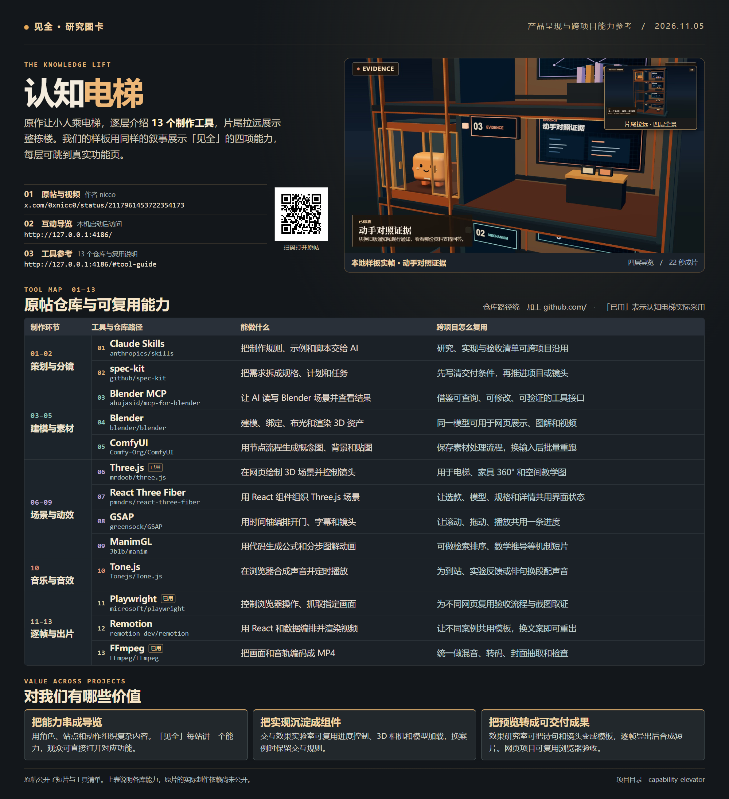
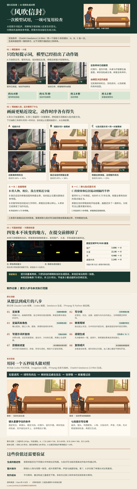
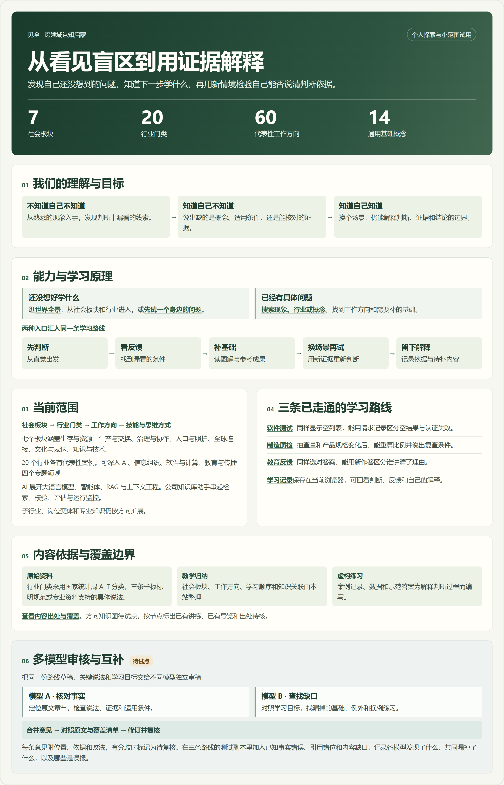
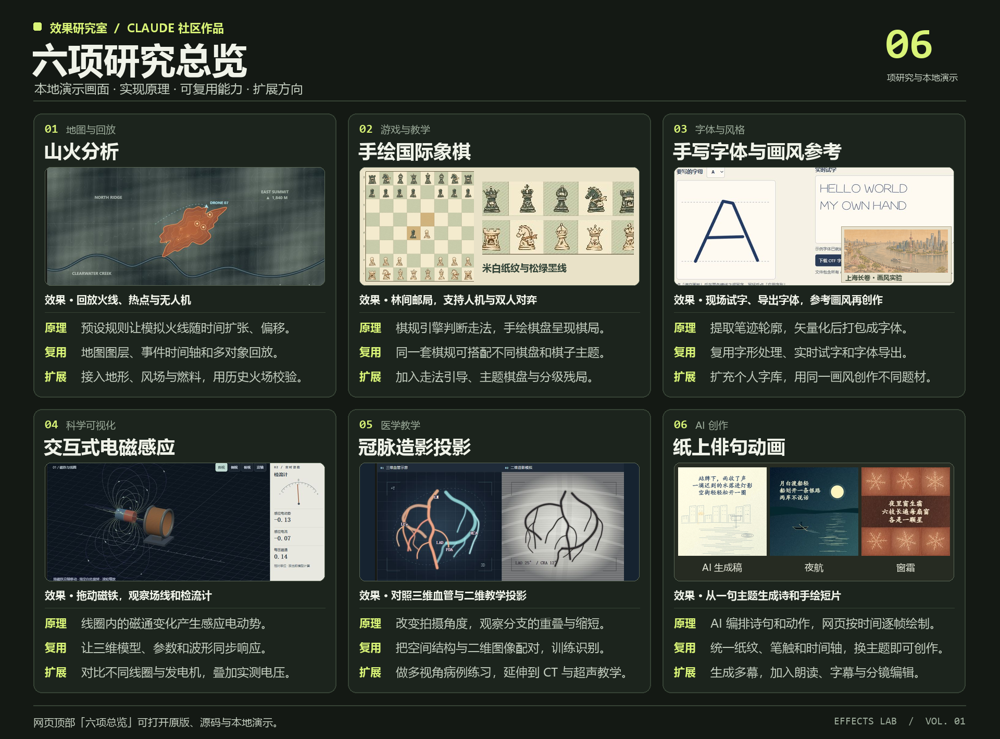

# GitHub 项目研究总库

整理值得深入研究的 GitHub 项目，记录它们解决的问题、值得借鉴的做法和复现中的发现。按编号浏览研究摘要，再进入子项目查看原仓库、详细笔记、截图和可用的 Web 演示。

## 研究索引

| 编号 | 子项目 | 原库 | 研究摘要 | 图片导览 | Web 演示 |
| --- | --- | --- | --- | --- | --- |
| 001 | [交互效果实验室](projects/001-interaction-effects-lab/README.md) | [MotionSites](https://motionsites.ai/) · [MapLibre GL JS](https://github.com/maplibre/maplibre-gl-js) · [Apache ECharts](https://github.com/apache/echarts) · [React Flow](https://github.com/xyflow/xyflow) | 汇总 16 个源参考、可操作复现与产品扩展，覆盖内容浏览、商品展示、材质反馈和业务交互。以共享款式与面料串联五步家具体验，沉淀原理、提示词与可继续组合的模块。 | [原理引导图](#interaction-effects-guide) | [在线总览与演示](https://yydshly.github.io/20261104_codex_project/001-interaction-effects-lab/) |
| 002 | [电梯叙事与工具能力研究](projects/002-capability-elevator/README.md) | [nicco 原帖](https://x.com/0xnicc0/status/2117961453722354173) · [Three.js](https://github.com/mrdoob/three.js) · [Playwright](https://github.com/microsoft/playwright) · [FFmpeg](https://github.com/FFmpeg/FFmpeg) | 借鉴角色乘电梯、逐层停靠介绍主题、片尾拉远全景的呈现方式，将一组工具或产品能力串成导览。包含四层互动样板、22 秒成片、13 个工具仓库与跨项目复用说明，验证数据驱动时间轴、浏览器逐帧采集和视频导出。 | [研究引导图](#capability-elevator-guide) | [在线研究与互动导览](https://yydshly.github.io/20261104_codex_project/002-capability-elevator/) |
| 003 | [风吹信封与付费前检查](projects/003-eian-seedance-workflow/README.md) | [Eian 原帖](https://x.com/EianLu/status/2118317430665613741) · [八步制作长文](https://x.com/i/article/2118298893238845441) | 用三条五秒原片区分模型基线、加入首尾帧与七段式提示词后的实际变化。最大可保留价值是付费前叠帧与局部合成，已修正四处输入图意外变化，稳定性与整片省成本仍待验证。 | [研究引导图](#wind-envelope-guide) | [在线研究与三组原片](https://yydshly.github.io/20261104_codex_project/003-eian-seedance-workflow/) |
| 004 | [Tesseract 的能力与价值](projects/004-tesseract-capabilities/README.md) | [Tesseract 官方库](https://github.com/mirage-hq/Tesseract) · [功能目录](https://mirage.app/tesseract/features) | 核心研究 Tesseract 如何以可编辑工程组织剪辑、二维动画、三维场景和音轨，以及对讲解制作和后续修改的价值。四部成片验证本机制作、路径追踪与 MiniMax 配音交付，保留能力边界，复用省时与教学收益仍待验证。 | [本轮研究引导图](#tesseract-guide) | [在线能力研究与实测作品](https://yydshly.github.io/20261104_codex_project/004-tesseract-capabilities/) |
| 005 | [见全 · 跨领域认知导航](projects/005-jianquan-cognition/README.md) | 自主产品探索 · [资料来源与覆盖](https://yydshly.github.io/20261104_codex_project/005-jianquan-cognition/#study/sources) | 研究大众怎样从社会全景进入陌生行业，发现认知盲区，找到所需基础和逐层深入的道路。用行业、技能与思维地图连接图解、案例和练习，保留 AI 深入样板；学习效果与多模型事实、覆盖互补审核仍待验证。 | [已有研究引导图](#jianquan-guide) | [在线探索与研究共识](https://yydshly.github.io/20261104_codex_project/005-jianquan-cognition/) |
| 006 | [六个优秀产品的效果与复用研究](projects/006-claude-showcase/README.md) | [Claude 原始作品串](https://x.com/claudeai/status/2111177834127601902) · [字体源码](https://github.com/harshpreet931/harshpreet-hand) · [电磁实验源码](https://github.com/thebuggeddev/electromagnetism) | 研究山火分析、Ballpoint Gambit、Harshpreet Hand、Induction Bench、AngioView 与 Twenty Haiku 六个优秀产品，从实际效果理解规则、数据与风格的配合。六个演示、绘画与短片提炼回放、主题化、字形资产、实验联动、空间教学和程序叙事的复用价值，并标明扩展范围。 | [已有研究引导图](#claude-showcase-guide) | [在线研究与六个演示](https://yydshly.github.io/20261104_codex_project/006-claude-showcase/) |

项目按收录顺序从 `001` 开始编号。新条目按编号追加，已分配的编号保持固定。索引摘要用一两句话写清研究对象和关注点。完成验证后，可补上一条主要发现。

## 项目引导图

### 001 · 交互效果实验室

这张图汇总了从源库参考、本地复现到产品扩展的探索过程。16 个案例分为内容浏览与叙事、商品展示与对比、材质与场景反馈、配置查询与编辑四类，每项保留源参考、可操作演示和实现提示词。

图中的家具链路依次为选椅子、360° 查看、切换灯光、配置报价和查找展厅，用同一份款式与面料选择串联多个交互。可以单独取用一个效果，也可以参考这条链路组合自己的产品流程。

后续可接入真实商品、价格与展厅库存，并按需求组合面料比较、规格帮助、报价分析和样品审批。当前报价与库存使用示例数据，分析和审批保留独立演示入口。[进入在线体验](https://yydshly.github.io/20261104_codex_project/001-interaction-effects-lab/) · [查看详细研究与扩展方向](projects/001-interaction-effects-lab/README.md)

### 002 · 电梯叙事与工具能力研究

核心价值是用角色乘电梯逐层介绍主题，再以建筑全景展示整体关系。工具清单、产品功能或知识步骤都可以采用这类空间叙事。我们的样板用「AI 为什么会答错？」串起找入口、理解生成、对照证据和跨域阅读四层，支持播放、拖动进度和楼层直达。

引导图沿用本轮生成的版本，包含效果实帧、仓库路径和价值说明。图中的本机地址供本地运行时使用，公开入口见[在线研究与互动导览](https://yydshly.github.io/20261104_codex_project/002-capability-elevator/)。

网页收录四层 3D 互动演示、22 秒有声成片、研究归纳、13 个工具的能力说明与 GitHub 入口，以及跨项目复用例子。已验证的制作路径为内容配置与时间轴 → Three.js 场景 → Playwright 逐帧采集 → FFmpeg 编码与混音。

可复用的是逐层导览的呈现方法、网页预览与视频共用时间轴、浏览器自动操作与验证，以及按模板更新素材后重新导出。13 个仓库按任务选择，原片具体调用哪些工具尚未核实。「见全」完整案例需要另行在本机运行。[详细研究与来源](projects/002-capability-elevator/README.md)

### 003 · 风吹信封与付费前检查

本轮最值得保留的做法，是在付费生成视频前叠看首尾帧、检查固定区域，再只合成需要变化的部分。局部改图同时改动了窗户、头发、手和桌面，检查与局部合成实际修正了这四处输入图问题。

沿用本轮生成的长图。A 用短提示词已经拍出窗帘先动、信封后滑。B 加首尾帧后构图和道具落点更贴近设定。C 改七段式后起动拉开约半秒，人物仍提前追看并多出斜光。每组只生成一次，未固定相同随机种子。原文八步保留并标明本次范围，整片一致性、稳定通过率和返工成本仍待验证。[在线研究与原片](https://yydshly.github.io/20261104_codex_project/003-eian-seedance-workflow/) · [完整摘要与来源](projects/003-eian-seedance-workflow/README.md)

### 004 · Tesseract 的能力与价值

研究核心是 Tesseract 的能力、运行方式和制作价值。它以可编辑工程组织普通剪辑、二维图层、三维场景和音轨，代理可以按文档修改工程、预览并渲染。机械讲解是本轮选择的验证场景，保留了从素材、动作和机位到配音成片的制作过程。

引导图使用本轮已经生成的版本，包含齿轮、车床、发动机和见全案例。图中的本机路径是当时的制作记录，公开入口见[在线能力研究与实测作品](https://yydshly.github.io/20261104_codex_project/004-tesseract-capabilities/)。

本轮使用 Windows Tesseract 0.5.0，完成齿轮 4 秒、见全 39.3 秒、车床 62.5 秒和发动机 67.2 秒四部成片。MiniMax 生成旁白，Tesseract 组织工程与渲染，FFmpeg 处理最终音轨、字幕和封装。发动机网页使用 Three.js 实时交互，和视频工程分别维护。

已经拿到的价值是让结构、运动和讲解形成可修改、可重渲染的作品，并交付通用视频与原始工程。网页区分已实测、官方支持和待验证，列出十二类能力、制作中的修正，以及普通视频精剪、纯二维动画、复杂导入等后续试验。复用能省多少工时、真实观众是否更容易理解，仍需测量。[研究摘要与验证范围](projects/004-tesseract-capabilities/README.md)

### 005 · 见全 · 跨领域认知导航

研究的起点是：持续学习仍会遇到“自己不知道自己不知道”的问题，进入一个新领域时，缺少能告诉自己“包含什么、需要什么基础、下一步往哪里走”的地图。目标是面向大众的跨行业技能与思维普及，以科普、图解和可操作案例提供认识方向与继续深入的入口。

沿用本次已生成的长图。没有明确想法时，从世界全景进入社会板块、行业和工作方向；已有问题时，从搜索进入概念与学习路线。两者连接同一套基础、讲解、跨领域关系和返回导航。三条样板进一步串起初次判断、反馈、补基础、换例与解释记录。

当前包含 7 个社会板块、20 个行业门类、60 个代表性工作方向和 14 个通用概念；AI、信息组织、软件与计算、教育与传播提供深入内容，公司知识库助手连接检索、核验、评估和运行监控。行业门类不等于岗位和专业知识已穷尽，已有路线也不等于学习效果已验证。

核心思考包括：怎样统一宏观与细节的入口，怎样让图解真正指明深入方向，怎样跨领域而不迷路，以及怎样区分原始资料、编辑归纳与虚构练习。后续按知识缺口扩展，先试点不同模型独立核对事实与查找覆盖缺口，再对照原文修订；多模型一致不自动代表正确。[在线探索](https://yydshly.github.io/20261104_codex_project/005-jianquan-cognition/) · [研究与共识](https://yydshly.github.io/20261104_codex_project/005-jianquan-cognition/#research) · [完整研究摘要](projects/005-jianquan-cognition/README.md)

### 006 · 六个优秀产品的效果与复用研究

本轮研究的是六个优秀产品与交互创作案例：**山火分析、Ballpoint Gambit 手绘国际象棋、Harshpreet Hand 手写字体、Induction Bench 电磁感应实验、AngioView 冠脉造影教学，以及 Twenty Haiku 俳句动画**。目标是从实际产品效果理解规则、数据、风格与操作如何配合，再提炼能用于自己产品的机制。

沿用已经生成的引导图。网页保留作者原站与原片、六个研究演示、原理与源码对照、原画与创作比较，以及两部完成短片。每个演示下方写明操作方式、本地实现、可复用能力和后续方向。[进入公开网页](https://yydshly.github.io/20261104_codex_project/006-claude-showcase/)

我们的理解是：用共同时间轴组织回放，把稳定规则与可变风格分开，将字形转成可安装素材，让实验参数与反馈联动，建立三维与二维的对应，并让 AI 在明确画法内编排诗和镜头。当前山火是模拟数据，电磁与冠脉使用教学模型；绘画是独立的画风参考实验，字体原库不提供任意图像生成。公开版提供示例操作与作品回看，新主题 AI 生成需本机服务。[完整研究摘要与六个产品入口](projects/006-claude-showcase/README.md)

## 收录新项目

1. 复制[子项目模板](projects/_template/README.md)到 `projects/<编号>-<英文短名>/README.md`，写明上游仓库、研究问题和复现记录。
2. 把封面和截图放在子项目的 `assets/`，用相对路径引用。填写替代文字，并用一句图注说明读者应关注的细节。根索引可链接封面。
3. 在上方索引补上对应条目，「原库」列填写上游仓库或官方入口。在索引下方添加引导图、案例范围、复用价值与扩展方向的说明。有在线演示时，再填入可访问的地址。

## Web 演示

首个静态演示就绪后，可将 GitHub Pages 的发布源设为 `main` 分支的 `/docs`。每个演示使用自己的 `docs/<编号>-<英文短名>/index.html`，把构建产物与静态资源放在该目录内。资源使用相对路径，或将构建基路径设为 `/20261104_codex_project/<编号>-<英文短名>/`。

启用后，演示地址的格式为 `https://yydshly.github.io/20261104_codex_project/<编号>-<英文短名>/`。[GitHub Pages 发布源说明](https://docs.github.com/en/pages/getting-started-with-github-pages/configuring-a-publishing-source-for-your-github-pages-site)
