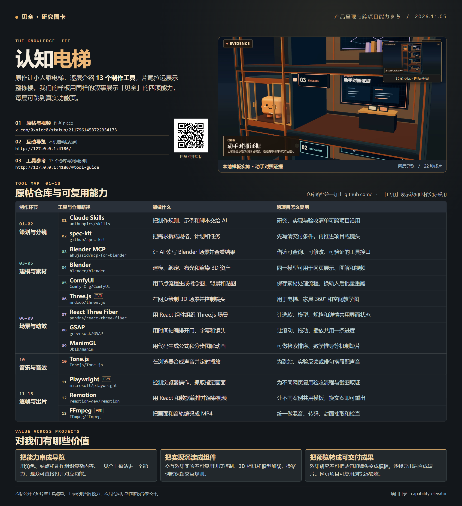

# 电梯叙事与工具能力研究

借鉴角色乘电梯、逐层展示主题、片尾拉远全景的呈现方式，将一组工具或产品能力串成导览。包含四层 3D 互动样板、22 秒有声成片、研究归纳、我们生成的引导图，以及原帖 13 个仓库的能力和跨项目复用说明。

样板从「AI 为什么会答错」出发，依次经过找到入口、理解生成、对照证据和跨域阅读。网页支持播放、拖动与楼层直达。本机运行时，「在见全体验」可打开相邻项目的对应页面。

[在线研究与互动导览](https://yydshly.github.io/20261104_codex_project/002-capability-elevator/) · [研究摘要与来源](../projects/002-capability-elevator/README.md) · [返回总库](../README.md#研究索引)



## 启动和导出

需要 Node.js 22。导出使用已安装的 Chrome 和 PATH 中的 FFmpeg。

```powershell
npm.cmd ci --ignore-scripts
npm.cmd run dev
```

打开 [本地导览](http://127.0.0.1:4186/)。主项目「见全」默认在 [4173 端口](http://127.0.0.1:4173/) 提供四个能力入口。如果主项目未启动，可在相邻的 society-atlas 目录运行 npm.cmd run dev。主项目地址也可以在 tour.json 中配置。

```powershell
npm.cmd run check
npm.cmd run render
```

成片保存在 public/media/cognition-elevator.mp4。渲染完成后刷新导览，底部出现下载入口。npm.cmd run render -- --draft 会单独生成 800×450 的快照版视频。网页导览静音，MP4 包含原创合成配乐和到站音。

## 静态部署

```powershell
npm.cmd run build
```

生成仓库内的 `docs/002-capability-elevator/`，由现有 GitHub Pages 的 main / docs 发布。导览、视频、引导图与工具清单均可在线使用。「见全」完整案例在本机运行，公开版会显示说明。

## 换内容

- [public/tour.json](./public/tour.json) 保存问题、楼层牌、正文、动作提示、目标地址、配色、停留和转场时长。单层可用 holdSeconds 覆盖全局停留时长。
- [src/timeline.js](./src/timeline.js) 从同一份楼层表计算轿厢高度、开门状态和片尾镜头。预览用当前时间，导出用帧号除以帧率。修改配置后刷新即可预览，重新运行导出即可出片。
- [src/scene.js](./src/scene.js) 实现电梯、角色、分层展厅和镜头。展厅内的示意道具按楼层 ID 选择。改展厅造型在这里进行。
- [render.mjs](./render.mjs) 用 Playwright 按帧驱动 Chrome，将画面送进 FFmpeg，并按同一时间轴混入 [src/audio.mjs](./src/audio.mjs) 生成的音轨。

## 制作参考

电梯、楼层导览和最终全景取自 [nicco 的短片概念](https://x.com/0xnicc0/status/2117961453722354173)。按时间定位画面、浏览器渲染和独立编码的思路参考 [ClaudeAnimationBase](https://github.com/JohnHeibel/ClaudeAnimationBase) 与 [PDoomVideo](https://github.com/JohnHeibel/PDoomVideo)。本项目使用 Three.js、Playwright 和 FFmpeg，三维场景、文案和音轨围绕「见全」单独制作。
