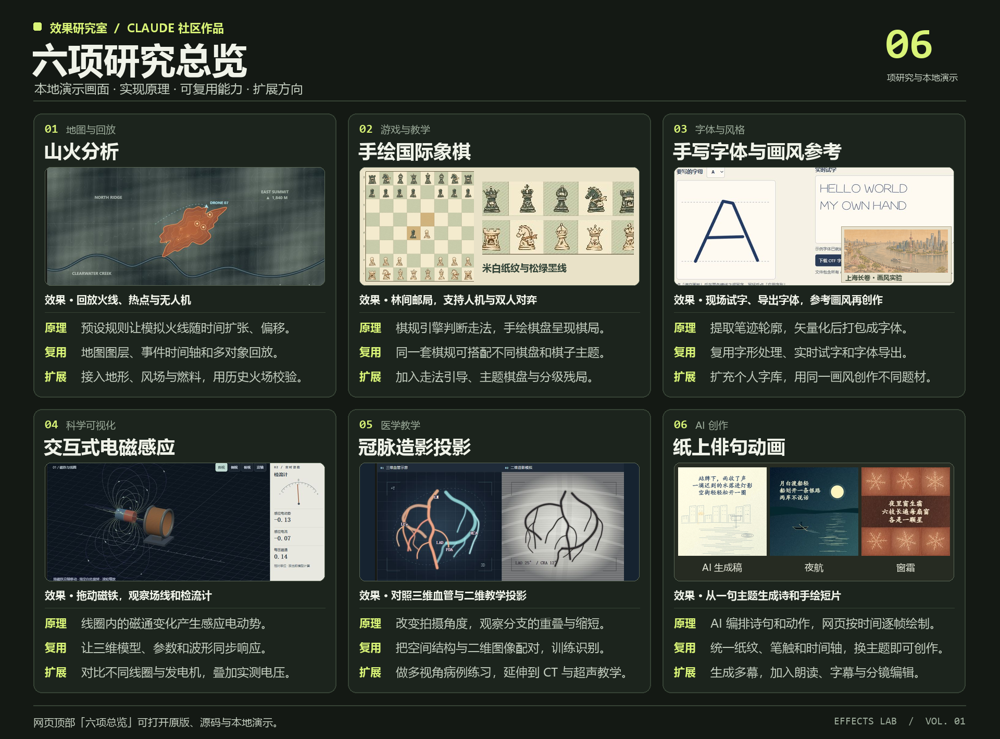

# 六个优秀产品的效果与复用研究

研究 Claude 社区展示的六个优秀产品：山火分析、Ballpoint Gambit 手绘国际象棋、Harshpreet Hand 手写字体、Induction Bench 电磁感应实验、AngioView 冠脉造影教学，以及 Twenty Haiku 俳句动画。从实际效果出发，理解规则、数据和视觉如何配合，再通过本地演示提炼可复用能力与后续产品方向。

[公开网页](https://yydshly.github.io/20261104_codex_project/006-claude-showcase/) · [完整研究摘要](../projects/006-claude-showcase/README.md) · [原始作品串](https://x.com/claudeai/status/2111177834127601902)



沿用已经生成的 1920 × 1420 引导图。网页集中放置六个演示、五幅原画与创作对照、两部完成短片和来源对照表，原站、原片与早期本地效果均保留。

## 我们的理解

这些产品共同展示了把内容变成可操作体验的方法：山火用同一时间轴组织多对象回放，棋盘把规则与手绘主题分开，字体把个人字形变成可安装素材，电磁实验让参数和反馈联动，冠脉教学建立三维与二维的对应，俳句让诗、镜头和声音共用时间轴。

复用时应同时看呈现方法、可操作的规则和实际产出。山火当前是模拟回放；绘画是另行完成的参考再创作，字体原库并不提供任意画风生成；冠脉练习使用教学结构；AI 镜头在工坊支持的元素与动作范围内编排。真实风场推演、临床病例和更广泛生成能力属于后续扩展。

## 本地运行

使用 Node.js 20.19+ 或 22.12+。

```powershell
npm ci
npm.cmd run dev -- --host 127.0.0.1 --port 4316
```

访问 `http://127.0.0.1:4316/` 或 `#overview`。六个本地演示分别为 `#wildfire/play`、`#chess/play`、`#font/play`、`#induction/play`、`#angio/play`、`#haiku/play`，每页下方有操作提示、实现原理、复用方向与当前范围。去掉 `/play` 可看原站；`#wildfire-video` 看山火作者原片。展开「旧版回看」可访问六个早期本地效果，例如 `#haiku/local`。嵌入应用与原片由其发布方提供，需要联网。运行 `npm run build` 可以生成静态产物。

短诗生成入口在 `#haiku/play`。它通过本机 Vite 服务调用已登录的 Codex CLI，使用该账号的 Codex 用量，需要联网。桌面运行环境会自动找到 Codex，普通终端需要让 `codex` 可执行文件出现在 PATH，或把 `HAIKU_CODEX_BIN` 指向可执行文件。独立托管 `dist` 时可以播放示例，生成入口需要本机服务。

短诗工坊会在当前浏览器保存主题、诗句、时长和最近一次 AI 镜头方案，刷新后恢复。绘画样张与已完成的 WebM 存放在 `public/`，从总览的「研究中完成的作品」回看。

## 六个研究对象与演示

| 产品 | 研究重点与我们的演示 | 原版来源 |
| --- | --- | --- |
| 山火分析 · Dilum Sanjaya | 地图、火线、热点和无人机的时间轴同步。[山火回放](https://yydshly.github.io/20261104_codex_project/006-claude-showcase/#wildfire/play) | [作者原片](https://x.com/DilumSanjaya/status/2108241054298415258) · [火迹社区实现](https://github.com/Dingyi-studios/firetrace) |
| Ballpoint Gambit · 手绘国际象棋 | 手绘风格与棋规分离，发展主题棋盘和入门教学。[林间邮局](https://yydshly.github.io/20261104_codex_project/006-claude-showcase/#chess/play) | [作者项目页](https://kevintngo.com/work/ballpoint-gambit/) |
| Harshpreet Hand · 手写字体 | 字形提取、矢量化和字体打包；本地支持编辑 A–Z、试字、导出 OTF，附画风研究。[字体与画风工坊](https://yydshly.github.io/20261104_codex_project/006-claude-showcase/#font/play) | [字库与生成流程](https://github.com/harshpreet931/harshpreet-hand) |
| Induction Bench · 电磁感应 | 三维装置、磁通、电压和波形联动，支持参数对照。[三维实验台](https://yydshly.github.io/20261104_codex_project/006-claude-showcase/#induction/play) | [作者原站](https://electromagnetism.wasmer.app/) · [源码](https://github.com/thebuggeddev/electromagnetism) |
| AngioView · 冠脉造影教学 | 三维血管到二维投影的空间对应，附三个练习。[冠脉投影练习](https://yydshly.github.io/20261104_codex_project/006-claude-showcase/#angio/play) | [作者原站](https://angioview.com/) |
| Twenty Haiku · 二十首俳句动画 | 纸上手绘风格、诗句与动作共用时间轴；本机 AI 生成受约束的镜头方案。[短诗动画工坊](https://yydshly.github.io/20261104_codex_project/006-claude-showcase/#haiku/play) | [Kevin Ngo 原片](https://x.com/kevin_t_ngo/status/2107939123818574231) |

## 发布

运行 `npm run build:pages`，以相对资源路径构建公开演示版，复制到 `../docs/006-claude-showcase/`，逐文件核对 SHA-256。GitHub Pages 沿用总库 `main` 分支的 `/docs` 发布源。

公开版可以操作六个演示、编辑和导出示例短片、浏览已有 AI 创作。新主题 AI 生成只在本机工坊启用，公开站点不连接个人 Codex 会话，也不托管生成后端。本机与公开站点的浏览器草稿分别保存。

旧版回看按需加载 `src/demos/` 中的实现。早期字体实验的字库适用 SIL OFL 1.1，许可证随字体保存在 `public/fonts/`。
