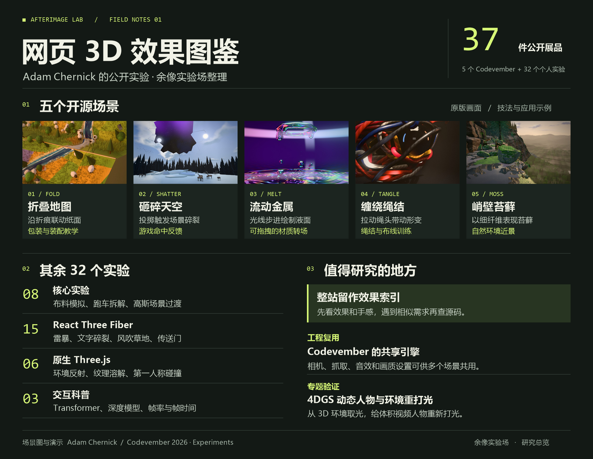

# 007 · 一个人的网页 3D 效果合集

整理 Adam Chernick 个人制作的网页 3D 效果，部分基于 Three.js、React Three Fiber 等开源示例扩展和组合。本轮沿用 2026 年 11 月 6 日收录的 37 项实验，覆盖折叠、碎裂、液态金属、绳索、植被、布料、产品拆解、反射和高斯场景，记录效果参考、工程复用和专题研究的价值。

[在线研究与效果展](https://yydshly.github.io/20261104_codex_project/007-creative-webgpu-showcase/) · [完整研究摘要与效果清单](../projects/007-creative-webgpu-showcase/README.md) · [返回研究索引](../README.md#研究索引)



已有 5 个 Codevember、8 个核心实验、15 个 React Three Fiber、6 个原生 Three.js 和 3 个交互科普模块。每项提供在线原版画面、中文原理、应用设想，以及已查到的操作与源码入口。作品来自作者，中文整理和展览页由本项目维护。

价值主要在效果选型与代码参考。有系列互动场景的需求时，可研究共享引擎；有动态数字人导览需求时，可专题验证 4DGS 与环境重打光。尚未扩展效果源码改造、真实业务样板、独立组件和多设备性能评估，作者后续日更也未并入本轮目录。

使用 Node.js 20 或更新版本，在本目录运行：

```powershell
npm start
```

打开 [http://127.0.0.1:4184/](http://127.0.0.1:4184/)。如端口被占用，可运行 `npm start -- 4185`。页面与解说位于 `dist/`，启动无需安装依赖。

每个展品都有自己的实时画面。滚动到附近时自动加载原版演示，离开后释放资源。点击「操作场景」可以把鼠标和键盘交给场景，也可以全屏查看。

演示需要联网，部分场景还需要浏览器和设备支持 WebGPU。本地服务提供 Gracia 4DGS 所需的跨源隔离响应头。建议使用新版 Chrome 或 Edge 查看；遇到加载问题可以从该模块的原站入口打开。 [实验目录](https://adamwebsite.com/experiments/) · [Codevember 源码](https://github.com/acher249/codevember-2026) · [Gracia 播放条件](https://github.com/acher249/4dgs-world-foundation-model-demo#notes)

运行 `npm run build:pages`，将五个静态文件复制到 `docs/007-creative-webgpu-showcase/` 并逐文件校验 SHA-256。公开站沿用总库 GitHub Pages 的 `main` 分支 `/docs` 发布源。

GitHub Pages 公开版提供 37 项说明与原版入口，支持的场景自动在各自模块内加载。两项 Gracia 4DGS 依赖跨源隔离，公开页会提示从原站打开。本地服务继续提供它们所需的隔离响应头。其余原版的可用性与画质取决于作者站、网络和设备。
