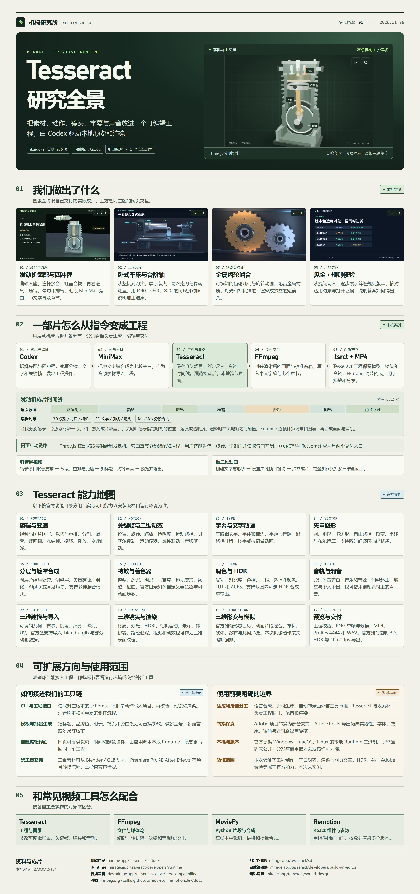

# 004 · Tesseract 的能力与价值

研究 Tesseract 如何以可编辑工程组织普通视频剪辑、二维动画、三维场景和音轨，以及这种方式对讲解制作、修改和交付的价值。齿轮、见全、车床和发动机是本轮的验证案例，研究范围同时保留工程原理、工具分工、官方能力和实际限制。

[在线能力研究与实测作品](https://yydshly.github.io/20261104_codex_project/004-tesseract-capabilities/) · [本轮研究引导图](https://yydshly.github.io/20261104_codex_project/004-tesseract-capabilities/#guide-image) · [源码与运行说明](https://github.com/yydshly/20261104_codex_project/tree/main/mechanism-research-lab) · [返回研究索引](https://github.com/yydshly/20261104_codex_project#研究索引)

## 我们形成的理解

Tesseract 的核心是视觉制作的工程与运行时。工程记录图层、素材、时间映射、关键帧、文字、相机、灯光、材料和音轨，运行时按时间计算属性，合成并渲染画面。由此可以组织剪辑、二维动效和三维镜头，具体可用范围取决于版本与素材。[官方功能目录](https://mirage.app/tesseract/features) · [Runtime 说明](https://mirage.app/tesseract/developers/runtime)

自然语言通过代理转成具体工程操作。Codex 负责分镜、脚本、工具调用和检查，Tesseract 负责工程编辑、预览和渲染，MiniMax 根据讲稿生成旁白，FFmpeg 处理最终音频、字幕与封装。Blender 可以作为外部模型制作入口，本轮主要使用程序几何，复杂模型导入仍需实测。

网页里的发动机由 Three.js 实时绘制，用户可以改变视角和曲轴角度，旁白时间驱动装配和四冲程。Tesseract 成片使用编排好的镜头与时间线。两者目前分别保存、分别维护，尚未验证自动同步改版。

## 沿用本轮生成的引导图

使用已有的 3200 × 6804 研究长图，网页可查看高清原图。图中的本机路径属于制作记录，公开作品与下载入口以在线网页为准。

## 研究怎样推进

1. 从用户提供的 X 转帖进入，研究 Mirage 的 Tesseract 与代理制作方式。技术判断以官方资料与本机结果为依据，转帖保留为起点。
2. 按 Windows 本机、金属齿轮转动、镜头推进、路径追踪和保留 `.tsrct` 的要求，完成 4 秒短片，确认基本制作流程可运行。
3. 尝试结合「见全 · 公司知识库助手」制作规则核验教学片。随后根据用户反馈，转向更适合呈现空间结构与运动的机械主题。
4. 制作台阶轴车削过程，再按“先介绍整体”的要求，追加 21 秒车床整机导览，形成全景到局部的 62.5 秒讲解。
5. 围绕“发动机是什么、怎样工作、如何制作”的问题，先做二维曲柄连杆示意，再实现网页三维剖面。
6. 添加 MiniMax 七段中文旁白、章节跳转和装配动作，用 Tesseract 制作独立发动机成片。
7. 进一步讨论普通剪辑、二维动画、音频来源、扩展与工具边界，形成研究长图和本次完整网页档案。

[最初提供的 X 链接](https://x.com/cfenghub/status/2118212495991361715) · [官方仓库与发行入口](https://github.com/mirage-hq/Tesseract)

## 实际产物与验证

| 产物 | 实际交付 | 说明 |
| --- | --- | --- |
| 金属齿轮 | 4 秒，1280 × 720，24 fps，MP4 和 `.tsrct` | 验证运动、金属材质、推进镜头和路径追踪。 |
| 见全规则核验 | 39.3 秒，1280 × 720，24 fps，MP4 和字幕 | 三份示例规定用于说明版本、适用范围与原文核验。 |
| 车床台阶轴 | 62.5 秒，852 × 480，24 fps，MP4、字幕、分镜和 `.tsrct` | 从整机推进到装夹、两次走刀、退刀和停转测量，保留 41.5 秒局部版。 |
| 发动机装配与四冲程 | 67.2 秒，852 × 480，16 fps，MP4、七章中文旁白、字幕和 `.tsrct` | 曲轴入座、活塞连杆装入、缸盖合拢，再解释进气、压缩、做功、排气。 |
| 发动机网页 | Three.js 实时模型与二维备用页 | 支持角度拖动、视角旋转、剖面切换和讲解联动。 |

制作记录使用 Windows Tesseract 0.5.0，发动机采用路径追踪每像素 8 采样、反弹上限总计 4 次。旁白来自 MiniMax `speech-2.8-hd`。修正过音轨输入时间映射、标注与构图等问题，校验了最终视频解码、七段旁白位置、字幕章节及 110 个存储姿态的机械接点。网页发布前另外检查视频播放、交互、资源链接、移动排版和 WebGL 不可用时的二维入口。

## 对我们的价值

已验证的是从工程到视频的制作能力，以及保留零件、镜头、标注、关键帧和分段音轨的修改入口。机械原理、装配说明和设备工序是本轮适配的讲解题目，网页互动进一步允许观众停在疑问位置观察。

值得继续验证的是同类项目的模板复用、修改成本、制作质量和观众理解效果。本轮没有量化省时或教学收益。当前模型的尺寸、配气、气流与去料经过简化，实体发动机制造还需要另外的图纸、材料、公差与试验条件。

## 能力范围与下一步

网页对十二类能力分别标出已实测、部分已用或官方支持，包括剪辑、二维动效、文字、矢量、合成、特效、调色、声音、三维模型、镜头渲染、形变模拟和导出。复杂遮罩、HDR、外部模型与 Adobe 工程转换等能力尚需独立测试。[官方能力目录](https://mirage.app/tesseract/features) · [工程转换兼容范围](https://dev.mirage.app/tesseract/converters/compatibility)

下一步可按同一工程改一次、把发动机重剪为约 25 秒、制作约 8 秒纯二维传力动画，以及邀请目标用户完成理解任务，分别记录修改点、工时、正确性和追问。以上均为待做试验。

## 源码与发布

源码位于 `mechanism-research-lab/`，安装依赖后运行 `npm run build:pages`，将相对基路径的 Vite 构建与公开素材复制到 `docs/004-tesseract-capabilities/`。沿用总库已有 GitHub Pages 的 `main` 分支 `/docs` 发布源。根索引和公开总览同步收录能力摘要、已有引导图与在线入口。
