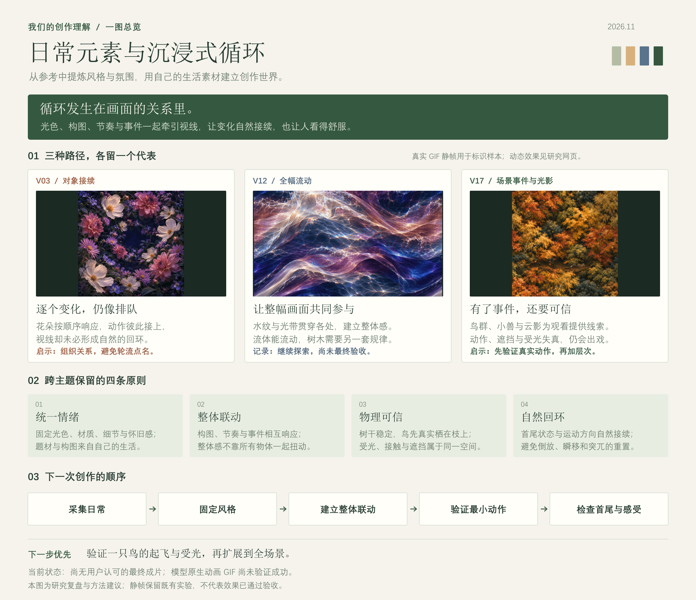

# 024 · 日常元素与沉浸式循环研究

研究怎样从自己的日常生活提取简单元素，形成有统一情绪、个人风格和整体循环感的作品系列。从 JenPanepinto 的花园与镜像纹样参考出发，用十八轮花朵、玻璃、旧物、水光及秋林实验，比较局部运动、接续、折叠、全幅流动、事件与光影，并把真实反馈用于下一轮判断。

核心理解是：**循环发生在画面的关系里**。光色、材质、细节和怀旧气息建立创作世界；构图、节奏与事件连接画面各处；运动服从材料和空间，首尾自然接续。抽象纹样与写实场景可以采用不同规则，悬疑是可选的观看线索，舒适与愿意持续观看始终是目标。

[在线研究与三个代表效果](https://yydshly.github.io/20261104_codex_project/024-immersive-loop-research/) · [研究方向与价值](https://yydshly.github.io/20261104_codex_project/024-immersive-loop-research/#research) · [版本对照](https://yydshly.github.io/20261104_codex_project/024-immersive-loop-research/#comparisons) · [创作方法](https://yydshly.github.io/20261104_codex_project/024-immersive-loop-research/#workflow)

## 已有研究引导图

沿用本轮已经生成的 2400 × 2070 原图，逐字节保持一致，不重新生成。只选 V03 花朵接续、V12 全幅水光、V17 秋林事件与光影三类不同路径，各保留一个样本；相近版本不重复陈列。静帧用于标识样本，动态以网页播放器为准。

## 研究方向与实际范围

| 方向 | 我们研究的具体问题 | 本轮留下的判断 |
| --- | --- | --- |
| 日常元素与原创系列 | 花园、旧物、玻璃、水光等不同材料，怎样属于同一个创作世界？ | 固定情绪、光色、材质与节律，重新选择主体与构图；从参考提炼关系，避免外观复用。 |
| 整体视觉循环 | 花朵逐个变化、空间折叠和整幅流动，分别怎样影响观看？ | 对象轮流动仍可能像排队；整体感依靠有组织的联系，夸张形变也可能造成反感。 |
| 材料、事件与可信空间 | 水纹的运动能否直接用于树林？动物从哪里起飞？ | 写实对象遵循其结构与接触关系。鸟应先栖枝，事件的反应、尺度与遮挡要成立。 |
| 光影与沉浸 | 增加云影、碎光、投影，能否使画面真实？ | 光源、材质、接触、遮挡与动作要相互一致；在静图上叠加亮暗不能可靠补足三维关系。 |
| 制作能力与验收 | 会生成图、能循环、能做出舒适作品，分别证明了什么？ | 分清原生静态素材、程序合成 GIF、原生动画请求与未执行草稿；技术衔接和观看感受分别检查。 |

网页默认仅展示三个代表，保留“全部探索”、主题筛选、搜索、两版对照、反馈、提示词、过程图及原文件索引。完整研究含 **2 组作者参考、18 个探索阶段、17 个动态实验阶段**；20 个 GIF 包含两组参考转码和一个预览变体，不是 20 件独立原创作品。V18 是静态起始图与原生 GIF 入口测试，实际只返回一帧 PNG。

## 对我们的价值与意义

1. **形成个人语言**：将日常观察整理成可延续的风格规则，在换主题时保留情绪与识别感，逐渐积累自己的作品世界。
2. **让返修改得有依据**：将“没有感觉”“像排队”“树不该这样动”“光影太假”等反馈，落实到构图、运动、事件和空间问题。保存失败样本，帮助避免重复同类尝试。
3. **保留可复用资产**：实际 GIF、同源 MP4、静态素材、提示词、制作脚本和检查记录一起回查，便于换题材、调节奏、对比新入口。真实省时与稳定通过率仍需衡量。
4. **支持后续用途验证**：可延伸到动态日记、个人影像集、氛围网页、展示背景、动态插画与系列视觉。它们是创作与产品假设，尚无长期使用、真实观众或商业成效证据。

## 可继续采用的创作流程

采集日常 → 固定情绪与风格规则 → 建立整体联动 → 验证一个最小动作 → 检查首尾与观看感受。网页将其展开为六步：取材、固定规则、规划视线返回、建立运动原因、自然归位、分别验收文件与感受。

下一步的最小验证是固定机位下，一只已经栖枝的鸟连续完成警觉、蹬枝、松爪与振翅飞离，检查足爪、遮挡、尺度、受光和机位稳定。先验证真实动作，再扩展事件、光影与最终循环；这只是一个验证分支，不能代替整个原创系列方向。

## 实际成果与尚未完成的部分

已有成果是实际文件、版本差异、反馈链和创作方法整理。**尚无用户明确认可的最终成片，也没有验证成功的模型原生动画 GIF。** “继续”不等于认可，循环标记、首尾误差与资源检查不等于舒适、沉浸或真实感已通过。

本轮模型生成的是静态底图、静态关键帧素材和姿态表，GIF／MP4 由本地程序合成、组帧与编码。文件名含 native 不证明原生动画；底层模型未报告时保持未知。外部视频路线没有上传起始图、提交任务或发生相关生成费用。公开页保留事实摘要，省去账号截图和私有执行草稿。

## 来源与原创边界

- 参考账号：[@JenPanepinto](https://x.com/JenPanepinto)。
- [花园参考原帖](https://x.com/JenPanepinto/status/2120637240007180786) · [镜像纹样参考原帖](https://x.com/JenPanepinto/status/2120150816287760496)。
- 作者参考单独标注，本地 GIF 为原帖短媒体的展示转码；作者实际工具、模型和提示词均未知。
- 本轮独立实验与作者原作分开。现有记录不代表取得作者原作的再授权，不为第三方素材授予新许可；复用时应回到原始来源核对用途。

## 公开部署与复核

沿用仓库 GitHub Pages：`main` 分支的 `/docs`。界面、引导图与小型预览位于 [`docs/024-immersive-loop-research/`](../../docs/024-immersive-loop-research/)，大体积媒体和公开研究文件保存在本目录 `archive/`，播放器按固定标签 `research-024-20261121` 从同一仓库加载，避免把全部素材重复放进 Pages 部署目录。

本机完整档案的 156 个文件保持原样。公开版省去登录截图及两份私有执行草稿，另增加一份事实状态摘要，形成 154 个公开研究文件；文本中的本机路径和账号信息已整理，视觉与动画媒体保留原字节。逐文件来源与发布哈希、引导图一致性见 [`publication-manifest.json`](publication-manifest.json)。公开网页需要网络加载固定版本的仓库媒体。

`publish.py --source <本机研究目录>` 生成发布内容；`verify.py` 检查实际链接、清单、媒体归属、引导图与公开范围。源码与记录用于研究复盘，部分历史渲染脚本中的本机依赖需另行配置，不能承诺一条命令复现所有生成过程。
