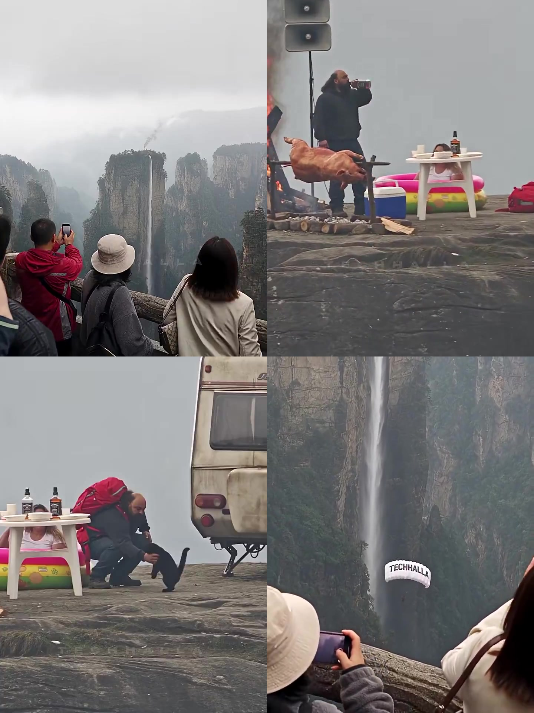

# 原作效果与我们的创作理解

2026-11-21更新：最新理解与[一张研究总览图](10-emotion-led-research.md)已整理。海洞小样的反馈推动我们把日常情绪放到选题起点，用人物行动、视角和可信世界承载欲望与情绪变化。以下保留原参考分析与早期创作假设。

## 先说明原参考的效果

原参考约 30 秒，采用游客观景台的拍摄位置：前景是游客，远处是雾中的石柱与瀑布。变焦把观察对象从山景变成山顶营地：房车、烧烤、桌椅、充气泳池、人物与黑猫。男子随后背包抱猫跃下，结尾出现降落伞。

从已观察的画面看，原片把几种效果组合在一起：

1. **像现实中的偶然发现。** 旁观者站在普通人可能站的位置，前景遮挡、远近变化、手机变焦感都给画面一个日常解释。
2. **把罕见生活放进可信的观看方式。** 人物在险峻山顶烧烤、喝酒、休闲，形成强烈的自由生活与身体感受投射。人物和道具承载这种向往。
3. **不断改变观众正在等的事情。** 先想看清远处，再想知道人物要做什么，然后等待跳下后的结果。
4. **让现实判断暂时悬而未决。** 细节显得熟悉，场景和行为又极不寻常；观看者可能在信与疑之间继续看。

以上是创作层面的解读，不等于已经证实每位观众都会产生这些反应。元数据、抽帧时间和来源另见 reports/reference-evidence.json。原声未完整实听；音效方面的后续描述均是新故事的设计意图。

## 用户明确指出的价值

用户的核心判断是：“分不清现实还是 AI”，并且人物展现和故事能刺激欲望、带来兴奋。用户进一步要求：**视角要有创意，并且与真实世界挂钩。**

本项目保留这三点作为创作方向。这里的“荷尔蒙上升”按口语中的兴奋、吸引、紧张、向往理解，没有做生理测量，也不写成医学或心理学效果结论。

## 我们形成的创作假设

**可信的观看位置，让人物和事件的刺激更容易被代入。** 从创作角度，可依次检查：

| 需要成立的关系 | 可见的画面依据 | 需要避免的偏差 |
| --- | --- | --- |
| 我为什么在这里看 | 机位属于游客、骑手、潜水员、伴侣或顾客 | 相机突然成为无所不在的无人机 |
| 我为什么继续看 | 一个尚未回答、可被画面回答的问题 | 只展示漂亮场景而没有事件 |
| 我向往什么 | 人物的生活、能力、主动回应或亲密关系 | 所有故事只剩豪车、美貌和价格 |
| 我暂时看不到什么 | 背后、洞口之后、车内、窗外等实际盲区 | 为反转强行隐藏本来必然能看到的信息 |
| 什么改变了我的感受 | 一次接近、一个动作、一处尺度变化 | 不断增加奇观，人物退化成摆设 |
| 看完留下什么 | 相视一笑、邀请、离开、放心或意犹未尽 | 依赖口播把原本看不懂的情节解释完 |

这不是经过统计验证的因果公式，而是本阶段用于比较与修改故事的工作模型。

## 欲望有多种入口

- **身体与气质吸引：** 成年人的神态、姿态、服装质感、距离与眼神。
- **能力与掌控：** 熟练做饭、驾驶、滑雪，以及从容处理突发情况。
- **自由与生活投射：** 从露台滑进雪山、收工后一起离开、临海空间中的片刻停留。
- **被选择与被等待：** 某个人主动靠近镜头，为拍摄者留出位置。
- **稀有体验与紧张兴奋：** 进入少见空间、发现镜头背后有庞然大物，再获得清楚的结果。

人物有自己的工作、意愿和行动。他们之间的回应，是吸引力的一部分。六个故事分别采用不同入口，防止系列变成同一情节换背景。

## 视角本身要做事

缆车的移动决定一次相遇会迅速结束；骑手胸前的相机让邀请直接朝向观众；潜水员转头之前看不到身后；新郎的手机由欣赏变成参与；顾客的低机位保留普通生活的距离；观察屋的低视线把动物尺度显现出来。

创意机位需要同时回答三个问题：**为什么会拍、相机能到哪里、此刻看不到哪里。** 原参考的一镜变焦只是一个案例，新故事可以采用符合拍摄者行为的少量镜头，不预设每条都必须一镜到底。

## 系列视觉规则

人物与空间可辨认，首要关系清楚；光线由场景里的天空、窗、炉火、灯具或水面解释。保留皮肤、衣料、餐具、玻璃、尘土和真实接触点。构图可有轻微遮挡和迟疑，但不能为了“手机感”把故事拍得不可读。

每条优先设置一处罕见场景或事件，其余细节服从现实比例、空间和动作因果。所有新故事和氛围图都属于原创构想，真实出处只支持其空间或活动原型。

## 本轮把认识变成什么

六张三联氛围板各提供三个关键视觉时刻；六份故事条目解释机位、人物、情绪、时间轴和风险；试镜卡把最难动作单独提出。阅读页把原参考、新概念与待验证事项并列呈现，便于选择下一步。

图片能帮助判断场景与人物关系，但不能证明动作衔接、角色跨镜一致、声音表演或整片效果已经成立。
