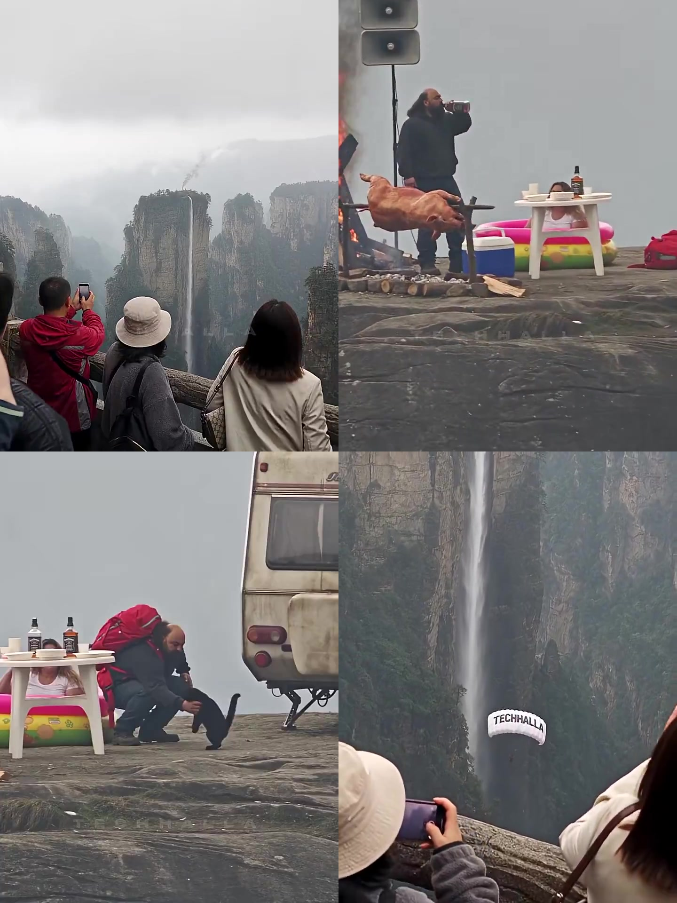

# 来源、证据与当前交付范围

> 来源档案保留2026-11-12的阶段记录；当前已完成两轮海洞视频小样，见[研究首页](../index.html#experiments)。

整理日期：2026-11-12（Asia/Shanghai）。

本页区分用户的创作目标、查得的公开信息与本项目的原创设定，便于后续继续研究和制作。

## 1. 原参考作品

### 用户发来的转发版本

- 链接：[Bill The Investor 的帖子](https://x.com/billtheinvestor/status/2120217438533066946)
- 帖文：“人类已经无法区分梦幻与现实了”。
- 公开帖子数据中的发布时间为 2026-11-10 18:10:03 UTC，即北京时间 2026-11-11 02:10:03。
- 公开元数据报告约 30.058 秒、720 × 960；本次下载文件经 ffprobe 读取，容器时长为 30.101333 秒，视频为 720 × 960、24 fps。元数据标称时长与文件容器时长分开记录，二者均不代表作者制作母版的规格。

直接网页读取曾返回 403；帖文及公开媒体地址通过公开 FxTwitter 接口读取。随后取得媒体并抽帧观察。因此，本项目可以描述已见的画面事件，但不把网页直读失败误写为无法取得任何内容。

抽帧可见的内容包括：游客前景、雾中的石柱与瀑布、山顶房车和露营用品、成年男女、黑猫、红背包，以及人物跃下后打开的降落伞。画面含 TECHHALLA 水印或字样。具体事件衔接依据采样画面，不等同于已经完成逐帧审查。

**声音证据限制：** 此轮没有完成原片全程实听，原片的语言、音乐、观众反应和准确声音时序不作为已验证事实。新故事中的声音描述均为拟定的声音设计。

### 本地留存的抽帧与证据记录

2026-11-12 已重新获取公开媒体，在系统临时目录完成分析；项目中没有存放整段原视频。保存了四张原内容抽帧和一张仅作排版的 2 × 2 联系表，没有 AI 重新生成、内容修补、裁切或叠字。

| 请求抽帧时间 | 项目文件 | 可见内容 |
| --- | --- | --- |
| 约 0.5 秒 | [reference-frame-01.jpg](../assets/reference-frame-01.jpg) | 游客前景、远处山峰与瀑布 |
| 约 5 秒 | [reference-frame-02.jpg](../assets/reference-frame-02.jpg) | 山顶露营物件、烤猪与饮酒人物 |
| 约 18 秒 | [reference-frame-03.jpg](../assets/reference-frame-03.jpg) | 背红色背包的成年男子与黑猫，后方为房车 |
| 约 29 秒 | [reference-frame-04.jpg](../assets/reference-frame-04.jpg) | 瀑布旁低处的 TECHHALLA 降落伞及观景游客 |

抽帧时间是请求的定位时间，未另行逐帧核对准确显示时间戳。JPEG 为原视频画面的抽取格式，不能称为无损视频帧。

- 公开帖文与媒体元数据（本地历史记录）：只保留相关正文、来源、时间和视频参数。
- 本地分析证据（本地历史记录）：记录来源地址、临时分析路径、视频与图片 SHA256、尺寸与时长、四帧定位时间和证据限制。
- 更早作者帖的公开文本核对（本地历史记录）：记录此次重新读取的作者帖文本和来源，不含完整回复链验证。

### 找到的更早对应帖子

- 链接：[TechHalla 的更早帖子](https://x.com/techhalla/status/2110686996049883550)
- 公开数据发布时间为 2026-10-15 10:59:29 UTC，即北京时间 2026-10-15 18:59:29。
- 经公开接口读取的原帖文字包含：“I won’t tell anyone when I make it, but there will be signs”及“magnific prompts below”。

该更早帖子与本轮找到的同片拆解资料共同支持创作者及生成创作的来源判断。上述文字提及 Magnific 提示词入口；本轮没有直接核实其全部自回复、实际提示词提交记录、视频模型版本、种子或生成次数。

因此，不能把“Seedance 2.5”“一次完成”“连续 30 秒由某模型直接生成”等第三方描述，写成本项目已经独立核实的制作事实。

### 辅助检索线索

[同片第三方拆解页](https://liuyidaoai.com/tutorials/techhalla-zhangjiajie-bbq-parachute-seedance-2-5)帮助定位到 TechHalla 的更早帖子，并提供了进一步研究的线索。它不是作者的实际生成记录；其模型名称、提示词和参数需要另行回到作者公开材料核对。

## 2. 六个原创故事与现实原型的关系

以下链接只证明相关空间或活动存在。它们不证明本项目的角色、关系、台词、机位组合或突发事件在这些地点发生过。

| 本项目故事 | 现实连接点 | 公开来源支持的内容 | 本项目另行设计的部分 |
| --- | --- | --- | --- |
| 缆车经过她家后院 | 雪道边的私人木屋、滑进滑出 | [Chalet Lalisar 官方介绍](https://airelles.com/en/destination/courchevel-hotel/suites/chalet-lalisar)介绍直接连接雪道的木屋及其设施 | 下行缆车与露台的相对位置、红衣滑手、喝咖啡后的行动、目光回应 |
| 海洞里的空座位 | 天然海洞中的临海餐厅 | [Grotta Palazzese 官方介绍](https://www.grottapalazzese.it/en/restaurant/)介绍设于天然洞穴内的餐饮露台 | 骑手的最后一单、女友安排、生日邀请、后厨路线和相机位置 |
| 她一直在指我身后 | 透明窗壁外是海洋的水下用餐空间 | [Ithaa 官方介绍](https://www.conradmaldives.com/dining/ithaa-undersea-restaurant/)介绍水下餐厅、透明围护和可见海洋生物 | 潜水维护人员与用餐者互动、转头时序、魟鱼的经过与精确距离 |
| 捧花归你，方向盘归她 | 婚礼花絮拍摄、封闭赛道体验 | 使用常见活动与设备逻辑，没有指定某条真实新闻作为原型 | 成年新娘的身份、装束、驾驶能力和与新郎的互动 |
| 夜宵摊老板的下班时间 | 夜宵收摊、骑行接人、客人拍食物 | 使用普通城市生活逻辑，没有指定真实店铺或真实人物 | 老板和女骑手的关系、到达时机、扣头盔和离开动作 |
| 早餐桌外多一位客人 | 水塘边下沉式摄影观察屋 | [Singita 官方摄影观察屋文章](https://singita.com/2025/11/hwata-blind-and-photographic-safaris/)介绍接近水面高度的观察位置，并记录大象饮水及溅水进来的经历 | 早餐桌、人物搭配、相互回应、抓手和笑的时序、动物具体位置 |

这些原型用于建立空间和活动的可信基础，不是对相应机构、地点或人物的合作背书。

## 3. 用户观点与项目假设

**用户明确提出的方向：** 真假难辨的观看感受；人物展现与故事对欲望、兴奋感的吸引；有创意的视角；与真实世界挂钩。

**我们据此提出的创作假设：** 普通拍摄者进入少见空间；有限视野让悬念成立；通过能力、关照与相互回应体现人物魅力；一条集中一件罕见事件；用一个完成的动作形成情绪收尾。

这些是假设和设计原则，尚未通过观众研究证明。原参考片的观看量、互动量或创作者声誉，也不能单独证明某项具体手法的因果效果。

## 4. 图像与制作状态的解释

- **原参考抽帧：** 来自用户给出帖子的媒体，用于解释已见画面；应保留来源标注，不与本项目新生成的图混同。
- **新生成的氛围概念图：** 用于理解场景、角色气质、观看位置和情绪变化；是本项目的视觉探索，不是真实事件照片。
- **三联氛围板：** 三个关键状态的示意，不能证明这些画面已具有同一空间、同一人物的连续视频一致性。
- **剧本与时间轴：** 拟定的叙事节拍，最终时序要以生成结果、表演和剪辑核对。
- **声音：** 当前是设计要求；未生成、未实听的声音不能标为已验收。
- **模型与费用：** 未经实际调用或报价核对的不填写确定版本、价格和成功率。

本轮围绕整理与氛围图展开，视频生成、台词配音、字幕合成和成片验收属于后续制作阶段。各项实际完成情况以项目首页和素材清单为准。

## 5. 后续新增来源时记录什么

至少保留来源标题、完整链接、读取日期、支持的具体判断，以及是否亲眼看到原图、原片或实际提交记录。把作者的目标、工具实际执行结果、我们的推断和观众反馈分别记录，避免把后来的整理配方误记成原作的真实制作过程。
