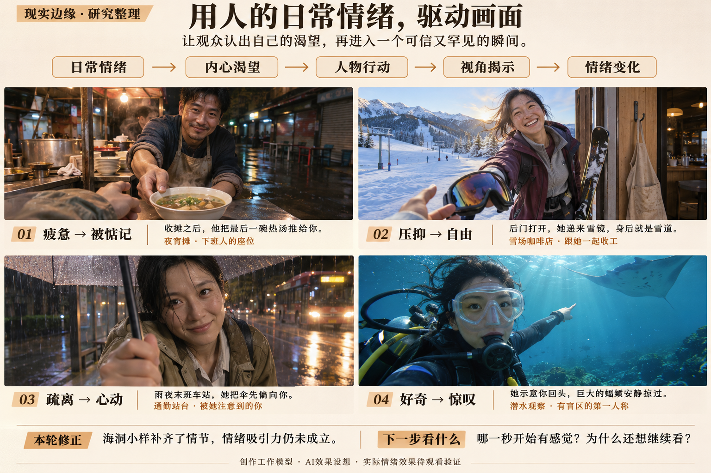

# 从日常情绪出发的短视频研究

2026-11-21｜本轮理解修正与效果设想。

我们要研究的是：**让观众认出自己熟悉的情绪与渴望，通过人物、动作、视角和可信场景，进入一个想亲历的瞬间。** 真实与AI难分的质感支持代入；人物的外形、能力、主动回应，以及接下来会发生什么，支撑欲望与继续观看的期待。

创作工作模型：**日常情绪 → 内心渴望 → 人物行动 → 视角揭示 → 情绪变化。** 情绪可以逐渐加深、悬而未决，或最终释放，无需每条都安排大反转。日常指人的情绪经验；场景可以普通，也可以罕见。

## 这次反馈让我们修正什么

8秒海洞小样的反馈是“看起来没啥内容啊”；15秒版补回配送、放蛋糕、牵手、生日祝福与入座后，用户仍说“没意思没价值啊”。据此，把情节补完整尚未满足这位观看者对吸引力的要求。

我的创作判断是：前一轮把制作重心放在因果和动作完成，情绪起点、欲望力度与期待的推进不足。现在把首要验看问题改为：**观众在什么处境下，会因哪个具体瞬间产生什么感受，又为什么想继续看？** 这是针对本轮反馈的解释，不能推成所有观众的普遍结论。

## 一张图里的四个效果设想

| 情绪起点与希望体验 | 让关系可见的动作 | 真实世界与视角 |
| --- | --- | --- |
| 疲惫 → 被惦记 | 收摊的人把最后一碗热汤推向你 | 夜宵摊；下班人的座位和工作袖口 |
| 压抑 → 自由 | 收工后，她把另一副雪镜递给你 | 雪场咖啡店；从工作门槛走向雪道 |
| 疏离 → 心动 | 雨夜，她先把伞偏向你 | 末班车站；被对方注意到的第一人称 |
| 好奇 → 惊叹 | 潜伴指向视线外，蝠鲼即将进入注意范围 | 潜水观察；相机盲区与自然尺度 |

四张均为新生成的静态效果设想，用于讨论表达方向，不是已生成的视频帧。日常细节提供认同，人物行动建立关系，观看位置决定何时发现；罕见体验可以进一步放大感受。各方向的刺激强度不同，不能把温暖关照直接等同于原参考的冒险兴奋。

## 研究可以带来的实际价值

1. **选题有依据。** 先确定人的情绪缺口与渴望，再选择人物和场景；同一套方法可以用于工作、通勤、亲密、自由、能力和探索。
2. **效果有具体抓手。** 用“递过来、向我倾斜、等我、示意回头”等可见关系指导画面，让吸引力落在能被看见的瞬间。
3. **AI能力有创作方向。** 把生活里向往、却难以恰好遇见或拍到的体验具体呈现，同时保持可相信的观看理由和物理关系。
4. **观看反馈能改变下一轮。** 先问哪一秒有感觉、想看下去的理由、何处失去兴趣，再决定修改什么；做出画面和完成剧情都只是阶段证据。

## 下一轮怎样判断

先隐藏情绪标签观看：能否看出人物在对“我”做什么？哪一秒产生期待或感受？后续还有什么值得等？用观看者原话记录，不用我们的说明代替其感受。静图只帮助判断场景、关系与方向；节奏、动作、声音和持续吸引力仍需动态验证。

制作：内置ImageGen，文字生成，无外部参考图输入，未调用ChatArt或发起新视频任务。完整实际提示词见[生成指令](../prompts/research-board/emotion-led-overview-v1.txt)，素材记录见[本轮来源与检查](../reports/emotion-led-research-overview-v1.json)。
