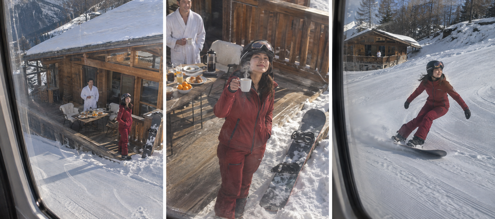
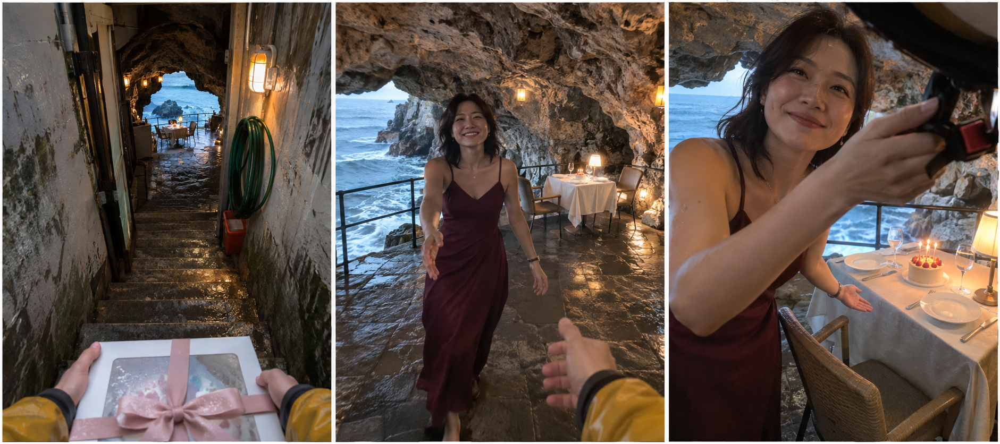
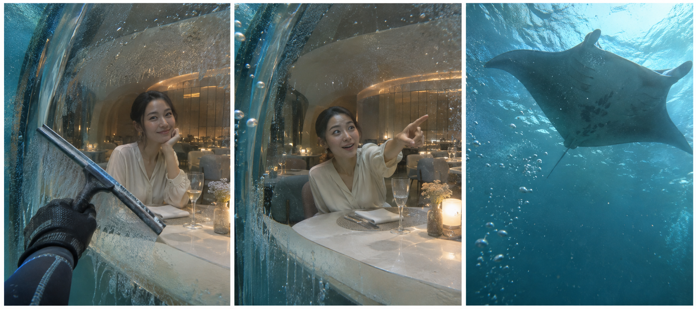
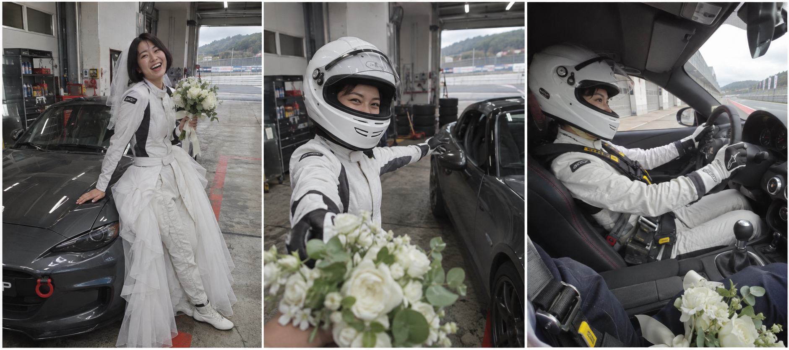
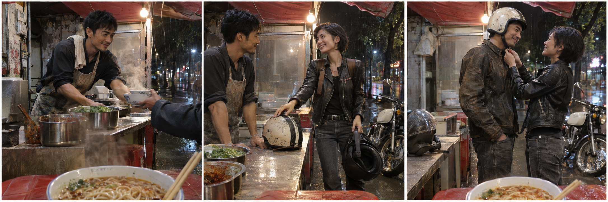
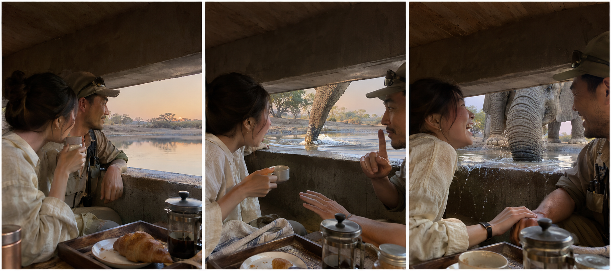

# 氛围概念图验看记录

验看日期：2026-11-12。验看范围：story-01 至 story-06 的六张 PNG 三联图。方式：逐张调用图像查看工具，目视整图；未播放视频，未听取音频。第 5 张补验使用内置 ImageGen 成功输出并已落地的 story-05-atmosphere-alt-v1.png。

## 本次结论与边界

这六张可用于理解场景氛围、人物气质、拍摄位置与故事转折。每张图包含三个取样瞬间，构成概念说明，不是三个已经验证连续动作的镜头。静态图没有画出某个中间动作，不单独构成未达标；若图示与动态方案在道具、服装、机位或动作状态上不同，则如实记录，留待动态制作统一。

没有修改图片、没有追加或改写已提交的生成提示词，也没有把事后验看说明当成原始生成指令。stories.json 只添加 image.reviewStatus、image.reviewNotes 并修正图下 panelCaptions；productionStatus 留给主代理统一更新。

| 图像 | 可以保留的表达 | 动态制作前要锁定 |
| --- | --- | --- |
| 01 缆车 | 窗框、早餐、浴袍同伴和红衣滑手共同建立稀有生活的偶遇感。 | 雪板由靠墙变为脚下的准备状态；同向下坡、缆车视差和接驳坡。 |
| 02 海洞 | 湿阶与水管连接工作日常，成年女友近身接应和空椅形成被等待的体验。 | 接盒、放盒、开盒、点烛与解扣的先后；胸前相机的合理高度。 |
| 03 潜水员 | 窗壁内外边界、指向肩后的手势及转头后单独看到魟鱼，共同支持视角悬念。 | 衣着由文案深色礼服或图示浅色衬衫中择一；魟鱼种类尺度、转头路径与回到原窗段。 |
| 04 赛道 | 赛车服与婚礼元素、递花、驾驶位里的从容和束带，表达人物主导感。 | 起步前把图中副驾腿上的捧花交回车外；完成裙罩移除、装备复核与座位左右关系。 |
| 05 夜宵 | 锅灶、雨夜、旧衣与备用头盔，把工作魅力、等待和熟悉关系连接起来。 | 图示汤面与文案炒面的版本选择；白黑两只头盔的交接、出发前佩戴，以及顾客机位的连续性。 |
| 06 早餐 | 低窗、咖啡、象鼻和大象头部揭示，把普通早餐与庞然大物相遇连接起来。 | 杯盘位置、人物手势、手腕或前臂的接触点，以及象鼻与头部的连续解剖。 |

## story-01 · 缆车经过她家后院

结论：已目视验看：可用于氛围与故事讨论；动态连续性待验证。

- 已看到缆车窗框、木屋早餐、浴袍同伴、红衣滑手与雪道；真实生活细节和运动自由的情绪关系清楚。
- 前两幅雪板靠在旁边，动态文案则设定滑手已穿好雪板；这是概念板与动态方案的准备状态差异。未来锁定视频时保留文案中的预先穿好设定，或另留穿板节拍。
- 右幅呈现滑手从窗外近处经过，尚不能证明缆车下行方向、接驳坡与滑行速度已连续成立。未来先用空间草图固定坡向和机位。

对应动态首测：未来先做 5–7 秒动态试镜：从露台推离到滑手进入雪道；仅验证坡向、脚板接触、窗框视差和人物尺度。

## story-02 · 海洞里的空座位

结论：已目视验看：可用于氛围与故事讨论；动态连续性待验证。

- 已看到雨衣袖口、双手托盒、潮湿石阶和水管；从配送工作进入海洞烛光用餐的空间变化明确。
- 中幅是女友伸手迎接，右幅已进入近身解扣和桌上蛋糕点烛的阶段；接盒、放盒、开盒及点烛过程被概念板压缩。静态板无需逐个画出动作，后续视频仍应按文案安排两只手的先后。
- 右幅头盔位于画面上缘，女友近身动作和视线支持被等待的第一人称体验；目前没有证据验证胸前相机高度在实际解扣和坐下时能连贯保持。

对应动态首测：未来先做 5–6 秒双人动作试镜：女友接稳盒子、放到桌上、再抬手解扣；验证接触点和视线，不先生成整条片。

## story-03 · 她一直在指我身后

结论：已目视验看：可用于氛围与故事讨论；动态连续性待验证。

- 前两幅保持潜水员在水中、女人在干燥餐厅内的透明窗壁边界，手套、工具与气泡为拍摄身份提供参照。
- 第三幅只呈现窗外水域中的魟鱼与水面，没有把窗内女人同时拼进转头后的画面，符合此故事依靠视角盲区产生悬念的表达。
- 图中女人穿浅色衬衫，文案暂设深色简洁礼服；气质与人物作用可接受，未来角色参考应二选一锁定，避免视频里变装。
- 魟鱼近景的轮廓与遮光传达尺度感，但整张静态板无法验证具体种类、连续游动、真实距离，以及转回后是否仍为同一窗段。

对应动态首测：未来先做 6–8 秒转头试镜：玻璃内指向 → 窗外转身 → 魟鱼正常掠过。先不加亲密互动，集中检查空间、鱼体和气泡。

## story-04 · 捧花归你，方向盘归她

结论：已目视验看：可用于氛围与故事讨论；动态连续性待验证。

- 已看到赛道维修区、白色赛车服与婚礼裙罩、向镜头递花的动作，以及副驾视角下戴盔并系肩带的驾驶者；角色主导感和从欣赏到参与的变化清楚。
- 右幅捧花仍在副驾驶腿上，动态文案要求起步前交给车外工作人员；该图可表达花归拍摄者的关系，但不能直接用作车辆加速时的连续性基准。未来车内运动镜头应去掉松散捧花。
- 左幅婚礼裙罩的取下过程、两人的装备复核和工作人员手势不必全部在三联图里出现；动态制作仍须按时间轴完成。
- 静态图能看见驾驶者的头盔和肩带，不能据此认定全部束带固定、衣物收纳、乘客装备与驾驶动作已通过动态验证。

对应动态首测：未来先做 4–6 秒静止车内表演试镜：新娘侧头确认、扣下面罩、看回前方。先确认座位和束带，再测试短距离起步。

## story-05 · 夜宵摊老板的下班时间

结论：已目视验看：可用于氛围与故事讨论；动态连续性待验证。

- 已看到有工作痕迹的围裙、蒸汽、金属锅、近处面碗、旧皮夹克、两只头盔和普通摩托；人物的熟悉笑容与扣头盔动作使关系可读，街边雨夜细节支持生活质感。
- 图示食物更接近带汤面碗与蒸汽锅，动态文案暂设铁板炒面；两者都能承载食物感官吸引，后续应锁定一种烹饪方式、碗数和收工动作，不能把概念图直接当成炒面连续性基准。
- 中幅白色头盔放在柜台、女骑手手里拿黑色头盔；右幅老板戴白色开放式头盔，黑色头盔留在柜台，物品交接可理解。女伴扣带尚在进行，不能把静帧写成两人都已完成佩戴。
- 右幅换夹克与近身扣带的中间过程被概念板压缩，关火、洗手、挂围裙、告别和离开未全部画出；这不影响氛围讨论，未来动态仍应按时间轴补齐因果，尤其女骑手出发前需重新戴好自己的头盔。
- 三幅取景从食物前景到人物中近景有距离变化；后续视频应固定最后一桌的位置，说明手机抬起或轻变焦的路径，不默认已经验证同一坐姿机位。

对应动态首测：未来先做 5–6 秒人物试镜：放备用头盔、抬眼笑、自然扣好带子。以是否像熟悉的人为首要标准，不先测试车辆运动。

## story-06 · 早餐桌外，多了一位客人

结论：已目视验看：可用于氛围与故事讨论；动态连续性待验证。

- 已看到下沉观察屋的低窗、早餐杯盘、成年客人与向导、先出现的象鼻和后揭示的大象头部；日常前景与罕见尺度相遇的构想可读。
- 右幅用窗内水滴、两人笑容和手腕附近的接触表达紧张释放；与文案暂设抓住前臂的位置略有不同。后续动态制作应锁定接触手、左右位置与发生时机。
- 三幅图中的杯位、餐盘内容、手势和人物相对窗口的位置存在变化；概念板可以表现不同瞬间，不能直接视为同一机位无缝连续的首尾帧。
- 大象在窗外饮水、人物留在观察屋内的边界清楚；静态图无法验证象鼻由上入水到头部揭示的连续解剖、真实距离及水花路线。

对应动态首测：未来先做 5–7 秒揭示试镜：象鼻在窗外入水，手机抬起见到整头大象；不加入早餐互动和泥水，先检查解剖与空间。

## 后续验看的共同标准

1. 机位属于谁、为什么会在这里、转向前后是否仍是同一空间。
2. 人物动作是否真正表达熟悉、被邀请、关照或主导，而不仅是好看的姿势。
3. 手、道具和接触点是否能在时间上先后成立；人和动物是否保持真实尺度。
4. 声音是否服从距离与介质，尤其是缆车远景和窗内外隔绝。
5. 把一次概念样图的感受与动态试镜证据分开记录，避免把静态可读性写成视频已通过。
