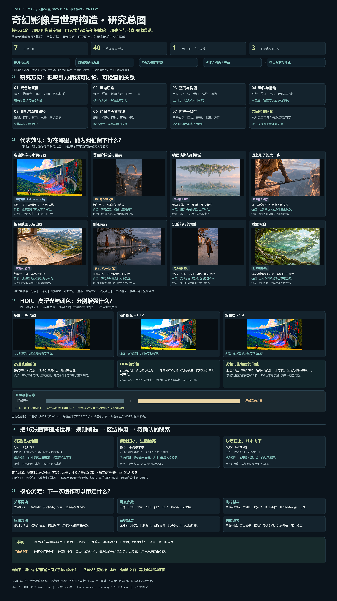

# 027 · 奇幻影像与世界构造研究

研究奇幻画面怎样通过**异常空间、光色、人物动作、相机和音乐**让人产生尺度感、进入感与情绪，再把这些理解转为可回查的原创构图、动作设计与世界规则。最初借鉴 @hi_personality 的骑行短片，后来从海边城市应用转为独立的视觉能力研究；当前重点是让图片之间形成世界关系。

[在线研究网页](https://yydshly.github.io/20261104_codex_project/027-surreal-motion-study/) · [曝光与 HDR](https://yydshly.github.io/20261104_codex_project/027-surreal-motion-study/#color) · [动作与情绪](https://yydshly.github.io/20261104_codex_project/027-surreal-motion-study/#motion) · [原创效果与世界候选](https://yydshly.github.io/20261104_codex_project/027-surreal-motion-study/#directions) · [公开文件](https://github.com/yydshly/20261104_codex_project/tree/main/docs/027-surreal-motion-study)

引导图直接复用本轮已生成的3200×5700研究总图，未重绘；SHA-256：`b7e03c4bd7e1806a66f999099c615f514819c7bac29d4fb4af5f6716c2c0c9dc`。图中HDR部分为机制说明，整张PNG是SDR。

## 我们理解了什么

好看的图片能帮助选风格、构图和材质，但它的后续价值取决于任务：要讲异常事件，就需要正常参照、变化和人物反应；要表现情绪，就需要重心、呼吸、停顿与节奏；要构造世界，就需要共同规则、空间连接和生活依据。反向思维是提出规则的方法，光色是组织观看的方法，运动与声音让这些关系随时间发生。

| 研究方向 | 具体研究 | 对我们的价值 |
| --- | --- | --- |
| 光色与氛围 | 同一海岸帧的曝光、饱和度对照；HDR、DaVinci调色；雾、冷暖和湿反光 | 能按情绪选择亮暗、颜色与亮点层次，避免把“更亮更艳”当作统一配方 |
| 反向思维与规则 | 倒悬城市、环境寻找生命、影子承托、地图变地形、异步倒影与逆雨 | 从改变一条常识提出原创方向，并找出让观众读懂规则的触点 |
| 空间与构图 | 弯曲海岸前后抽帧；小主体与巨构、S形路线、高差、遮挡和留白 | 在出图或搭场景前明确尺度参照、视线入口和核心看点 |
| 主体动作与情绪 | 骑行、贴胸后仰、脚底接触、行走舞步、停顿与短暂闭眼 | 把“沉醉、释放、惊疑”等目标转成可审阅的身体行为 |
| 相机与观看路径 | 跟随、接近、转向、前景退出、视差与揭示 | 区分场景造型的贡献和镜头运动的贡献，规划观众何时看见什么 |
| 时间、音乐与节律 | 踩踏频率、位移速度、相对运动；100 BPM、16拍设计与空拍 | 以落脚、回弹和停顿组织节奏，保留生成后逐拍核对的必要性 |
| 世界一致性 | 4张风格母图、16个地点、3个核心规则候选、区域角色与生活体系 | 从图库转向世界设定，发现水位、高差、入口、生态和连接的冲突 |

## 代表效果怎样复用

- **弯曲海岸**：开场已有异常弧形空间，小骑行者给出尺度，后段观看方向和人物相对大小改变。可借鉴“先让世界成立，再沿路进入”；原片没有展示平地从零卷起。
- **暮色阶梯城与悬空巨拱**：阶梯、高差、冷暖光和巨构组织纵深。可用于关卡入口或建筑叙事的美术提案；单图深度重投影GIF的推进感未达到用户目标。
- **镜面浅海与倒悬花园城**：重力倒置、镜像与浅水触点形成宁静奇观。适合继续建立可进入区域和生活规则，当前只是方向图。
- **迈上影子的第一步**：用后脚在岩台、前脚接触悬空影子，把“影子承托”落到可见关系。发现—第一步—站稳三图提供静态叙事草案，不能证明真实承托或动态连续性。
- **折叠地图**：纸脊接山脊、墨线接河流，让平面与地形的变化有共同线索。可用于地图转场设计；尚未完成连续折叠。
- **倒影先行**：正常同步→人停倒影继续→回头→人物确认，说明异常需要前后情景和反应。9秒本地分层粗剪仍有滑步与形变。
- **沉醉前行**：从姿态情绪出发，设计四拍母题、宽路站位、完整支撑脚和音乐关系。已有一条用户通过的AI视频；精确BPM、足部接地和批量稳定性尚未量化验证。
- **树冠湖等世界地点**：图像提供地貌和材质线索，价值在于进一步比较规则和连接，而非据此宣称已建成可探索世界。

## HDR、高曝光与调色各有什么价值

**曝光**改变整体亮暗与中间调，可增强通透、轻盈或梦境感；过量会损失高光、材质和层次。**饱和度**改变颜色强度，帮助强调植被、海水或灯光；过量会破坏色彩主次。**HDR**涉及内容信号、亮度范围、色彩管理和显示链路，在适配设备上能给亮部更多亮度余量，并保留明暗层次；它不等于整体提亮或提高饱和度。**调色**组织曝光、对比、白平衡、冷暖和局部主次，DaVinci Resolve是进行这类后期处理的软件。

同帧的+1EV与饱和度×1.4是我们在作者已调色的SDR映射预览上做的教学实验，不是作者原始设置，也不是未调色/已调色对比。三条分析分发副本有BT.2020/HLG信令，本地变体为8-bit AVC，尚无母版或显示亮度测量。

2026-11-12归档的[作者HDR回复](https://x.com/hi_personality/status/2115573454628106332)确认HDR与DaVinci；[流程回复](https://x.com/hi_personality/status/2115776938069635304)自述Midjourney→经ComfyUI使用其称为“minimax h3”的模型→DaVinci后期。具体模型完整标识、节点工作流、提示词与调色参数未知，不能由画面唯一反推。

## 已完成与未完成

已归档三条重点骑行原片及另一条巨构参考，整理12张早期原创关键帧、36个静态展示阶段、40项表现手法、10种效果图、3段局部机制预演、影桥与折纸静态序列、巨拱GIF、倒影粗剪、本地舞步与一条用户通过的AI舞步视频。后续扩展4张风格母图和16个地点；不同版本、缩略图和抽帧不重复累加为作品数。

16个地点目前分为**3张核心规则候选、8张内部空间候选、4张城市生活体系、1张独立视觉母题**。三个候选为“树冠成为地面”“低处归水，生活抬高”“沙漠在上，城市向下”。这些关联是研究中的推导，尚未建立共同地理与连续空间。

40项是研究目录，不是40个已实现运行时特效。局部预演和2.5D动画不等于完整3D；一条成片通过不等于稳定生成能力。25帖和传播数字主要来自用户文章的历史快照，未逐帖全部独立验证，骑行与点赞中位数不能证明因果。第二参考的发布账号为@EiiKwesiKay，原始创作者身份与完整制作链路未确认。背景音乐身份和许可也未确认。

尚无可探索3D世界、正式产品、观众理解测试或商业价值验证。提出过的森林世界空间关系页及四图关联/冲突标注尚未制作。

## 核心沉淀与推进方式

沉淀六类材料：**关系词典、可变参数、执行材料、验收方法、证据分层、失败边界**。原片与参考素材库的价值，是提供可观察的尺度、遮挡、节律和情绪基准；原创图用于比较和沟通，提示词与脚本支撑复用，失败记录帮助判断什么时候必须换成真实几何、角色表演或视频制作。

下一步从一个世界候选开始，先用既有四图核对地理、水位、高差、入口与生活规则，再决定采用静态叙事、受控视频或可探索3D。按“规则是否读得懂→动作是否有感→连续空间是否成立→是否值得持续探索”逐级验证。省时、传播、长期停留与商业收益都是待验证目标。

## 公开范围与复现

实质研究主要截至2026-11-14，本轮2026-11-21补充研究总图、完整理解与公开发布。网页为无构建依赖的静态站，保留原帖链接、研究抽帧、原创图片、可播放试作、提示词与制作记录。原片片段仅置于出处明确的分析语境，不能当作已获新作品使用许可的素材包。

发布包省略登录与账户字段、服务日志、临时上传数据、用户粘贴文章全文、截断视频和中间音视频；原始本地资料保留。16原图重复ZIP留在本地，网页可逐图查看与下载，并链接公开图像目录。引导图与保留的原创图、成片字节不变，记录在`publication-manifest.json`。

发布：`python projects/027-surreal-motion-study/publish.py --source <surreal-motion-study绝对目录>`。检查：`python projects/027-surreal-motion-study/verify.py`。本机预览：`python -m http.server 4187 --directory docs`，访问`http://127.0.0.1:4187/027-surreal-motion-study/`。GitHub Pages沿用`main /docs`。
