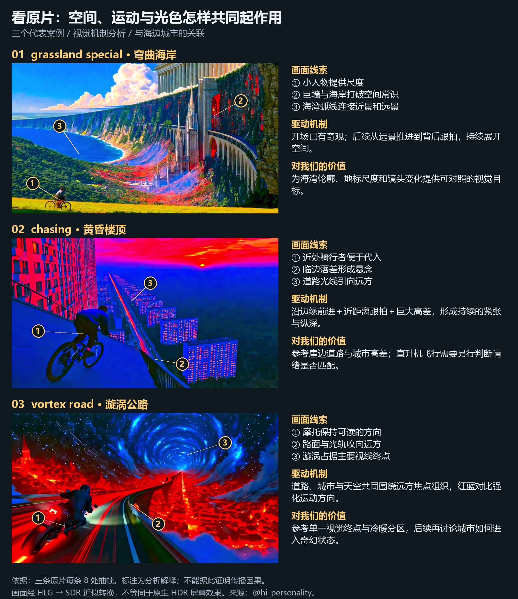
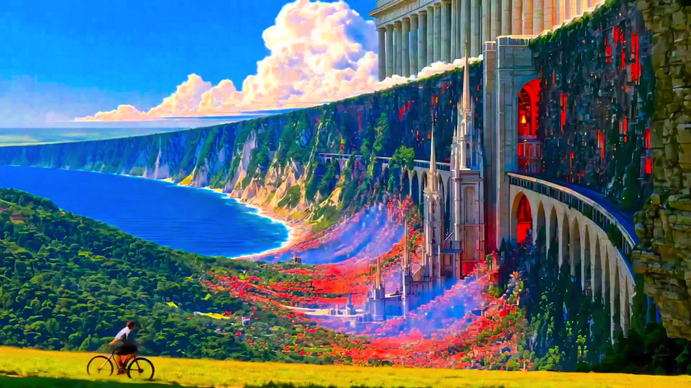
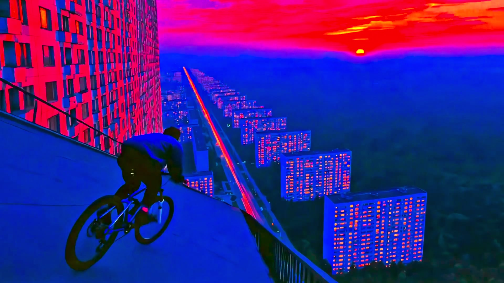
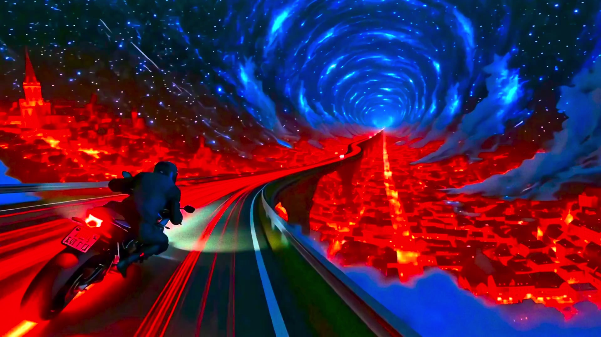
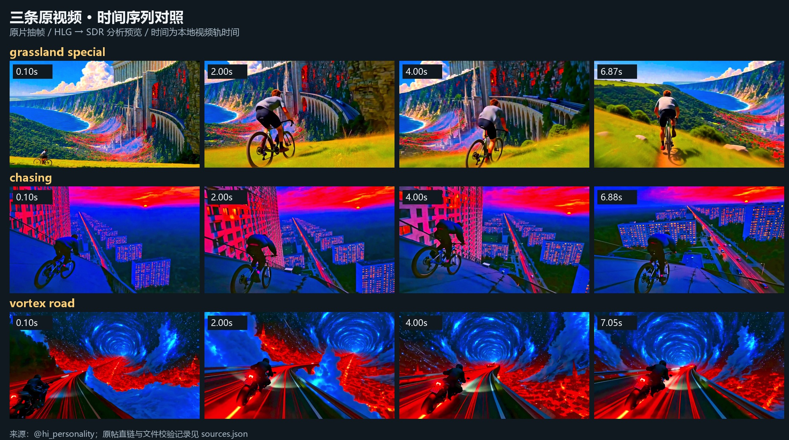

# 奇幻追车影像：效果、驱动与参考价值

日期：2026-11-12（上海时间）。当前状态：第一轮图文分析完成，等待与用户沟通下一步。

后续研究：用户已选择先深入弯曲海岸，详见 [前后抽帧分析：场景与镜头的贡献](grassland-space-study.md)。本子项目仍保持分析阶段。

光色补充：[同一海岸帧——曝光、饱和度、HDR 与 DaVinci 调色](color-hdr-study.md)，包含受控教学对照与 HDR 显示机制说明。

**初步核心：一个方向明确、可读的小主体持续前进，镜头带观众探索异常尺度的空间；光色与 HDR 强化第一眼的视觉强度。** 这是基于三个代表案例的视觉解释，尚不是关于传播效果的因果结论。

## 证据范围

- 保留了用户提供的完整文章，包含原有 25 条帖子表格。其余条目的画面标注仍以该文章为依据。
- 本轮独立打开三条原帖，获取完整公开播放变体，分别在 8 个时间点抽帧，共 24 张。视频、播放列表、哈希与抽帧时间均记录在 [sources.json](sources.json)。
- 抽帧图由 HLG 转成 BT.709 SDR 分析预览，适合判断构图、动作和大致色彩关系；不能复现原生 HDR 屏幕的峰值亮度和全部色彩观感。
- 本轮没有人工听辨音乐，也没有核实其作者身份和素材授权。

## 1. grassland special：奇观先成立，运动再展开它

[原帖](https://x.com/hi_personality/status/2115567493565825244) · 本地视频轨约 6.97 秒。

### 看得到什么

开场约 0.10 秒，骑行者位于左下，人物很小；海湾、弧形岸线、巨大的石墙与建筑占据大部分画面。到约 2 秒，骑行者明显变大，视角接近侧后方；到约 6.87 秒，视角已接近背后跟随，海湾和远处崖壁仍在。

开场已有弯曲岸线和异常尺度。已核对的抽帧没有展示一套完整的“普通平地逐渐卷成墙”的过程。此前直接把效果描述成正在发生的卷曲动画，表达过强。

### 效果由什么驱动

1. **第一帧的空间关系。** 熟悉的草地、海湾和建筑被组织成一个异常宏大的空间，观众很快就能读出奇观。
2. **小主体提供尺度。** 骑行者把环境从漂亮背景转成具有可想象尺寸的地方。
3. **镜头变化提供探索过程。** 从远处展示世界，逐渐靠近主体并转到背后，画面一直有新的空间信息。
4. **近景运动与远景尺度共同工作。** 草地和骑行者变化明显，远处海湾保持识别度。

“想继续看前方”“产生探索感”是视觉机制解释。仅凭这些抽帧，无法分离实际摄影机推轨、变焦和生成式画面变化，也不能证明作者拥有一致的三维场景。

### 对海边城市的价值

可用来确定海湾弧线、地标尺度、主体大小和镜头由远及近的关系。更有价值的借鉴对象是同一画面内的近景、行动路线与巨大远景如何配合。我们尚未决定海边城市是否采用空间变形。

## 2. chasing：明确的前进方向，加上临边高差

[原帖](https://x.com/hi_personality/status/2117011977658876093) · 本地视频轨约 6.98 秒。

### 看得到什么

主体近、位于画面偏左下。左侧是近距离高楼立面，脚下屋顶向边缘延伸，右侧城市明显低于主体。远处明亮道路通向地平线；天空是强烈的粉橙色，城市和屋顶偏蓝紫。后续抽帧持续沿屋顶行进，楼体和城市的遮挡关系变化。

### 效果由什么驱动

1. **路面边缘与城市落差。** 让观众直接看见主体所处的位置和潜在危险。
2. **接近主体的镜头。** 骑行姿态、屋顶纹理和边缘都可读，增加跟随体验。
3. **纵深引导。** 亮路、楼群排列和地平线把视线引向远方。
4. **冷暖分区。** 温暖天空和窗口与冷色屋顶、城市形成清楚的层次。

临边紧张感是分析推断；它可以与骑行、前进和光色共同解释画面，但不能单独解释该帖的曝光。

### 对海边城市的价值

可参考崖边公路、山脊、码头边缘和高差镜头的构图。这里有一个需要讨论的迁移差异：骑行者必须依靠狭窄路面前进，直升机可以自由飞离边缘。换成直升机后，画面可能更强调自由与尺度；原作的临边紧张感不能自动保留。

## 3. vortex road：行动路线与视觉终点共同组织空间

[原帖](https://x.com/hi_personality/status/2118132771290030513) · 本地视频轨约 7.15 秒。

### 看得到什么

摩托在近景偏左，路面和红色光轨向远方收束。蓝色云与星空形成螺旋，橙红城市也沿其周围展开。车辆一直前进，路面曲线、城市形态和天空旋向随画面变化。

### 效果由什么驱动

1. **清楚的行进路线。** 护栏、车道和光轨维持可辨认的前后方向。
2. **强视觉终点。** 漩涡中心、道路消失方向与城市排列相互呼应。
3. **空间元素共同配合。** 城市、云层与道路共同形成被卷入的观感，不能把全部效果归结为一张旋转天空背景。
4. **红蓝对比和光轨。** 色彩分区与道路上的连续亮线强化方向和速度的可读性。

“被吸入”“催眠感”是对视觉体验的解释。旋转速度、相机轨迹、光轨生成方式和真实几何不能从抽帧反推出唯一实现。

### 对海边城市的价值

可参考“明确路线通向一个主要视觉终点”的组织方式。海湾出口、远处灯塔、港口入口都可以用来讨论同类构图。是否采用漩涡或整体城市变形，留待沟通决定。

## 4. 时间序列带来的三个修正

1. **“始终背后跟拍”概括过强。** grassland special 开场有明显侧面远景，随后才接近背后跟随；另外两条的主体也并非始终居中。
2. **“卷曲世界”包含画面设计与运动两个问题。** 可以先存在一个异常世界，再通过镜头探索它；不能把每条作品都理解成地面正在随时间卷起。
3. **约 7 秒不等于无缝循环。** 三条所核对的开头和结尾，在主体位置、大小或背景关系上均有明显不同。本轮没有确认它们是首尾无缝的循环片。

## 5. 视觉驱动与制作驱动分别是什么

| 层面 | 当前证据 | 能支持的判断 |
|---|---|---|
| 画面构图 | 原片抽帧 | 熟悉物体、异常尺度、可读主体和行动路线共同组织注意力。 |
| 时间与运动 | 24 个时间点的抽帧 | 主体持续前进，视角和环境关系持续变化；具体运动算法未公开。 |
| 图像与视频生成 | 作者原始回复 | 作者描述使用 Midjourney，再通过 ComfyUI 使用其称为 minimax h3 的模型。 |
| 后期与调色 | 作者原始回复 | 作者描述使用 DaVinci Resolve 做后期和调色。 |
| HDR 显示 | 作者回复及本地视频元数据 | 三份变体带 BT.2020 / HLG 标记；不能把屏幕亮度差异归结为饱和度。 |
| 传播效果 | 用户文章中的历史数据 | 适合提出待检验的方向；不能分离招式、账号增长、HDR 和分发因素的贡献。 |

[作者关于制作流程的原始回复](https://x.com/hi_personality/status/2115776938069635304) · [作者关于 HDR 与调色的原始回复](https://x.com/hi_personality/status/2115573454628106332) · [本轮核对记录](reference/author-workflow.md)

关于流程分工，可以提出一个工作假设：图像阶段主要决定空间与构图，视频阶段展开动作与镜头，后期进一步组织光色。作者没有公开工程文件，因此这个分工仍是分析，不是对每个效果制作步骤的完整还原。

## 6. 原视频与参考素材库，对我们的实际价值

| 用途 | 具体价值 | 后续讨论时可比较的东西 |
|---|---|---|
| 视觉目标 | 把“好看、震撼、自由”变成有图可指的目标。 | 主体多大、海湾占多少画面、地标与地平线在哪里。 |
| 镜头词汇 | 分开远景展示、靠近、侧后跟随和背后跟随。 | 我们希望观众欣赏世界，还是代入主体。 |
| 情绪选择 | 区分探索、临边紧张、失重与被吸入的体验。 | 红色直升机适合承载哪一种体验。 |
| 可变因素 | 逐项记录空间、动作、镜头、光色、时长。 | 将来如做实验，可以清楚知道改了哪一项。 |
| 质量对照 | 在研究和后续制作中保留同一套代表画面。 | 画面是否仍能读懂方向，主体是否被奇观淹没。 |
| 证据积累 | 原帖、视频、抽帧时间和作者回复可回查。 | 哪些观察已经确认，哪些仍是推测。 |

使用边界：原视频不等同于可直接复用的游戏资产、可玩的三维世界或工程实现说明。尚未核实的素材许可不支持直接把原画面投入公开成品。我们可先把它们作为研究与沟通参照。

## 7. 本轮结束后，先沟通的事情

目前不选择开发路线或排期。先与用户讨论：

1. 海边城市更想带来哪种主体验：自由探索、临边紧张，还是梦境失重？
2. 三类中最值得继续拆哪一类：弯曲海岸、楼顶跟拍、漩涡公路？
3. 再决定是扩充参考库、深入镜头拆解、做静态方向图，还是进入效果实验。

用户决定下一步前，本子项目保持为图文分析与参考库。
