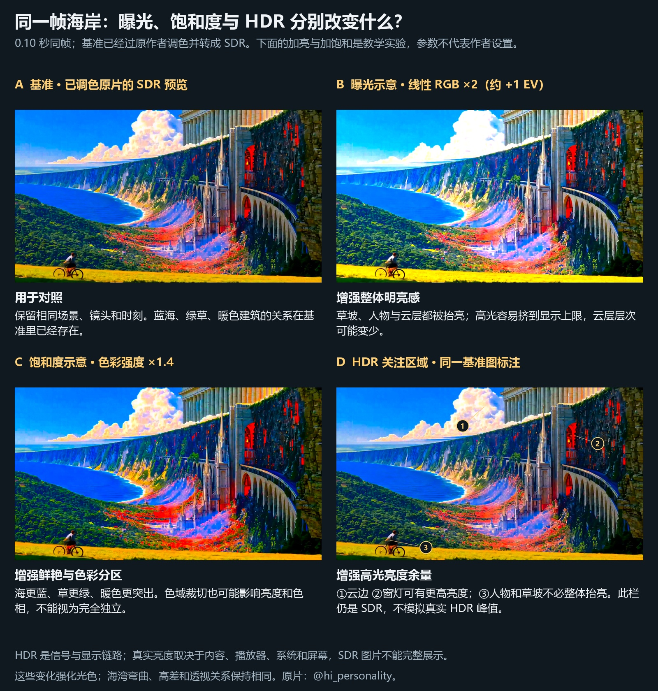
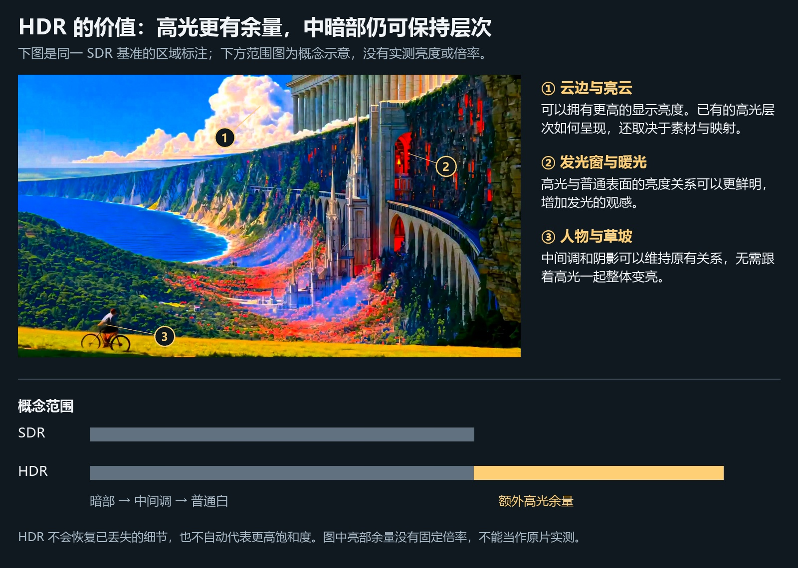

# 同一帧海岸：曝光、饱和度、HDR 与 DaVinci 调色

日期：2026-11-12（上海时间）。研究对象：[grassland special 原帖](https://x.com/hi_personality/status/2115567493565825244)的 0.10 秒抽帧。本轮只更新分析与说明图。

**曝光示意增强整体明亮感；饱和度示意增强色彩强度；HDR 为高光提供额外显示余量。它们可以共同强化画面，但承担的作用不同。**

## 1. 先说明对照图的基准

这是一张**已经经过作者调色的公开视频抽帧**，不是作者的未调色素材。我们把同一 HLG 帧转换为 SDR，再制作两个受控的教学变体。额外增益不是作者参数，也不代表原作者的前后对比。

所有版本使用同一时刻、相同完整画幅和相同场景内容。曝光与饱和度示意没有改变海岸形状、建筑、人物位置或镜头透视。

## 2. 曝光：主要改变“整体有多亮”

图 B 在同一 SDR 基准的线性 RGB 上施加 ×2 增益，作为约 +1 EV 的显示预览实验，再输出到相同的 SDR 范围。它不等于在相机 RAW 或作者 DaVinci 工程里增加一档曝光。

在这个例子里可以直接比较：

- 草坡更亮、更像强烈日照。
- 人物与建筑阴影也被抬亮，整体画面更有明亮感。
- 云层高光更容易达到输出上限，亮部区分可能变少。

**它增强的是明亮程度；能否保住层次还取决于增益施加的位置、原素材和高光处理方式。** 实际调色也可以只调整某个亮度区间或局部区域，本轮刻意用统一增益帮助看清变量。

## 3. 饱和度：主要改变“颜色有多强”

图 C 以线性 BT.709 亮度轴为参照，把各颜色偏离中性色的幅度乘以 1.4，再限制到相同输出范围。它是数学教学示意，不是 DaVinci 的饱和度算法，也不代表作者把滑杆设到了某个值。

画面里更容易看出的变化是：

- 海水的蓝、草地的绿更强烈。
- 建筑和谷地的暖色更突出。
- 冷暖区域的色彩区分更鲜明。

原片本来已经高度饱和。这个故意较强的教学增量，会让很多颜色超出当前 SDR RGB 可表示的范围，裁切后亮度和色相也可能变化。因此，图 C 同时展示了“继续推强颜色”的效果与副作用，不能理解成饱和度越高越好。

方法记录中约 70.8% 的像素在本次变换后至少有一个线性 RGB 通道超出 0–1。这是本次数学变换的越界统计，不代表 70.8% 的像素变成白色，也不是原视频质量评分。裁切前，亮度轴保持误差小于 0.000001；裁切后不再保证亮度保持。

## 4. HDR：给高光额外余量，增强亮度层次的表现空间

图 D 使用与图 A 完全相同的 SDR 基准，只标出 HDR 相关区域。我们没有把 JPEG 额外加亮后冒称真实 HDR 对比。

| 同一海岸画面中的区域 | HDR 可以支持的表现 | 不能直接推出的结论 |
|---|---|---|
| 云边与亮云 | 高光可以比普通白和主体中间调更亮。 | HDR 必然增加云层细节，或能够恢复已丢失的细节。 |
| 发光窗与暖光 | 发光区域与普通表面的亮度关系可以更鲜明。 | 作者对窗口单独用了某种具体节点或参数。 |
| 人物、草坡与建筑暗部 | 中暗部可以维持原有关系，无需随高光整体抬亮。 | HDR 播放在所有屏幕上都相同，或整幅画面一定更亮。 |

HDR 使用相应的信号、色彩管理和显示链路。HLG 是标准 HDR 信号体系之一；具体显示表现仍要结合播放器、系统、屏幕和映射。图中范围条仅说明“额外高光余量”这个概念，没有实测亮度刻度，也不表示固定的 SDR/HDR 亮度倍率。[ITU-R BT.2100](https://www.itu.int/rec/R-REC-BT.2100)

我们手中的三个 X 分发变体标记为 BT.2020 / HLG；作者也确认过 HDR 与 DaVinci 调色。这支持“作者使用 HDR、当前分发变体带 HDR 信令”的判断。本地变体解码为 8-bit AVC，未获得 HDR 母版或显示测量，不能据此声称它满足母版的全部标准要求，或推断真实峰值亮度。[作者 HDR 回复](https://x.com/hi_personality/status/2115573454628106332) · [原始核对记录](reference/author-workflow.md)

## 5. DaVinci 调色是什么

**DaVinci 调色，指用 Blackmagic Design 的 DaVinci Resolve（达芬奇）软件整理视频的亮暗、颜色和整体风格。** 常用的是它的 Color 页面。[官方 Color 说明](https://www.blackmagicdesign.com/products/davinciresolve/color)

用这张海岸画面来理解，可以分成四类工作：

| 工作 | 直观例子 |
|---|---|
| 校正与平衡 | 修正偏色，让整段视频的亮暗、白平衡保持一致。 |
| 风格调色 | 让海水偏冷、云边和窗灯偏暖，确定梦幻或写实的情绪。 |
| 局部控制 | 分别处理云、海水、人物和阴影，让注意力落在需要的位置。 |
| 色彩管理与输出 | 根据交付目标管理 SDR、HDR 和不同显示格式。 |

这些是软件可支持的工作举例，不是对作者节点图的复原。[官方调色与色彩管理培训](https://www.blackmagicdesign.com/products/davinciresolve/training)

作者公开描述的流程包含 Midjourney、通过 ComfyUI 使用其称为 `minimax h3` 的模型，以及 DaVinci Resolve 后期与调色；没有公开具体曝光、饱和度、曲线或局部调色设置。[作者制作流程回复](https://x.com/hi_personality/status/2115776938069635304)

## 6. 与上一轮空间感分析怎样接上

| 层面 | 主要增强什么 |
|---|---|
| 海湾弧线、高差、巨型建筑与小人物 | 世界的尺度、凹深和弯曲空间感。 |
| 主体行进与观看方向变化 | 接近、跟随和进入感。 |
| 曝光与亮度组织 | 整体明亮程度、主体和环境的可读性。 |
| 饱和度与冷暖调色 | 色彩强度、区域区分和情绪。 |
| HDR 信号与显示 | 高光亮度余量及其与中暗部的关系。 |

这些层面会相互影响。调色和 HDR 可以强化观看冲击，但这次同帧实验没有改变海岸几何或镜头，因此不能把它们当作弯曲地形的来源。

## 方法与可回查文件

- [方法、参数、输出哈希与局限](reference/color-study-method.json)
- [原视频与来源清单](sources.json)
- [教学图生成脚本](scripts/render_color_study.py)
- [基准 SDR 帧](assets/color-study/baseline-sdr.png)
- [曝光示意帧](assets/color-study/exposure-plus-one-ev.png)
- [饱和度示意帧](assets/color-study/saturation-1p4.png)

为保证曝光和饱和度实验使用一致的色彩解释，本轮从同一 HLG 帧解出线性 RGB，经固定 Hable 映射和 BT.709 原色转换，统一编码为带 sRGB ICC 的 PNG。基准转换与上一份 JPEG 预览的传递函数略有区别，比较应以本图内的统一基准为准。

原视频、此前抽帧和空间分析图均未改动。未安装或操作 DaVinci，未修改海边城市或实现运行时效果。
