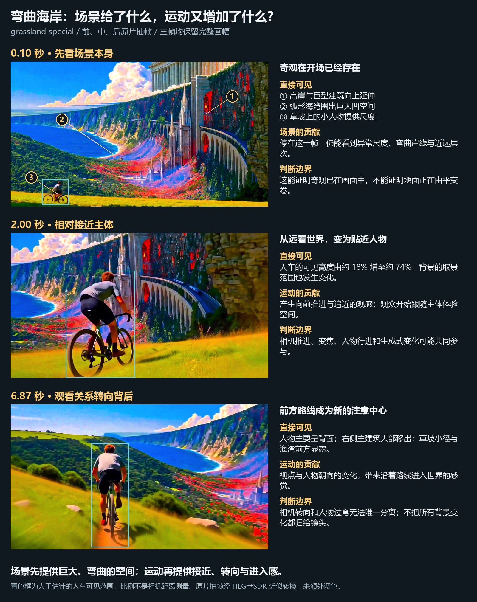
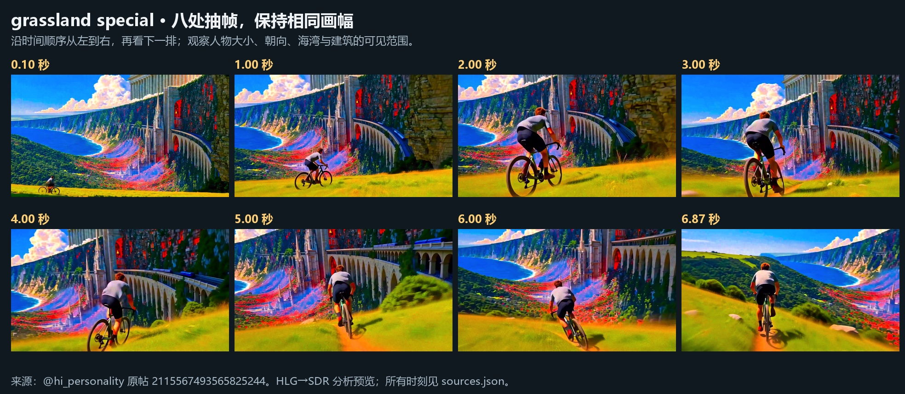

# 弯曲海岸的空间感：场景与镜头分别贡献了什么

研究对象：[grassland special 原帖](https://x.com/hi_personality/status/2115567493565825244)。日期：2026-11-12（上海时间）。本轮仅做原片分析。

光色部分另见：[同一帧的曝光、饱和度、HDR 与 DaVinci 调色说明](color-hdr-study.md)。

**前后帧支持的主要结论：巨大、弯曲的空间关系在开场就已成立；随后，相对接近主体、改变观看方向和展开前方路线，让观众产生进入这个世界的感觉。**

这里的“场景本身”指画面中已经存在的造型和空间关系，不意味着作者实际建立了一套固定三维模型。人物在画面中有多大，也受到初始取景的影响；不能把场景和构图完全分离。

## 1. 开场 0.10 秒：运动展开之前，奇观已经给了什么

这一帧能同时看到近景草坡和骑行者、中景海湾和谷地，以及远处高崖、巨墙和建筑。

| 画面里直接可见的关系 | 主要贡献 | 为什么会显得有空间感 |
|---|---|---|
| 海湾岸线从左侧远处弯向右侧谷底 | 场景形状＋取景 | 轮廓围出凹深的空间，视线能沿岸线从近处走到远处。 |
| 高崖和建筑连续向上伸展 | 场景造型 | 水平方向的海域与竖直方向的巨墙形成明显高差。 |
| 大建筑与很小的人车同时出现 | 相对尺度＋初始构图 | 熟悉的人车尺寸提供参照，建筑和海湾因此显得巨大。 |
| 草坡、谷地、海面与远崖相互遮挡 | 场景布局＋视点 | 观众能够辨认前后层次，不只是看到一张无层次的色彩背景。 |

暂停在开场，以上关系仍然可读。因此，空间奇观不依赖后续镜头运动才出现。

“弯曲海岸”在这里是对画面观感的称呼：弧形海湾、高崖与沿崖建筑共同形成近似巨大碗状空间。我们没有看到先是普通平地、再逐渐卷成墙的完整过程，也没有测量到真实地形曲率。

## 2. 0.10 → 2.00 秒：相对接近，让观看关系发生变化

开场人车很小，接近侧面；到 2 秒，人车占据了画面很大一部分，视角接近侧后方，建筑、拱廊和海湾的取景范围也与开场不同。

为便于对比，图中用青色框标出了人工估计的人车可见范围：

| 时间 | 可见人车包络框高度 | 占 1080 像素画面高度的比例 |
|---|---:|---:|
| 0.10 秒 | 约 192 像素 | 约 18% |
| 2.00 秒 | 约 798 像素 | 约 74% |
| 6.87 秒 | 约 775 像素 | 约 72% |

这些是人工框选的近似值，不是精确跟踪数据。2 秒包络框触及下沿，骑行姿态、车身朝向和可见范围也会影响数值；不能据此换算出相机距离、焦距或人物真实速度。

### 这一变化增加了什么

- **接近感：** 观看者从远处看一个人在风景里移动，转向近距离跟随他的动作。
- **尺度转换：** 巨大环境仍在，人物却变得可触及，抽象的“大世界”开始与身体尺度发生联系。
- **运动预期：** 主体持续行进，观众开始关心接下来会经过哪里。

画面呈现出推近和追近的观感。它可能由相机前移、变焦、人物接近、姿态变化及生成式画面变化共同产生。由于没有相机或场景数据，本轮不把其中任何一个解释确定为唯一原因。

## 3. 2.00 → 6.87 秒：从侧后方转向背后，空间变成可进入的路线

到后段，人物主要呈背面；开场右侧的大建筑大部移到取景边缘之外；前方草坡、小径和海湾方向更清楚，对岸高崖仍可辨认。

### 这一变化增加了什么

- **前进方向更明确：** 人物朝向与前方小径形成联系，视线更容易沿路线继续向前。
- **新区域被显露：** 原先被主体或画面边缘挡住的草坡与海湾区域进入视野，世界呈现出可继续探索的范围。
- **参与感：** 观看位置接近人物背后，更像跟着他走进空间。

这些变化支持“视点调整和主体行进共同展开空间”的解释。人物过弯也会改变我们看到的身体方向，因此不能只凭侧面变背面就断言相机绕人物转了某个固定角度。背景中的细节也可能包含生成式形变，不能全部当作刚性三维场景的真实视差。

## 4. 八处抽帧的连续核对

| 时段 | 直接观察 | 可提出的镜头语言解释 | 仍不能确定的内容 |
|---|---|---|---|
| 0.10 → 1.00 秒 | 人车由左下小主体变为较大的侧面主体，建筑取景也改变。 | 开场展示世界，随后开始接近主体。 | 相机前移、主体接近与变焦各占多少。 |
| 1.00 → 2.00 秒 | 主体进一步变大、姿态起伏，侧后观看关系增强。 | 追近并建立身体尺度。 | 姿态、透视和生成式变化的独立贡献。 |
| 2.00 → 4.00 秒 | 主体位置、朝向和可见建筑关系持续变化。 | 跟随行进，并调整观看方向。 | 唯一的相机路径、速度和侧倾角。 |
| 4.00 → 6.00 秒 | 人物沿草坡前进，小径与新的草坡区域显露，主体大小有变化。 | 跟拍中带有距离和取景节奏。 | 背景是否保持精确的三维几何一致性。 |
| 6.00 → 6.87 秒 | 观看关系更接近正后方，海湾前方打开，主建筑大部退出。 | 将注意力交给前进路线，形成进入感。 | 相机转向、人物过弯和画面形变能否分离。 |

主体大小并非始终单调增加，不能把全片简单理解为一个持续匀速的推近。

## 5. 最后怎样区分“来自场景”与“来自镜头”

| 效果 | 当前最稳妥的归属 | 证据强度 |
|---|---|---|
| 岸线弯曲、海湾凹深、崖壁和巨型建筑 | 静态造型与初始构图 | 高：0.10 秒即可直接看见。 |
| 世界显得巨大 | 场景相对尺度＋人物大小＋取景 | 高：大小关系可见；真实尺寸未知。 |
| 由远看转为贴近人物 | 相对运动与取景变化 | 高：前后帧可见；具体运动方式未知。 |
| 从侧面观看转为背后跟随 | 视点与人物朝向共同变化 | 高：观看关系可见；相机和人物的贡献不能唯一分离。 |
| 沿路线进入世界 | 上述运动与场景共同产生的体验 | 中：属于视觉机制解释。 |
| 地面在播放中从平地卷起 | 尚无充分证据 | 未确认：不能用岸线本来就弯曲来证明。 |
| 所有变化都来自一台真实相机在固定三维城里运动 | 尚无充分证据 | 未确认：存在生成式形变的可能。 |

## 6. 对海边城市研究的具体价值

这段原片可以给我们两组分开的视觉参照：

1. **静态空间参照：** 单帧是否能读出海湾凹深、竖直尺度、近远层次与小主体的尺寸关系。
2. **时间展开参照：** 前后画面是否让人感到逐渐接近主体、看见新的空间，并明确前进方向。

它们可以分别讨论。先选什么样的空间，再讨论观看者怎样进入它，会比直接把“弯曲海岸”当作一个技术特效名称更容易沟通。

本轮没有确定海边城市的场景造型、相机路线或实现方法，等待用户讨论后再决定研究的下一步。

## 素材与方法

- 使用既有的完整公开原片变体和 8 处抽帧，本轮未重新下载或更新社交数据。
- 图中各帧均保留完整 16:9 画幅，仅等比例缩放与添加分析标注，没有单独裁切或重新调色。
- HLG→SDR 近似预览的转换方法沿用此前记录；这次分析集中于空间和运动，不比较峰值亮度。
- [来源与哈希](sources.json) · [人工观察与包络框记录](reference/grassland-frame-observations.json) · [图解生成脚本](scripts/render_grassland_study.py)
