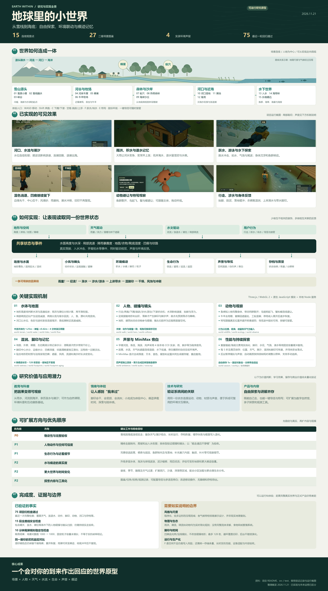

# 028 · 地球里的小世界 · 连续生态世界与痕迹记忆研究

研究怎样以小岚为中心，把雪山、河谷、森林、河口与海底接成可自由行走的世界，让天气、水流、动物、声音和足迹共同回应人的行动。15个观察点、27幕图鉴、雨洪潮汐、游泳跃水、干湿脚印与MiniMax导览构成可操作原型；沉淀共享状态、触地事件、环境记忆和连续导览的复用方法，服务自然科普、数字展陈与探索体验。流体和生态为简化模型，动作真实度、长时性能与学习/商业收益仍需验证。

[在线研究与引导图](https://yydshly.github.io/20261104_codex_project/028-earth-within/) · [自由探索](https://yydshly.github.io/20261104_codex_project/028-earth-within/play.html#walk) · [海岸脚印](https://yydshly.github.io/20261104_codex_project/028-earth-within/play.html?shore=footprints&tide=ebb#walk) · [二维图鉴](https://yydshly.github.io/20261104_codex_project/028-earth-within/atlas.html)

## 我们研究的方向与理解

### 先构建世界，再组织元素

场景之间需要地势、水源、河道和岸线解释；蜂巢与蚁穴也要依附于可抵达、可观察的具体地方。地理与气候尺度经过压缩，目的是串联体验。

### 以小岚建立体验中心

用户能走、跑、蹲、跳、涉水、游泳和下潜。导览沿途行进，讲解时仍可转动镜头，按键接管；动作、碰撞和声音要对应同一次行为。

### 环境响应比元素数量更重要

雨不仅是粒子：它改变水流、浑浊度、水位、积水、动物和声景。水流也不只是贴图：它影响游速、鱼群、漂叶与绕流。

### 脚印是环境记忆，也是情绪点

带水上岸的脚印逐步变浅，湿色消退后仍有凹痕。风、雨和潮水改变“我来过”的证据，使时间和陪伴感有可见载体。

## 本轮引导图

4000 × 7200，沿用本轮生成的原始 PNG，未重新绘制或替换。SHA-256：`1b18700c91af506a8b204c15bcd2a36589b5d78d357d57bf6e758410716ef152`。同时保留 SVG 矢量版。图中的本机磁盘提示属于制作环境记录，线上访问不依赖该磁盘。

## 已实现的效果

### 连续世界与微观观察

从雪线沿同一条河走到海边，再下潜到海带林和礁石。蜂巢、蚁穴、蟹等支持近看；特写可环视并避开前景遮挡。 [体验](https://yydshly.github.io/20261104_codex_project/028-earth-within/play.html#overview)

### 雨洪、退水与泥泞

雨大时河流变急、变浑并逐渐涨水，浅滩被淹；停雨后缓慢退水，保留湿泥、泥沙、积水和最高水位痕。动物会避雨。 [体验](https://yydshly.github.io/20261104_codex_project/028-earth-within/play.html?weather=after-rain#walk)

### 潮汐、回流与顺逆流

涨潮推向河口，退潮加快出海；岩石和树干周围分流、减速与回水。人物、鱼群、漂叶共用简化流场。 [体验](https://yydshly.github.io/20261104_codex_project/028-earth-within/play.html?tide=flood#estuary)

### 跃水、戏水与湿润

安全水深与路径允许时向前跃水；入水冲击、拍水、游泳尾波和水下气泡由动作触发。衣裤靴分区浸湿，出水滴水。 [体验](https://yydshly.github.io/20261104_codex_project/028-earth-within/play.html?water=play&tide=ebb#walk)

### 脚印干燥与痕迹记忆

真实落脚留下左右靴底印；边缘先干、中心后干，干后凹痕继续保留。风填砂、雨磨钝、潮水冲刷；完全洗平后不会复现。 [体验](https://yydshly.github.io/20261104_codex_project/028-earth-within/play.html?shore=footprints&tide=ebb#walk)

### 动物避让与水下世界

鱼感知人物完整身体并带动同群散开；鸟提前起飞、蟹和蝶连续避让，离开后恢复。海草、海星和海葵构成水下层次。 [体验](https://yydshly.github.io/20261104_codex_project/028-earth-within/play.html#dive)

### 人物运动与镜头

小岚转向、跑蹲跳、抬脚涉水、拔脚踩泥和屈膝落地；木屋、台阶、岩石与动态动物参与碰撞，跟随/导览/特写镜头扫掠避障。 [体验](https://yydshly.github.io/20261104_codex_project/028-earth-within/play.html#walk)

### 近看一个地方

观察主体不再只是一幅远景；特写跟随真实位置，能拖动、缩放并避开挡住主体的物体。先感受地方，再解释具体元素。 [体验](https://yydshly.github.io/20261104_codex_project/028-earth-within/play.html#tide)

## 世界范围与路线

雪原小屋 → 雪线融水 → 峡谷 → 河岸木屋 → 蜂巢 → 牛羊牧场 → 蚁穴 → 热带森林 → 海岸沙丘 → 河口湿地 → 潮池 → 海湾 → 入水 → 海带林 → 外侧礁石。

世界包含融水槽与源头水池、峡谷、木屋与燕巢、牛羊、蜂巢、地下蚁穴、棕榈/大叶植物/蕨叶、芦苇湿地、沙丘、潮池蟹、海草/海带、鱼群、海星、海葵和外侧礁石。此前的27幕二维场景图鉴另保留入口。

WASD移动、Shift奔跑、C下蹲/下潜、空格跳跃/上浮、F跃水/戏水/拨水、E特写，鼠标环视。导览连续行进，到站讲解，讲解时可看四周；按键接管后能返回继续。

## 如何实现

### 共享世界状态

地形高度与材质、雨量与遮蔽、径流与潮位共同给出水深、流速和湿度。人物、动物、材质、声音读取相同结果，减少彼此矛盾。

对应模块：`world.js / world-terrain / world-weather / world-tides`。

### 水文与局部绕流

低岸连通与地形决定淹没；雨洪与潮位分开计算。障碍物的迎流减速、两侧分流和背水回流用局部近似叠加，人、鱼和漂叶共用。

对应模块：`world-water / world-flow / world-drainage / world-puddles`。

### 人物状态与真实触地

行走、涉水、游泳、下潜和动作切换跟随水深；靴底接触、落地、拍水和入水事件同时触发粒子、脚印、声音与鱼群响应。

对应模块：`world-walk / world-hero / world-water-actions / world-collision`。

### 独立演化的环境记忆

地面、衣裤与左右靴底分别存水；脚印中心水分、边缘水分、凹痕深度、纹路清晰度独立计算，风雨与淹水时长改变结果。

对应模块：`world-ground-memory / world-wetness / world-footprints / world-footprint-aging`。

### 声音与可接管导览

4段CC0实录分别混合平缓河流、急流、海浪与风。距离、天气与遮蔽连续改变音量和滤波；水下低通，旁白压低环境声。15站MiniMax录音随公开版发布。

对应模块：`world-ambience / world-audio / world-guide / voice.mjs`。

### 有边界的运行开销

重复元素实例化，脚印和粒子固定容量复用；每5秒和离页保存，恢复检查安全位置。后台暂停，自动画质按持续帧耗时调节分辨率。

对应模块：`world-session / world.js / 各效果缓冲模块`。

## 研究价值

### 自然科普与环境理解

把“下雨—涨水—动物避雨—退水留痕”的关系变成可亲历的观察，而不只是知识说明。可用于自然课堂、亲子探索与数字展陈。

### 情绪、时间与陪伴

人物建立中心，足迹证明到来，痕迹的干燥和消失让时间被看见。可继续研究人的探索动机、陪伴感与地方记忆。

### 模块复用与原型研发

共享状态、触地事件、近看镜头、可接管导览、音频缓存和快照恢复可被拆出，用于别的互动世界与教学原型。

### 内容与产品探索

自由探索、讲解、图鉴和可配置观察点能组合成不同内容载体。学习效果、长期使用、效率节约、付费和商业收益尚未测量。

## 下一步与验收方向

| 优先级 | 方向 | 工作与目标 |
| --- | --- | --- |
| P0 | 稳定性与全路线验收 | 复杂天气/潮位组合、长时实机运行、恢复存档、音频失败和写入退化；保证雪线到海底确实能连续走通。 |
| P1 | 动作、碰撞与镜头 | 精修走跑转向、坡地与出入水衔接；按人物/动物体型复核碰撞，在不同视角验证避障。 |
| P1 | 生态行为与可观察细节 | 完善惊逃与返回、鱼群转向、鸟落地及巢穴内部；把可近看的地方做具体，而不单纯增加数量。 |
| P2 | 水、泥沙与地表真实度 | 多层水体、泡沫、岸线浪与泥沙输移；评估可变形地表和更大痕迹容量的表现价值与性能代价。 |
| P2 | 更大世界与时间变化 | 昼夜、季节、融雪、天气过渡；扩展洞穴、沙漠和深海，配合分区加载与合理生态分布。 |
| P2 | 探索工具与内容 | 图鉴任务、拍照、观测记录、多语言旁白、移动操作、无障碍及存档导出；先通过真实使用再扩充。 |

## 已验证事实与完成边界

最近一轮原始世界回归为75项通过。既有10分钟离屏模拟共6000帧，场景对象数1000→1000，粒子固定容量未增长；这不等于实机恒定帧率。发布检查另验证子目录资源、引导图哈希、15段MP3、15站文本和公开文件。浏览器实走与媒体检查记录在 `verification/`。

- 这是低多边形、程序化的压缩流域。雪原与热带等相邻是展示设计，不是现实地理与气候带复刻。
- 潮汐演示约±0.42米、4分钟一周期，中游雨洪最大涨幅约1.25米；水文和绕流是简化规则，没有完整流体求解。
- 动物采用感知、避让、避雨和恢复规则；没有完整食物网、繁殖、迁徙和季节生态。
- 脚印通过材质、光照与法线呈现凹痕，不改变行走碰撞地形；固定128枚循环覆盖旧印，后台和离线不继续演化。
- 已有75项世界回归检查及一次10分钟离屏模拟记录；对象数1000→1000不代表实机恒定帧率，动作与全路线仍应继续实走验收。
- 公开静态版复用15段已生成MiniMax旁白，不提供在线改文后实时合成。原始本地服务保留持久缓存；密钥与原始缓存容器不发布。
- 本地存档跟随当前浏览器与域名，不跨设备同步。物理手机、触屏长时体验及跨浏览器性能尚未完成系统验收。

## 发布、源码与音频复用

公开网页从GitHub Pages的main分支`docs/028-earth-within/`发布。`index.html`为研究页、`play.html`为3D世界、`atlas.html`为二维图鉴。浏览器需支持WebGL 2；首次点击后解锁声音。

本项目的 `source/` 保存原始本地服务、完整src、测试、制作脚本、package-lock与环境模板；不包含node_modules、.env、个人存档、原始录音临时文件或MiniMax缓存容器。安装依赖后在source中执行`npm start`可运行本地原版，`npm run test:world`运行世界回归。

公开版15段MiniMax旁白从已有缓存离线导出，每段先校验EWVOICE1容器、音频长度与SHA-256；没有调用API重新合成。`assets/narration/manifest.json`保留文本和音频校验值。网站直接播放静态MP3，不提供在线改文实时合成。旁白字幕与录音按站点一一对应。

四段环境实录为平缓河流、急流、海浪与风声，来源Freesound CC0，作者与处理参数见[source/assets/audio/SOURCES.md](https://github.com/yydshly/20261104_codex_project/blob/main/projects/028-earth-within/source/assets/audio/SOURCES.md)。雨点、脚步、蜂鸣和气泡等仍由程序合成。Three.js与OrbitControls为MIT，公开版附完整许可。

发布：`cd source && npm ci`，回到本目录执行`npm run publish`、`npm run verify`、`npm run preview`。构建从已导出的音频和源码生成静态目录；不需要读取密钥，也不重新合成语音。`export-narration.mjs <原始本地项目目录>`仅用于在已有缓存更新后离线重新导出。

原始研究与公开整理截至2026-11-21。应用潜力不等于已经验证的学习成效、长期情绪效果、节省工时或商业收入。

[返回总库](../../README.md#研究索引)
