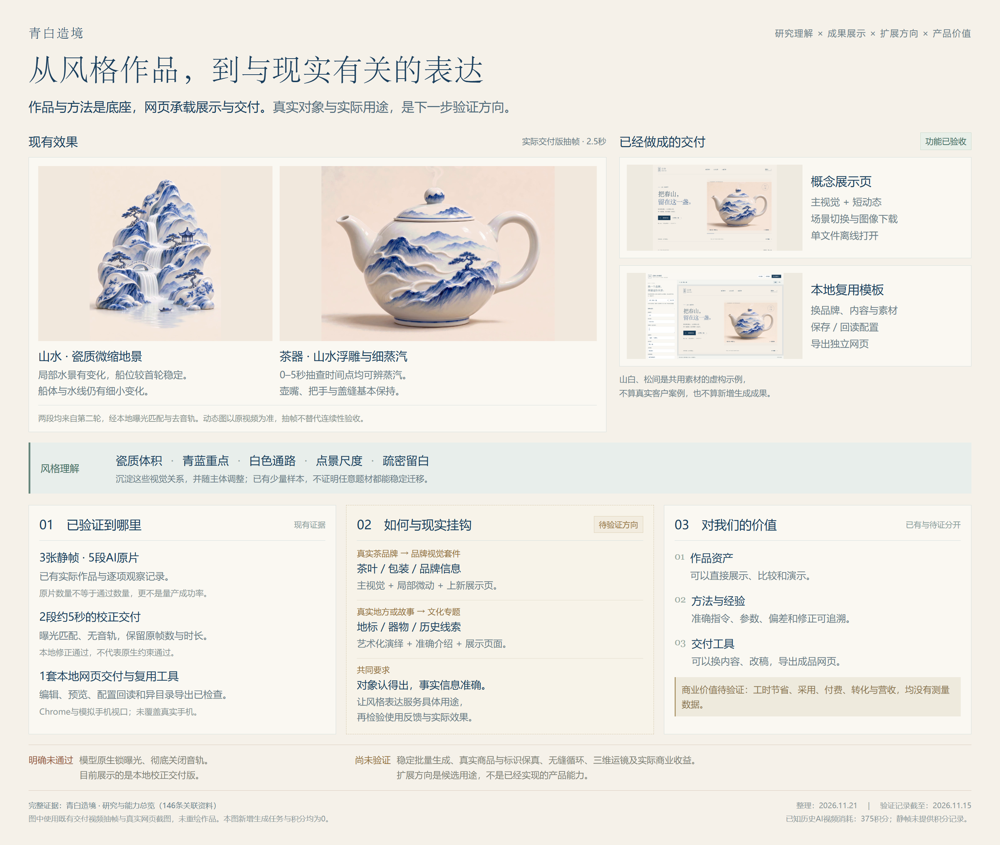

# 029 · 青白造境：风格作品、网页交付与现实应用研究

**从青花山水参考出发，研究一种视觉表达怎样沉淀为可展示的作品、可追溯的制作方法和可复用的网页交付，再讨论与真实产品、地方及文化故事结合的用途。** 我们关注瓷质体积、青蓝重点、白色通路、点景尺度与疏密留白的关系，而不只记录蓝白配色或一条提示词。

三题材静帧、三轮五段AI原片、两段约5秒的曝光校正版、概念展示页和本地模板，已经形成可看的作品与可操作交付。价值在作品资产、准确指令和失败经验，以及能换内容、改稿、保存配置并导出网页的工具；稳定复现、真实商品保真、实际客户采用、工时节省与商业收益均没有因此得到证明。

[在线研究总览](https://yydshly.github.io/20261104_codex_project/029-blue-white-relief/) · [现有效果](https://yydshly.github.io/20261104_codex_project/029-blue-white-relief/#results) · [能力与边界](https://yydshly.github.io/20261104_codex_project/029-blue-white-relief/#capabilities) · [山白展示样板](https://yydshly.github.io/20261104_codex_project/029-blue-white-relief/tea/) · [模板编辑器](https://yydshly.github.io/20261104_codex_project/029-blue-white-relief/tea/studio.html) · [返回研究总库](https://github.com/yydshly/20261104_codex_project#研究索引)

## 我们的理解与已有引导图

**作品与方法是底座，网页承载展示与交付；真实对象与实际用途，是下一步验证方向。** 现实对象应当仍可识别，事实信息应准确，风格化画面承担表达与氛围，再由实际使用反馈检验是否有用。

沿用2026-11-21已经生成的2800×2366原图，不重画、不裁换内容。它由已有交付视频抽帧与真实网页截图排版，图中不是新视频、真实客户或新增商品案例。SHA-256：`1a7d847c656621b2559d85787420c32c48cc624b10f40bdc4f8d8fa1c14c9b63`。图内146条资料是此前本地快照，公开版索引另计，并明确标示来源链接、已验收、未通过和未验证。

## 研究方向与视觉原理

1. **瓷质承载形体：** 让圆润体积、结构转折、柔和高光与接触阴影共同成立，避免只是给平面图染蓝。
2. **白色通路连接层次：** 山水可用瀑布、水面串联高差；换主体时需要重设通路，并保留器物或植物自身结构。
3. **暖白承托青蓝：** 深蓝聚焦、淡蓝组织远近，大面积低细节区域参与构图。作者配色图不是本次实测的像素比例。
4. **点景建立尺度：** 亭桥、松树、小舟提供大小关系；不把同一组道具机械搬到每个主体。
5. **疏密组织视线：** 层叠体块、开阔水面和外围留白交替，控制装饰密度与观看节奏。

这些是对参考的观察与提炼，不是原作者逐字提示词或原始制作步骤。源帖为[Zidan子丹的青花山水](https://x.com/liluocheng13/status/2121285407824572635)。作者标注静图使用Gemini、视频使用Grok Imagine；具体版本、参考输入与生成参数未知。

## 已做出的作品与三轮发现

| 阶段 | 实际执行与效果 | 范围与问题 |
| --- | --- | --- |
| 静帧与程序预演 | 山水、茶器、莲花各一个文字生成静帧；三支程序叠加的微动预演 | 未把原作图片传入ImageGen，版本和种子未知；程序预演不是AI视频 |
| 第一轮AI视频 | 山水、茶器各一段，Seedance 2.0首帧模式，实际合计150积分 | 山水船位漂移、雾区外溢；茶器约3秒仍有细丝、4–5秒难辨；开场变暗，脚本实际sound=1 |
| 第二轮定向修正 | 沿用同一输入图，约束船位与雾区，要求持续供汽，实际合计150积分 | 船位较稳但外观、水线仍有变化；茶器覆盖0–5秒的25个抽查时间点可见蒸汽。sound=0后原片仍有非零音轨，曝光仍下降 |
| 第三轮路径探针 | 只做茶器，改用单图参考与JSON布尔sound=false，实际75积分 | 片内亮度波动减小，但整体仍偏暗且有音轨；未通过原片门槛，按确认条件没有提交山水 |
| 本地校正交付 | 第二轮两段完成曝光匹配和去音轨，完整解码；121帧、24fps、约5.04秒 | 属于后处理，不让原生曝光或无声验收变为通过；只验证这两段 |

两段校正视频各有10个选定背景与结构区域，包含未参与拟合的留出区域；最大全段亮度波动约为山水3.16%、茶器2.95%。这不是全画面曝光真值，船区也仍有细小变化。严格瀑布流向和水体物理没有仅凭抽帧判定通过。

三轮AI视频实际累计375积分。静帧没有提供积分记录，不记为0；网页、模板、后处理和本次公开整理没有新增生成积分。每题材每轮样本很少，参数修改与随机性同时存在，不能计算稳定成功率或独立归因。

## 网页与模板实现了什么

- **统一研究入口：** 播放当前交付、切换验证轮次、筛选能力状态、搜索素材与证据、阅读公开原文，查看相关页面。
- **山白概念展示：** 主视觉、茶器升汽、山水动态、三种茶席时刻、影像弹窗与图像下载。
- **本地模板编辑器：** 修改品牌、文案、配色，替换本地图片和视频，保存与导入配置，导出可独立打开的HTML。
- **可选商品区：** 默认隐藏。输入商品名称和图片后才能启用；商品或咨询链接由使用者填写，没有支付、订单或在线商店后端。

山白与松间为复用同一批素材的虚构示例，不是两家客户或两套新生成作品。验收商品也有明确测试标记，不能代替真实茶叶、包装与标识保真验证。浏览器记录来自隔离Chrome和390px模拟手机视口，未覆盖真实手机或所有浏览器。

## 实际适用用途与对我们的价值

| 已有资产或功能 | 可支持的用途 | 已落地的价值与未测量项 |
| --- | --- | --- |
| 作品、原片与对照 | 内部提案、风格评审、作品展示与概念演示 | 可以直接看、比较与讨论；没有观众偏好或传播效果数据 |
| 准确指令、参数与失败记录 | 相近任务的创作准备、偏差定位、返修与复核 | 经验可以回查，不再只保存一张成图；没有稳定成功率或独立因果证据 |
| 网页与配置模板 | 同结构页面换品牌、换内容、改稿与交付 | 编辑、配置回读与导出已经实际跑通；节省多少工时和每个新项目成本多少尚未测量 |

目前可以确认它是一套创作与交付资产。是否减少沟通、是否被真实客户采用或付费、是否提高转化，仍需实际用途与测量，不能用页面完成代替商业验证。

## 与现实世界结合的扩展方向

- **真实茶品牌 → 品牌视觉套件：** 结合真实茶叶、包装、品牌信息，形成主视觉、局部微动和上新展示页。需要单独验证商品身份、包装和文字标识。
- **真实地方、器物或文化故事 → 专题展示：** 从可识别的地标、器物形制和历史线索出发，做艺术化演绎并配上准确介绍。不能把风格化画面当作写实考据。
- **内部创作与研究资产 → 按任务复用：** 将视觉规则、样本、制作记录与验收边界组织成可调用资料，继续检验复用质量与维护投入。

这些均为候选方向。稳定批量、任意风格迁移、真实商品保真、无缝循环、三维运镜、真实客户和商业收益没有计入已具备能力；模型原生锁曝光与彻底关闭音轨在本次试验中明确未通过。

## 公开范围、运行与复现

公开包包括本研究自制静帧、程序预演、五段AI原片、派生交付、准确指令、验证摘要、页面与模板源码。原帖图片和视频保留在本地归档，公开版保留作者链接与观察，不再次分发原帖媒体。私有任务状态、认证信息、临时验收商品、完整本机路径和工具包全文不作为公开成品。详见[公开范围说明](PUBLICATION.md)。

`docs/029-blue-white-relief/` 是Pages入口与主要播放素材；`projects/029-blue-white-relief/materials/` 是同仓库的证据原件及发布时转换路径的文本快照。较大的辅助材料由同一仓库的raw地址提供，页面正文证据也有快照可读。引导图和本次自制媒体按原字节复制，文字快照若转换了本机路径，会记录原件和公开文件的不同哈希。

在仓库根目录运行 `python projects/029-blue-white-relief/publish.py` 可重建研究入口与详细素材页。首次从完整本地研究刷新时，使用 `--refresh-local --source-root <本地研究工作区>`；该步骤不提交AI任务。原本独立的展示页和编辑器保持对应功能；编辑器导出的网页仍内嵌素材，支持离线交付。

历史素材与验收主要形成于2026-11-15；引导图与公开整理日期为2026-11-21。`publication-manifest.json`记录公开运行文件与引导图哈希；`verification/`记录本轮发布检查，不把旧浏览器记录冒充新一轮生成或商业验证。
