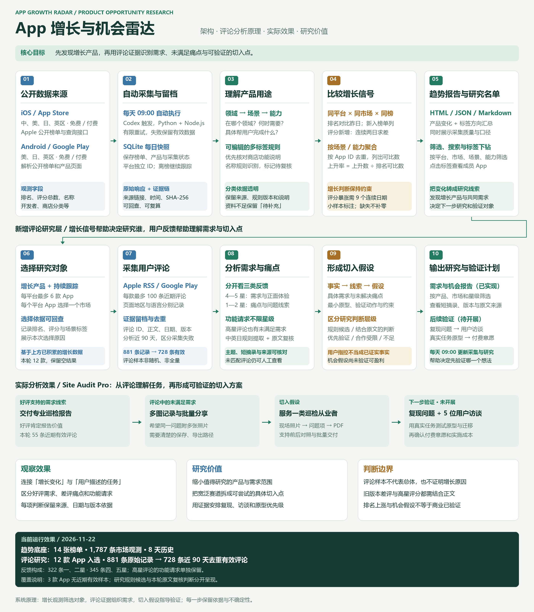

# 035 · App增长与产品机会研究

研究方向是：**从移动App商店的连续变化中选择研究对象，再通过用户评论理解具体需求、尚未满足的痛点和功能请求，形成可以复现、访谈和制作原型验证的产品切入假设。**

目前实现了公开信息获取、历史快照、透明标签、同条件增长比较、评论采样与证据归类，以及结合本轮原文的研究判断。实际用户访谈、当前版本问题复现、替代产品原型、收费与盈利验证尚未开展。

[在线研究与引导图](https://yydshly.github.io/20261104_codex_project/035-app-opportunity-radar/) · [评论研究固定快照](https://yydshly.github.io/20261104_codex_project/035-app-opportunity-radar/report/index.html#research) · [产品与标签快照](https://yydshly.github.io/20261104_codex_project/035-app-opportunity-radar/report/index.html) · [返回研究总库](https://github.com/yydshly/20261104_codex_project)

## 研究起点与问题

讨论从[Stringers公开帖子](https://x.com/stringers_cn/status/2121445525006524627)开始。本系统为自主实践，没有接入原作者的内部系统或第三方付费下载、收入数据。

我们希望弄清：哪些产品在增长，哪些具体场景与核心能力有共同信号；用户为什么使用它们；增长产品仍有哪些任务障碍；哪些问题适合小范围软件原型，哪些依赖支付、品牌、补贴、物流或客服资源；什么证据足以安排下一步验证。

**目前的核心数据范围仍是App Store和Google Play。** 评论研究扩展了分析深度，尚未扩展为Web、桌面、浏览器插件等全形态产品情报，也没有证明增长的因果关系。

## 已有引导图



直接复用用户指定的`app-growth-radar-overview-20261122-research-v2.png`，2800×3210；不重新生成、重排或压缩。公开包保留同版SVG，发布脚本核对原始PNG、SVG字节及SHA-256；精确哈希见`docs/035-app-opportunity-radar/publication-manifest.json`。

图上层是已运行的商店趋势底座，下层是新增评论研究。后续复现、访谈、原型和付费意愿测试明确标记待开展，不能把架构中的目标步骤当作已经完成的商业验证。

## 信息获取与保存

| 信息 | 来源与范围 | 保存与使用方式 |
| --- | --- | --- |
| iOS榜单 | Apple公开RSS，中国、美国、日本、英国，免费/付费各最多100条 | 保存榜单成员、名次、来源更新时间与本地观测时间 |
| iOS产品资料 | Apple Lookup公开接口 | 名称、开发者、类别、评分总数及商店链接 |
| 安卓榜单与产品 | google-play-scraper 10.1.2解析Google Play，美国、日本、英国 | 平台独立ID，以`play:`包名前缀区分；解析失效记录错误 |
| Apple评论 | 公开customerreviews RSS，按最新排序，当前每App最多2页/100条 | 正文、星级、日期、版本、评论ID、来源与原始响应 |
| Google评论 | 锁定版本解析器的NEWEST接口，按市场与语言请求，最多100条 | 地区/语言不保证作者来自该国；文字评论数量不同于评分总数 |

本机Codex任务每天北京时间09:00触发Python与Node.js采集。SQLite保存每日增长快照、研究运行、评论观测和请求状态；原始响应保留来源、观测时间和SHA-256。请求使用正常TLS验证、节流和有限重试，不使用私人账号或付费情报服务。离榜产品默认继续跟踪30天，当前每平台每市场有刷新上限，超过上限会记录覆盖缺口。

同日成功数据不能被后续失败覆盖；空评论、无近期样本、网络/解析错误分开记录。评论ID和重复正文用于去重，编辑保留逐日观测。完整数据库、完整评论与原始响应继续留在本地，公开版只使用必要的产品元数据、研究摘要、短摘录、日期版本和来源。

## 分析逻辑与原理

### 从领域到具体任务

领域回答“属于什么产品”，场景回答“什么时候需要”，能力回答“具体完成什么”。例如Site Audit Pro从“工作效率”细化为“现场巡检与验收”，能力为拍照记录、图片标注、问题指派及PDF报告生成。

标签采用App ID指定的商店说明核对项与可编辑名称规则，保留来源、日期、规则ID、版本及限制说明。一个产品可以有多个标签；宽泛商店分类不自动推断核心能力，资料不足保留待补充。商店说明核对代表核对开发者声明，尚不代表逐款实测功能。

### 在同条件下比较增长

- 排名只与昨日同平台、同市场、同榜单的成功观测比较；缺失不补零，不用多日增量冒充单日增长。
- 新入榜要求昨日完整榜单、今日成功榜单，首次收录不等于新上架或突然增长。
- 新增评分来自连续两日总数差，评分数回退留空；评分暴涨需要9个连续日期，且当天新增至少20、达到前7天日均3倍、基线为正。
- 按场景和能力在同平台同市场聚合；每个标签内按App ID去重。上升率=排名上升产品数/连续两日同榜排名可比产品数，新入榜另列；多标签分组不可相加，小于5个样本标记小样本。
- Google评分可能全球汇总，不能跨地区相加为新增用户；排名、评分不能换算下载量、活跃或收入。

### 从评论证据到需求与切入假设

首版每平台选择最多6款有增长信号或持续跟踪的App，同一平台App只选一个市场。选择原因与增长记录保留，分析近90天的可验证日期评论。样本不是全量或随机抽样，不从样本差评比例推算总体不满意率。

四、五星评论用于理解需求与正面体验，一、二星评论用于痛点线索；**明确功能请求从所有星级独立提取**。星级可能与正文矛盾，未匹配低星评论也保留供查看，不把低星数量当作已确认痛点数量。

`research_rules.json`维护中英日主题、局部排除词、最小原型、验证动作与约束。规则只能形成可解释、待复核的候选，不是完整语义理解；每个主题至少有两条ID和正文不同的反馈才生成机会假设。

本轮另逐条阅读若干原文，形成4条研究判断，保存在按日期命名的研究记录中。判断必须引用本次同App、同市场的有效评论ID，不能用错平台、地区或过期证据。规则候选与原文研究判断在网页中分开，用户指控不当作已证实事实，旧版本差评不当成当前版本已确认缺陷。

## 本轮实际效果与评论引导的发现

截至**2026-11-22**，已有8天增长观测，14张当日榜单均取得数据，1,787条市场观测、1,735条可比较；938条已标注场景和能力，其余849条仍待补充。日本、英国付费榜和部分详情存在来源覆盖缺口，报告逐项标注，没有为补齐数量重跑整轮或造数据。

本轮入选12款App，保存881条原始评论观测；按90天和重复正文处理后，有效728条，其中一、二星322条、四五星345条、三星61条。9款有近期有效评论；Subwhere AR未取得评论，PewPewPew及WikiCamps Australia取回的评论不在当前分析窗口，不能解释为这些产品没有用户或没有痛点。

| 对象 | 本轮证据与理解 | 切入判断及验证约束 |
| --- | --- | --- |
| Site Audit Pro，美国安卓 | 55条近期有效评论。好评肯定专业报告；高星评论仍请求一项问题多张照片、整改前后对照与批量分享；低星评论提到图片操作、报告查找、保存位置和新版流程障碍 | 优先访谈电工、装修验收或小型巡检团队中的一种人群。最小原型为“现场照片→问题项→多图对照→PDF→批量交付”。先复现当前版本，再验证真实任务完成和迁移、付费意愿 |
| iAEON，日本安卓 | 正面反馈看重购物优惠；负面反馈提到结账排队时启动、出码慢及逐张选择优惠券；高星用户也提出更直接的优惠开关 | 研究结账准备与优惠选择流程，先做交互原型。有商家和系统合作条件时再考虑组件；不能把需求线索当作独立App可替代官方钱包的依据 |
| Reco Social，美国iOS | 样本中的正面体验多次提到奖励，部分差评声称注册奖励、任务进度、提现条件和到账不符合预期 | 先核实宣传、条件、追踪与兑现链路。可研究条件透明和证据留痕，暂不优先复制补贴模式；评论不构成欺诈事实认定，也不能把增长直接归因于AI社交功能 |
| PicoPDF，日本安卓 | 仅4条近期高星短评，主要为好用或安装方便，没有低星样本 | 证据不足，保留跟踪并观察真实文档任务；不据此认定没有痛点或立即做一套通用PDF工具 |

Just Eat的反馈还提示：配送延迟和客服响应可能依赖履约、合作方和运营能力，不应把所有差评都转成“开发一个软件功能就能解决”的建议。

## 价值、能力边界与后续顺序

当前可确认的成果是连续资料、可编辑分类、同条件比较、可回查评论证据、研究摘要和公开网页。它们帮助缩小研究对象，把宽泛赛道拆成具体任务，并安排复现、访谈和原型的优先级；实际省时、获客、留存、迁移、付费或盈利提升尚未测量。

后续优先顺序是：核对现有版本与设备 → 访谈5位真实目标用户 → 用他们的一项真实任务测试最小原型 → 比较完成时间、保存导出成功率与迁移负担 → 验证采用和付费意愿，并核算维护成本。是否继续开发取决于这些结果，而非只看榜单上涨。

当前没有接入真实下载、活跃用户、收入、广告投放、全分类榜、用户行为数据或增长归因，也未完成Web、桌面与插件产品覆盖。关键词主题可能误判，低星和高星都需要结合正文、版本与时间核对。

## 网页部署与更新方式

沿用现有GitHub Pages的`main /docs`。`docs/035-app-opportunity-radar/`提供完整研究页、原样引导图、可交互案例和过滤后的增长/评论固定报告；页面显示快照日期。**本机每日采集与公开页面更新是两件事：公开页不自动抓取商店，也不会随本机采集自动更新。** 需要重新生成公开包并提交部署，才能替换发布快照。

发布采用允许清单：不包含数据库、完整原始响应、完整评论正文、评论者头像、凭据、依赖目录或本地绝对路径。公开报告中的评论保留短摘录、评分、日期、版本、ID和商店来源；原文可能被编辑或删除。

## 复现、源码与检查

`collector/`保留本次采集、标签、增长、评论与报告源码及锁文件，配置为公共端点。安装Python 3.10+、Node.js后：

```powershell
cd projects/035-app-opportunity-radar/collector
npm ci --ignore-scripts --no-audit --no-fund
python -m app_radar collect
python -m app_radar research
python -m app_radar report
python -m unittest discover -s tests -q
```

`collect`已内置评论采集，通常不需要紧接着再运行`research`；后者用于单独刷新评论。没有本地历史时重新建立基线，公开固定快照不能冒充新机器已采集的历史。

从仓库根目录发布并检查：

```powershell
python projects/035-app-opportunity-radar/publish.py
python projects/035-app-opportunity-radar/verify.py
```

本地采集分析已有68项单元测试、36项报告DOM交互检查通过。网页本轮的静态检查、交互检查、桌面/窄屏观察及部署核对另见本项目`verification/`；检查范围与未完成项按实际结果记录。

## 主要来源

- [讨论起点](https://x.com/stringers_cn/status/2121445525006524627)
- [Apple公开榜单示例](https://rss.marketingtools.apple.com/api/v2/us/apps/top-free/100/apps.json)
- [Apple Lookup接口说明](https://developer.apple.com/library/archive/documentation/AudioVideo/Conceptual/iTuneSearchAPI/LookupExamples.html)
- [Apple评论RSS示例](https://itunes.apple.com/us/rss/customerreviews/page=1/id=6742024490/sortby=mostrecent/json)
- [google-play-scraper源码与文档](https://github.com/facundoolano/google-play-scraper)，本轮锁定10.1.2；主干新增能力不自动视为已安装版本能力。
- 逐条评论的来源、评分、日期和版本见公开报告；本轮判断的依据ID保留于研究快照。
