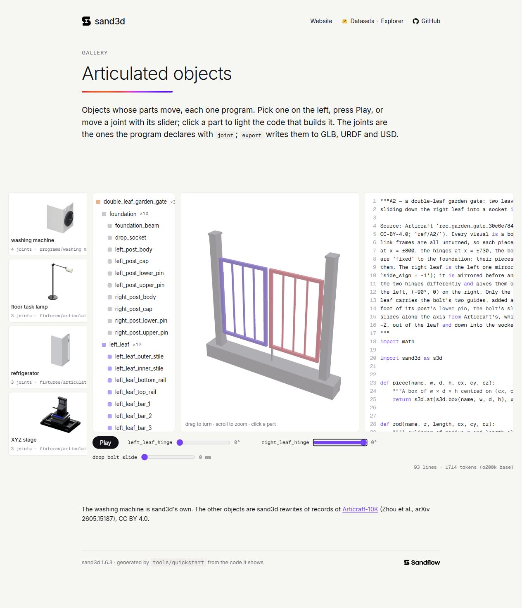
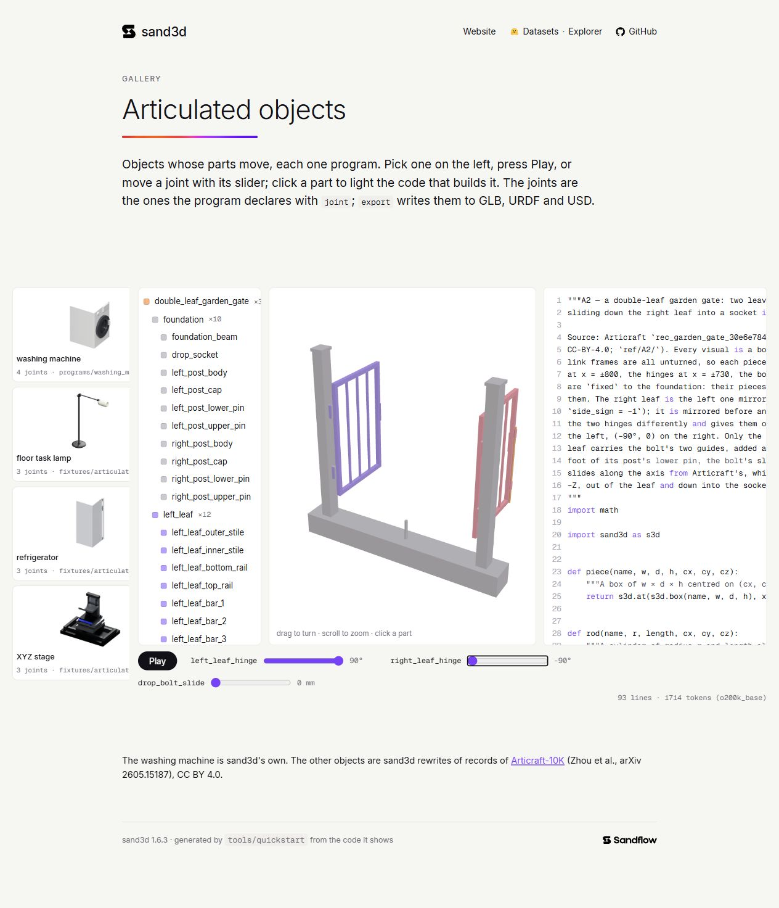

# 24 · sand3d 介绍之二

第23条说明有哪些代码资产、适合拿来做什么。第24条补上怎样写建模程序、怎样核对能否复建、怎样交付关节。对小柚可沿用带盖盒案例，把盖宽跟随盒体、铰链定位于后上沿、开合后可归位写成验收条件，让后续改尺寸时有明确的检查依据。

## 两条来源的差异

|维度|第23条|第24条补充|
|---|---|---|
|研究重点|介绍资产规模、可编辑性与使用场景|解释模型怎样用具名部件和局部坐标写出装配关系|
|案例证据|第23条操作洗衣机门与抽屉|第24条操作庭院门的左右铰链，并对照程序中各自的方向和限位|
|代码长度|第23条已指出数字来自项目基准|这里补齐各基准的样本量、统计口径与公平对照方案|
|复建一致性|第23条已区分库源码摘要和网格哈希|这里核对双进程测试、场景摘要字段及按 bpy 版本保存的基线|
|对外交付|第23条列出 GLB、URDF 等用途和动力学边界|这里核对 URDF 的静止态、单位、文件配套与实际缺少的字段|
|小柚应用|第23条给出带盖盒和可复用道具库方案|第24条沿用同一盒子，增加尺寸变更检查、重复构建记录及关节交付验收|

Ryrenz 原帖快照为文字长帖，含 GitHub 链接，附件数为 0。网页八图与第23条共用仓库 README 补充展示。新增画面来自 sand3d 官网庭院门。原帖发布于 11 月 7 日，所对照的固定提交为 11 月 19 日的 f840420f，榜单与 fork 数保留为发帖时的说法。

## 展示效果

依据两条帖文快照对照附件和仓库链接。复用第23条的八张补充图及核对记录，本条新增官网 Gallery 1.6.3 的庭院门开合截图。键盘操作左右旋转滑块后恢复闭合读数，插销保持 0 mm。

### 第23条留下的图像证据

洗衣机说明图同时展示部件树、四个关节和三个交付格式。双孔板展示几何外观和孔位。八张 README 图与第23条相同，详见第23条的图集和洗衣机操作记录。

### 第24条新增的交互证据

庭院门关闭时两扇门与底座前后关系可见。左右滑块分别到约 +90° 与 −90° 后，两片门扇沿各自立柱铰链打开。右侧程序区能对照命名、边界框参照和方向，顶部选中模型标为 garden gate。

### 同一门例中仍然有具体数字

官网示例包含具名立柱、门扇和左右枢轴，也保留宽度、位置等数值。命名框架让依赖关系更容易读和改，实际的数值与方向仍需在规格里定义。

## 详细核对

### 第24条在同一项目上补充了方法、证据和交付条件

两条都指向 Sandflow 的同一个仓库。第23条原帖介绍资产规模、可编辑和导出用途，其深入分析已经覆盖了部件命名、token 基准和格式差异。第24条原帖具体解释了手算坐标的痛点，提出短 API、复建一致性与 URDF 限位。这里继续核对局部坐标如何起作用、测试覆盖什么、导出文件实际包含哪些字段。

两条原帖快照与第23条深入分析。

### 命名引用把位置关系写进程序

API 可以根据部件的面、边或包围盒读取坐标框架。先在父件上明确参照面或支点，再用局部偏移放置子件。孔距、尺寸、正方向仍须给定。用第23条带盖盒举例，盒盖宽度从盒体宽度推导，盒盖枢轴从盒体后上沿取基准。以后若分别改宽度和深度，可检查宽度改变盖长、深度改变后沿枢轴位置。

官方 API，固定提交的 frames.py 和装配指南。

### 约 3,600 tokens 说的是 API 文档

官方 API 页标注 3,643 tokens，使用 o200k_base，内容包括规则、签名和例子。给小柚制定建模任务，还需要对象规格、部件名、单位和验收条件，返工和工具运行分别记录。项目版本及 tokenizer 会影响数字。

官方 API 页面与固定版本 API。

### 2–6 倍来自四项代码长度比较

项目以对照代码 token 数除以 sand3d 代码 token 数，排除注释和 docstring。报告的中位数为 Blender Python 4.0×（30 个 CAD 样本，9 个达到该基准的正确形状）、CadQuery 2.3×（17 个）、FeatureScript 6.0×（13 个）、Articraft SDK 2.0×（12 个）。程序作者及内容覆盖存在差异，9/30 是该对照组的记录。小柚试验应先让两版达到同一验收条件，再比较代码与修订用量。

官方 token 基准表及口径说明。

### 复建测试检查固定环境下的场景摘要

官方用同一 Python 在两个新进程运行登记样例，改变哈希种子并反转样例顺序。摘要包含物体变换、顶点、边、面以及适用的材质和关节信息，并另按 bpy 版本比较基线。小柚应保留环境、输入、几何摘要和导出哈希，分别检查同环境的复建和目标查看器能否打开。

固定提交的 test_determinism.py、harness.py 和 test_golden.py。本轮读取了测试实现。

### 庭院门演示能看清左右关节和符号

官网示例把左右门扇做成不同的部件，分配各自的铰链和开门方向。界面显示左侧约 +90°、右侧约 −90° 时，两扇门分别离开闭合位。闭合状态的界面读数约为 0°。另列的插销滑动保持 0 mm。双扇门帮助理解相同轴向下用角度符号区分两侧动作。

官方 Gallery 1.6.3 庭院门交互截图。原示例来自 Articraft-10K，官网重写。

### URDF 导出提供静止态和关节限位

导出器按静止态写 link 树、关节原点、父子链接、适用的轴与限位。旋转限位用弧度，滑动用米，显示网格为旁置 OBJ。当前代码把有限转动和滑动关节的 effort、velocity 写成 0，输出中也没有惯量和碰撞元素。机器人仿真还需要在目标软件补齐这些配置并验证，网页则可用 GLB 和专门的交互逻辑。

固定提交的 urdf.py、assembly.py 与关节导出测试。

### 小柚可以把改稿验证写进道具规格

沿用第23条带盖盒，先验两个不互相替代的改动。改宽 160→200 mm 时盖宽同步变化，改深 100→120 mm 时后沿枢轴随盒体移动。保留部件名、开盖轴与 0–105°范围，并检查闭合、开启与归位。GLB 用于布景和网页开合，URDF 留给需要机构数据的交付。

根据 API、官网演示和导出源码整理的候选验收，尚待本地建模。

## 小柚带盖盒对照

检验具名参照能否减少小柚盒子的改稿工作，同时保持结构和开合正确。候选对照尚待运行。

1. 两版先做基础款，核对闭合与 105° 开启。
2. 各自从基础款独立改宽到 200 mm 和改深到 120 mm，记录需要改动的参数、时间与返工。
3. 以相同输入重建两次并比较几何记录，在目标查看器检查 GLB 开合。
4. 先比较通过的输出，再汇总 token 与人工修改时间。

查看[对照记录表](experiments/24-sand3d/prop-comparison.csv)。

## 来源

- [Ryrenz 原帖](https://x.com/ryrenz/status/2118917617545072970)
- [原帖正文快照](sources/24.json)
- [官方 API](https://sand3d.sandflow.ai/api.html)
- [官方 token 基准](https://sand3d.sandflow.ai/tokens.html)
- [官方活动模型库](https://sand3d.sandflow.ai/gallery.html)
- [URDF 导出源码](https://github.com/Sandflow-ai/sand3d/blob/f840420fe9996dca4728d7a5eb8bfb87135d91ce/src/sand3d/urdf.py)
- [双进程确定性测试](https://github.com/Sandflow-ai/sand3d/blob/f840420fe9996dca4728d7a5eb8bfb87135d91ce/tests/test_determinism.py)
- [场景摘要算法](https://github.com/Sandflow-ai/sand3d/blob/f840420fe9996dca4728d7a5eb8bfb87135d91ce/tests/harness.py)
- [关节导出测试](https://github.com/Sandflow-ai/sand3d/blob/f840420fe9996dca4728d7a5eb8bfb87135d91ce/tests/test_export_joints.py)
- [第23条研究](23-sand3d-deep-dive.md)
- [固定版本 API 源文](https://github.com/Sandflow-ai/sand3d/blob/f840420fe9996dca4728d7a5eb8bfb87135d91ce/docs/api.md)
- [Articraft-10K 来源](https://huggingface.co/datasets/camvsl/Articraft-10K)
