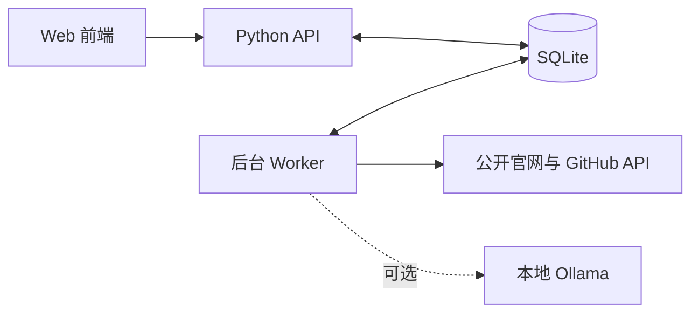

# Growth Casebook 获客研究台

从公开官网与 GitHub 资料生成带来源的产品研究报告。第一版完整覆盖网页提交、后台采集、结构化报告生成、案例搜索、来源回查、版本更新和 JSON 导出。

本地统一使用入口为 http://127.0.0.1:8766/ 。默认首页为“项目总结”，汇总研究过程、数据入口、当前统计、实现效果、价值与限制；案例库、采集任务、自动发现和数据与方法均在同一研究台内。原有 `#/overview` 和 `#/library` 等链接继续可用。

阶段回顾的正式文档在 [项目回顾](static/project-review.md)，记录 2026 年 11 月 21 日的验证快照和开发接手位置。[研究摘要](../projects/021-growth-casebook/README.md) 重点说明研究内容、价值、对我们的意义和验证边界。研究总库保留一个指向公开研究页的入口；旧的回顾路径由 `python build_project_review.py` 维护兼容跳转。

项目总结页提供 [研究全景图 PNG](static/research-map/research-overview.png) 和 [可编辑 SVG](static/research-map/research-overview.svg)，完整汇总研究内容、入口、处理逻辑、报告、验证结果、价值、限制与待验证扩展。该图是固定快照；本机服务运行时，执行 `python generate_research_map.py` 可读取当前数据重新生成（制图依赖 Pillow，运行研究台无需该包）。对应数据和布局检查记录保存在 `static/research-map/`。

## 公开网页部署

[公开研究与案例快照](https://yydshly.github.io/20261104_codex_project/021-growth-casebook/) 沿用本仓库 GitHub Pages 的 `main /docs` 发布源。线上版复用同一套前端，可查看项目总结、原引导图、案例、历史报告、JSON、采集记录和来源；新增采集、设置与更新在本地版本执行。页面明确显示快照时间与只读范围。

本地服务运行时执行 `python publish_snapshot.py`，生成明确文件清单到 `docs/021-growth-casebook/`，再按清单提交到远端。公开内容只包括项目公开资料、来源引用和短摘录；`data/casebook.sqlite3`、完整正文、翻译模型、配置、凭据及未发布/排除的产品不进入发布包。引导图保持原文件不变，`publication-manifest.json` 记录文件清单、报告数、统计与原图 SHA-256。

## 启动

需要 Python 3.10 或更新版本。在本目录执行以下命令。

```powershell
python -m pip install -r requirements.txt
python run.py --open
```

默认地址为 http://127.0.0.1:8766。端口可通过 `python run.py --port 8770` 修改。

在网页点击“新建研究”，输入公开产品官网或 GitHub 仓库。表单提供 Postiz、Plausible、Umami 三个真实产品的填写快捷方式，提交后才执行网络采集。任务完成后自动打开报告。

## 架构



前端为原生 HTML、CSS 和 JavaScript，由 FastAPI 同源提供。Worker 在同一应用内以独立线程领取持久化任务。每次领取带有租约和执行次数，重启后可恢复过期任务，过期 Worker 的结果不能覆盖新的执行结果。

项目数据默认保存在本目录的 `data/casebook.sqlite3`。该文件包含任务、来源快照和报告版本，需保留。每次成功更新会原子发布新版本；刷新失败时仍可阅读已有报告。`CASEBOOK_DB` 可指定其他数据库路径。

## 采集与报告范围

- 官网最多获取首页、定价、内容和文档四个页面，遵循 robots.txt，记录不可用来源和原因。动态渲染后才出现的内容可能无法取得。
- GitHub 使用官方公开 REST API，获取仓库指标、README 和最近四条发布记录。受官方免费配额限制，接口遇到限额时报告会说明。
- 官网链接的社媒账号作为后续研究入口。第一版尚未采集社媒帖子、互动、关键词、真实访问量或支付收入。
- 报告分为产品概览、生意与定价、获客入口、公开动作、社媒与社区、事件时间线、竞品研究线索和附录八节。事实与动作保留来源引用。
- 无日期的入口显示“日期未披露”，明确给出日期的发布事件才进入时间线。Stars 和 Forks 展示采集时的快照。
- 首版报告主要描述公开入口与可观察动作，渠道带来的客户和收入需要补充转化数据。竞品章节提供进一步研究入口。

完整报告结构见 `report.schema.json`，对应的校验模型在 `casebook/models.py`。沿用了早期原型中“结构化报告、来源引用、缺失数据显式展示”的设计，采集快照与任务存储独立于原型目录。

## 报告生成模式

默认使用**证据整理模式**，按规则识别内容入口、文档、公开仓库、自托管路径和发布记录，生成可追溯的结构化报告。此模式无需模型密钥，内容深度取决于本轮采集到的资料。

如本机已经安装 Ollama 并具备可用模型，可以在启动前设置以下配置。模型只润色摘要，规则生成的事实、指标和动作仍保留原始来源。

```powershell
$env:CASEBOOK_OLLAMA_MODEL = '你的本地模型名称'
python run.py
```

可选设置 `CASEBOOK_OLLAMA_URL`，默认 `http://127.0.0.1:11434`。模型响应失败或引用格式不合要求时使用证据整理模式，并记录提示。该可选路径需要本地模型实际运行才能验证。

## 中文展示

产品简介、报告中的英文摘录和发布说明可由本地 Argos 英译中模型翻译，无需付费 API 或密钥。首次安装需要联网下载约 71 MB 的模型，之后使用 CPU 离线翻译。

```powershell
python -m pip install -r requirements-translation.txt
python setup_translation.py
python translate_existing.py
```

完成后重启服务并刷新网页。新采集的报告会自动准备中文译文，已有报告可用 `translate_existing.py` 补齐。译文按原始文本缓存在 SQLite，重复运行不会重复翻译；中文简介也参与搜索。

正文默认展示译文，可展开“查看原文”，附录保留来源正文。JSON 导出保留原始字段，并附带 `translations` 映射。来源快照和历史报告原文不被翻译覆盖。机器翻译可能误译产品名、技术术语和截断的发布片段，请结合原文核对。未安装模型时继续展示原文。

`casebook/reviewed_zh.json` 保存首批公开简介和摘录的校对译文，以原文精确匹配，原文变化后不会套用旧译文。自动翻译会检查数字、代码标识和重复内容，未通过时保留原文。这些检查不能保证语义准确，复杂资料仍需核对。

## 自动发现与入库

网页“自动发现”提供立即发现、定时开关、每批数量和发现间隔。首次安装默认关闭定时运行，可手动启动。开启后由现有后台 Worker 执行，浏览器关闭不影响运行，本地服务停止期间暂停；服务重启后补跑一次到期扫描。

发现流程：选择公开来源 → 提取产品与官网 → 保存候选及各来源记录 → 按官网域名与仓库去重 → 每批加入 1–10 个研究任务 → 官网免费采集、中文报告、案例库展示。来源可独立启用：

- **BetaList**：读取官网公布的 Atom 订阅，经目录的公开 Visit 链接解析真实官网，每次最多解析六条记录。不需要产品开源或提供 API 密钥。
- **Product Hunt 公开订阅**：免登录读取官方 Atom feed，保存产品名、简介、发布日期和原始记录链接。后台自动查找官网：尝试订阅提供的公开跳转，再从 Hunted.Space 的同一产品记录、Apple 官方应用搜索和 Hacker News 公开链接寻找候选。候选需通过名称、功能及同一 Product Hunt / App Store 产品回链核对；不会猜测域名、解验证码或绕过访问限制。未确认时保留 `listing_only` 中文简报。
- **Show HN**：使用 HN Search 的公开 API，读取至少 5 分的产品展示帖子，排除代码托管、应用商店和文章链接；优先独立域名首页，跳过个人站内的演示或文章路径。保存帖子日期和来源链接。社区展示不证明提交者代表产品方。
- **GitHub**：检索自托管应用、SaaS 主题，排除分叉、归档、低于 500 Stars、教程、目录、模板和缺少独立官网的项目。Stars 仅用于初筛。

同一产品可保留多个来源。没有公开仓库的产品只采集官网、定价、内容和文档，也能生成完整章节的报告；开源状态标为未确认。目录和社区记录进入报告与事件时间线，记录日期不等于产品首次上线日期，展示不代表已证实获客或收入增长。

默认每 24 小时一批、每批 5 个产品，可配置 6–168 小时。发现状态、来源链接、候选、任务关联和定时设置保存在同一个 SQLite 数据库中；发现任务有租约，重复触发共享活动任务，重启恢复时不会重复建相同产品。启用 Product Hunt 自动发现时，后台也会自动补采已有简报；未确认官网的产品每 24 小时重试，重启后保留冷却记录。其他已有产品不自动刷新，失败采集可从“采集任务”重试。

各来源独立记录读取结果、错误和冷却时间；一个来源限额或失败时继续其他来源，并可处理已有候选。候选按所选来源轮流入队，避免历史 GitHub 候选阻塞新来源。免费 GitHub API 遇到 403 配额耗尽或 429 时暂停后续 GitHub 请求。官网及目录跳转在每一跳请求前校验公网地址和 robots.txt。报告完成才进入案例库，已打开的案例库会自动刷新列表与统计。英文摘录会尝试本地翻译；未通过检查的段落显示中文提示并保留原文入口。

当前覆盖部分公开目录、社区发布和开源软件产品，仍不包含支付收入、真实访问量或完整社媒讨论。Product Hunt 的产品页和官网跳转在本次环境触发 Cloudflare 验证（403）；本版使用官方公开订阅接入，不宣称已解除网站验证。官方 GraphQL API 需要 Token，官方 MCP 需要账号登录，本版订阅模式均不依赖它们。

官网自动核对成功后，后台继续采集官网、定价、内容和文档，发布 `website` 新版本，原 `listing_only` 简报可回查。报告的 `website_resolution` 保存匹配方法、时间、证据链接和失败记录，网页可展开查看。公开搜索命中本身不能确认官网，多个候选冲突时保持简报。官网校验最多访问四个候选页，遵守公网限制、robots.txt、超时与体积上限。开发者个人域名下的产品页保留路径（如 `/hollr`），不采集成开发者首页。相同规范化官网已属于其他产品时拒绝覆盖。手动补充官网作为可选入口继续保留。

自动匹配受公开目录、社区索引和美国 App Store 的覆盖限制，不能保证找到所有产品。名称或功能不符、缺少回链、候选冲突、证书异常和来源限额都会保留查找记录，不会降低校验要求强行关联。

`Report.coverage` 区分 `website`、`repository`、`listing_only`。对于简报，项目的 `website` 字段暂存 Product Hunt 收录入口，不表示已确认的产品官网；官网核对并采集成功后替换为产品站点。`website` 表示取得官网正文，并不保证定价、收入、流量或社媒资料齐全，缺项仍列入 `gaps`。调用 API 时应结合 `coverage` 解读。Product Hunt 公开记录保留来源与订阅链接，并展示来源署名。

升级会自动将原有 GitHub 候选迁移为支持无仓库产品的结构；旧候选表保留为 `discovery_candidates_v1`，项目、采集任务、原始来源和报告版本保持原样。原有定时设置及来源选择保留；新增来源可在网页勾选后保存。

来源初筛仍可能误收个人演示。验收确认的误收项可通过 `Database.set_project_hidden(id, reason)` 从案例库排除，传入空原因可恢复；报告和来源保留供回查，详情会标注排除原因。该机制不自动认定产品是否闭源或具备营收。

## API

| 请求 | 用途 |
| --- | --- |
| `POST /api/projects` | 提交 `url`、可选 `name`、`github` 和 `category`，返回任务 |
| `GET /api/tasks` | 最近任务列表 |
| `GET /api/tasks/{id}` | 任务进度与失败原因 |
| `GET /api/projects?q=&channel=` | 搜索已发布案例 |
| `GET /api/projects/{id}?version=` | 报告详情与版本列表 |
| `POST /api/projects/{id}/refresh` | 创建更新任务 |
| `GET /api/projects/{id}/report.json?version=` | 导出 JSON |
| `GET /api/stats` | 基于已发布报告的统计 |
| `GET /api/health` | 服务状态及生成模式 |
| `GET /api/discovery` | 发现设置、最近运行、候选和发布状态 |
| `PUT /api/discovery/settings` | 保存 `enabled`、`batch_size`、`interval_hours` 和可选 `enabled_sources`（`product_hunt`、`betalist`、`hacker_news`、`github`） |
| `POST /api/discovery/runs` | 立即创建或复用一轮发现任务 |
| `POST /api/projects/{id}/website` | 为 Product Hunt 产品补充 `{url}`，创建采集任务并保留原简报 |

相同项目的并发提交共享一个活动任务。官网项目按规范化域名识别，GitHub 地址按仓库识别。服务仅监听本机地址，并校验 Host 与写入请求来源。采集器限制公网 HTTP/HTTPS、标准端口、重定向目标、单页体积及超时。

## 验证

```powershell
python -m pip install pytest
python -m pytest -q
```

测试覆盖 API → Worker → 采集器 → 报告 → 数据库、版本保留、失败刷新、并发提交、租约恢复、来源引用和私网地址拦截。测试数据为隔离的确定性样本，真实采集验收另通过网页完成。

第一版定位为本机单人研究工具。MCP、用户画像、个性化实验、授权收入导入和多用户部署属于后续阶段。
