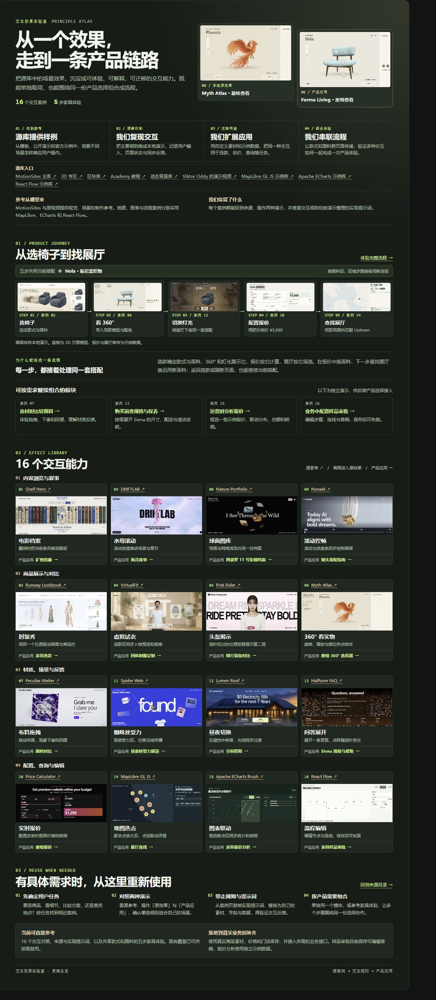

# 交互效果实验室

这个本地子项目收录可操作的交互对照。01–05 来自 [Viktor Oddy 的演示视频](https://x.com/viktoroddy/status/2117959947204092218)，06–13 来自 MotionSites 模板库和教程，14–16 参考 MapLibre、Apache ECharts 和 React Flow 的官方资料。进入案例先体验「原效果」，再切到「产品应用」。页面下方可以复制按案例整理的实现提示词。

[在线总览与演示](https://yydshly.github.io/20261104_codex_project/001-interaction-effects-lab/) · [研究摘要与可扩展方向](../projects/001-interaction-effects-lab/README.md)



```powershell
npm install
npm run dev -- --host 127.0.0.1
```

`npm run build` 生成生产构建。案例和版本可以通过 URL 片段直达，例如 `#runway/product`。点「重置演示」可重新开始。流程编辑中手动保存的快照留在当前浏览器，两个版本分别保存。

`npm run build:pages` 将静态版本构建到总库的 `docs/001-interaction-effects-lab/`，资源基路径与 GitHub Pages 子目录匹配。GitHub Pages 从 `main` 分支的 `/docs` 发布。

网页页头的「来源参考」可通过 `#sources` 直达，收录原视频、MotionSites 分类库及 MapLibre、ECharts、React Flow 示例库。每个案例在工具栏提供「查看来源」，来源目录也能跳回对应的本地演示。

页头的「原理总览」可通过 `#overview` 直达。总览使用本地演示的截图，包含 16 个原效果模块与家具体验的五步产品画面。模块可进入对应源案例、原效果和产品应用。「打开整张图」可查看用于分享的静态长图。

总览同时记录我们对实验室的理解。源库提供样例与参考，本地演示提取输入、状态和反馈，产品应用用自己的素材与数据验证迁移，家具五步则验证共享选择如何连接多个交互。面料、帮助、报价分析和审批画布可作为后续组合的独立参考。按需复用时，从用户任务选案例，再对照演示、提取规则与提示词，最后接入真实业务数据。

| 原效果 | 可复用的规则 | 产品应用 |
| --- | --- | --- |
| [Shelf Hero](https://motionsites.ai/?prompt=vasari-vhs-hero) | 围绕当前条目重新排布封面，同时更新年代和详情 | Mineral Atlas 矿物馆藏 |
| [Runway Lookbook](https://motionsites.ai/?prompt=vell-lookbook) | 用同一个连续位置驱动视觉层、序号和商品列表 | Forma Living 家具选款 |
| [DRIFTLAB](https://driftlab-works-agency.vercel.app/) | 滚动驱动分段叙事，主体视频与滚动时间分开 | PELAGIC 海洋主题叙事 |
| [VirtualFit 参考](https://www.pinterest.com/pin/743234744804756299/) | 一次选款同步更新人物、商品和规格 | 团体制服定制 |
| [Pink Rider](https://motionsites.ai/?prompt=pink-rider) | 指针轨迹形成局部揭示遮罩，笔迹随时间消退 | 装备细节对比 |
| [Myth Atlas](https://featured-creatures.vercel.app/) | 拖动、缩放、光照和资料联动的实时 3D 查看器 | Siena 扶手椅 360° 示意与部位说明 |
| [Peculiar Atelier](https://motionsites.ai/3d-websites?prompt=peculiar-atelier) | 抓取布面网格，释放后让约束、重力和阻尼驱动形变 | 面料拖拽对比 |
| [Nature Portfolio](https://motionsites.ai/?prompt=nature-portfolio) | 球面和网格共用同一份条目数据和详情 | NASA 阿波罗 11 号影像档案 |
| [NovaAI](https://motionsites.ai/lesson/build-scroll-animated-website-with-ai) | 双向滚动和滑块对应同一帧进度 | 镜头装配指南 |
| [Price Calculator](https://motionsites.ai/sections?prompt=price-calculator) | 按选项和数量计算示例费率、方案对比和费用明细 | Siena 扶手椅报价 |
| [Spider Web](https://motionsites.ai/?prompt=found-spider) | 固定端点，指针扰动和载荷让位移沿绳索传递 | 悬索桥受力展项 |
| [Lumen Roof](https://motionsites.ai/?prompt=lumen-roof-hero) | 遮挡时更换场景，光线与背景一起过渡 | Siena 空间照明 |
| [Halftone FAQ](https://motionsites.ai/?prompt=solace-faq) | 统一控制问题展开，点阵随指针变化 | Siena 规格与帮助 |
| [MapLibre 点位聚合](https://maplibre.org/maplibre-gl-js/docs/examples/create-and-style-clusters/) | 点击聚合点放大，选中点位时更新标记与详情 | Siena 展厅查找 |
| [ECharts 框选](https://github.com/apache/echarts-doc/blob/master/en/option/component/brush.md) | 框选散点，同步更新分组统计和明细 | 家具报价分析 |
| [React Flow 保存与恢复](https://reactflow.dev/examples/interaction/save-and-restore) | 编辑流程节点与连线，保存和恢复快照 | 家具样品审批 |

页头「家具体验」从 `#runway/product` 开始，依次选椅子、看 360°、切换灯光、配置报价和查找展厅。五步共用款式与面料，选择会保留到当前标签页刷新后。换款时带出该款默认面料，在选款、360° 或报价修改面料会同步到后面的步骤。展厅可分别筛选同款和同款同面料的样椅。3D 查看以同一个基础椅模型做比例与配色示意，灯光使用对应配色图片和光照预设，报价费率和展厅库存为示例数据。布料和悬索的参数供观察交互反馈使用。

`src/cases.js` 是可复用交互说明的入口。`src/demos/` 中每个案例的组件接收 `mode`，用同一组件承载参考演示与产品应用。加案例时先明确三项：用户能做什么、页面记录什么、哪些画面要同步变化。再给两个版本分别准备数据和素材，将组件接入 `src/App.jsx` 的案例入口。

「原效果」复现参考中的主要交互，布局适配实验室画幅。VirtualFit 使用重新制作的演示素材，点选衣服是在已准备好的图之间切换。MotionSites 的参考素材、图像和名称来自相应模板，面向本地演示使用。产品应用是独立的示例构想。

本地素材在 `public/demo-assets/`。内置 ImageGen 生成了三组补充素材：`virtualfit/` 的暖色公寓、同一模特四款服装与平铺商品图，`runway/` 的统一视角六款透明扶手椅，以及 `shelf/` 的八种透明矿物标本。DRIFTLAB 用 Canvas 重建文字投影，主体和背景使用参考素材。
