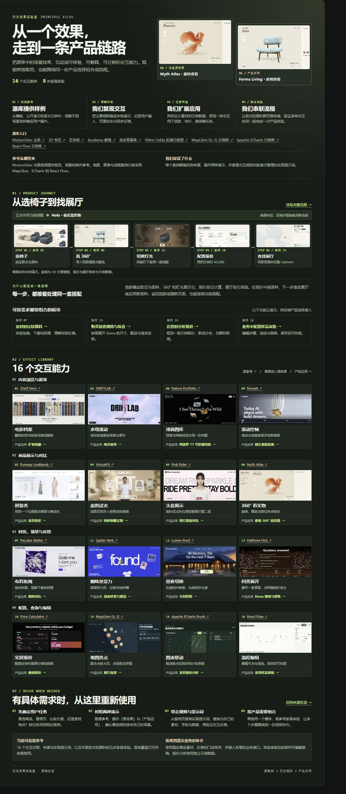

# 001 · 交互效果实验室

把公开演示里的交互效果拆解为可理解、可操作、可迁移的案例。项目收录 16 个源参考及对应的本地复现与产品扩展，再用选椅子、360° 查看、切换灯光、报价和展厅查找组成五步产品体验。款式和面料在步骤之间共享，形成从单个交互到完整任务的复用参考。

[在线总览与演示](https://yydshly.github.io/20261104_codex_project/001-interaction-effects-lab/) · [源码与运行说明](../../interaction-effects-lab/README.md) · [返回研究索引](../../README.md#研究索引)

## 图片导览

引导图使用实验室的真实演示截图。网页版图中的模块可进入原效果、产品应用与源参考。

## 涉及哪些案例

| 分类 | 源效果与本地演示 | 产品扩展 |
| --- | --- | --- |
| 内容浏览与叙事 | Shelf Hero 电影档案、DRIFTLAB 水母滚动、Nature Portfolio 球面图库、NovaAI 滚动控帧 | 矿物馆藏、海洋故事、阿波罗 11 号档案、镜头装配指南 |
| 商品展示与对比 | Runway Lookbook 时装秀、VirtualFit 虚拟试衣、Pink Rider 头盔揭示、Myth Atlas 360° 查看 | 家具选款、团体制服、骑行装备对比、座椅查看器 |
| 材质、场景与反馈 | Peculiar Atelier 布料拖拽、Spider Web 蜘蛛丝受力、Lumen Roof 昼夜切换、Halftone FAQ 问答展开 | 面料对比、悬索桥受力展项、空间照明、Siena 规格与帮助 |
| 配置、查询与编辑 | Price Calculator 实时报价、MapLibre 地图聚合、ECharts 框选、React Flow 流程编辑 | 座椅报价、展厅查找、家具报价分析、样品审批草稿 |

## 沉淀的价值

- 每个案例对应源参考、原效果、产品应用和实现提示词。按用户输入、页面状态与同步反馈理解核心机制，再换成自己的对象、素材和数据。
- 五步家具体验共用款式与面料。在报价中更换面料后，展厅按新搭配筛选；返回选款或刷新页面可以继续当前搭配。
- 保留 16 个案例的独立入口，既能单独取用，也能借鉴跨页面传递选择的方式。现有覆盖可供按需复用。

## 可扩展方向

以下为后续方向，按实际产品需求推进。

1. 用真实商品模型、面料、价格与展厅库存替换示例数据，接入业务接口。
2. 将面料比较、规格帮助接入选购过程，继续完善一条产品任务。
3. 将独立报价分析接入业务报价记录，将样品审批画布接入真实任务状态与权限。
4. 继续沿用同一模板沉淀新案例，保留源参考、可操作对照、交互规则与产品用途。

## 来源与实现范围

主要视觉参考来自 [Viktor Oddy 原视频](https://x.com/viktoroddy/status/2117959947204092218)、[MotionSites](https://motionsites.ai/) 及其模板和教程。地图、图表与流程分别采用 [MapLibre GL JS](https://github.com/maplibre/maplibre-gl-js)、[Apache ECharts](https://github.com/apache/echarts) 和 [React Flow](https://github.com/xyflow/xyflow)。完整来源随案例保留在网页与源码中。

「原效果」复现参考的主要交互，产品应用由本项目扩展。座椅共用一个基础 3D 模型做比例和配色示意，试衣切换预备图像，报价与展厅库存为示例数据。报价分析和审批画布目前为独立演示，审批保存可编辑草稿。第三方素材与模型来源说明保留在素材目录中。

## 发布与验证

源码位于 `interaction-effects-lab/`，静态演示位于 `docs/001-interaction-effects-lab/`，通过 GitHub Pages 发布。构建会为部署目录生成资源路径，同时保留本地预览用法。以实际构建、包装检查和线上浏览器验证为发布依据。
