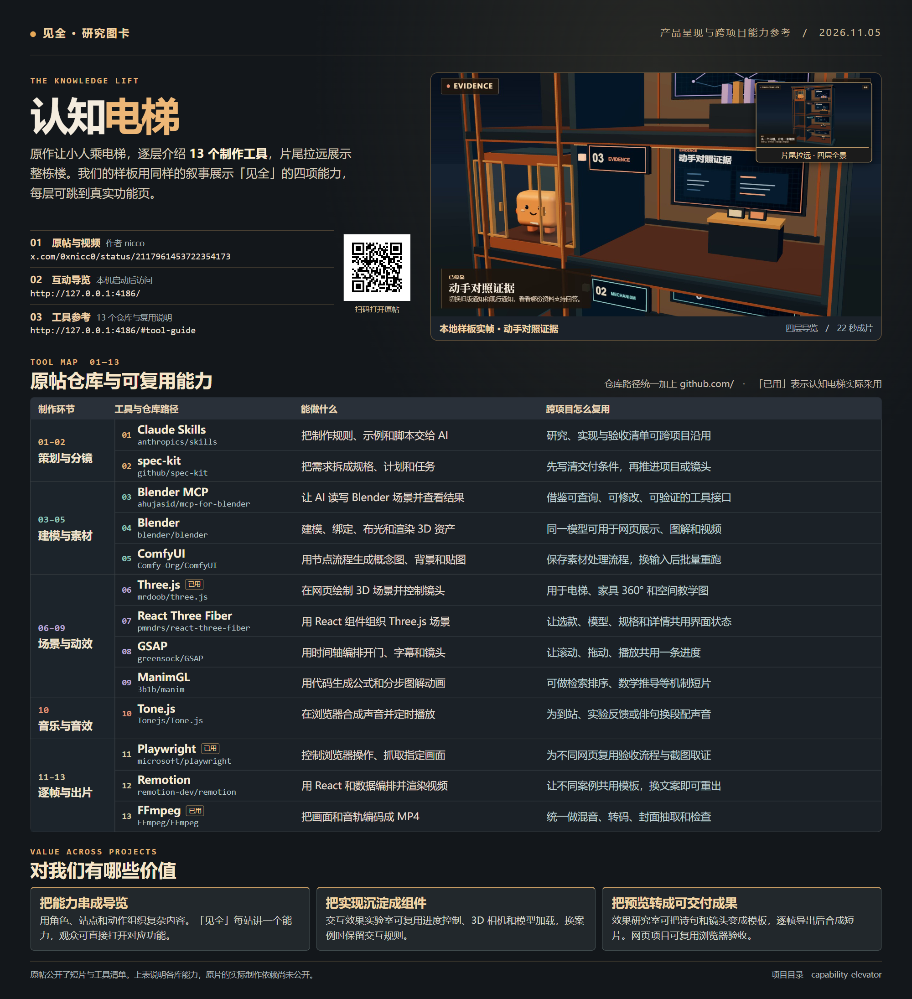

# 002 · 电梯叙事与工具能力研究

借鉴角色乘电梯上行、逐层停靠介绍主题、片尾拉远建筑全景的呈现方法，把一张工具清单或一组产品能力组织成可浏览的旅程。研究包含四层互动样板、22 秒有声成片、13 个工具仓库的能力地图，以及跨项目复用说明。

[在线研究与互动导览](https://yydshly.github.io/20261104_codex_project/002-capability-elevator/) · [研究引导图](https://yydshly.github.io/20261104_codex_project/002-capability-elevator/#guide-image) · [源码与运行说明](../../capability-elevator/README.md) · [返回研究索引](../../README.md#研究索引)

## 研究对象与理解

nicco 的原帖配有一支约 27 秒的 3D 电梯动画。每层展示一个工具的名称和布景，正文中的 13 个链接指向对应的独立 GitHub 仓库。电梯和楼层是串联信息的叙事结构，仓库提供制作工具、接口、文档与示例。[原帖与视频](https://x.com/0xnicc0/status/2117961453722354173)

原帖引用的指南介绍分镜、按时间定位画面、关键帧检查和出片，并链接了可运行的独立示例。本轮查阅未找到该电梯原片的工程、提示词或构建记录，原片具体用了哪些工具仍待核对。[引用的制作指南](https://x.com/seeconvm/status/2106096193235259564) · [ClaudeAnimationBase](https://github.com/JohnHeibel/ClaudeAnimationBase) · [PDoomVideo](https://github.com/JohnHeibel/PDoomVideo)

## 图片导览

沿用本轮生成的图卡。近景展示电梯停靠和主题展板，小图展示片尾的四层全景。图中的本机地址供本地运行时使用，在线入口位于本文顶部。

## 网页包含哪些内容

| 模块 | 内容与操作 |
| --- | --- |
| 四层互动导览 | 「AI 为什么会答错？」依次经过找入口、理解生成、对照证据和跨域阅读。支持播放、暂停、拖动进度和楼层直达。 |
| 22 秒成片 | 1280 × 720、24 fps 的 MP4，包含合成音轨和到站提示音，可播放或下载。 |
| 研究归纳 | 说明原作、13 个链接与视频的关系，区分已验证的实现、可复用方案和仍待核实的制作依赖。 |
| 13 项工具参考 | 保留原帖顺序，每项有 GitHub 链接、能力说明和跨项目复用例子。 |
| 研究引导图 | 使用我们生成的效果与能力图卡，支持在线查看和下载。 |

四层中的「见全」完整案例需要在本机另行运行。公开网页提供电梯互动、成片、研究内容与外部工具入口，本机预览可继续进入对应的「见全」页面。

## 13 个仓库分别提供什么

| 环节 | 仓库 | 参考能力 |
| --- | --- | --- |
| 制作规范 | [Claude Skills](https://github.com/anthropics/skills)、[spec-kit](https://github.com/github/spec-kit) | 可复用的任务规则、规格、步骤和验收条件。 |
| 模型与素材 | [Blender MCP](https://github.com/ahujasid/mcp-for-blender)、[Blender](https://github.com/blender/blender)、[ComfyUI](https://github.com/Comfy-Org/ComfyUI) | 软件操作接口、3D 资产和可保存的素材生成流程。 |
| 场景与动效 | [Three.js](https://github.com/mrdoob/three.js)、[React Three Fiber](https://github.com/pmndrs/react-three-fiber)、[GSAP](https://github.com/greensock/GSAP)、[ManimGL](https://github.com/3b1b/manim) | 浏览器 3D、组件化场景、时间轴和精确图解。 |
| 声音 | [Tone.js](https://github.com/Tonejs/Tone.js) | 程序合成音效和事件、节拍调度。 |
| 验证与交付 | [Playwright](https://github.com/microsoft/playwright)、[Remotion](https://github.com/remotion-dev/remotion)、[FFmpeg](https://github.com/FFmpeg/FFmpeg) | 浏览器自动操作、按数据编排视频、媒体编码与混音。 |

本项目实际采用 Three.js、Playwright 和 FFmpeg。音轨由本项目的 PCM 合成脚本生成，播放进度和镜头由共用时间轴计算。其余仓库是按任务取用的参考，软件和素材的具体使用条件以对应项目说明为准。

## 沉淀的价值

1. 把工具、产品功能或知识步骤分配到不同楼层，用一个角色和连续动作组织演示。每层确定主题、动作、反馈与下一步。
2. 内容和时间轴分开保存。预览按当前时间绘制，导出按帧号除以帧率绘制，两者共用场景和镜头逻辑。
3. Playwright 可以按真实网页入口操作、读取结果和截图，既能支持出片采集，也可用于其他网页的交互验收。进一步分析画面可结合程序检查与 AI 判断。
4. 从具体任务选择仓库。图解制作可借鉴规格与验收模板，交互实验可复用进度和相机控制，批量视频可采用参数化模板和统一媒体导出。

## 发布与验证

源码在 `capability-elevator/`，通过 `npm.cmd run build` 生成 `docs/002-capability-elevator/`，沿用仓库的 GitHub Pages 发布入口。资源采用相对路径，Three.js 与所需几何体模块随静态网页发布。

发布检查覆盖嵌套路径加载、四层交互、13 个仓库地址、引导图与视频资源、手机布局、研究归纳以及导出模式。本地案例入口与公开导览按运行环境显示。
