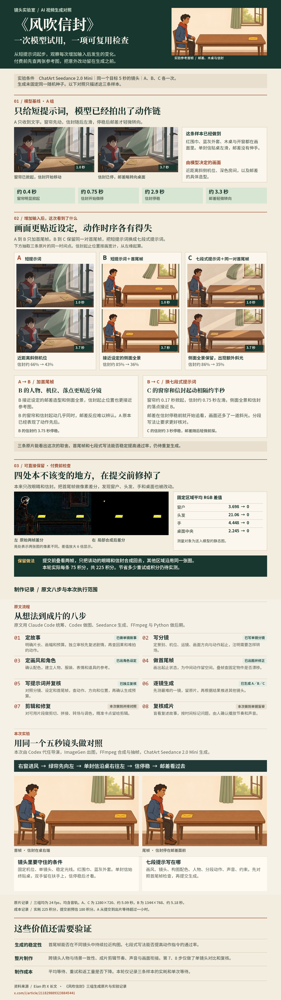

# 003 · 风吹信封与付费前检查

参考 Eian 的八步 AI 短片流程，用同一个五秒镜头生成三条对照原片，区分模型已经能做到的动作、加入首尾帧与七段式提示词后实际看到的变化。最值得保留的是付费前叠帧与局部合成，本轮确实发现并修正了窗户、头发、手和桌面四处输入图的意外变化。

[在线研究与三组原片](https://yydshly.github.io/20261104_codex_project/003-eian-seedance-workflow/) · [研究引导图](https://yydshly.github.io/20261104_codex_project/003-eian-seedance-workflow/#guide-image) · [完整实验记录](../../eian-seedance-workflow-demo/README.md) · [返回研究索引](../../README.md#研究索引)

## 研究对象与问题

Eian 的长文将 AI 短片制作组织为定故事、写分镜、定画风与角色、做首尾帧、写提示词并复核、逐镜生成、后期和审片八步。原文由 Claude Code 统筹，Codex 做图，Seedance 生成动态，FFmpeg 与 Python 做后期。本次由 Codex 统筹，图像由 ImageGen 制作，视频走用户选择的 ChatArt Seedance 2.0 Mini。[Eian 原帖](https://x.com/EianLu/status/2118317430665613741) · [长文与流程](https://x.com/i/article/2118298893238845441)

研究希望弄清楚这些输入和检查分别带来什么，而评估整套流程对成片质量和成本的收益需要更完整的验证。本轮只做一个镜头，故事是右窗进风、窗帘先动、单封信贴桌向左滑动并停稳，邮差随后看过去。

## 沿用本轮生成的引导图

图中展示的是本轮三条原片和实际参考图。数值归零衡量输入静态图中四个固定区域的像素差，视频执行情况由原片另行检查。

## 三组样本说明了什么

| 组别 | 输入 | 本轮实际观察 |
| --- | --- | --- |
| A | 短提示词 | 已拍出窗帘先动、信封随后左滑、停稳后邮差轻微转向。模型自行选择人物细节、近距离斜侧机位和深色房间。 |
| B | A 的短提示词加首尾帧 | 人物、侧面全景和信封起止更贴近分镜。窗帘与信封起动接近，邮差反应不明显。 |
| C | 七段式提示词加 B 的同一对首尾帧 | 窗帘约 0.17 秒动、信封约 0.75 秒动。邮差停稳前已追看，画面出现额外斜光。 |

三组同用 Seedance 2.0 Mini，各生成一次，未固定同一个随机种子。B 到 C 同时扩写了动作、空间和约束。短提示词中已经能看到动作先后，提示词格式对稳定通过率的影响仍需另测。

## 最大价值与保留做法

本轮最值得保留的成果是付费生成视频前的输入图检查。只想改变眼睛和信封的局部改图，同时改变了窗、头发、手和桌面。叠帧与差分找出偏差后，我们只将眼睛和信封合成回同一底图。

| 固定区域 | 原始平均 RGB 差值 | 局部合成后 |
| --- | ---: | ---: |
| 窗户 | 3.698 | 0 |
| 头发 | 21.06 | 0 |
| 手 | 4.448 | 0 |
| 桌面中央 | 2.245 | 0 |

差值基于归一至 1280 × 720 后的区域采样，归零来自复用固定像素。这一做法可以继续用于参考帧提交前检查。实际能减少多少重试或积分，需要增加对照测量。

## 执行范围与待验证价值

原文八步保留在网页中，并逐项标注本次范围。第 1–6 步完成了单镜头准备和三组生成。第 7、8 步只做了三组并排剪辑和单镜头复核。

仍需验证首尾帧与七段式写法能否稳定提高通过率、跨镜头人物和场景一致性、整片剪辑与声音衔接，以及平均等待、重试、返工和积分是否下降。

本轮每条实耗 75 积分，共 225 积分，提交前预估 180 积分。A 从提交到出片超过一小时。三条均为 24 fps 且含音轨，A、C 为 1280 × 720、约 5.09 秒，B 为 1344 × 768、约 5.18 秒。

## 网页与发布

页面提供三组原片切换、按时间点观察、输入图差分、提示词文件、原文八步和现有高清长图。源码在 `eian-seedance-workflow-demo/`，运行 `node eian-seedance-workflow-demo/build.mjs`，将明确列出的页面与素材复制到 `docs/003-eian-seedance-workflow/`。沿用仓库 GitHub Pages 的 `main` 分支 `/docs` 发布入口。
