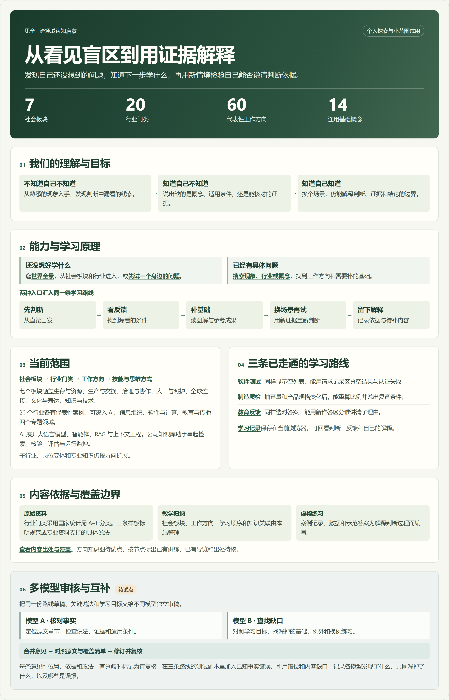

# 005 · 见全 · 跨领域认知导航研究

研究大众如何在陌生领域中发现认知盲区，看清一个方向包含什么、需要哪些基础、可以怎样逐层深入。目标是面向大众的跨行业技能与思维普及网页，让人从宏观社会结构找到具体学习入口，并沿知识关系继续探索。

[在线世界全景](https://yydshly.github.io/20261104_codex_project/005-jianquan-cognition/) · [研究目标与思考](https://yydshly.github.io/20261104_codex_project/005-jianquan-cognition/#research) · [交互总览与引导图](https://yydshly.github.io/20261104_codex_project/005-jianquan-cognition/#project-overview) · [源码与本地运行](../../society-atlas/README.md) · [返回研究索引](../../README.md#研究索引)

## 我们研究的是什么

起点来自程序员持续学习 AI 的经历：即使一直学习，也可能不知道还存在哪些重要方向。一个术语清单难以回答“我还没看见什么”和“下一步该学什么”。因此，研究对象逐步从 AI 科普扩展为跨领域的认知导航、知识组织和学习引导。

我们希望支持三个连续变化：

1. **不知道自己不知道**：通过社会全景、陌生行业和身边现象，发现此前没想到的概念、关系与条件。
2. **知道自己不知道**：能指出自己缺的是基础、机制、适用条件，还是可核对的证据，并找到深入入口。
3. **知道自己知道**：能在给定范围内解释所学，并在新情境中说明判断依据与边界。网页里的阅读次数与点击记录不直接代表掌握。

这是一项自主产品探索，没有单一上游仓库。参考资料分别附在具体讲解与「内容来源与覆盖」中，学习结构和教学案例由本站整理。

## 目标与核心思考

| 研究问题 | 当前设计 | 还要验证什么 |
| --- | --- | --- |
| 没有想法时，如何看见必要的方向？ | 世界全景 → 社会板块 → 行业 → 代表性工作方向 | 初次使用者能否找到感兴趣且此前陌生的方向 |
| 有问题时，如何找到基础与深入道路？ | 统一搜索连接概念、知识地图、讲解和项目路线 | 问法是否能匹配，先备知识提示是否足够 |
| 宏观与细节怎样用同一套方式展示？ | 统一首页、领域总览、知识讲解；图解、位置提示与返回导航 | 跨域后能否说清当前位置与继续方向 |
| 科普如何超越“知道一个名字”？ | 说明工作内容、知识部分、所需基础、分层深入与相关领域 | 内容是否帮助建立可解释的结构 |
| 怎样发现理解中漏掉的条件？ | 初次判断 → 反馈 → 补基础 → 换例再试 → 留下解释 | 能否在新情境迁移，是否仍保留误解 |
| 内容从哪里来，怎样持续补充？ | 区分原始资料、教学归纳与虚构练习，按知识缺口补来源 | 引用是否支持具体说法，岗位差异和例外是否缺失 |
| 多模型能否互补？ | 拟让不同模型独立核对事实、审查覆盖，再对照原文修订 | 命中、共同遗漏、误报与修订后的效果 |

科普书籍、历史演变和专业资料可以帮助建立从整体到细节的结构。当前部分领域提供形成过程视角，尚未完成跨行业的系统书单与历史资料审核。

## 沿用已有研究引导图

使用本次已经生成的 2950 × 4590 长图，未重新生成。公开网页可展开查看或[打开高清原图](https://yydshly.github.io/20261104_codex_project/005-jianquan-cognition/assets/jianquan-overview.png)。图中的“个人探索与小范围试用”表示产品成熟度；现在可通过公开网页访问。

## 两类入口怎样连起来

**还没有明确想法**：打开世界全景，选择「知识与技术」等社会板块，进入行业与工作方向，阅读主要做什么、先学什么、如何继续深入。也可以从一个身边的问题开始，发现相关概念后回到地图。

**已经有具体问题**：搜索行业、技能或现象，进入相应知识点，查看图解与边界，再按基础、关联领域或项目路线继续。两种入口使用同一套内容和返回路径。

可先体验三条路线：

- [软件测试](https://yydshly.github.io/20261104_codex_project/005-jianquan-cognition/#study/testing)：同样显示空列表，通过请求记录区分空结果与认证失败。
- [制造质检](https://yydshly.github.io/20261104_codex_project/005-jianquan-cognition/#study/quality)：改变样本与规格后，重算比例并说明复查条件。
- [教育反馈](https://yydshly.github.io/20261104_codex_project/005-jianquan-cognition/#study/assessment)：同样选对答案，通过新作答区分是否讲清理由。

AI 深入样板可从 [AI 地图](https://yydshly.github.io/20261104_codex_project/005-jianquan-cognition/#domain/ai)进入大语言模型、Agent、RAG、提示词与上下文工程，查看内部知识、基础和分层阅读。公司知识库助手把任务、资料版本、检索、上下文、回答核验、评估和运行监控连接起来，并可返回 AI 与信息组织。

## 当前产物与范围

当前有 7 个社会板块、20 个行业门类、60 个代表性工作方向、14 个通用基础概念和 3 条完整学习样板。四个较深入的专题领域为 AI、信息组织、软件与计算、教育与传播。网页已连接宏观入口、行业路线、图文讲解、互动练习、跨域跳转与可选理解记录。

20 个行业门类提供广度入口，每个门类的三个方向是代表性选择，不能据此推断岗位、专业知识和技能已经全量覆盖。AI 内容深度较高，各行业的展开程度仍不均衡。练习反馈是教学规则，不是真实模型输出或专业资格评定。学习记录只在主动保存时写入当前浏览器，公开站点和本地站点互不共享这些记录。

## 信息依据与可信程度

行业门类参考国家统计局 A–T 分类；社会板块、工作方向、学习顺序和跨域关联是编辑组织。AI 与相关领域保留论文、标准、官方资料等引用。三条完整样板标出具体说法与对应来源，例如 HTTP 语义、样本比例与教学学习研究。案例名称、数据和参考答案属于虚构教学材料。

有来源不等于每句话均已充分核验，也不等于覆盖完整。事实审核需要检查原文、版本、适用条件和说法是否一致；覆盖审核需要对照学习目标、先备知识、关键关系、例外和练习。现阶段保留[来源与覆盖说明](https://yydshly.github.io/20261104_codex_project/005-jianquan-cognition/#study/sources)及[研究资料索引](https://yydshly.github.io/20261104_codex_project/005-jianquan-cognition/#research)，尚未完成全站逐条独立审核。

## 多模型检查与后续扩展

多模型审核目前是方案，尚未接入自动审稿服务。拟让模型 A 核对事实与引用，模型 B 查找基础、例外、知识关系和练习缺口，彼此独立输出位置、依据与改法；再合并意见、对照原文、修订并复核。模型可能共同漏掉问题，一致意见不能替代原始证据。

下一步先对软件测试、制造质检、教育反馈建立方向知识图，标出已有讲解、可练内容、先备知识与待核出处。在测试副本加入已知事实错误、引用错位和内容缺口，记录模型命中、共同遗漏与误报，再根据缺口扩展内容。随后观察小范围用户能否找到方向、完成换例判断并说清依据，检验实际学习效果。

## 源码、验证与发布

源码在 `society-atlas/`，静态页面位于 `dist/`，本地预览无需第三方依赖。运行 `npm run check` 检查现有导航、内容和交互测试；`npm run build:pages` 把 `dist/` 复制至 `docs/005-jianquan-cognition/` 并逐文件核对 SHA-256。总库索引、公开总览和本摘要同步记录研究对象、目标、思考与已有引导图。

GitHub Pages 沿用 `main` 分支 `/docs` 发布源。网页不需要模型 API 或后台服务，站内搜索为本地内容检索。技术检查只能证明被检查的页面与交互正常，内容的全面性、学习效果和模型审核互补仍按上述方案继续验证。
