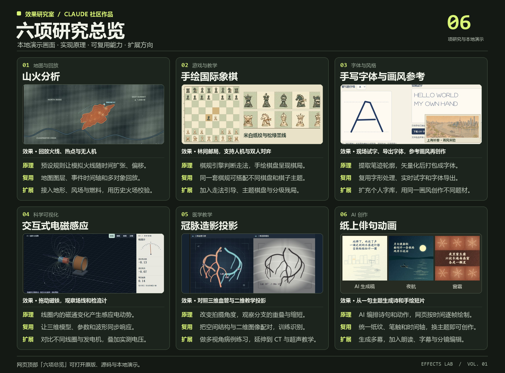

# 006 · 六个优秀产品的效果与复用研究

研究 Claude 社区展示的六个优秀产品及交互创作案例：山火分析、Ballpoint Gambit 手绘国际象棋、Harshpreet Hand 手写字体、Induction Bench 电磁感应实验、AngioView 冠脉造影教学，以及 Twenty Haiku 俳句动画。关注实际效果如何由规则、数据、风格和交互共同实现，并用六个可操作演示检验可复用的做法。

[公开研究与演示](https://yydshly.github.io/20261104_codex_project/006-claude-showcase/) · [原始作品串](https://x.com/claudeai/status/2111177834127601902) · [源码与本机运行](../../claude-showcase-lab/README.md) · [返回研究索引](../../README.md#研究索引)

## 沿用已生成的引导图

使用本轮已经生成的 1920 × 1420 引导图，未重新绘制。公开网页首页直接展示此图，并连接原版、研究演示、源码记录、绘画对照和短片。[查看高清引导图](https://yydshly.github.io/20261104_codex_project/006-claude-showcase/six-research-projects.png)

## 六个产品分别是什么

| 产品与原版 | 实现原理与可复用价值 | 我们的演示与后续方向 |
| --- | --- | --- |
| **山火分析 · Dilum Sanjaya**：[作者原片](https://x.com/DilumSanjaya/status/2108241054298415258)；另保留 [FireTrace 社区工作台](https://realkk.icu/firetrace/) | 用地图图层和同一事件时间轴组织火线、热点、无人机与资源回放。适合参考应急演练和事件复盘的工作流。 | [山火模拟回放](https://yydshly.github.io/20261104_codex_project/006-claude-showcase/#wildfire/play)：预设公式驱动扩张与偏移。真实地形、燃料、风速和风向驱动的计算列为扩展，保留 USGS、NOAA、LANDFIRE 等数据入口与历史边界校验思路。 |
| **Ballpoint Gambit · Kevin Ngo**：[在线体验](https://ballpoint-gambit.vercel.app/) · [作者说明](https://kevintngo.com/work/ballpoint-gambit/) | 将手绘风格与走棋规则分开，风格贯穿棋子、棋盘和操作反馈，结合语音入门课程。价值在于让规则清晰的游戏更有趣、更易进入。 | [林间邮局](https://yydshly.github.io/20261104_codex_project/006-claude-showcase/#chess/play)：手绘主题、chess.js 棋规、双人或简易电脑对弈、悔棋与棋局保存。后续可换主题，增加语音引导和分级残局。 |
| **Harshpreet Hand · Harshpreet Singh**：[在线字体样张](https://harshpreet931.github.io/harshpreet-hand/) · [字库与生成流程](https://github.com/harshpreet931/harshpreet-hand) | 从手写笔记提取字形轮廓，矢量化后打包为字体，多种字形保留笔迹变化。可复用为个人字库、品牌字体和排版素材。 | [笔迹与画风工坊](https://yydshly.github.io/20261104_codex_project/006-claude-showcase/#font/play)：重写 A–Z、实时试字与 OTF 导出；另有《卧室》到《雨后的阳台》、虹桥春市和现代上海长卷的画风参考实验。后续可扩字符、照片提取与作品版本比较。 |
| **Induction Bench**：[作者原站](https://electromagnetism.wasmer.app/) · [项目源码](https://github.com/thebuggeddev/electromagnetism) | 磁铁运动改变线圈磁通，按变化率计算感应电动势，使三维装置、场线、仪表和波形同步。可复用为可操作、可比较的科学实验。 | [三维电磁感应实验台](https://yydshly.github.io/20261104_codex_project/006-claude-showcase/#induction/play)：调整匝数、速度、磁极与视角，并对照两次实验。后续可扩发电机、不同负载和实测电压校验。 |
| **AngioView · Annas Rahman**：[作者原站](https://angioview.com/) · [作者原帖](https://x.com/AnnasRahmanMD/status/2107153860271706177) | 同一组三维冠脉随拍摄角度投影到二维，解释重叠与缩短。价值在于建立空间结构与影像之间的对应。 | [冠脉投影练习](https://yydshly.github.io/20261104_codex_project/006-claude-showcase/#angio/play)：双视图模型与缩短、角度选择、跨视角识别三课。后续可扩影像题库、CT 切面、超声探头训练和检查讲解。 |
| **Twenty Haiku · Kevin Ngo**：[作者原片](https://x.com/kevin_t_ngo/status/2107939123818574231) | AI 写诗，程序逐帧绘制，以统一纸纹、笔触、构图和时间轴组织诗、画与声音。可复用为诗文课堂、节令短片和展览内容。 | [短诗动画工坊](https://yydshly.github.io/20261104_codex_project/006-claude-showcase/#haiku/play)：五幕示例可编辑、播放、导出并保存草稿；本机可输入主题生成诗和镜头 JSON。后续可增加多幕编排、朗读与字幕。 |

## 我们形成的理解

1. **先看实际效果与完整操作。** 保留作者在线版或原片，再用自己的演示解释机制。视觉风格、交互反馈和最终产出共同构成产品体验。
2. **把稳定规则和可变呈现分开。** 棋规可搭配不同画风，时间轴可回放不同事件，三维结构可切换观察角度。复用的是可重新组织内容的机制。
3. **模型与数据决定模拟能回答什么。** 当前山火是模拟回放，接真实风场需要数据对齐、火传播计算和历史火场验证。电磁读数也采用简化模型和相对单位，接实测仪器需要标定。
4. **字体复刻与绘画参考各有实现。** 原字库解决字形提取和字体打包。绘画研究通过构图、配色与笔触分析完成新的画作，使用了另行生成的素材，不能据此推断原库能生成任意风格图像。
5. **AI 创作入口要有可执行范围。** 本机生成器输出经校验的诗句和镜头方案，由既有绘图元素与动作执行。题材可以改变，表现范围受工坊画法限制。
6. **展示完成与产品效果验证分开记录。** 冠脉使用简化教学模型；真实病例、医学测量、教学收益、原版完整复刻程度和商业化价值需要后续验证。

## 已完成的研究产物

- 六个可操作研究演示，每页均有操作提示、原理、本地实现、可复用能力、扩展方向与当前范围。
- 一张研究引导图，以及六项原理、价值、原版链接和源码记录对照表。
- 《卧室》与《雨后的阳台》、《清明上河图》虹桥局部与《虹桥春市》，以及现代上海《黄浦江春景》长卷；参考原画与我们的创作分别标注。
- 《从暮到晓》15 秒五幕短片和《雨停后的末班站》6 秒 AI 生成稿，可直接播放；短诗工坊支持编辑、播放、WebM 导出和浏览器草稿恢复。
- 山火真实数据扩展路线、手绘棋盘主题与课程思路、电磁实验对照，以及冠脉三课与医学产品方向说明。

## 原版、源码与使用范围

字体生成流程标注 MIT，字库标注 SIL OFL 1.1。FireTrace 社区实现与电磁实验源码公开，研究时未见许可证；其余原版保留公开试玩或视频，未查到可复用应用源码或原动画工程。源码公开与获得复用授权需要分别确认，状态以页面中的研究记录为准。

我们的演示是独立研究实现，不代表原版源代码、素材或功能完整复刻。原版山火、社区 FireTrace 和本地山火按不同入口展示；原片继续使用作者媒体地址，联网状况和发布方的嵌入策略会影响加载，页面提供外部打开链接。

## 发布与验证

源码在 `claude-showcase-lab/`，运行 `npm run build:pages` 构建公开版并复制到 `docs/006-claude-showcase/`，逐文件校验 SHA-256。公开站点沿用总库 GitHub Pages 的 `main` 分支 `/docs` 发布源。

公开版保留六个演示、现成作品、示例编辑与导出。**新主题 AI 生成只在本机服务启用**，需要已登录的 Codex CLI 与网络；公开网页不提供生成后端。浏览器棋局和草稿按站点分别保存，不上传。

完成构建、静态资源校验后，在网页检查引导图、六个入口、山火时间轴、电磁参数对照、冠脉课程、短诗编辑与视频播放。检查结果证明已操作流程可运行，真实数据推演、临床使用、教学收益和扩展产品价值仍按各页说明继续验证。
