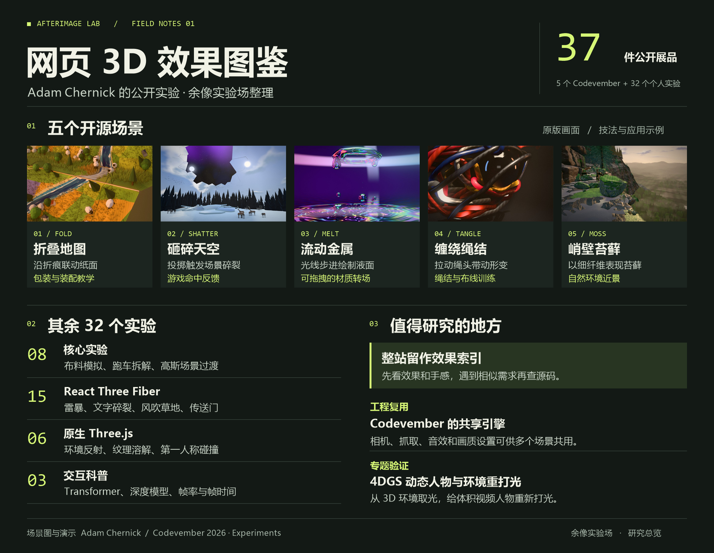

# 007 · 一个人的网页 3D 效果合集

研究 Adam Chernick 个人制作的网页 3D 实验，整理折叠、碎裂、液态金属、布料、产品拆解、反射与高斯场景等效果。保留 37 项原版入口、中文原理和应用参考，重点判断效果选型、共享引擎复用与 4DGS 环境重打光的价值，并说明本轮尚未扩展的内容。

[在线研究与效果展](https://yydshly.github.io/20261104_codex_project/007-creative-webgpu-showcase/) · [作者实验目录](https://adamwebsite.com/experiments/) · [Codevember 原库](https://github.com/acher249/codevember-2026) · [源码与本机运行](../../creative-webgpu-showcase/README.md) · [返回研究索引](../../README.md#研究索引)

## 这个合集的能力

Adam Chernick 以个人作者身份制作、扩展和组合网页 3D 场景。部分实验来自他对 Three.js、React Three Fiber 等开源示例的改编，原站保留来源说明。其能力体现在把材质、光照、物理和输入组织成可以实时观看与操作的效果。

我们的子项目接入作者在线原版演示，并整理中文说明、源码入口与用途设想。本轮关注已有视觉与交互实现，在具体需求出现时选取相应代码研究。装配教学、商品展示和数字人导览等是可迁移方向。

## 沿用已生成的引导图

网页首页沿用这张已经生成的 2220 × 1719 总览图。画面和数量对应 2026 年 11 月 6 日的收录，研究归纳整理于 11 月 21 日。作者后续新增作品按需求继续增补。[公开引导图](https://yydshly.github.io/20261104_codex_project/007-creative-webgpu-showcase/assets/research-overview.png)

## 我们的理解与价值判断

- **效果参考。** 先看视觉与操作手感，遇到相似需求再查源码。液态金属可供材质转场参考，碎裂可供游戏命中反馈参考，折叠可供教程参考。
- **工程复用。** Codevember 的共享引擎集中渲染、后处理、相机、抓取、音效和设置，独立目录组织每个场景。对系列互动作品，可以研究公共能力和场景接口怎样协作。[共享引擎](https://github.com/acher249/codevember-2026/tree/main/shared/engine)
- **专题验证。** 4DGS 示例由 Spark.js 渲染静态高斯环境，Gracia 播放动态体积视频人物，从环境立方贴图求球谐光照给人物重新打光。数字人导览需要验证换场景后的光色、播放与移动体验。[上游实现说明](https://github.com/acher249/4dgs-world-foundation-model-demo)

整站留作效果索引，按实际项目需求挑选一两项深入。现有资料已可供选型和源码回查，产品使用收益继续通过具体项目验证。

## 已收录的效果

目录保留 11 月 6 日的 37 项快照，包括 5 个 Codevember、8 个核心实验、15 个 React Three Fiber、6 个原生 Three.js 和 3 个交互科普。名称可以进入本展页对应模块，原版和源码在模块内提供。

### Codevember · 5 项

| 效果与入口 | 能看到什么 | 应用参考 |
| --- | --- | --- |
| [折叠地图 · Fold](https://yydshly.github.io/20261104_codex_project/007-creative-webgpu-showcase/?exhibit=fold#exhibit-fold) | 一条乡间景色印在纸地图上，沿预设折痕可以把地图叠起来。 | 把操作说明里的折叠顺序做成可练习的包装、纸艺或装配教程。 |
| [砸碎天空 · Shatter](https://yydshly.github.io/20261104_codex_project/007-creative-webgpu-showcase/?exhibit=shatter#exhibit-shatter) | 把石头扔向天空，碎片会落在下方结冰的湖面上。 | 用在可破坏场景的游戏原型里，检验玩家能否从碎片读懂命中结果。 |
| [流动金属 · Melt](https://yydshly.github.io/20261104_codex_project/007-creative-webgpu-showcase/?exhibit=melt#exhibit-melt) | 镜面上方有一股液态金属，你可以抓起它并拖到别处。 | 为珠宝或金属产品的视觉原型制作可拖拽的液态转场。 |
| [缠绕绳结 · Tangle](https://yydshly.github.io/20261104_codex_project/007-creative-webgpu-showcase/?exhibit=tangle#exhibit-tangle) | 一束漆面绳索悬在光柱里，观众可以拽住松开的绳头。 | 用于绳结训练或线缆布置模拟，让学习者观察拉动一端如何影响余段。 |
| [峭壁苔藓 · Moss](https://yydshly.github.io/20261104_codex_project/007-creative-webgpu-showcase/?exhibit=moss#exhibit-moss) | 森林上方的崖壁长满苔藓，近看能辨出一根根细丝。 | 用于自然场景的近景地表，把岩面、植被和攀附关系表现出来。 |

### 核心实验 · 8 项

| 效果与入口 | 能看到什么 | 应用参考 |
| --- | --- | --- |
| [跑车拆解 · TypeGPU + WebGPU](https://yydshly.github.io/20261104_codex_project/007-creative-webgpu-showcase/?exhibit=typegpu-webgpu#exhibit-typegpu-webgpu) | 在浏览器里看一辆未来跑车，探索动态仪表与零件拆解视图。 | 用于设备说明或产品展示，先介绍外观，再引导用户了解内部部件的位置和作用。 |
| [管道屏保 · Pipe Screen Saver](https://yydshly.github.io/20261104_codex_project/007-creative-webgpu-showcase/?exhibit=pipe-screensaver#exhibit-pipe-screensaver) | 经典 Windows 3D 管道屏保的浏览器重制版，管道穿过盒子，随后淡出并重新生长。 | 用于生成式待机画面或科技展背景，同一套规则可持续生成不同构图。 |
| [雨巷布料 · Cloth Sim Alley](https://yydshly.github.io/20261104_codex_project/007-creative-webgpu-showcase/?exhibit=cloth-sim-alley#exhibit-cloth-sim-alley) | 雨夜小巷里晾着 23 件衣服，阵风、热风和穿行的无人机都会改变布料的形态。 | 把会响应环境和移动物体的织物用到展厅装置或游戏场景中，让布料成为可观察的交互反馈。 |
| [高斯神庙 · Vapor Splat](https://yydshly.github.io/20261104_codex_project/007-creative-webgpu-showcase/?exhibit=vapor-splat#exhibit-vapor-splat) | 走进一座以高斯泼溅呈现的神庙，在可游玩的场景里寻找钥匙。 | 把扫描或生成的空间变成有目标的导览，例如在数字展馆安排寻物路线。 |
| [高斯场景过渡 · 3DGS Gaussian Interpolation Transitions](https://yydshly.github.io/20261104_codex_project/007-creative-webgpu-showcase/?exhibit=3dgs-gaussian-interpolation-transitions#exhibit-3dgs-gaussian-interpolation-transitions) | 用键盘在几个 SOG 高斯场景之间切换，观察中间的连续过渡。 | 用于空间叙事中的章节转换，方便观众比较同一位置的不同版本。 |
| [高斯场景映射 · 3DGS Env Map Ground Projection](https://yydshly.github.io/20261104_codex_project/007-creative-webgpu-showcase/?exhibit=3dgs-envmap-ground-projection#exhibit-3dgs-envmap-ground-projection) | 把一辆反光汽车放进高斯泼溅场景，观察车漆怎样映出周围环境。 | 把可配置商品放进已有的扫描场地，在不重建场地网格的情况下获得协调的反射。 |
| [动态高斯播放 · 4DGS Gracia WebSDK](https://yydshly.github.io/20261104_codex_project/007-creative-webgpu-showcase/?exhibit=4dgs-gracia-websdk#exhibit-4dgs-gracia-websdk) | 在 Three.js 页面里观看由 Gracia WebSDK 播放的动态高斯场景。 | 用于远程舞蹈、动作训练或表演回看，允许观众从多个位置观察动作。 |
| [动态人物与生成场景 · 4DGS + World Foundation Model](https://yydshly.github.io/20261104_codex_project/007-creative-webgpu-showcase/?exhibit=4dgs-world-foundation-model#exhibit-4dgs-world-foundation-model) | 把可以从不同角度观看的动态人物放进生成的三维世界，切换环境时仍可继续探索。 | 用于数字展馆和沉浸式导览，把实拍体积视频讲解员放进不同空间，跟随环境改变光色。 |

### React Three Fiber · 15 项

| 效果与入口 | 能看到什么 | 应用参考 |
| --- | --- | --- |
| [网页与三维遮挡 · Mixing HTML and WebGL](https://yydshly.github.io/20261104_codex_project/007-creative-webgpu-showcase/?exhibit=mixing-html-and-webgl#exhibit-mixing-html-and-webgl) | 网页元素和三维物体出现在同一场景，物体挡住网页元素时，后者会被遮住。 | 用于三维设备的可点击标签，保留 HTML 按钮的交互能力并遵守场景遮挡关系。 |
| [碰撞与间接光 · SSGI Spheres with Rapier](https://yydshly.github.io/20261104_codex_project/007-creative-webgpu-showcase/?exhibit=ssgi-spheres#exhibit-ssgi-spheres) | 一组球体在场景里运动并碰撞，用来观察球体和周围表面的受光关系。 | 给物理演示和玩具游戏加上随物体移动的光照反馈。 |
| [环境模糊过渡 · Environment Blur and Transitions](https://yydshly.github.io/20261104_codex_project/007-creative-webgpu-showcase/?exhibit=environment-blur-and-transitions#exhibit-environment-blur-and-transitions) | 一个反光球用来对照环境预设与模糊程度，切换时可以观察反射变化。 | 用于商品的材质预览，让用户在不同光照下比较同一表面。 |
| [文字碎裂 · Cell Fracture](https://yydshly.github.io/20261104_codex_project/007-creative-webgpu-showcase/?exhibit=cell-fracture#exhibit-cell-fracture) | 立体文字在交互时裂成多个不规则块，碎片各自运动。 | 用于活动标题揭幕或小游戏里的可破坏字牌，避免运行时切割模型。 |
| [空间影廊 · Image Gallery](https://yydshly.github.io/20261104_codex_project/007-creative-webgpu-showcase/?exhibit=image-gallery#exhibit-image-gallery) | 图片陈列在有反射的三维画廊里，点选图片会把视角移过去。 | 用于小型线上展览，让观众点作品就能靠近查看。 |
| [雷暴云层 · Thunder Clouds](https://yydshly.github.io/20261104_codex_project/007-creative-webgpu-showcase/?exhibit=thunder-clouds#exhibit-thunder-clouds) | 云层中出现闪电，镜头会随雷暴事件产生晃动。 | 用于天气场景或沉浸式叙事，通过相机反馈传达雷暴的力度。 |
| [动态车漆反射 · Building Dynamic Env Maps](https://yydshly.github.io/20261104_codex_project/007-creative-webgpu-showcase/?exhibit=building-dynamic-envmaps#exhibit-building-dynamic-envmaps) | 镜头观察一辆反光汽车，车漆里的棚灯形状随场景灯光布局变化。 | 搭建在线汽车或家电摄影棚，用几块虚拟灯面控制产品轮廓高光。 |
| [声音驱动画面 · Audio Analyser](https://yydshly.github.io/20261104_codex_project/007-creative-webgpu-showcase/?exhibit=audio-analyser#exhibit-audio-analyser) | 程序生成的三维场景随声音变化，声音本身成了画面输入。 | 让音乐播放页或演出屏幕随音轨生成可视化反馈。 |
| [环境投影地面 · Envmap Ground Projection](https://yydshly.github.io/20261104_codex_project/007-creative-webgpu-showcase/?exhibit=envmap-ground-projection#exhibit-envmap-ground-projection) | 反光汽车与 HDR 背景里的地面接在一起，看起来像停在环境中。 | 将小型商品模型放进拍摄场地的全景照片，快速制作有地面参照的预览。 |
| [复用三维模型 · Re-using GLTFs](https://yydshly.github.io/20261104_codex_project/007-creative-webgpu-showcase/?exhibit=re-using-gltfs#exhibit-re-using-gltfs) | 加载一个 glTF 资产后，在场景中摆放它的多个实例。 | 在虚拟门店、仓库或园区中反复摆放同款道具，减少重复加载。 |
| [全景热点导览 · Sky Dome with Annotations](https://yydshly.github.io/20261104_codex_project/007-creative-webgpu-showcase/?exhibit=sky-dome-with-annotations#exhibit-sky-dome-with-annotations) | 在球形全景中查看标注，热点作为通往另一个视点的入口。 | 用普通全景照片搭建房产、展厅或校园的分点导览。 |
| [风吹草地 · Grass Shader](https://yydshly.github.io/20261104_codex_project/007-creative-webgpu-showcase/?exhibit=grass-shader#exhibit-grass-shader) | 草地上的草叶随风弯动，能从不同角度看到草丛层次。 | 用在户外游戏地图或园林方案预览里，以较少的几何资源表现大片植被。 |
| [场景统一调色 · Color Grading](https://yydshly.github.io/20261104_codex_project/007-creative-webgpu-showcase/?exhibit=color-grading#exhibit-color-grading) | 同一套三维场景可以套用调色后的色调和明暗关系。 | 用于游戏关卡或品牌展页，用统一色调覆盖不同场景材质。 |
| [程序化海面 · Water Shader](https://yydshly.github.io/20261104_codex_project/007-creative-webgpu-showcase/?exhibit=water-shader#exhibit-water-shader) | 一大片海面持续起伏，光泽会随着水面的局部朝向移动。 | 为港口、岛屿或水上关卡添加可循环的远景水面。 |
| [穿越传送门 · Enter Portals](https://yydshly.github.io/20261104_codex_project/007-creative-webgpu-showcase/?exhibit=enter-portals#exhibit-enter-portals) | 从三维门框里看到另一套场景，进入时两个空间会平滑交接。 | 把展览房间、产品章节或游戏关卡连成连续的空间导航。 |

### 原生 Three.js · 6 项

| 效果与入口 | 能看到什么 | 应用参考 |
| --- | --- | --- |
| [UltraHDR 贴图加载 · UltraHDR Texture Loader](https://yydshly.github.io/20261104_codex_project/007-creative-webgpu-showcase/?exhibit=ultrahdr-texture-loader#exhibit-ultrahdr-texture-loader) | 在原生 Three.js 场景中读取 UltraHDR 图像，把亮部信息用于环境和材质。 | 让在线商品棚拍或全景预览保留灯光、窗户和金属反射里的亮部层次。 |
| [反射与折射材质 · Materials Env Maps](https://yydshly.github.io/20261104_codex_project/007-creative-webgpu-showcase/?exhibit=materials-envmaps#exhibit-materials-envmaps) | 观察环境映射在反射和折射两种材质模式下的差别。 | 为镜面标牌、玻璃瓶或透明饰件选择合适的材质模式。 |
| [立方环境预滤波 · PMREM Cubemap](https://yydshly.github.io/20261104_codex_project/007-creative-webgpu-showcase/?exhibit=pmrem-cubemap#exhibit-pmrem-cubemap) | 用一组六面环境贴图为网格中的材质提供不同清晰度的反射。 | 让电商的同一产品在抛光、喷砂和哑光选项间呈现可比较的外观。 |
| [全景环境预滤波 · PMREM Equirectangular](https://yydshly.github.io/20261104_codex_project/007-creative-webgpu-showcase/?exhibit=pmrem-equirectangular#exhibit-pmrem-equirectangular) | 把一张经纬展开的环境图送进材质对照网格，观察不同表面的受光。 | 把一张 360° 环境照片用作虚拟影棚的照明素材，快速比较材质样品。 |
| [随机纹理溶解 · Random UV](https://yydshly.github.io/20261104_codex_project/007-creative-webgpu-showcase/?exhibit=random-uv#exhibit-random-uv) | 观察纹理取样被打散后形成的颗粒变化和材质溶解。 | 用于展页揭示动画或游戏道具消失，给过渡添加可控的不规则边缘。 |
| [第一人称碰撞 · Games FPS](https://yydshly.github.io/20261104_codex_project/007-creative-webgpu-showcase/?exhibit=games-fps#exhibit-games-fps) | 从第一人称视角穿行，和场景中的几何体发生碰撞。 | 搭建室内巡检、建筑漫游或游戏关卡的移动原型。 |

### 交互科普 · 3 项

| 效果与入口 | 能看到什么 | 应用参考 |
| --- | --- | --- |
| [Transformer 词语机器 · How a Transformer Works](https://yydshly.github.io/20261104_codex_project/007-creative-webgpu-showcase/?exhibit=how-transformers-work#exhibit-how-transformers-work) | 用可交互的词语机器演示模型怎样一步步接续文字。 | 用于 AI 入门课，帮助初学者把注意力与逐词生成区分开。 |
| [深度模型怎么学 · How a Depth Model Learns](https://yydshly.github.io/20261104_codex_project/007-creative-webgpu-showcase/?exhibit=how-depth-models-learn#exhibit-how-depth-models-learn) | 通过互动看到模型怎样从单张照片估计远近，并把照片抬成有纵深的三维视图。 | 用于计算机视觉教学，帮助学习者区分模型推测的深度和真实测量。 |
| [帧时间与帧率 · How Frame Time and FPS Work](https://yydshly.github.io/20261104_codex_project/007-creative-webgpu-showcase/?exhibit=frame-time-fps#exhibit-frame-time-fps) | 把屏幕当作按节拍翻动的图册，观察新画面没赶上时怎样重复上一帧。 | 用于前端性能培训，让团队理解平均 FPS 接近时为什么仍会感觉卡顿。 |

## 尚未扩展的部分

| 方向 | 本轮范围 | 继续研究的价值 |
| --- | --- | --- |
| 效果二次开发 | 接入作者原版，尚未移植或改写上游特效源码。 | 替换素材、开放参数，将单项效果用于自己的页面。 |
| 真实业务样板 | 包装教程、商品展示、游戏反馈和数字人导览目前保留为应用设想。 | 接真实内容与业务流程，验证是否帮助用户完成任务。 |
| 组件与共享引擎 | 已识别共享能力，尚未提取成独立组件。 | 评估场景接口、公共能力和系列作品的维护方式。 |
| 性能与兼容性 | 有浏览器操作记录，尚未系统测量多设备帧率、显存和加载成本。 | 确定画质策略、设备覆盖和资源预算。 |
| 3DGS / 4DGS | 已整理原版场景与重打光路径，素材接入、连续播放和部署条件继续按专题核验。 | 验证动态人物与生成空间的协作。 |
| 后续作品 | 保留本轮 37 项目录，作者后续 Codevember 日更和新增实验尚未收录。 | 按实际技法需求补充可对照的案例。 |

## 来源与许可

- [原始 X 帖子](https://x.com/ajc_builds/status/2118544045316198491)介绍个人 Codevember 日更挑战。
- [作者实验目录](https://adamwebsite.com/experiments/)说明开源示例、扩展与组合的来源。
- [Codevember 仓库](https://github.com/acher249/codevember-2026)采用 MIT，扫描素材与字体等按各自声明使用。[第三方鸣谢](https://github.com/acher249/codevember-2026/blob/main/CREDITS.md)
- [4DGS 示例](https://github.com/acher249/4dgs-world-foundation-model-demo)的作者源码采用 MIT，Gracia SDK 和其他资产有单独许可。[许可说明](https://github.com/acher249/4dgs-world-foundation-model-demo#license)

页面通过原版地址嵌入在线场景，原版加载受作者站、网络和设备影响。用途说明记录的是我们的应用设想。共享引擎与 4DGS 的研究方向依据上游结构归纳。

## 发布与验证

源码与本机服务位于 `creative-webgpu-showcase/`。运行 `npm start` 后访问本机 4184 端口，运行 `npm run build:pages` 复制静态文件并逐文件校验 SHA-256。公开站沿用总库 GitHub Pages 的 `main` 分支 `/docs` 发布源。

网页提供已有引导图、研究归纳、完整效果清单、待扩展范围和 37 个原版入口。支持的场景进入视口后自动加载，移出后释放，搜索与分类可以定位相应效果。

GitHub Pages 公开版受浏览器隔离条件约束，两项 Gracia 4DGS 通过模块中的原站链接播放。本机服务提供跨源隔离响应头。其余原版演示需要联网，部分需要 WebGPU。验证记录以实际完成的页面操作为准。
