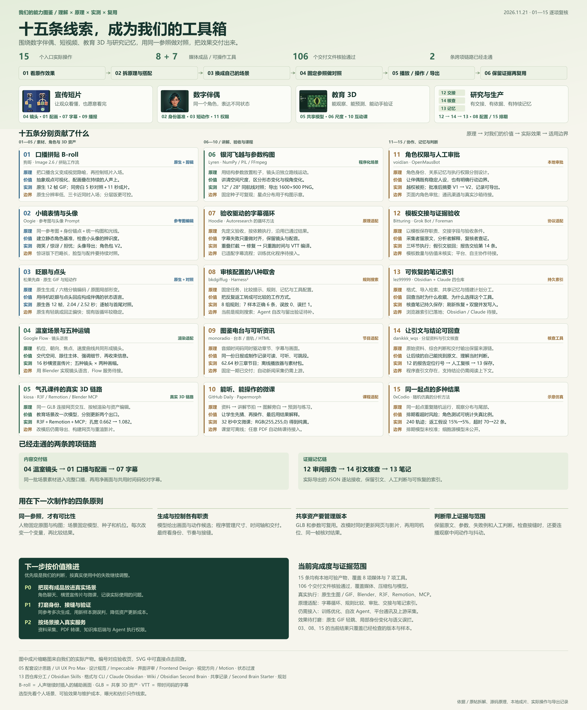

# 008 · 16 个链接的能力与价值解析

解析 **15 条 X 原帖与 1 个 Gitruck 有声剪辑补充案例，共 16 个链接**。重点是生图与角色一致性、短片镜头和配画、共享 3D 教学、Agent 工作流及可追溯知识库，判断这些能力怎样用于我们的数字伴偶、宣传片、课程与研究记录。

[在线解析与效果](https://yydshly.github.io/20261104_codex_project/008-link-capability-atlas/) · [逐项验收](https://yydshly.github.io/20261104_codex_project/008-link-capability-atlas/acceptance.html) · [源码与本机运行](../../x-capability-atlas/README.md) · [返回研究索引](../../README.md#研究索引)

## 沿用已经生成的引导图

引导图沿用本轮已生成的版本，图中十五条对应最初的 15 条原帖。第 16 条将之前已经展示的 Gitruck 有声剪辑对照单独解析，补充口播语义、图解特写与可继续精修的工程这一层。网页明确标出 15＋1 的收录口径。[放大引导图](https://yydshly.github.io/20261104_codex_project/008-link-capability-atlas/assets/atlas-understanding-20261121.svg)

## 能力与复用价值

- **短片制作。** 镜头语言、拼贴配画、口播剪辑、时间轴字幕与可听节目配合，帮助观众在持续的人声中看清重点。温室横竖宣传片、两种口播剪法和原生拼贴 GIF 提供实际对照。
- **角色表达。** 用同一张小镜原图固定脸型、眼镜、发夹与构图，再比较微笑、惊讶、担忧、眨眼和点头。已有三种表情与原生 GIF，身份局部变化和循环接缝仍需继续打磨。
- **教育 3D。** 一个共享 GLB 服务 R3F 网页交互与 Remotion 讲解片，通过 Blender MCP 修改资产。银河构图与 RGB 微课补充空间解释、预测、操作和结果验证的组织方法。
- **生产与知识系统。** 验收循环减少重复重跑，配置搜索比较误放、误拦和检查成本，模板与引文报告保留交接证据，持久索引支持刷新和跨窗口回查，随机仿真帮助比较排期假设。

## 十六个链接的范围

| 编号 | 链接与研究对象 | 可复用能力及本站验证 |
| --- | --- | --- |
| 01 | [狗哥 · Image 2.6 拼贴](https://x.com/gbroai/status/2118360718554894395) | 口播含义转成视觉隐喻，已有原生 GIF、分层动画与同旁白对照片。 |
| 02 | [Oogie · 头像配方](https://x.com/oggii_0/status/2118216706459914578) | 参考图承载身份，提示词统一构图与风格，已有三表情和头像导出。 |
| 03 | [松果先森 · 短动作](https://x.com/songguoxiansen/status/2118177108573016517) | 短动作表达角色状态，已有原生眨眼、点头与逐帧、首尾对照。 |
| 04 | [Google Flow · 五种镜头](https://x.com/FlowbyGoogle/status/2118082696119541769) | 用机位和节奏表达叙事意图，已有 Blender 温室横竖片与五组镜头。 |
| 05 | [kiosa · 设计与 3D 工具](https://x.com/thegreatest_sv/status/2118374136799985771) | R3F、Remotion、Blender MCP 共用气孔模型，网页、讲解片和修改记录齐备。 |
| 06 | [Lyren · 银河飞越](https://x.com/0xAIlabs/status/2118379258607251490) | 结构参数与镜头分开，已有同航线旋臂对照片与 PNG 导出。 |
| 07 | [Hoodie · Autoresearch](https://x.com/HoodieFade_/status/2118010863038746652) | 把验收与重试适配到字幕流程，实际拦截重叠并只重跑受影响环节。 |
| 08 | [bkdgiffug · Harness²](https://x.com/bkdgiffug/status/2118038567264141418) | 将配置比较适配为八种规则试跑，记录误放、误拦与检查成本。 |
| 09 | [monoradio · 新闻电台](https://x.com/monoradio102/status/2118287543288697312) | 同一音频时钟驱动章节、字幕与配图，已有三章节目与离线播放器。 |
| 10 | [GitHub Daily · Papermorph](https://x.com/GitHub_Daily/status/2118350138347544618) | 资料组织成讲解节拍与练习，已有中文 RGB 微课与学习记录。 |
| 11 | [voidJan · OpenMausBot](https://x.com/voidJan/status/2118240276473147484) | 角色职责和执行权限分开，已有本地审批及版本记录。 |
| 12 | [Bitturing · Bot 模板](https://x.com/Bitturing/status/2117885119092683260) | 复用职责和交接协议，实际运行采集、分析、复核并拦截错误引文。 |
| 13 | [lez99999 · 知识库四仓库](https://x.com/lez99999/status/2118063491894714842) | 区分格式、导入、检索与记忆，已有持久笔记、跨窗口回查与迁移 JSON。 |
| 14 | [danikkk_wqs · 第二大脑](https://x.com/danikkk_wqs/status/2118100946911932809) | 保留原文与上下文，已有引文定位、人工支持度复核和笔记交接。 |
| 15 | [0xCodio · 随机仿真](https://x.com/0xCodio/status/2118290123255349265) | 将重复抽样适配到排期，已有 240 条轨迹及固定种子的基准比较。 |
| 16 | [Gitruck · 有声口播剪辑](https://github.com/Gitruck/cli#demo) | 比较原始口播与图解、特写成片，理解语义配画与可编辑工程的价值。 |

## 我们已经留下的理解

固定参考图、模型、随机种子或机位，才能看清一个变量带来的变化。模型提供画面与动作候选，程序负责尺寸、时间轴、检查和交付，最后仍要实际播放或操作。

共享资产可以被多个出口复用。修改 GLB 后，需要导出资产、重新构建网页和渲染影片，再用相同机位与帧号检查。可复用的工作流要保留版本、参数、失败例和判断依据。

两条已经走通的链路是 **04 镜头 → 01 口播配画 → 07 字幕交付**，以及 **12 审阅报告 → 14 引文核查 → 13 持久笔记**。前者复用同一批场景素材与字幕时间码，后者传递真实导出的报告与核查记录。

## 实测边界与后续方向

网页逐条保留原作、实现依据、本地效果与交付入口。第 07–08、11–14 条主要是原理与场景适配。原库训练优化、Agent 自改、外部通讯与权限、Obsidian／Claude 服务，以及上游自动采集、任意 PDF 转课尚未接入。第 16 条核对已有原作与独立的本地剪法，Gitruck CLI 和云端服务未在本项目执行。

原生 GIF 的首尾与部分中间帧仍有轻跳，惊讶头像有局部身份变化，逐字规则会误拦合理转述。排期模型的参数是示意假设。多次生成成功率、真实用户理解程度、实际节省工时和维护成本继续通过真实项目验证。
