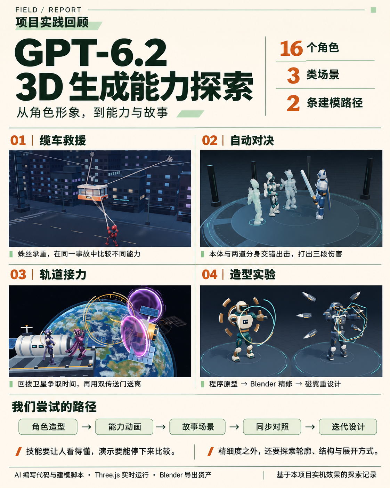

# 009 · GPT-6.2 的 3D 生成能力探索

本轮研究 **GPT-6.2 如何把自然语言需求转成可编辑的 3D 角色、动作、特效与故事场景，并根据实际观看反馈继续修改**。项目把 16 个角色身份、三类实战场景与 Blender 造型对照组织成一条可运行的演示链，观察原型制作、视觉讲解和跨场景复用的价值。

[在线研究与能力价值](https://yydshly.github.io/20261104_codex_project/009-gpt62-3d-capability/journey.html) · [英雄档案与实机演示](https://yydshly.github.io/20261104_codex_project/009-gpt62-3d-capability/) · [源码与建模脚本](../../species-arena-3d/) · [返回研究索引](../../README.md#研究索引)

## 沿用已经生成的引导图



引导图沿用本轮已经生成的版本，四组效果来自项目实机画面。阅读时可以先看英雄的形象，再进入同一事故比较能力，最后观察时间轴、角色资产与外观怎样继续复用。[查看引导图](https://yydshly.github.io/20261104_codex_project/009-gpt62-3d-capability/journey/gpt62-3d-exploration.png)

## 研究对象与制作路径

最初的问题是能否做一款与 AI 有关的 3D 游戏。讨论随后收敛到更具体的观察对象，包含多种角色体型、清楚的招式动作、能力对环境的改变，以及在同一个问题中比较不同解决方式。

制作过程保留了两条路径。

```text
自然语言需求 → 代码生成与修改 → Three.js 几何、材质、关节和特效 → 浏览器实时场景

造型目标 → Blender Python 建模脚本 → GLB 部件资产 → 共用 JavaScript 关节与动作 → 实时场景
```

浏览器执行已经生成的代码与资产。Blender 4.5.3 实际导出了磁极的两款 GLB 外观，每款对应 21 个部件挂点与 9 种材质，动作继续由 JavaScript 关节系统驱动。几何、材质、动作与事件编排可以分别检查和继续修改。

## 相关能力与价值

| 能力 | 当前项目里的证据 | 可以怎样使用 |
| --- | --- | --- |
| 几何与材质构建 | 双足卫士、四足岩兽、六足机械、浮游生物，以及不同超能英雄的造型 | 把角色或产品概念变成可旋转检查的原型，用于早期形体评审与方向选择。 |
| 层级关节与程序动画 | 待机、移动、蓄力、施放、磁环与磁翼展开 | 使同一资产具备可复现、可暂停的动作，便于检视结构和时序。 |
| 可读的技能特效与反馈 | 16 套招式表现，蓄力、施放和冷却状态，以及映阵本体与分身三段命中 | 将抽象能力转成观众能辨认的动作和结果，可用于规则讲解与互动展示。 |
| 时间轴与场景叙事 | 同一缆车事故的 11 条单人路线，轨道拦截的 5 条单人路线 | 固定问题与环境后比较不同方法，适合能力导览、方案解释与短片编排。 |
| 多角色协调 | 牵星与疾弧的缆车联合救援，时缝与折径的轨道接力 | 通过同场接手展示角色之间的职责和依赖，可继续迁移到协作任务解释。 |
| 共享资产与多场景复用 | 共用英雄名录、角色选择、动作系统，以及磁极外观跨竞技场与轨道使用 | 给后续场景一个已有的角色和动作基础，使修改可以跨多个展示出口核对。 |
| Blender 脚本与资产设计 | 程序原型、原型精修、磁翼重设计三种造型对照 | 分别研究表面细化与整体轮廓、结构、展开机制的变化，形成可继续迭代的资产流程。 |
| 对照、回放与交付 | 同步双画面、任务节点、回放链接、只看画面、5.2 秒造型演示与保持展开 | 用相同机位和时间点定位差别，支持原型评审、效果讲解、录制与后续复查。 |

这些是当前项目可展示的能力与应用方向。实际节省工时、真实用户理解程度和长期维护成本，需要在具体项目中继续测量。

## 当前可以观察的效果

- **英雄档案。** 16 个身份包含 12 位超能英雄与 4 个竞技异种。可按类别和可进入的场景筛选，旋转观察并预演能力。[打开英雄档案](https://yydshly.github.io/20261104_codex_project/009-gpt62-3d-capability/)
- **异种竞技场。** 16 个角色均可自动对决。映阵的两道分身与本体交错出击，命中实际按三段结算。[查看映阵，选择对手并开战](https://yydshly.github.io/20261104_codex_project/009-gpt62-3d-capability/arena.html?hero=mirror)
- **超能现场。** 围绕同一场缆车事故展示 11 条单人救援路线，以及牵星与疾弧的联合路线。联合路线可切换街头与极速视角。[进入蛛丝救援](https://yydshly.github.io/20261104_codex_project/009-gpt62-3d-capability/rescue.html?hero=web)
- **轨道拦截。** 磁极、牵星、根珀、折径、时缝提供 5 条单人路线，时缝与折径可以同场接力。13 秒共用时间轴支持双画面对照、暂停定位与复制链接。[打开同步对照](https://yydshly.github.io/20261104_codex_project/009-gpt62-3d-capability/orbit.html?hero=rewind&compare=portal&t=6.6) · [查看联合交接](https://yydshly.github.io/20261104_codex_project/009-gpt62-3d-capability/orbit.html?hero=rewind&mission=relay&t=7.35)
- **磁极造型实验。** 左侧为程序原型，右侧可切换 Blender 原型精修和磁翼重设计。三种版本属于同一英雄身份，可同步暂停、保持展开、看背面，并带选中的 Blender 外观进入实战。[打开造型对照](https://yydshly.github.io/20261104_codex_project/009-gpt62-3d-capability/magnet-lab.html)

## 我们形成的理解

先把形象、能力与现场反馈连起来，才能看清一个 3D 生成结果是否可用。让蛛丝拉住缆车、让藤架弯曲承重、让卫星沿来路倒退，提供了可观察的作用关系。

规则执行需要被传达。初期对决已有技能伤害，通用闪光却让人以为只在普攻。补齐招式、分身和状态提示后，伤害、动作与特效才能对得上。

精修和重设计回答不同问题。磁极原型精修沿用了轮廓，主要比较表面细节。磁翼版进一步改变装甲、背部结构和展开方式，才形成另一套设计选择。

展示控制也来自实际反馈。2.2 秒演示很快收回，且出现过起步卡在第 0 秒的问题。现在的 5.2 秒时间轴、保持展开、看背面、双画面对照和回放链接，使差异可以停下来检查。

共享角色与动作给后续扩展提供基础。新增外观和场景可以继续使用已验证的挂点、动作与时间轴，减少需要重新设计的部分。实际迭代效率仍要结合维护与验收成本判断。

## 验证范围与后续研究

当前完成了自动对决、角色观察、能力预演与可交互回放。对决按距离、冷却和命中规则结算，缆车与卫星轨迹由代码编排。研究记录以可运行页面、实机截图、暂停时刻与构建产物为依据。

本轮的模型名称沿用试用记录。生成速度、额度和画面提升属于个人观察，尚未开展同条件的模型性能横向评测。当前产物支持检查代码与效果，模型的稳定通过率、跨任务泛化与实际生产成本仍需要独立实验。

后续可以先让玩家选择两位英雄与接力顺序，加入会影响结果的出手时机，再补足失败、恢复和重试。长期关卡与成长循环、通用物理交互、实际教学效果与完整产品收益，继续按具体问题验证。

## 运行与发布

源码位于 `species-arena-3d/`。在该目录运行以下命令。

```powershell
npm ci
npm run dev
```

本机预览默认使用 `http://127.0.0.1:5194/`。运行公开构建后，逐页检查研究摘要、引导图、模型资产和三个场景的正常入口。

```powershell
npm run build:pages
```

公开产物位于 `docs/009-gpt62-3d-capability/`，沿用总库 GitHub Pages 的 `main` 分支 `/docs` 发布源。在线研究页使用 `journey.html`，同目录的 `index.html` 为英雄档案，角色、模型与图片使用对应的静态资源路径。
