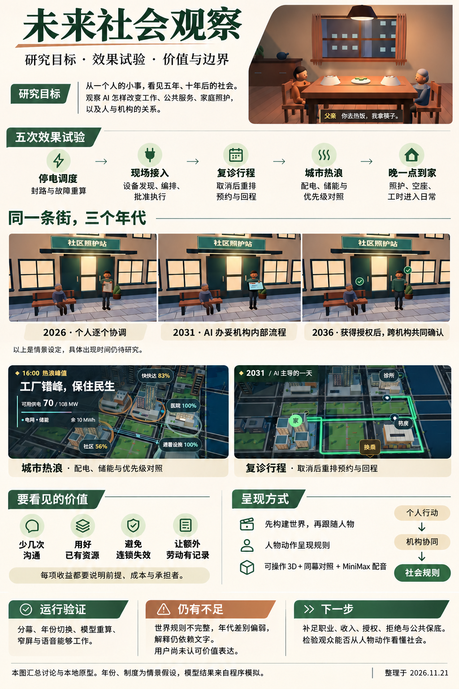

# 010 · 未来社会叙事与 AI 价值研究

研究怎样从人物的小事呈现五年、十年后的社会，比较 AI 在协调负担、资源调度和劳动记录中的作用。五个可操作 3D 原型、三年代同幕对照与 MiniMax 配音，形成一组可继续复用的场景与讲解方式，世界规则、年代差异和真实观众的理解仍待深化。

[在线研究与五个互动原型](https://yydshly.github.io/20261104_codex_project/010-future-society-study/) · [已有研究引导图](https://yydshly.github.io/20261104_codex_project/010-future-society-study/#guide-image) · [制作能力与价值](https://yydshly.github.io/20261104_codex_project/010-future-society-study/#capabilities) · [网页与可编辑源码](../../future-society-study/) · [返回研究总库](../../README.md#研究索引)

## 沿用本轮生成的引导图



引导图沿用已经生成的版本，以本轮原型实帧为参考，整理研究目标、五次效果试验、三年代设定和现阶段不足。它是本项目的阅读入口，详细规则与模型数值以对应页面为准。[查看原图](https://yydshly.github.io/20261104_codex_project/010-future-society-study/media/future-society-overview.png)

## 研究目标与形成过程

最初从停电后的调度入手，先后尝试封路重算、设备接入、复诊行程重排和城市热浪。用户指出，基础调度和一次代办的尺度不足以表达未来社会，随后将方向收敛到先建立世界，再通过人物的小事侧面呈现社会。

“类似末日短剧”指一种叙事组织方式。观众先认识世界的日常环境与规则，再跟随人物行动逐渐看懂它。当前故事选择阿澄晚到十二分钟接父亲，用照护站交班、回程空座和护理员工时，连接家庭与公共服务。

本轮需要回答的具体问题包括以下几项。

- 画面能否让人看懂现在、五年后和十年后的区别。
- 人物做一个小动作，能否带出工作、服务、授权和资源分配的变化。
- AI 所带来的便利怎样产生，需要谁同意，又让谁承担额外时间或费用。
- 分幕、对照和语音能否帮助观众理解，而故事仍由人物行动推进。

## 当前世界与故事设定

| 时点 | 同一件晚到怎样处理 | 要观察的社会关系 |
| --- | --- | --- |
| 2026 · 具体街区的示意基线 | 阿澄分别联系照护站与父亲，护理员自愿多留，手写交班记录，父女步行回家。 | 个人承担跨机构与家庭之间的协调。纸本并不代表现实所有机构的数字化水平。 |
| 2031 · 五年后的设想 | AI 填好照护改约单，由护理员在站内确认并记录工时，回程另行安排。 | 机构内流程可以办妥，跨服务仍需另外确认。 |
| 2036 · 十年后的设想 | 父亲与护理员分别同意后，获授权代理确认延时照护、原班次空座与工时。 | 多个机构能够在有限资源和权限内共同承诺，并明确额外劳动。 |

年份与制度是创作阶段设定。当前没有证据证明这些安排会按此时间出现。公共服务保底、补贴来源、撤回授权、申诉和退出后的替代服务，仍需要继续设计。

## 已实现的制作能力与复用价值

| 能力 | 当前证据 | 可复用价值 |
| --- | --- | --- |
| 程序化 3D 场景与人物动作 | 城市街区、照护站、角色动作、车辆停靠开门、父女回家吃饭 | 把抽象关系转成可观看、可修改的空间与行为，用于故事原型与视觉评审。 |
| 分幕与时间轴 | 四幕推进、暂停、重播、片段定位 | 让情节、动作与音轨有共同的组织方式，便于逐段检查和继续改编。 |
| 同条件对照 | 2026／2031／2036 同幕并排，同一时刻切换规则、预算和优先级 | 固定条件后定位差异，避免把多种变化混成一种收益。 |
| 有约束的程序模拟 | 预算和时限内重排行程，有限储能下的配电与连锁反馈 | 解释条件、依赖与代价，复用为教学模型和方案推演。 |
| MiniMax 配音与播放联动 | 预生成中文语音随分幕、年份和主题切换，可暂停、重听或静音 | 补足动机、情境与因果说明，形成可调整的互动讲解。 |
| 网页与研究归档 | 五个原型、实帧、已有引导图、早期四版 ZIP、讨论修正与验证范围 | 把理解、实际效果与当前缺口放在同一入口，供后续复查与迁移。 |

本轮没有开展生成模型性能排名或生产效率测量。以上能力证明了原型可以制作与检查，真实项目的省时、观众理解和长期维护成本仍需另行测试。

## 五个可操作原型

| 原型 | 可以实际操作什么 | 研究中的作用与局限 |
| --- | --- | --- |
| [停电后的二十分钟](https://yydshly.github.io/20261104_codex_project/010-future-society-study/demos/blackout-2031.html) | 在同一组事故中切换逐步调度与协同，观察复电时限和派车 | 建立调度交互基线。基础重算尚不足以说明未来五年的差距。 |
| [现场设备接入](https://yydshly.github.io/20261104_codex_project/010-future-society-study/demos/future-grid-2031.html) | 查找设备、编排方案、批准执行，改目标或封闭道路 | 研究临时接入的流程与执行反馈。使用预设规则与设备数据。 |
| [复诊行程重排](https://yydshly.github.io/20261104_codex_project/010-future-society-study/demos/ai-world-2031.html) | 取消接驳后改预算，比较直达、换乘和无法满足的结果 | 让跨服务计划与约束可见。用户仍认为单次代办的价值尺度偏小。 |
| [城市热浪](https://yydshly.github.io/20261104_codex_project/010-future-society-study/demos/city-system-2031.html) | 同时刻比较配电机制、储能预判、民生与生产优先级 | 展示资源依赖与取舍，帮助分开说明联合调度和提前规划的贡献。 |
| [晚一点到家](https://yydshly.github.io/20261104_codex_project/010-future-society-study/demos/late-home.html) | 有声故事、年份切换、同幕对照、暂停、重播和视角控制 | 从小事连接社会关系。当前年代差异与完整世界的表达仍待深化。 |

## 作品中研究的 AI 价值

这些是情景所讨论的作用，须与上表已经做出的制作能力分开理解。

- 减少个人在多个联系人之间反复传话和核对的负担。
- 在当事人同意、机构授权与资源可用时，让多项服务接成可兑现的安排。
- 用联合调度和储能规划，在模型条件下避免部分连锁后果，并保留资源到更需要的时刻。
- 让额外劳动、补贴与资源取舍有明确记录，能追问由谁决定、由谁承担。

热浪推演中，医院与接驳的恢复主要来自联合配电。保持民生规则，只比较是否提前规划，17:00 社区供电为 30 MW 与 20 MW，累计至 18:00 的降温服务差 450 人次，同时更多生产负荷被延后或未满足。人次表示服务次数。相关阈值、权重、需求与供给均来自演示设定。

## 验证范围、已有不足与后续问题

现有检查记录包括桌面与窄屏、分幕与年份切换、同条件模型重算、MiniMax 音轨播放及暂停。公开版另检查总库入口、引导图、五个独立页面、嵌入演示与早期存档下载。

人物与城市行为由程序执行，语音预先生成。本轮未验证真实城市数据、现实机构授权与实时代理协作。供电模型的守恒和行程约束验证，也不等于社会预测或真实城市效益得到验证。

用户先后指出代办尺度小、画面基础、世界规则薄、年代差别弱以及场景价值不清楚。最新对照保留这些问题，观众是否能从人物动作读懂社会变化，还需反馈。

下一步先补足主角职业、收入和街区服务的底稿，再设计补贴来源、工作人员拒绝、居民撤回与申诉。之后从多个角色经历同一件小事，检查关掉解释时是否仍能看懂社会差异。游戏化在世界与展示体验成立后继续讨论。

## 来源、文件与运行

内容来自本轮对话、本地原型、实际截图、模拟模型与生成音轨。3D 使用 [Three.js](https://github.com/mrdoob/three.js)，中文配音使用 [MiniMax](https://www.minimax.io/)，画面和交互检查使用 [Playwright](https://github.com/microsoft/playwright)，音频处理使用 [FFmpeg](https://github.com/FFmpeg/FFmpeg)。网页保留源代码与音轨的既有许可证和生成标记。

- 可编辑网页位于 [future-society-study/](../../future-society-study/)。
- 五份原始 HTML 与场景、模型模块位于 [source/](../../future-society-study/source/)，可运行静态页面位于 [demos/](../../future-society-study/demos/)。
- [早期 ZIP](../../future-society-study/downloads/future-society-demos-2026-11-09.zip)包含当时四个版本。当前网页另外收录了后续更新与三年代短剧。
- 已生成的引导图位于 [media/future-society-overview.png](../../future-society-study/media/future-society-overview.png)，本轮沿用同一文件。

在仓库根目录执行公开产物复制。

```powershell
python future-society-study/publish.py
python -m http.server 57228 --bind 127.0.0.1 --directory docs
```

预览路径为 `http://127.0.0.1:57228/010-future-society-study/`。静态产物位于 `docs/010-future-society-study/`，沿用 GitHub Pages 的 `main` 分支 `/docs` 发布源。
