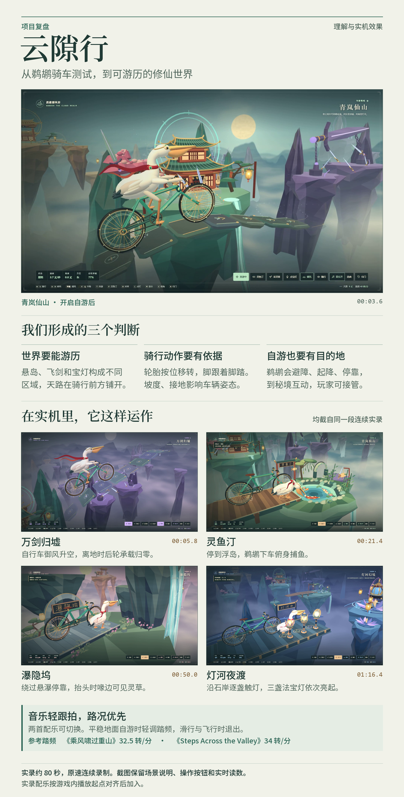

# 011 · 云隙行 · 3D 骑行世界研究

研究怎样把一只骑自行车的 3D 鹈鹕做成可控制、可自主游历、能通过运行状态核对的修仙世界。作品把程序化天路、状态驱动的车辆与角色、自游寻路、秘境动作和音乐适配连成一段完整体验。可复用的价值是把视觉概念推进成可试玩的关卡原型，再通过界面反馈定位交互、运动和展示问题。

[在线研究](https://yydshly.github.io/20261104_codex_project/011-yunxi-ride/) · [直接试玩](https://yydshly.github.io/20261104_codex_project/011-yunxi-ride/play.html) · [完整界面实录](https://yydshly.github.io/20261104_codex_project/011-yunxi-ride/#recording) · [返回研究总库](../../README.md#研究索引)

## 研究引导图

图中的五张画面均取自同一段连续实录。场景说明、操作按钮与实时参数保留在画面中，可按标注时间回看。[打开原尺寸引导图](https://yydshly.github.io/20261104_codex_project/011-yunxi-ride/yunxi-project-overview.png)

## 我们解决了什么问题

最初测试“3D 鹈鹕骑自行车”能否成为可操作的画面，随后把场景升级为可骑行、可飞行的修仙世界。悬岛、亭阁、飞剑、瀑布和宝灯承担地标作用，天路只在前方有限长度出现。角色抵达地标后会经历停靠、下车、动作反馈和回座，让场景与行为相连。

轮胎与脚踏脱节的反馈，推动实现从固定播放动画改为实际位移、轮转、齿比和脚掌共用同一运动状态。后轮承载、坡度、滑行和起落进入观察范围。早期无界面的剪辑也促使我们补录完整页面，保存操作与参数，方便核对展示内容。

## 已实现的能力与可复用价值

| 能力 | 已实现及可观察的效果 | 可复用价值 |
| --- | --- | --- |
| 程序化场景与天路 | 五类修仙区域、有限前瞻的动态天路、后方淡出与遇障缩短 | 构建有区域差异的探索关卡，用可抵达地标连接美术与行进方向。 |
| 状态驱动的车与角色 | 实际位移驱动车轮，传动带动曲柄与脚掌，车身随坡度、接地与载荷变化 | 将运行状态与动画统一，让接触、滑步、踏频和坡道问题能被定位。 |
| 自游与秘境引路 | 自游选择方向、避障、起降；接近三处地点后按阶段停靠、互动、回车；玩家可手动接管骑行 | 复用到自动导览和角色活动，按引路、对齐、动作、反馈等阶段逐项验证。 |
| 可见动作与结果反馈 | 灵鱼汀下车捕鱼，瀑隐坞绕行采草，灯河夜渡依次点亮三灯 | 将任务状态落实到角色动作、目标物变化和界面提示，便于观察和验收。 |
| 双曲目与轻跟拍 | 两首配乐可切换，稳定地面自游时按各自参数轻调踏频 | 将音乐作为动作的可选输入，让坡度、飞行、受阻与滑行等状态决定适配程度。 |
| 完整界面与研发表达 | 约 80 秒连续实录、关键时间定位、研究引导图、12 条整理版提示词及 X 草稿 | 把作品、观察依据与可复用的任务描述放在同一处，支持后续回查、复现和改进。 |

## 证据与边界

完整实录从普通页面启动自游，保留左上标识、右上场景说明、底部按钮，以及速度、高度、后轮承载和踏频。视频原速连续导出为 1080p / 30 fps，配乐按游戏内开始播放的时间点另行对齐。一次实录可核对该次路线的表现，其他生成路线和设备性能仍可继续检查。

碰撞与载荷采用适合游戏表现的探针和近似计算。三处秘境为指定地点，自动访问受距离与访问状态约束。跟拍使用两首曲目的预设参数。角色动作已纳入运动和活动状态，持久背包、修为和长期游戏循环可以继续设计。音乐创作提示词为本次整理文本，X 文案属于发布草稿。

## 源码与发布

- 交互实现与打包脚本位于 [pelican-immortal-world](../../pelican-immortal-world/)。
- 手册、提示词与原尺寸引导图位于 [research](../../pelican-immortal-world/research/)。
- GitHub Pages 的静态产物位于 [docs/011-yunxi-ride](../../docs/011-yunxi-ride/)，包含试玩页、两首曲目、源码入口与完整界面实录。

在仓库根目录运行 `node pelican-immortal-world/publish.mjs` 可重新生成离线试玩文件并更新公开页。GitHub Pages 使用 `main` 分支的 `/docs` 目录。
