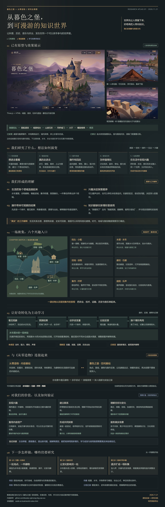

# 012 · 暮色之堡与知识世界探索

研究怎样把一幅 3D 城堡画面推进成可亲历的世界，再让科普、历史、音乐与农业随着探索自然发生。我们用 Three.js + HTML 实现从渔屋码头出发、登船渡湖、上山入堡、穿过大厅、沿螺旋石阶登塔的连续原型，并整理与《从零造物》内容连接的方向。已经获得的价值是可复用的程序化场景、通行与操作基础；兴趣激发和学习迁移需要用具体知识交互与真实体验者验证。

[在线研究](https://yydshly.github.io/20261104_codex_project/012-castle-knowledge-world/) · [直接试玩](https://yydshly.github.io/20261104_codex_project/012-castle-knowledge-world/play.html) · [研究引导图](https://yydshly.github.io/20261104_codex_project/012-castle-knowledge-world/#guide-image) · [返回研究总库](../../README.md#研究索引)

## 研究引导图



使用已有的 2700 × 8297 高清长图，保留城堡全景、第一人称划船与塔顶俯瞰三张原型实帧。网页支持查看原图、下载和页内展开，图区分已有原型、候选提案与待验证效果。

## 我们做了什么

| 部分 | 已有成果 | 可复用价值 |
| --- | --- | --- |
| 程序化世界 | 城堡、湖面、岩岛、山地、林地、渔屋和旧塔遗迹，支持暮色与月夜 | 为关卡、空间叙事与互动展示提供可编辑的环境基础。 |
| 连续通行 | 第一人称从湖对岸渔屋码头出发，渡湖后经栈台、石阶、吊桥、城门、大厅与 60 级螺旋石阶抵达塔顶，可返程 | 用实际路线连接外部世界、室内与垂直空间，核对尺度和方向引导。 |
| 划船与岸上探索 | 登船、双桨划行、浮灯航标、靠岸下船，沿岸步道连接渔屋与遗迹 | 把移动方式和目的地组合成完整的到访体验。 |
| 体验修正 | 修正门框重叠闪烁；起点改到渔屋码头，使船的位置与前往城堡的路线相符 | 用玩家反馈核对空间、操作入口与流程逻辑。 |
| 研究表达 | 愿景、思考演变、现有证据、可点击六地点提案、价值、验证方式与来源集中到网页 | 让读者理解实际完成范围，也为后续制作和评审保留共同依据。 |

## 我们形成的理解

世界先让人愿意进入和停留，好奇再引出动手尝试。水车灌溉、谷物磨粮、装船运输、集市称重和院落奏乐，可以把不同领域接在同一段生活里。玩家根据自己的兴趣停留，先观察现象、预测、改变量，再比较结果，想追问时进入剖面、原理与历史出处。

“真实”的工作解释是生活关系合理、模型有依据、史实可回查，画面可以采用风格化建模。地理精度、具体时代和地域尚待确定。闯关、副本、修仙与任务成长均属于讨论过的玩法方向，尚未选定一种游戏类型。

## 与《从零造物》的连接

[《从零造物》](https://github.com/bluesky-rgb/cong-ling-zao-wu)的科技树、拍摄本、原理说明、来源与待核事项，为器物提供可追查的内容起点。我们的城堡提供可走近、可绕看、可操作的空间基础。本次提出“暮湖秋集”作为候选章节，用一袋谷物从田地到集市的旅程连接六处地点。

- 码头与小船，比较载重、吃水和偏载。
- 水渠与水车，观察水流、转速和提水。
- 田地与谷物，改变一个条件、保留对照并加速观察。
- 磨坊与石磨，查看磨齿、进料和机械传动。
- 集市与杆秤，移动秤砣、比较力矩与平衡。
- 庭院与陶埙，循声跟奏、比较指孔与音高。

这些知识交互、秋集地图和因果联动属于提案。引用内容提供选题与查证起点，未复制对方的实现或声称已经接入。水车、石磨、杆秤和陶埙的已有拍摄本入口在网页中逐项列出。

## 对我们的价值与验证方式

已经沉淀了程序化 3D 场景、连续通行、岸上与水上切换，以及从反馈修正体验的制作方法。这些可以继续用于探索关卡、互动展示和知识章节原型。

预期的学习价值是让人发现兴趣、理解生活环节的联系，并在新情形里使用知识。观察依据包括自发停留、愿意重试、提出新问题、能解释原因，以及条件改变后的预测与判断。亲子共探、青少年自主学习、课堂器物讨论和文化场馆体验都是候选使用场景，首批对象与真实需求仍需验证。

下一步从水车或小船载重中选择一件器物，做完整的“观察—预测—操作—比较—解释—迁移”体验，再连接到田渠或磨坊。明确公式、单位、简化条件、史料出处和实验记录后，再根据体验者的行为决定扩展范围。

## 证据与边界

- 当前可以试玩的是城堡与湖区漫游、划船和登塔。小船载重、水车提水、作物生长与乐器教学模型尚未实现。
- 水面与通行采用适合实时场景的视觉与交互近似，不能当作实测物理结果。
- 现有城堡呈现哥特式幻想风格，《从零造物》采用北宋穿越主线。正式知识章节需要确定时代地域并核对器物与文化组合。
- 学习收益、长期留存和商业价值没有用户试验数据，网页分别标明实现、提案和验证范围。
- 引导图由现有原型截图与网页排版导出，沿用本轮已交付版本。

## 源码、复现与发布

源码位于 [castle-at-dusk](../../castle-at-dusk/)，使用 Three.js 0.187.0 和 esbuild 0.25.12。静态发布产物位于 [docs/012-castle-knowledge-world](../../docs/012-castle-knowledge-world/)。

```powershell
cd castle-at-dusk
npm ci
node publish.mjs
```

`build.mjs` 把 Three.js、场景代码和样式打成单文件原型，保留 Three.js 许可证。`publish.mjs` 更新研究首页、试玩页、原有引导图和截图，并调整公开页面的相对链接。GitHub Pages 沿用本仓库 `main` 分支的 `/docs`。

桌面使用拖动和滚轮观察，点击“漫游”后用 WASD 移动、Q/E 或拖动转头，在船边按 F 登船或靠岸下船。触屏提供方向按钮与登船按钮。页面需要支持 WebGL 的现代浏览器，设备性能与长时间体验仍可继续测量。

## 本次发布核对

已检查 1440 像素桌面与 390 像素手机布局、10 个研究区块、六处地点切换、长图展开和本地资源链接。引导图与原文件的 SHA-256 一致。试玩检查了 WebGL 加载、渔屋码头起步、步行到船边、登船、划行距离变化、返回起点和月夜切换，浏览器未出现脚本错误或资源请求失败。这次发布检查覆盖入口与主要状态切换，完整路线的长期稳定性和跨设备性能仍可继续测量。
