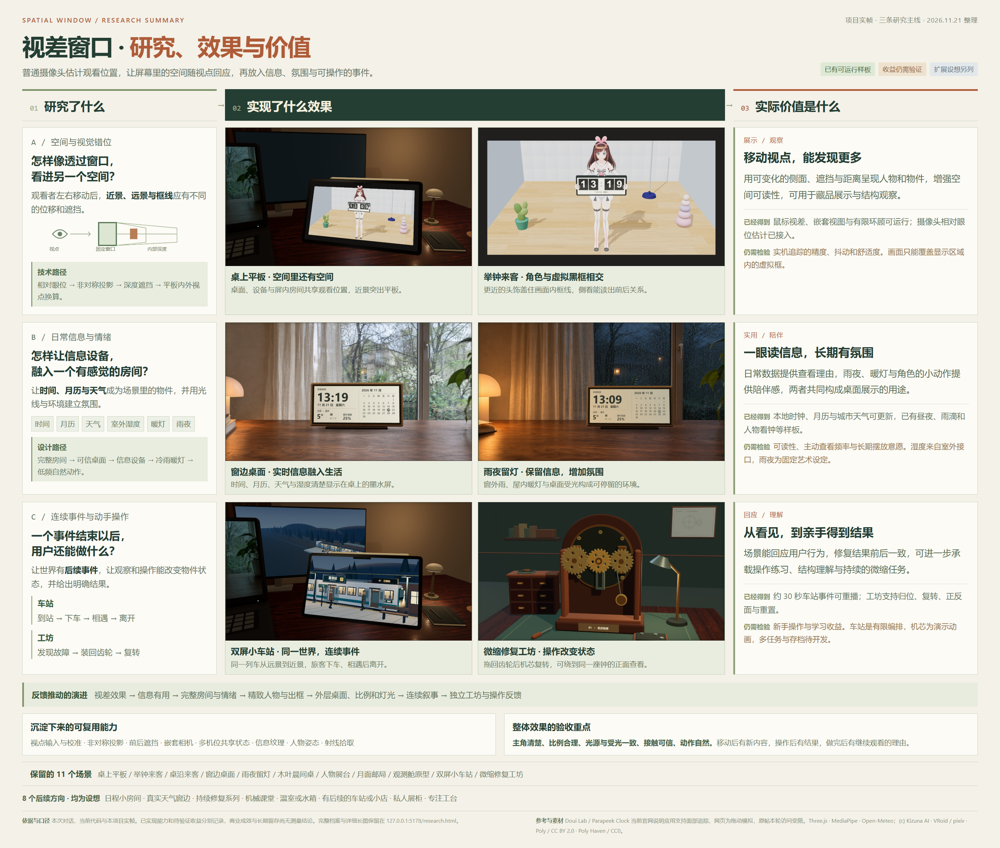

# 013 · 视差窗口与微缩交互研究

研究普通摄像头与观看位置怎样驱动屏幕里的空间，再把时间信息、氛围和可操作事件放进同一个环境。我们用 Three.js、MediaPipe 与浏览器界面实现 11 个可切换场景，从视差和出框推进到嵌套桌面、双机位连续叙事与齿轮修复。已经沉淀的价值是可复用的视点、投影、场景状态与反馈能力，可用于互动展示、氛围桌面和操作原型；真实使用、追踪稳定性与学习收益继续验证。

[在线研究与效果](https://yydshly.github.io/20261104_codex_project/013-spatial-window/) · [直接体验工坊](https://yydshly.github.io/20261104_codex_project/013-spatial-window/play.html?scene=workshop) · [已有引导图](https://yydshly.github.io/20261104_codex_project/013-spatial-window/#guide-image) · [可编辑源码](../../head-tracked-room/) · [返回研究总库](../../README.md#研究索引)

## 沿用已经生成的引导图



沿用本轮已经交付的 2880 × 2445 PNG，发布时逐字节及 SHA-256 核对。三行分别讲空间错位、日常氛围和事件操作，三栏分别讲研究问题、场景效果和价值。图中的本机地址是制作记录，公开入口见上方链接。详细长图也在研究网页保留。

## 我们做了什么

| 研究方向 | 可体验效果 | 可复用价值 |
| --- | --- | --- |
| 视点与出框 | 普通摄像头估计相对眼位，鼠标模拟视差，虚拟黑框与前景物件形成遮挡 | 用固定窗口投影帮助观察近远层次、侧面与被挡住的内容。 |
| 屏内外嵌套 | 木桌、设备与平板构成外层空间，内部房间从同一个观看位置渲染 | 复用局部视点换算与渲染纹理，将小空间嵌进设备或展柜。 |
| 日常与氛围 | 白天窗边和雨夜暖灯中的墨水屏，显示时间、月历、天气与室外湿度 | 把信息产品融入完整环境，探索清楚可读的日常展示与低频陪伴。 |
| 双机位叙事 | 约 30 秒列车驶来、进站、旅客下车相遇离开、列车驶出，可重播 | 远近机位共享同一世界、同一对象和事件状态，衔接观看注意力。 |
| 动手修复 | 独立工坊里拖回齿轮，机芯复转，再绕到同一座钟的正面 | 连接观察、操作与可见结果，形成可以复位重试的修复样板。 |
| 研究表达 | 15 个主题、历次反馈、11 个场景、技术路径、来源和 8 个扩展方向 | 为后续创作、评审和迁移保留可追溯的依据与实现边界。 |

## 我们形成的理解

视差成立之后，还需要回答场景为何值得看。用户先追问原作的实际用途，再要求精致人物、完整房间、情绪价值和持续事件，随后通过截图指出外层桌面、电脑比例、平板主次与灯光受光问题。工坊阶段进一步明确，平板是一个具体样式，主题需要自己的空间和操作方式。

共同标准包括主角清楚、比例合理、光源与受光一致、手脚与物件接触可信、动作有自然停顿。侧身应看到新的内容，操作应改变状态，一个事件结束后应有继续探索的目的。

原作来自 [Doui Lab 演示帖](https://x.com/DouiLabApps/status/2119414517126107169)。本轮原帖直接访问受限，补查了作者 [Parapeek Clock 当前产品页](https://www.doui-lab.com/en/apps/parapeek-clock/)、[隐私说明](https://www.doui-lab.com/en/apps/parapeek-clock/privacy/)与[帮助页](https://www.doui-lab.com/en/apps/parapeek-clock/support/)。当前应用支持面部追踪，官网拖动演示模拟视点；视频拍摄当时的设备、版本与内部代码尚未直接确认。

## 场景范围

11 个场景为桌上平板、举钟来客、桌沿来客、雨夜留灯、窗边桌面、木叶晨间桌、人物展台、月面邮局、观测舱原型、双屏小车站与微缩修复工坊。页面可以按空间、日常、事件筛选，并从说明直达演示。

公开演示使用项目已有的 VRoid AvatarSample_C 作为举钟人物，本机仍可按 README 加载官方初版 Kizuna AI MMD。引导图与历史截图记录本机人物外观，公开版的人物外观与其不同。原始 MMD 模型与贴图只在本机提供。

## 实际价值与验证范围

已经得到的成果是可编辑、可运行的制作基础，包括视点校准、非对称投影、前后遮挡、嵌套相机、多机位状态、实时信息纹理、人物姿态与射线拾取。可以复用到角色与藏品展示、桌面信息设备、场景讲解、连续事件和操作反馈原型。

日常便利性、情绪陪伴与结构学习是使用价值方向。需要观察真实使用者能否看清信息、能否独立操作、能否解释变化，以及是否愿意再次开启。商业成效、教学收益与长期留存尚无测量结论。

- 摄像头提供相对眼位估计，光线、观看距离与姿势影响效果，实机精度和长期稳定性仍需验证。
- 普通画面覆盖显示区域内的虚拟框，物理边框之外不能绘制；多位观看者共享同一视点画面。
- 天气依赖 Open-Meteo，湿度是所选城市的室外数据；雨夜氛围为固定艺术设定。
- 窗边、雨夜与晨间桌采用图像分层，观察范围与完整三维场景不同。
- 两块车站屏幕是网页里的虚拟设备，真实多屏校准和跨机器同步尚未接入。
- 工坊目前为单故障样板，齿轮、摆锤和指针由演示动画驱动，真实传动、准确走时与多故障推理尚待建立。
- 持续任务、进度存档、后台常驻与 Windows 安装包尚未交付。

## 扩展方向

日程小房间、真实天气窗边、持续修复系列、机械课堂、温室或水箱、有后续的车站或小店、私人展柜和专注工台，均是依据已有能力整理的候选方向。每个方向需要新增自己的内容、规则、状态保存与使用验证，尚未选定为下一步。

## 源码、复现与发布

源码位于 [head-tracked-room](../../head-tracked-room/)，静态产物位于 [docs/013-spatial-window](../../docs/013-spatial-window/)。研究首页为 index.html，可操作演示为 play.html，完整档案入口也保留 research.html。

```powershell
cd head-tracked-room
npm.cmd ci
npm.cmd run dev
```

更新公开产物时运行以下命令。

```powershell
npm.cmd run publish
```

发布脚本以相对资源路径构建公开版本，复制并校验产物及已有引导图，使用仓库现有的 main 分支 /docs 发布方式。摄像头画面和导入模型在浏览器内处理；天气查询需要联网。

素材归属、模型说明与生成提示词保留在源码 README 和研究网页。主要素材包括 (c) Kizuna AI、© pixiv Inc. / VRoid Project、Poly Astronaut / CC BY 2.0、Poly Haven / CC0，以及本项目生成背景与程序几何。

## 本次发布核对

本地静态发布目录已检查研究首页、15 个主题、11 个场景切换、公开人物加载、工坊安装与重置、正反面、车站重播，以及 1440 像素桌面与 390 像素手机布局。摄像头入口用浏览器虚拟视频设备验证了授权、模型与 WASM 加载和关闭流程，这项检查不覆盖真实人脸定位精度。浏览器未发现脚本异常或本站资源请求失败。引导图与原件 SHA-256 一致，在线发布后的核对以实际可访问页面和部署结果为准。
