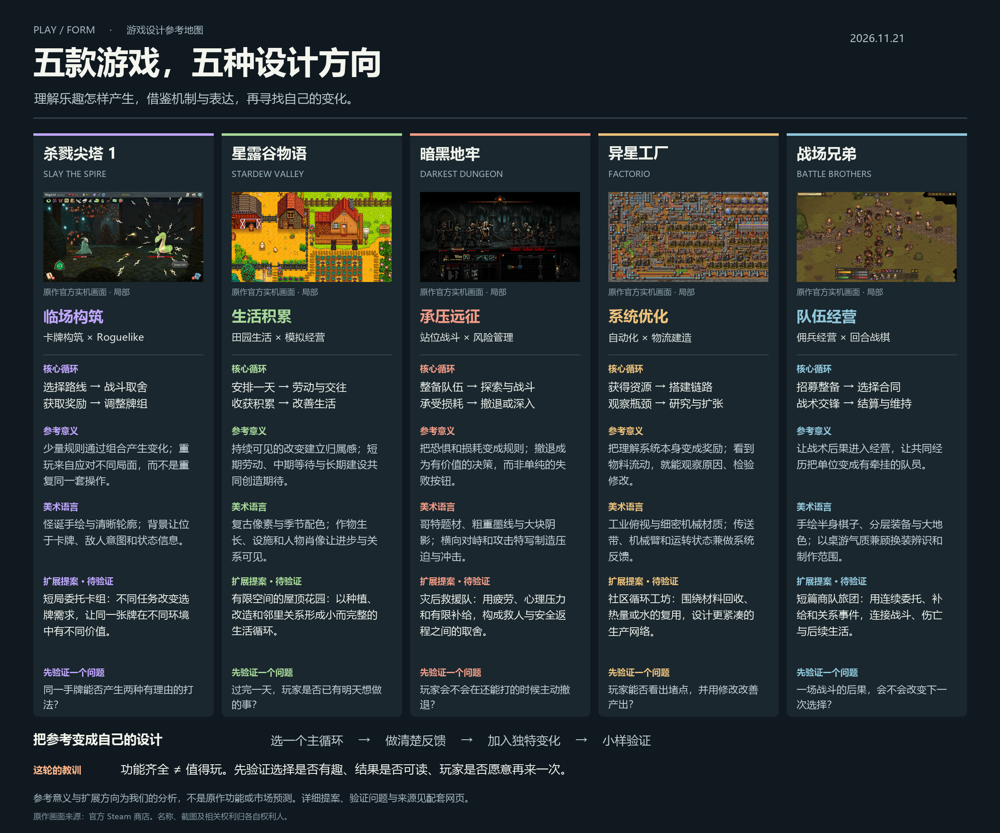

# 014 · 五款游戏设计参考总结

这轮工作的最终整理是一份网页与一张完整总览图。五款作品分别代表临场构筑、生活积累、承压远征、系统优化和队伍经营。页面把原作玩法、美术特点、参考意义、可扩展方向与验证问题放在一起，便于回查和继续设计。

[在线研究网页](https://yydshly.github.io/20261104_codex_project/014-game-design-lab/) · [本地离线版](../../game-design-lab/offline.html) · [总览 PNG](assets/design-summary/design-map.png) · [总览 SVG](assets/design-summary/design-map.svg) · [内容与实现说明](../../game-design-lab/summary/README.md)

## 研究内容、价值与对我们的意义

本次研究对照五款原作的核心选择、美术表达、持续投入理由和制作重点，提炼临场构筑、生活积累、承压远征、系统优化与队伍经营五条方向。已有总览图用于整体导览，原作截图、循环节点与比较表用于逐项回查，扩展提案保留需要试玩回答的问题。

对我们的意义是形成后续游戏设计的判断依据：先选择希望玩家反复体验的核心循环，再决定辅助机制；按信息辨识、情绪表达和状态反馈安排美术投入；先检验选择是否有趣、结果是否可读、玩家是否愿意继续，再扩充功能与内容。五款经典的成功不直接构成新项目的市场依据。

这轮机制实验也提供了反面经验：规则齐全和流程可运行，仍可能缺少独特卖点、吸引人的表现与长期牵挂。保留这些实现和反馈，帮助以后识别技术完成度与玩家体验之间的差距。当前价值集中在参考选型、制作取舍与验证顺序，不宣称已经找到新的商业机会。

## 网页内容

- 五款游戏的原作官方实机截图与可切换的玩法、美术、参考意义分析。
- 可点击的循环节点，说明每个阶段改变了什么。
- 决策时间、持续投入理由、制作重点和可迁移机制的横向比较。
- 每款一份扩展提案，分别说明保留什么、改变什么、先验证什么，以及容易走偏的地方。
- 三种跨作品的组合思路，同时说明体验之间可能发生的冲突。
- 本轮网页游戏实验的经验与不足，及官方来源。

## 五个方向

| 作品 | 方向 | 意义 | 可扩展的提案 |
| --- | --- | --- | --- |
| 杀戮尖塔 1 | 临场构筑 | 随机条件下的组合决策与可读风险 | 任务环境改变卡牌价值 |
| 星露谷物语 | 生活积累 | 多层目标、持续改变与归属感 | 屋顶花园与邻里生活 |
| 暗黑地牢 | 承压远征 | 多维损耗与主动撤退 | 灾后救援队与返程决策 |
| 异星工厂 | 系统优化 | 可观察的因果与瓶颈 | 社区工坊与循环利用 |
| 战场兄弟 | 队伍经营 | 战术后果、经济与人物牵挂 | 连续委托中的商队旅团 |

扩展方向都是设计设想，没有作为已实现功能或经过市场验证的结论呈现。官方截图与玩法来源见网页末尾；参考意义、美术作用和验证问题为我们的分析。

## 制作过程留下的判断

先前制作过五个简化机制实验，随后集中制作了独立佣兵任务。它们能够运行部分规则与结算，但缺少足够明确的独特卖点、画面反馈与持续投入理由。用户的实际反馈未支持继续把它们作为完成品质的游戏方向扩张。

目前以研究整理为主，保留历史实验作复盘材料。以后需要先验证核心选择是否有趣、结果是否清楚、玩家是否愿意继续，再决定增加系统和美术内容。

[历史研究与五款实验归档](../../game-design-lab/research.html) · [灰旗佣兵团机制实验](../../game-design-lab/iron-company/offline.html) · [佣兵实验规则与范围](../../game-design-lab/iron-company/README.md)

## 文件与运行

当前入口：`game-design-lab/index.html` 与可双击的 `game-design-lab/offline.html`。总览图为 2400 × 2000，PNG 与自包含 SVG 均可下载。网页支持大图缩放、键盘切换、手机布局和打印。

内容位于 `game-design-lab/summary/content.json`。在 `game-design-lab` 执行 `npm run build` 可重建网页、离线包、总览图和 `docs/014-game-design-lab/` 静态副本。源码、静态网页与历史机制实验一并保留；在线地址由本仓库 GitHub Pages 的 main 分支 /docs 发布。
