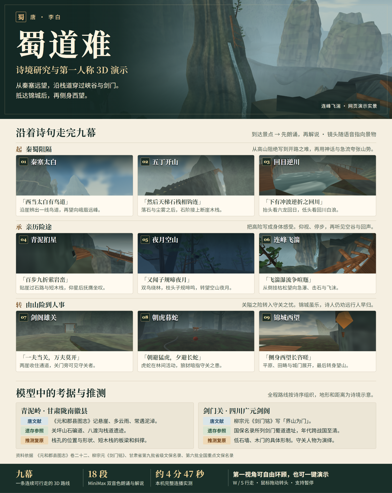

# 015 · 《蜀道难》第一人称诗境研究

我们把李白《蜀道难》做成一条可行走的 3D 蜀道。研究从一个具体问题开始：读者以旅人的眼睛站在路上时，能否看清诗句在说哪处景物，并从走路、转头和听觉中感到「难」？九幕按诗序从秦塞太白连到锦城西望，讲解随地点触发，视线随语句落到有对应位置的三维物件上。

[在线研究与引导图](https://yydshly.github.io/20261104_codex_project/015-shu-road/research.html) · [直接进入 3D 演示](https://yydshly.github.io/20261104_codex_project/015-shu-road/) · [源码](../../shu-road-demo/) · [返回研究索引](../../README.md#研究索引)

## 实现了什么

- **连续蜀道。** 九个场景由可走的地形与栈道相连。可以用 W / S 前后走，拖动环顾，停下俯看脚下或切到全景查看路径。开启语音导览后，到达景点会触发讲解，听完留在原处。完整演示用短转场压缩长连接段。
- **诗句、声音和位置对应。** 18 段 MiniMax 语音分为诗人朗诵和旁白解说。字幕与镜头按语句推进，鸟道、栈孔、倒挂枯松、飞瀑和关门都有可定位的场景目标。鸟与虎狼等移动目标的标记随模型移动，语音可暂停和恢复。
- **可看见的诗意。** 用崩落岩块和尘雾表现五丁开山，用急流和击石飞沫表现「万壑雷」，用低头、坐低和手抚胸前表现青泥岭的「抚膺坐长叹」，最后从锦城回望入蜀的山路。

## 探索了什么

| 问题 | 本轮的理解与做法 |
| --- | --- |
| 怎样让诗里的「高」和「险」能从第一视角感受到？ | 先确定旅人可以站在哪里、脚下走得通不通，再核对台阶、木构、岩壁、人物和动物的相对尺度。通过近处栈板、绝壁与远峰的落差表现高险。 |
| 怎样边游览边听懂，减少找景和等候？ | 用到达、朗诵和解说组织叙事，细分镜头转向时机。允许手动停步与环顾；演示把长路上的空档缩短，沿途语音与字幕继续对应。 |
| 哪些形态能够据史料建模？ | 唐代文字说明地势与通行环境，遗存提供石碥道、栈道和关隘的参照。每个具体栈孔、木构尺寸和关门样式都要单独判断依据。 |

诗的空间顺序兼有情绪变化。秦蜀阻隔和五丁开山写通路来之不易；青泥、空山和飞湍把险峻变成行路者的身体感受；剑门把山川之险引向守关人事，尾声抵达锦城却仍劝早归。

## 什么有依据，什么是推测

- **青泥岭。** 《元和郡县图志》卷二十二记载青泥岭崖险多雨、行人屡遇泥淖。关坪山石碥道和八渡沟栈道遗迹是本轮参考。具体栈孔的孔形、孔位，短木栈的板梁与斜撑为推测。 [唐代原文](https://zh.wikisource.org/wiki/元和郡縣圖志/卷22) · [甘肃省省保名录](https://www.gs.gov.cn/gsszf/c100054/202304/169834641/files/d47e74422e0f4aa99fbeb09bf1f9b698.pdf)
- **剑门关。** 柳宗元《剑门铭》的「界山为门」指向地势，国保名录记录剑门蜀道遗址的年代跨战国至清。画面将两崖夹道作为主要依据，低石墙、木门与守关者服饰作为推测或演绎。 [唐代原文](https://zh.wikisource.org/wiki/劍門銘（並序）) · [第六批全国重点文保名录](https://www.mct.gov.cn/whzx/ggtz/200606/t20060609_694678.htm)

网页以「唐文献」「遗存参照」「推测复原」标注两处场景。太白与峨眉的相对位置、九幕的距离、传说人物与志怪意象按诗境编排。

## 有什么价值

这套方法让读者可以在听到某句诗时，亲自找到它对应的地形或动作，也能打开现场说明追溯建模依据。可复用的部分是「诗文分段 → 可站立的观察点 → 场景模型与动作 → 带定位的朗诵和解说」，适合继续用于古诗教学展示、史地导览或文化展陈原型。当前验证覆盖内容与操作流程，实际教学收益仍需与读者体验一起评估。

## 验证与运行

桌面 Chrome 完整演示用时约 4 分 47 秒，九幕、18 段语音顺序播完。另检查了暂停恢复、手动环顾、W / S 行走、栈板和接路的脚下支撑，以及重点景物的画面遮挡。

静态网页使用原生 HTML、CSS、JavaScript 与 WebGL。音频预先生成并随网页加载。源码目录的 `index.html` 可在本地直接打开，`research.html` 为研究说明。GitHub Pages 使用仓库既有的 `main` 分支与 `/docs` 发布目录。
