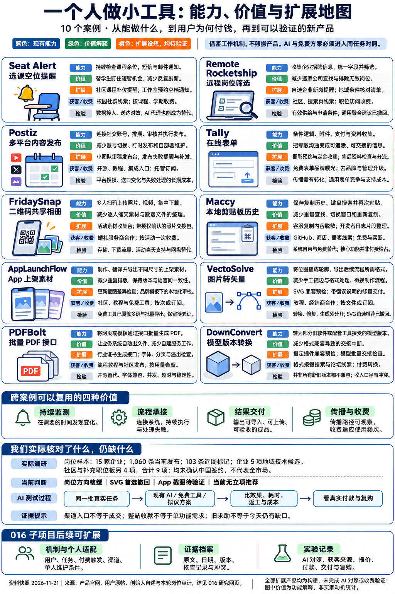

# 016 · 从小工具案例到个人 AI 协作：能力、价值与产品研究

从 [Feng_YQ](https://x.com/Feng_YQ) 分享的[“闷声发大财”案例库](https://msfdcszhd.com/)出发，研究一个人能借鉴哪些工作机制、为谁创造价值，以及如何获客和收费。研究经过远程岗位供给核对、小工具与 AI 替代比较，后来转向个人与 AI 共同形成目标、表达偏好和修改作品的问题。

留下的成果是一份可回查的研究网页、案例地图、公开来源和岗位审计。当前没有找到证据充分、值得我们一个人立项的收费产品，已暂停这条产品探索线。**工具有用、生意成立、适合个人经营，是三个不同的判断。**

网页发布路径：[研究网页](https://yydshly.github.io/20261104_codex_project/016-solo-business-study/) · [仓库源码路径](https://github.com/yydshly/20261104_codex_project/tree/main/projects/016-solo-business-study)

本地入口：[打开网页](index.html) · [研究价值](index.html#value) · [AI 协作探索](index.html#collaboration) · [研究全景图](index.html#map) · [离线版](offline.html) · [返回总库](../../README.md#研究索引)

以上公开地址为本项目的发布入口；发布状态以实际部署核对为准。

## 内容与已有价值

收录 10 个案例：**Postiz、Tally、Maccy、FridaySnap、Seat Alert、Remote Rocketship、AppLaunchFlow、VectoSolve、PDFBolt、DownConvert**。每项分别记录公开能力、用户价值解释、获客入口、收费范围、单人维护成本、现有 AI 与免费替代，以及证据缺口。

这些案例帮助我们辨认四类可复用价值：在需要的时间发现变化的**持续监测**，把系统与步骤接起来的**流程承接**，产出可导入、可发布文件的**结果交付**，以及让用户发现并购买服务的**传播与收费**。它们可以用于理解自己的工作，不要求先复制一个完整产品。

全景图提出 **20 种产品扩展构想**，用来拓宽观察范围；它们没有完成真实需求、获客或收费验证，不是开发清单。网页还保留案例搜索、状态筛选、岗位分栏、来源分类、研究 JSON 导出和判断修正记录。

### 前段案例研究快照

[](assets/research-map-20261121.png)

这张图记录前段案例研究，**没有覆盖后来对个人 AI 协作的完整讨论及暂停决定**。蓝色为公开介绍中的现有能力，绿色为价值解释，橙色全部为待验证构想；当前结论应结合后续章节阅读。

选用内置 imagegen 生成的首版，保留[生成提示词](assets/research-map-prompt.txt)和[版本说明](assets/research-map-provenance.json)。后续修订尝试未选用。DownConvert 案例实际涉及 SketchUp `.skp`，几何体插画不表示支持任意模型格式。[overview.jpg](assets/overview.jpg)另存研究网页的实际界面截图。

## 岗位供给：先核对来源，再讨论分析与收费

审计窗口为 **2026-11-14 14:34 至 2026-11-21 14:34，上海时间**，对象为居住中国大陆的开发者。核对企业招聘页与公开招聘系统，并以 V2EX、电鸭、Remote OK、We Work Remotely 补充。

| 观察项 | 本轮结果与口径 |
| --- | --- |
| 企业样本 | 15 家；14 家列表可读，12 家日期可核 |
| 当前公开发布条目 | 1,060 条，包含全部职能的当前存量 |
| 近周标记发布 | 103 条，包含全部职能、最近重发和地区版本，不统一视为首次新增 |
| 核心地域候选 | 9 项：企业 5＋电鸭 2＋补充职位板 2 |
| 中国签约确认 | 未联系雇主完成确认；9 项不能称为已确认可在中国受雇的岗位 |
| 专项外包 | Windows/DMA 项目另列，不计入核心 9 项 |

这是一次公开来源快照，不是全市场岗位总量或完整历史新增统计。缺日期、未取得列表和地域未知均保留未知；匿名合集中的疑似重复没有合并成精确去重总数。

已有价值是看清“能取得信息”和“持续得到足够合适的机会”之间的距离，也记录了公开接口、Feed、正文分类和地域复核的维护成本。按这个定位，尚不足以支持个人经营一个岗位聚合与付费提醒产品，因而停止推进。

[审计摘要](evidence/jobs-audit.txt) · [完整数据](evidence/jobs-audit.json)。11 份公开审计证据保存在 `evidence/`，复制时逐份 SHA256 与原件一致。

## SVG 与小工具：把推断和替代方案补回来

SVG 曾被暂列为优先试销方向，后来撤回。原始求助是个人剪贴簿用途，不能外推成店铺批量订单；图片转矢量、兼容修复和生成新设计也不是同一个任务。现有产品的整站收款，不能单独证明其中某个功能、我们选择的人群或新产品会有人付费。

补查 [Cricut 官方 AI Project Designer](https://cricut.com/blog/cricut-launches-ai-project-designer/)后，生成类任务已有强替代。它不证明任意已有 SVG 都能忠实修复，但要求我们先用相同真实文件比较当前工具，再讨论缺口。App 商店截图也面临多语言、批量导出和 AI 编辑的免费替代；保留案例参考，不升级为当前立项推荐。

这一步形成的可复用方法是：先分清输入、预期结果和验收方式，再核对今天能用的 AI、官方工具和免费方案；不能靠旧求助帖或“AI 做不了”的假设支撑机会。

## 后来的重点：目标会在与 AI 协作时逐步形成

研究随后从“验收 AI 有没有做完”转向更早的一步：人不一定已经知道目标，往往看见方案后才发现哪里不喜欢；单靠文字，难以准确表达效果、位置和取舍。验收助手只能覆盖其中一部分，不能因此继续作为首选产品。

已有 AI 工具正在覆盖这些环节：

- [Stitch](https://blog.google/innovation-and-ai/models-and-research/google-labs/stitch-ai-ui-design/)支持从目标、感受和参考出发，通过对话、方案变化及项目上下文探索方向，也能用 DESIGN.md 传递设计规则。
- [v0 Design Mode](https://v0.app/docs/design-mode)提供选中元素、视觉调整、前后比较和源码修改；[Instructions](https://v0.app/docs/instructions)可保存并复用偏好规则。
- [Lovable 预览工具栏](https://docs.lovable.dev/features/preview-toolbar.md)提供选区、手绘标注和评论；[Memory](https://docs.lovable.dev/features/memory.md)记录偏好、纠正和已排除方案，用于后续协作。

这些是官方能力说明，不是本项目完成的同任务实测。它们已构成强替代，不能再把“AI 不理解”“不会提问”或“不会记住偏好”当作立项前提。

对我们仍有实际意义的，是改进协作方式：先看少量差异明确的方案，用相对选择和具体位置表达反馈，记录喜欢的部分、保留项与选择理由，再迭代。这样的用法可能有价值；是否需要另付钱购买一个个人 AI 协作助手，尚无证据。

## 对我们的意义

研究留下了一套可以继续使用的判断方法：从工具能力找到具体任务，从原始来源核实价值，再把免费替代、付费触发、获客投入和长期维护放在一起比较。它既帮助理解已有产品，也帮助在写软件之前识别关键前提。暂停一个证据不足的方向，可以保留精力，而不丢掉已积累的资料。

在自己的创作中，不必等目标完全清晰才使用 AI。把它作为一起看方案、比较效果、发现偏好的伙伴，并按阶段记录决定，比把所有沟通困难都归结为“缺少一个工具”更有操作价值。这是可直接复用的工作方式；真实省时程度、跨任务稳定性及是否适合他人，仍应继续观察。

## 当前结论与重启条件

当前没有值得我们据此立项的收费产品，已暂停这条产品线。保留案例、来源、供给审计和协作方法，继续作为今后判断项目及使用 AI 的参考。暂停并不否认问题存在，也不否认现有工具有用；它意味着尚未证明一个新增产品能持续创造足以收费的差异，而且适合个人承担获客、交付与维护。

若未来重启，需要先出现以下证据：

1. 同一类真实任务反复发生，已有工具与清楚的协作流程仍不能以合理成本解决。
2. 在相同素材和目标下，拟议方法能稳定减少沟通、返工或交付成本，保留失败与未测记录。
3. 可以重复触达相似用户，有真实付费行为，报价能覆盖获客、支持和维护。
4. 所需投入适合一个人持续承担；不以增加功能代替验证这些条件。

目前未完成这些验证。图中的扩展构想、早期推荐和试单门槛都按历史阶段理解，不作为当前开发承诺。

## 来源、运行与继续整理

资料快照为 **2026-11-21**。逐项官网、原始用户讨论、作者自述与支付数据随网页保存；功能、价格和招聘状态后续可能改变。访问量不等于成交，收入不等于利润，支付同步也不能验证同页的渠道与团队自述。

直接打开 `offline.html` 可浏览内嵌界面、数据与全景图；原图、提示词和证据链接依赖相邻 `assets/`、`evidence/`，外部来源需要网络。既有版本在本地 HTTP 下核对过导航、搜索、筛选、导出与布局，保留静态检查和文件哈希记录；内置浏览器未直接验证 `file:` 双击方式。

从工作区根目录预览：

```powershell
python -m http.server 8786 --bind 127.0.0.1
```

打开 `http://127.0.0.1:8786/projects/016-solo-business-study/`。更新内容后，重新生成离线版与静态目录：

```powershell
node projects/016-solo-business-study/build.mjs
```

构建按 `publish-files.json` 的明确清单写入 `docs/016-solo-business-study/`，不会删除本地文件；未选用的图和失败编辑提示词留在本地，不在发布清单内。提交、远端部署和上线核对是单独步骤。网页使用原生 HTML、CSS、JavaScript，不包含采集后端、收费业务或自动更新服务。
