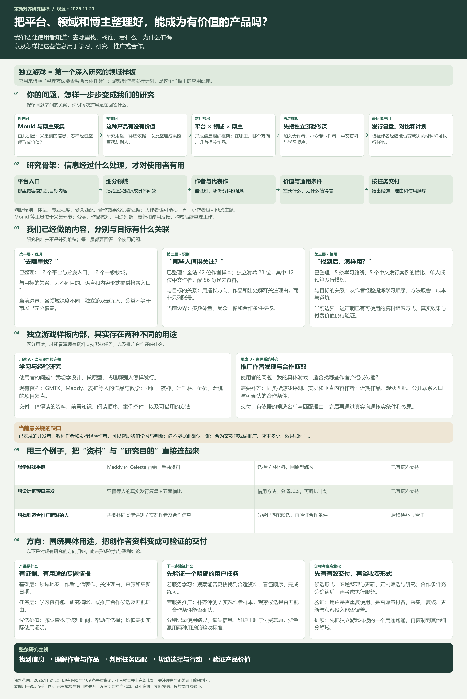
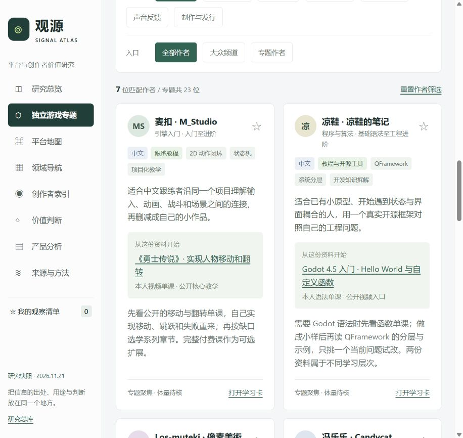
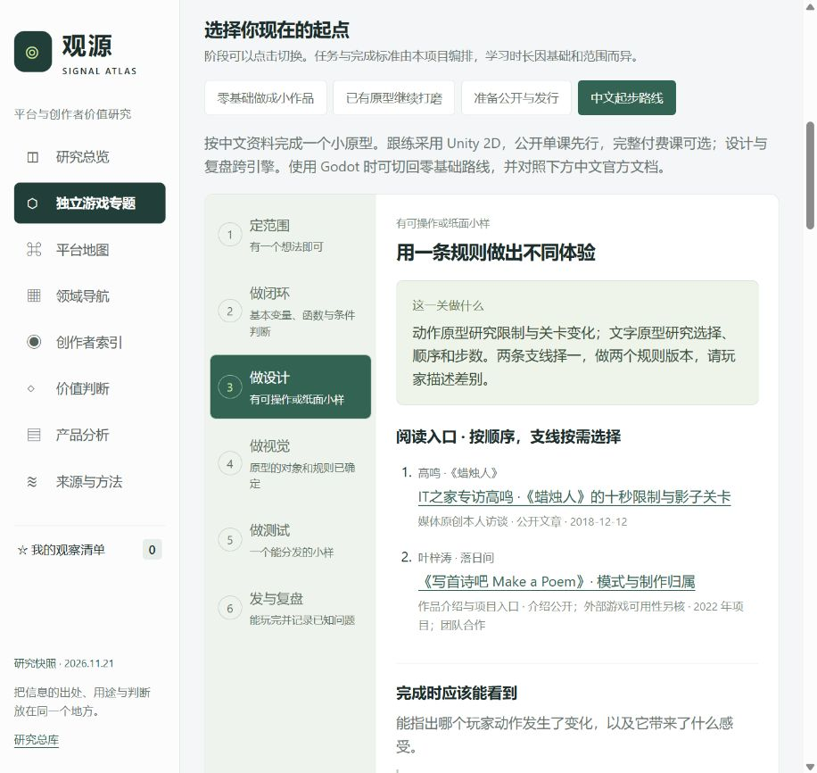
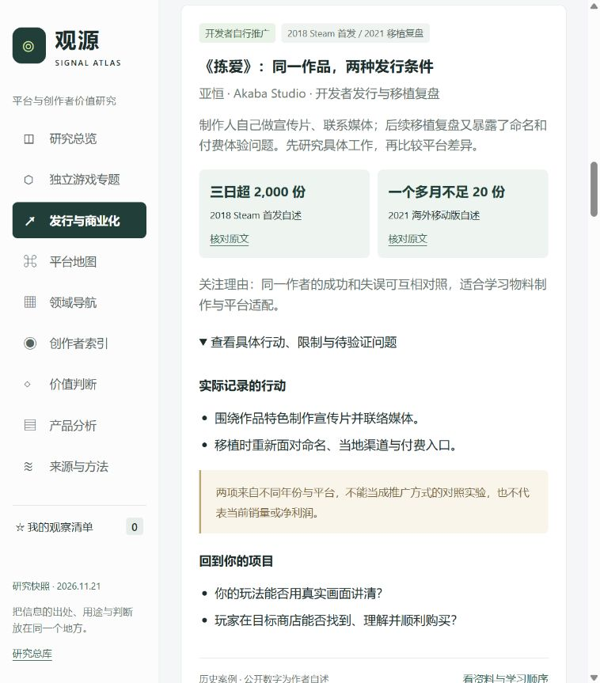
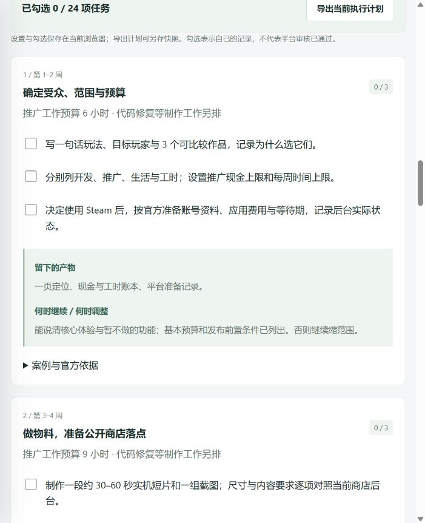

# 017 · 观源 · 平台与创作者价值地图

研究平台、领域和博主信息经过怎样的整理，才能帮助人找到值得关注的作者、选择资料、学习、研究及判断合作，并检验这种整理能否成为有价值的产品。独立游戏是第一个深入样板，制作与发行内容是该样板里的应用延伸。

[在线研究与我们的理解](https://yydshly.github.io/20261104_codex_project/017-creator-value-atlas/#overview) · [单人发行计划](offline.html#publishing?tab=plan) · [五案例横比](offline.html#publishing?tab=comparison) · [发行与商业化](offline.html#publishing) · [进入独立游戏专题](offline.html#indie) · [离线研究总览](offline.html#overview) · [返回研究总库](../../README.md#研究索引)

[研究目标与成果关系图 · 高清 PNG](assets/research-goal-map-v2-20261121.png) · [可放大矢量 SVG](assets/research-goal-map-v2-20261121.svg)。以“整理创作者信息能否成为有价值的产品”为主线，逐项连接原始提问、平台与领域地图、作者与作品、独立游戏样板、学习经验用途、待补的推广合作信息及验证方向。生成脚本为 `scripts/render_goal_map_v2.py`。此前的[资料清单与发行手册总图](assets/research-understanding-map-20261121.png)保留作为详细附件，研究主线以新版为准。

## 研究内容、价值与对我们的意义

**研究内容**：从 Monid 相关采集场景出发，建立“平台入口 → 细分领域 → 作者与代表作品 → 价值与适用条件 → 按任务交付”的组织框架。体量、专业程度、受众匹配和合作效果分别记录，不用粉丝量代替全部价值判断。当前含 12 个平台与分发入口、12 个一级领域、42 位作者样本及 109 条去重来源。

**研究价值**：平台地图回答“去哪里找”，作者与作品回答“找谁、看什么”，学习路线与案例对比回答“怎样学习、哪些经验值得借鉴”。候选产品价值在于减少筛选与核对工作，保留出处、判断理由并持续更新；实际节省、付费意愿与盈利仍需验证。

**对我们的意义**：把零散收藏积累成能回查、能比较、能沿任务使用的个人研究库，为选择学习材料、理解制作与经营的取舍提供依据。同时用一个细分领域样板检验信息整理的用途、维护投入与产品化可能，为是否继续扩展提供证据。

**已有成果与缺口**：独立游戏的 28 位作者（含 12 位中文）、56 份资料、5 条学习路线，以及 5 个中文发行案例、横向比较和 24 项单人计划，主要支持学习与经验研究。推广合作仍需系统补齐同类型评测、实况作者的近期内容、受众、公开联系入口与可确认的合作条件。现有开发者与发行经验作者不能直接视为推广候选；自动采集、实际发信、投放、付费与复购均未验证。

[在线研究与我们的理解](https://yydshly.github.io/20261104_codex_project/017-creator-value-atlas/#overview) · [推广与产品假设](https://yydshly.github.io/20261104_codex_project/017-creator-value-atlas/#product) · [源码与来源](https://github.com/yydshly/20261104_codex_project/tree/main/projects/017-creator-value-atlas)



## 独立游戏专题

收录 **28 位作者（含 12 位中文作者）、56 条代表资料、5 条学习路线**，沿六个方向组织。本轮新增 5 位中文发行作者、10 份亲历项目资料、5 个案例与七步商业化学习路线。此前中文起步路线与语言筛选继续保留。聚焦 PC 小型独立游戏与 2D 原型，保留原有英文原作与中文导读。

[直接进入中文路线与作者](offline.html#indie?path=zh-first&language=%E4%B8%AD%E6%96%87)

| 中文作者 | 主要方向与代表资料 | 建议顺序 |
| --- | --- | --- |
| 麦扣 / M_Studio | Unity 2D 项目教学；《勇士传说》公开单课与完整课程目录 | 移动与翻转 → 自己做一屏闭环 → 按需补状态机、存档与打包 |
| 凉鞋 | Godot 函数单课、QFramework 开源架构 | 补语法 → 完成不用框架的小样 → 遇到耦合问题再看分层 |
| Los-muteki | 繁体中文像素美术；Aseprite 界面、像素实验课 | 认识工具 → 画小素材 → 对照转换示范与轮廓可读性 |
| 冯乐乐 / Candycat | 《Unity Shader入门精要》公开数学章、随书源码与勘误 | 数学基础 → 一个简单效果 → 按需补光照与特效 |
| 叶梓涛 / 落日间 | 《写首诗吧》作品资料、落日间年度复盘 | 拆解玩家动作 → 小互动 → 看研究与协作如何连接 |
| 王妙一 | 《WILL：美好世界》制作访谈、2026 年开发复盘 | 文字重排与资源取舍 → 长期维护、任务拆分与制作安排 |
| 高鸣 | 《蜡烛人》官方资料、本人关卡设计访谈 | 核心限制与原型 → 影子关卡变奏 → 回自己的小样测试 |

中文作者分别标注跟练教程、开源工具、技术书、研究文章或作品访谈。王妙一、高鸣作为作品与本人访谈案例收录；不据此断言持续更新教程。专题作者表示内容聚焦，粉丝量待核。中文专业声音、完整财务账目与渠道因果数据仍是覆盖缺口。



| 方向 | 作者 | 可以解决的问题 |
| --- | --- | --- |
| 玩法与关卡 | Mark Brown / GMTK、Maddy Thorson | 手感参数、玩家引导、输入容错、碰撞和移动平台 |
| 引擎入门 | Brackeys、GDQuest | GDScript、首个完整项目、计分、失败与导出 |
| 程序与算法 | Amit Patel / Red Blob Games、Bob Nystrom、Sebastian Lague、Freya Holmér | 状态机、游戏循环、寻路、六角格、搜索与游戏数学 |
| 美术与工具 | Pedro Medeiros / Saint11、Kenney | 像素画、视觉一致性、原型素材与造型工具 |
| 声音反馈 | Akash Thakkar | 动作反馈、声音层次、音频协作与制作复盘 |
| 制作与发行 | Tom Francis、Derek Yu、Rami Ismail、Chris Zukowski、Simon Carless | 控制范围、原型、玩家测试、商店表达与市场案例 |



每张学习卡说明擅长方向、收录依据、两份代表资料、关注理由、前置知识、阅读顺序、练习与适用范围。外部资料逐项标注形式、访问方式、历史年份或版本和核对深度。作者同时进入原有索引，支持观察清单和最多三人对照。

## 中文发行、推广与商业化

[直接进入发行专页](offline.html#publishing)。新增内容覆盖开发者自发推广、专业发行协作、Demo 与展会、首发失利、付费路径和现金流。每位作者的两份资料都进入原有作者索引、学习卡、观察清单、对照与导出。

| 作者 | 主案例与擅长方向 | 推荐顺序 |
| --- | --- | --- |
| 亚恒 / Akaba Studio | 《拣爱》；宣传片、媒体联系、移植与付费体验 | 2018 宣传篇 → 做自己的物料 → 2021 跨平台复盘 |
| 夜神不说话 | 《拯救大魔王2：逆流》；团队结算、人力与多年现金流 | 首发文字稿 → 区分收入与成本 → 多年经营总结 |
| 叶千落 | 《戴森球计划》；发行合作、类型玩家测试、排期与定价 | 项目访谈 → 发行演讲 → 现行官方规则 |
| 传传 | 《出将入相》；展会、新品节、首周结果与回本 | 首发复盘 → 对照 Demo 与活动 → 早期团队成本复盘 |
| ash / 蓝桃游戏 | 《逃离永明岛》；直接支出、工时与低于预期的首发 | 七个月支出 → 补全成本表 → 首周总结 |



七步路线依次为定受众、做物料、备 Demo、连渠道、谈分工、算收入、发与复盘。任务与完成标准由本项目编排；各步骤连接本人经验与 Steamworks 中文新品节、UTM 和定价文档。执行联系、付费宣传和商业合作均需要由实际项目继续推进，本轮仅建立研究与练习入口。

案例注明平台、年份、观察窗口、作者角色和缺失数据。愿望单存量、同期总销量、购买来源和实际到款分别记录；不给出通用转换率、定价或收益预测。蓝桃的阶段开销不含生活费与机会成本，夜神的结算估算不是净利润，传传的首周结果不是最终回本结论，Gamera 的整体成功也不能单独归给某个渠道。

亚恒的 2018 原发 indienova 正文不可读，本轮使用明确署源的 GameRes 转载；年度文章保留本人署名。叶千落采用 GameRes 承载的 GWB 本人问答与演讲整理，职务与机制说法按 2021 年理解。夜神的视频按附带完整文字稿核对，未逐段观看视频。其余作者以原创投稿正文核对。公开数字未独立审计，未访问任何人的私人后台。

新增 `#publishing` 独立入口，支持阶段链接恢复和发行研究单独导出；总专题导出也包含案例与路线。机核作为第 12 个平台入口，叶梓涛已有平台标签相应接入。

## 单人低预算：五案例横比与执行计划

发行页提供三个入口：[五案例横向对比](offline.html#publishing?tab=comparison)、[单人发行计划](offline.html#publishing?tab=plan)、[案例与原文](offline.html#publishing?tab=research)。带原有阶段参数的旧链接仍进入对应学习阶段。

横比把团队条件、推广动作、公开现金口径、人力、可借用部分和避坑点放在同一张表中，窄屏可展开逐案阅读。六种方法依次处理实机物料、类型玩家试玩、匹配作者与媒体、适量开发日志、符合条件的活动、可选付费实验；六项避坑保留原案例与官方出处。可复用程度和优先级属于本项目判断，不把未知费用补成零。



执行模板假设已有 PC 原型、面向 Steam 小体量买断，安排 12 周发行准备与上线后 30 天复盘。8 个阶段、24 个具体任务均有产物、继续条件及调整条件，包含联系模板、传播记录字段和账本分类。周数不代表剩余开发工期，关键体验或平台条件未完成就顺延。

可修改项目名、新增推广现金上限与每周推广时间。默认 500 元、每周 5 小时是规划示例；现金可设为 0，40% / 20% / 40% 是额度预留示例，不是报价、支出或回报预测。Steam Direct 费、开发素材、个人工时与生活资金单列。发行前的推广任务预留 43 小时，上线后记录与复盘预留 6 小时，开发修复与日常维护另排；这些是编辑编排的工作预算，未经项目实测。

设置与任务勾选使用独立的浏览器存储键保存，未改动原观察清单。计划可单独导出 JSON，包含设置、完成标记、8 个阶段、24 个任务、对比、原案例和引用资料；全站导出也保留计划进度。勾选仅代表使用者自己的记录，不代表平台审核通过或预算已花费。

本轮补读 6 个现行官方入口：Steam Direct 登记、应用费用、发行流程、更新后的英文审核流程、序列号、用户评测规则。读取日为 2026-11-21；中文审核页提示英文已更新，因此采用更新英文版。计划保留该日官网的首几款作品付费后至少 21 天等待、即将推出页面公开至少两周、商店送审至少提前 7 个工作日等条件，并提醒按应用后台核对，不承诺审核日期。

## 学习顺序

零基础路线依次进入定范围、做闭环、调手感、做视觉、加声音、做测试和发版本。编程完全陌生时先做语言练习，Brackeys 与 GDQuest 的项目教程择一。每个阶段都有具体任务和完成时应该看到的结果。

已有原型路线从手感开始，按需补程序与算法，再整合视觉、声音和玩家测试。发行路线围绕验证范围、观察试玩、解释作品与发布版本展开。营销研究可在概念阶段开始，源码、技术和引擎根据实际项目选取。

资料中的学习顺序、练习和完成标准由本项目编排，需要通过实际使用继续检验。角色控制、战棋算法、图形数学和发行经营分别保留自己的前提。

中文路线按定范围、做闭环、做设计、做视觉、做测试、发与复盘六步展开。Unity 2D 跟练以公开核心内容先行，完整付费课可选；Godot 学习者可以回到原有路线并对照中文官方文档。QFramework 和 Shader 均安排为遇到对应问题后再学的支线。

## 规模与来源口径

资料整理日期为 **2026-11-21**。GMTK、Brackeys 和 Sebastian Lague 的 YouTube 作者栏检索快照分别约为 174 万、194 万和 140 万订阅，检索结果标注约两个月前抓取。网页保留原视频、读取日和快照性质。这些数值用于解释大众入口，按非实时数据理解。

其余 25 位按公开作品的专题聚焦收录，跨平台体量待核。作者、团队和合著作品分别说明，关注理由属于编辑判断。

文章按可读正文核查，仓库按 README 和章节原稿核查，视频按简介、章节与配套资料核查。本轮未逐部观看视频，未运行外部教程、源码、可操作作品或付费工具。Pedro 的图解按目录与代表文章核对，未逐张审核全部图解。

本轮中文视频部分直读受限，只核到本人检索索引，学习卡已明确区分。冯乐乐的数学章 PDF 文本抽取乱码，依据仓库公开说明与章节入口收录，未通读推导。作者 About 页另支持本人身份与著作归属。王妙一和高鸣使用原创媒体访谈，作者自述与独立验证分别理解。

Bob Nystrom 的书站读取失败，提供作者仓库的原始章节，原稿中的代码标记需结合仓库阅读。Kenney 主站受 robots 限制，采用本人 itch 页面。Godot 中文文档固定到 4.3，和教程、当前安装版本分别核对。Shader Forge 等历史工具与现用环境的兼容性待实测。营销案例保留原年份，当前平台功能配合 Steamworks 官方文档理解。

## 全站内容与功能

九个入口分别为研究总览、独立游戏专题、发行与商业化、平台地图、领域导航、创作者索引、价值判断、产品分析和来源与方法。

全站整理 12 个平台与分发入口、12 个一级领域、42 位作者和 109 条去重来源。39 位作者的所列资料来源已读，影视飓风、老师好我叫何同学、毕导THU 三位仍为待复核候选。itch.io 记录游戏、原型与素材，机核入口连接开发者本人投稿和历次复盘。

平台适配、领域标签和关注理由是编辑性分类。受众画像、报价、回复率与成交效果待核。消费、运动、旅行等方向仍有样本缺口，专题深化与整体覆盖分别说明。

支持作者、主题和作品搜索，平台、领域、语言、用途与来源状态交叉筛选，学习阶段切换与链接恢复，浏览器观察清单，作者对照，完整研究、筛选结果和独立游戏专题的 JSON 导出。来源页可按类型与关键词查询。

## 打开与更新

沿用研究总库的 GitHub Pages：`main` 分支的 `/docs` 为发布源，在线路径为 `/20261104_codex_project/017-creator-value-atlas/`。构建同步网页、脚本、样式及新版引导图 PNG / SVG；引导图原文件保持不变。首页、项目摘要与总库索引统一说明研究内容、价值、对我们的意义，以及学习经验成果和推广合作缺口。

直接用桌面浏览器打开 `offline.html`。界面、样式、数据、脚本与引导图均已内嵌；高清图文件与矢量版链接使用随项目提供的 assets，外部原文链接需要网络。观察清单保存在当前浏览器，导出可留存快照。

也可以在工作区根目录启动本地预览。

```powershell
python -m http.server 8797 --bind 127.0.0.1
```

访问 `http://127.0.0.1:8797/projects/017-creator-value-atlas/offline.html#indie`。

- `data.js` 保存原有平台、领域、作者、方法与来源。
- `indie-data.js` 保存独立游戏专题的作者、资料、路线和配套文档，按稳定作者 ID 合并到原有索引。
- `indie-zh-data.js` 单独维护首批中文作者、代表资料和中文路线。
- `publishing-data.js` 保存中文发行作者、案例、商业化比较、指标口径、官方文档和七步路线。
- `solo-release-data.js` 保存五案例横比、六种方法、六项避坑、预算示例、12 周准备及 24 项任务，另含联系模板与现行官方依据。补充数据在专题合并前加载。
- `app.js` 实现专题、导航、筛选、学习卡、观察清单、对照与导出。
- `styles.css` 保存响应式界面和打印样式。
- `index.html` 是分文件入口，`offline.html` 是生成的单文件版本。
- `build.mjs` 生成离线版，并同步到 `docs/017-creator-value-atlas/`，同时调整返回总库的相对链接。

修改源码后运行以下命令。

```powershell
node projects/017-creator-value-atlas/build.mjs
```

本项目采用原生 HTML、CSS、JavaScript，交付本地研究网页。数据快照与后续自动采集分别处理，外部采集需要继续核对接口字段、权限、许可和费用。

## 验证记录

发布前核对：桌面 1280×900 与手机 390×844 断点的首页无文档横向溢出；新版引导图加载为原始 3600×5384，离线版内嵌同一张图。研究内容、价值、对我们的意义三张摘要卡及推广缺口显示正确；首页进入独立游戏专题和发行页 24 项任务入口通过。构建资源与发布目录同步，其他子项目的工作区差异不纳入本研究提交。

语法、唯一 ID、作者合并、平台与领域关联、56 条代表资料、5 条路线和 22 个学习阶段的关联检查通过。单文件内嵌五份数据脚本和应用脚本，构建检查外部脚本及样式残留，静态目录对应资源保持一致。

浏览器验证了专题搜索、方向与作者组交叉筛选、学习卡、阶段切换及刷新恢复、专题作者加入与移出观察清单，以及实际专题 JSON 下载。桌面和手机断点的显示与旧索引功能继续通过浏览器验收。实帧保存在 `assets/`，外部教程和学习效果按前述范围保留待实测状态。

上一批中文验证：中文筛选匹配 7 位（含繁体中文），与美术方向交叉筛选匹配 2 位；中文路线与语言可随链接刷新恢复。总索引的游戏开发／中文筛选、麦扣与凉鞋对照、观察清单刷新持久化与实际 23 作者专题下载通过。手机页面与路线实测内容宽度和视口均为 375px，无横向溢出；学习卡可滚动阅读。浏览器未记录 JavaScript 错误，三个中文实帧保存为 `indie-zh-authors.jpg`、`indie-zh-route.jpg` 和 `indie-zh-mobile.jpg`。

上一轮发行验证：五个案例与七个学习阶段关联检查通过，官方文档可进入阶段阅读列表。收入阶段刷新恢复、案例展开、本人学习卡、作者保存后刷新与还原、五位发行作者交叉筛选及两人对照通过。实际下载并解析发行 JSON，包含 5 位作者、10 份代表资料、5 个案例、7 个阶段和 3 份官方文档。中文制作与发行筛选匹配 6 位（含既有王妙一），链接刷新恢复；当时来源页匹配 103 条记录。

手机视口下页面内容宽度为 375px，商业化表格在自己的容器内横向滚动；导航、阶段切换、案例展开与滚动学习卡通过。临时视口已恢复，浏览器没有记录 JavaScript 错误。实帧保存在 `publishing-cases.jpg`、`publishing-route.jpg` 与 `publishing-mobile.jpg`。

本轮单人计划验证：5 行、7 列的案例对比、6 种方法与 6 项避坑的引用关联通过；8 阶段共 24 个任务 ID 唯一，全部原文和官方文档引用可解析。旧学习阶段链接继续打开研究页，新比较与计划入口可独立定位。全站去重来源为 109 条。

实际将推广现金设为 0 元、每周时间设为 1 小时并勾选两项任务：页面显示零额度及 31 小时时间缺口，刷新后设置和勾选保留。下载并解析的 JSON 含设置、两项进度、5 案例、8 阶段、24 任务与 19 条引用。验收后已通过界面还原默认 500 元、每周 5 小时与 0/24 任务；原有观察清单未改变。

默认视口及 390×844 手机断点通过，手机文档内容宽度与可用宽度均为 375px；对比表在容器内滚动，逐案阅读与任务卡无页面横向溢出。临时视口已恢复，浏览器没有记录 JavaScript 错误。新实帧为 `solo-case-comparison.jpg`、`solo-release-plan.jpg` 与 `solo-release-mobile.jpg`。这些验证覆盖网页与本地计划功能，实际发行效果、耗时和支出尚未实测。

## 原始入口

[GMTK](https://gamemakerstoolkit.com/) · [Celeste & Forgiveness](https://www.maddymakesgames.com/articles/celeste_and_forgiveness/index.html) · [Red Blob Games](https://www.redblobgames.com/) · [GDQuest](https://www.gdquest.com/) · [Saint11](https://saint11.art/) · [How To Market A Game](https://howtomarketagame.com/) · [Steamworks](https://partner.steamgames.com/doc/marketing/wishlist)

中文发行：[亚恒的宣传篇（明示转载）](https://www.gameres.com/forum/t/825375) · [夜神的首发文字稿](https://www.gcores.com/videos/126067) · [叶千落的项目访谈](https://www.gameres.com/880415.html) · [传传的《出将入相》复盘](https://www.chuapp.com/article/291001.html) · [蓝桃的首周总结](https://www.gcores.com/articles/202753)。每位作者的第二份资料及现行官方文档在网页中逐项保留。

完整逐项来源、支持范围、历史年份与核对深度在网页中保留。
