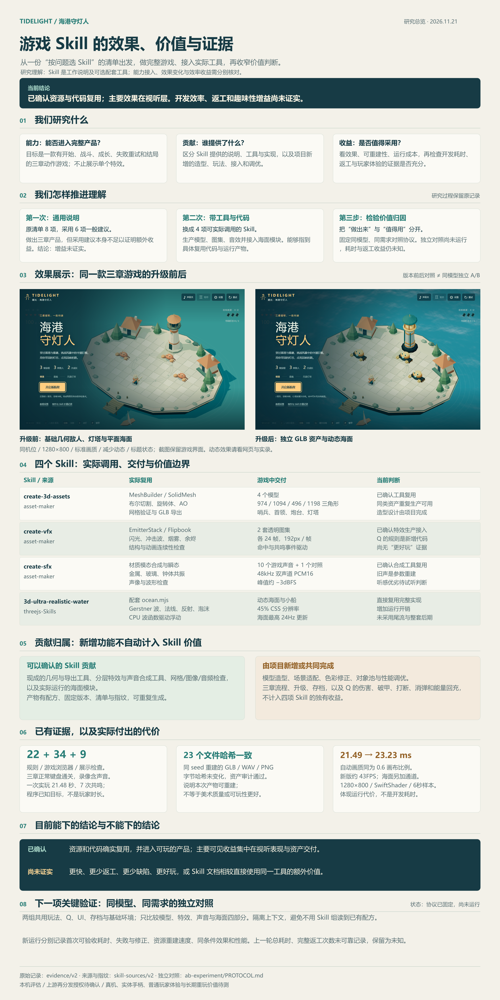

# 018 · 潮光：游戏开发 Skill 的能力、效果与价值研究

围绕一款可从开场玩到结局的 Three.js 三章动作游戏，研究 Skill 提供的是通用工作说明、可执行工具还是可复用实现，实际带来了哪些效果，以及这些效果能否证明开发更快、返工更少或玩家更喜欢。

研究分两轮：第一轮采用六项通用建议完成产品梳理，未证实相较模型直接开发的额外增益；第二轮实际调用 create-3d-assets、create-vfx、create-sfx 和 3d-ultra-realistic-water，生产资源并接入游戏，确认具体工具与代码复用。新增玩法、普通工程修正和完整产品功能单独归属，不合并成 Skill 的独有贡献。

- [在线研究回顾与一图总览](https://yydshly.github.io/20261104_codex_project/018-game-skill-product/research.html#overview)
- [完整三章游戏](https://yydshly.github.io/20261104_codex_project/018-game-skill-product/) · [模型、特效与声音展台](https://yydshly.github.io/20261104_codex_project/018-game-skill-product/gallery.html)
- [同机位版本前后对照](https://yydshly.github.io/20261104_codex_project/018-game-skill-product/research.html#compare) · [音效对照](https://yydshly.github.io/20261104_codex_project/018-game-skill-product/research.html#sound)
- [本地源项目与运行说明](../../harbor-skill-demo/README.md)
- [完整用法和生成命令](../../harbor-skill-demo/SKILL-USAGE.md)
- [固定来源、实际调用与 SHA-256](../../harbor-skill-demo/skill-sources/v2/manifest.json)

## 研究引导图

沿用已经生成的原图，不重新生成或改动图中文字。图内“本机评估”记录研究阶段状态；本次发布已核对海面 MIT，未分发无许可证声明的工具包与 Skill 全文，当前范围见后文发布说明。

[高清 PNG](https://yydshly.github.io/20261104_codex_project/018-game-skill-product/assets/research/research-overview-v3.png) · [可编辑 SVG](https://yydshly.github.io/20261104_codex_project/018-game-skill-product/assets/research/research-overview-v3.svg) · [图表依据与指纹](https://yydshly.github.io/20261104_codex_project/018-game-skill-product/assets/research/overview-manifest.json)

## 原清单研究了什么

原起点是“第一版跑通以后，按问题选择 Skill”的八项清单。原帖原链接未提供，第一轮保存的是检索到的同名公开版本，未声称它们与原帖完全相同。

| Skill | 面向的问题 | 第一轮范围 |
| --- | --- | --- |
| game-design-theory | 玩法规则、核心循环、阶段奖励与挑战递进 | 采用建议 |
| game-engine | 网页原型、游戏更新、碰撞、渲染与性能组织 | 采用建议 |
| game-developer | Unity / Unreal 引擎系统开发 | 仅目录收录，未调用引擎 |
| game-ui-design | 开场、游玩、成长、失败、结局等界面流程 | 采用建议 |
| game-ui-ux | 手机、手柄、安全区、焦点和输入归属 | 采用建议，实体手柄未实测 |
| threejs-game-ui-designer | Three.js 世界、HUD 和菜单状态 | 采用建议 |
| game-feel | 移动、命中、受伤、冲刺的语义反馈 | 采用建议 |
| higgsfield-websites | Higgsfield 生成素材与部署流程 | 仅目录收录，未使用服务 |

第一轮游戏实现与检查记录能证明完成了相应功能，不能单独证明 Skill 提高了效率或能力上限。[第一轮判断](https://yydshly.github.io/20261104_codex_project/018-game-skill-product/research-v1.html)与[原八项来源](https://yydshly.github.io/20261104_codex_project/018-game-skill-product/skill-sources/manifest.json)保留，结论为“增益未证实、采用必要性低”。

## 第二轮实际采用的四项能力

| Skill / 来源 | 实际复用 | 交付与效果 | 价值边界 |
| --- | --- | --- | --- |
| create-3d-assets · [asset-maker](https://github.com/Be1l-ai/asset-maker) | MeshBuilder、SolidMesh、Manifold CSG、旋转体、地面 AO、GLB 导出和网格检查 | 哨兵、首领、炮台、灯塔 4 个 GLB；974 / 1094 / 496 / 1198 三角形，可独立旋转查看 | 确认工具复用；造型配方、足部与色彩修正由项目完成，没有骨骼动画 |
| create-vfx · asset-maker | EmitterStack、Flipbook、缓动、结构与动画连续性检查 | 潮汐和金色撞击 2 套透明图集，各 24 帧、192px；游戏内由命中和共鸣事件触发，池上限 14 | 确认特效生产接入；Q 的伤害、破甲、打断、消弹和能量规则是新增玩法代码 |
| create-sfx · asset-maker | 金属、玻璃、钟体等模态合成、瞬态与立体声函数 | 10 个游戏音效和 1 个旧声参数重建对照，48kHz 双声道 PCM16、峰值约 −3dBFS，可试听 | 确认合成工具复用；音量、包络和事件绑定由项目适配，听感未盲评 |
| 3d-ultra-realistic-water · [threejs-Skills](https://github.com/zafmy/threejs-Skills) | 配套 ocean.mjs 的 Gerstner 波、细节法线、反射、泡沫和 CPU 波函数 | 动态海面与同波场小船浮动；45% CSS 分辨率、最高 24Hz 更新 | 直接复用完整实现；尺度、水位与性能缓存由项目适配，未使用尾流和整套后期 |

来源固定至 asset-maker `d095bc28e9a8e4cfe58996cbaf3a0ee9cbe4e46e` 与 threejs-Skills `5ea1661a0e05d82b054553daaa6baf6d0233c33c`。网页提供实际符号、配方、参数、清单与记录，而非只有 Skill 名称或效果描述。

## 游戏效果与贡献归属

暮港学习近战预警与反击，雾礁加入炮台、火线和掩体，风暴灯塔包含甲壳窗口与双阶段首领。两次装备选择改变后续属性，检查点、暂停、重试、续玩和结局形成完整旅程。手机有摇杆和动作按钮，键盘为 WASD/J/Space/Q/E。

这些产品流程和输入、存档、规则代码属于项目实现。四项工具主要参与资源生产与海面实现，不把三章产品或 Q 的新功能都算成 Skill 的价值。版本升级前后的截图仅展示实现变化，旧版没有等量新资源，不能当作同模型独立 A/B。

## 效果、验证与代价

- 22 项规则测试、34 项游戏浏览器检查和 9 项资源接入阶段展示检查通过；研究回顾另有 14 项页面检查与 152 个本地引用核对。
- 同 seed 重建的 23 个 GLB / WAV / PNG 字节哈希一致，说明本次资产可重建，不代表美术或可玩性更优。
- 正常键盘与菜单完成三章，21.48 秒、7 次共鸣、0 重试；[录像含游戏声音](https://yydshly.github.io/20261104_codex_project/018-game-skill-product/evidence/v2/full-playthrough.mp4)。程序已知目标位置，该时长不是普通玩家时长，也不是开发耗时。
- 同为 1280×800 CSS、自动画布比例 0.6，软件渲染平均帧时间由 21.49ms 变为 23.23ms，约 43FPS；标准画质 48.14ms 与 47.90ms 差值很小，不宣称加速。
- 主通道绘制由 152 次变为 103 次，海面每次更新另加 1 次与 8880 三角形。数据为 Headless Chromium / SwiftShader 预热 3 秒后取样 6 秒，不能代表真机。

原始[浏览器记录](https://yydshly.github.io/20261104_codex_project/018-game-skill-product/evidence/v2/browser-verification.json)、[通关记录](https://yydshly.github.io/20261104_codex_project/018-game-skill-product/evidence/v2/playthrough.json)、[性能记录](https://yydshly.github.io/20261104_codex_project/018-game-skill-product/evidence/v2/performance.json)和[重建记录](https://yydshly.github.io/20261104_codex_project/018-game-skill-product/evidence/v2/reproducibility.json)保留。实际也遇到 UTF-8、SDK API、双声道包络、模型足部和线性色彩、海面运行开销等修正；没有完整逐次日志，不将这些描述当成可比较的返工次数。

## 我们目前理解的价值

已确认的是现成工具和实现确实复用，并交付了可运行的视听效果、可编辑配方与可重建资产。大量同类资源生产、团队交接和后续改版可能受益，但本轮尚未量化。SDK 或模块自身的能力，也不能自动算成 Skill 文档这种包装形式的独有收益。

开发更快、返工更少、缺陷更少、普通玩家更喜欢或更愿重玩，目前均未证实。首次开发总耗时和完整返工次数保留为未知。真机触控、实体手柄、物理输入延迟与长期体验仍需另测。

## 同模型、同需求对照的状态

[协议已固定](https://yydshly.github.io/20261104_codex_project/018-game-skill-product/ab-experiment/PROTOCOL.md)，独立对照尚未运行。计划使用同一选定模型、隔离上下文和相同规格，共用三章玩法、Q、UI、输入和存档，只比较模型、特效、声音、海面四部分。新运行需分别记录首次可验收耗时、失败与修正、重建耗时、同条件效果与性能；历史数据不倒推，没有偏好评价不填写分数或胜负。

## 用法与公开发布范围

选型以具体问题、实际工具、交付格式和验收为依据。先确认调用接口与许可，再生成资源、接到既有事件、检查运行、保留配方和指纹，最后按同需求对照判断净收益。普通游玩无需 Python 或外部账号；重新生成依赖本地独立环境及从上游自行获取的工具包，见 [SKILL-USAGE.md](../../harbor-skill-demo/SKILL-USAGE.md)。

Three.js 与海面模块均按 MIT 保留许可证。asset-maker 未声明仓库许可证，本次远端与静态包不分发其工具包、复制模板或上游 Skill 全文；提供来源、指纹、本项目配方与现有生成资源。详见 [第三方说明](../../harbor-skill-demo/THIRD-PARTY-NOTICES.md)与[发布核验](https://yydshly.github.io/20261104_codex_project/018-game-skill-product/publication/source-rights.json)。本次部署沿用 GitHub Pages 的 main/docs，生成的引导图保持原样。
