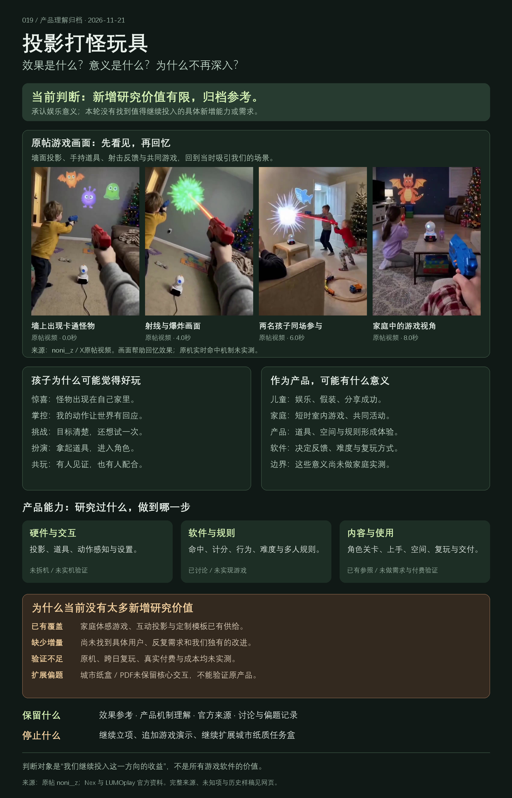

# 019 · 投影打怪玩具：效果、意义与研究判断

**当前判断：效果直观，有儿童娱乐与共同游戏的意义；对我们当前没有太多新增研究价值，保留理解与来源，不继续立项或制作演示。**

这是对本次研究投入的取舍，不是对投影玩具、游戏软件或儿童游戏价值的全面否定。

[打开研究网页](index.html) · [离线阅读](offline.html) · [原帖](https://x.com/noni__z/status/2120168976135209223) · [返回总库](../../README.md#研究索引)

## 一图汇总



[PNG](assets/projection-play-overview-v2.png) · [可编辑SVG](assets/projection-play-overview-v2.svg)

修订版加入原帖视频0、4、6、8秒四张画面，直接呈现墙面目标、射击特效、两名孩子参与与家庭视角，帮助回忆。四张画面保持原帖内容，不用AI重绘；实时命中机制仍未核验。其余包括童趣解释、产品能力、意义、研究停止依据与未知项。SVG内嵌图片，可独立保存。

## 效果与意义

原帖附件约12.4秒，包含投影目标、红蓝玩具枪、儿童移动、多人和爆炸画面。原机具体型号、每次命中是否真实对应、实时识别精度和长期复玩均未核验。“美国第一”没有排名来源。

童趣解释包括空间惊喜、道具扮演、行动掌控、明确挑战和共同参与。家庭短时娱乐与共玩是使用场景假设，不宣称学习、治疗或亲子关系改善成效。

软件与规则能够改变玩法、难度和复玩，有一般学习价值；当前没有识别出值得我们专门实现的新机制或需求缺口。Nex与LUMOplay提供已有供给参照，未做同任务实测。

## 为什么停止

- **基本机制已能解释**：现有材料足够理解“投影目标、实体道具、行动反馈、同场游戏”的组合，继续重复解释的新增收益低。
- **已有产品覆盖相关能力**：Nex提供家庭体感游戏，LUMOplay提供互动投影与定制模板。它们说明已有供给，不证明市场没有任何缺口。
- **未找到具体的新增需求**：合作、创作、更多内容都是可想象的方向；没有证据表明某类家庭反复遇到现有方案不能解决的问题。
- **关键体验仍未实测**：没有原机命中测试、设备搭建测试、家庭跨日复玩或真实付费记录，无法支持更强判断。
- **软件价值尚未落到本项目**：软件与规则有一般学习价值，但目前没有提出值得我们专门实现、比较和保留的新机制。
- **早期扩展偏离吸引力**：城市任务盒与PDF组织了纸质活动，未保留动作输入到即时反馈的核心体验；不能用它验证投影玩具。

## 保留的讨论与样稿

网页保存从童趣、六组城市文化玩法、苏州纸盒，到软件层次、产品层次和最终停止的讨论摘要。全部扩展按历史设计设想理解，不是开发清单。

[11页纸质样稿](archive/suzhou-window-spirit-v01.pdf)保留作偏题记录。它没有实现动作识别、投影命中与实时反馈。已核对版式和尺寸，未实际剪折、儿童试玩或路线踏勘。69元、27元、1,200元和100家庭/8订单为早期纸盒测试假设，没有真实报价与交易，不适用于原玩具。

## 实现与资料

本项目只实现研究归档页、一张汇总图、离线版、资料导出、图像放大及讨论展开；没有制作互动投影游戏。

- [S1 · 原帖与附件](https://x.com/noni__z/status/2120168976135209223)：用户提供。正文经公开转存读取，附件约12.4秒，按抽帧观察。不是原机实测或交易证据。
- [S2 · Nex Playground 官方游戏目录](https://www.nexplayground.com/games)：官方提供家庭运动、合作等游戏的说明；本轮未购买或实测。
- [S3 · LUMOplay：所需设备](https://help.lumoplay.com/hc/en-us/articles/360002783453-Required-equipment)：官方说明计算机、感知设备和显示设备的分工；不能据此识别原帖玩具的硬件。
- [S4 · LUMOplay：Motion Maker 模板](https://help.lumoplay.com/hc/en-us/articles/360003430793-What-is-Motion-Maker)：官方提供互动墙面等模板与素材替换说明，作为已有供给的参照。
- [S5 · 苏州官方：平江历史街区](https://visitsz.wglj.suzhou.com.cn/scenic-spot-detail.aspx?id=34)：支撑早期候选区域的公开介绍。网页资料不能替代路线踏勘。
- [S6 · Creative Tonies 官方介绍](https://us.tonies.com/collections/creative-tonies)：支持家庭自录故事与留言的产品参照；没有证明我们的城市任务盒需求。
- [S7 · LEGO Build the Change 活动材料](https://www.lego.com/en-us/sustainability/buildthechange/courses)：儿童重新想象城市空间的活动参照；不代表本项目已经有学习或商业成效。


资料整理日期：2026-11-21。图和HTML通过 `build.py` 从固定内容生成；需要Python、Pillow与Windows等线字体。修改样式或脚本后重新运行。构建仅复制明确清单到 `docs/019-projection-play-study/`，不删除文件，不自动提交或发布。

```powershell
python projects/019-projection-play-study/build.py
```

公开地址以实际部署核对为准：
https://yydshly.github.io/20261104_codex_project/019-projection-play-study/
