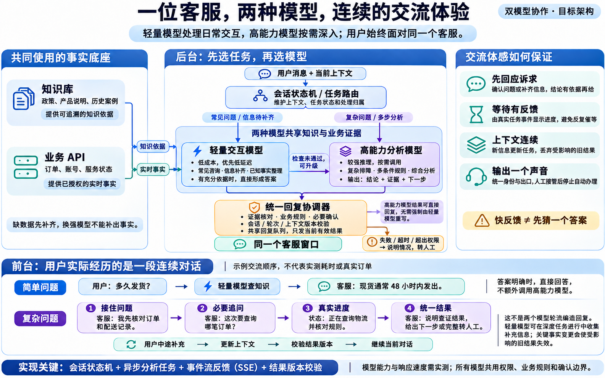

# 020 · 知识库与客服业务闭环研究

**研究怎样把企业资料建成可信、可维护的知识库，再在其上构建能回答、能办理、能持续跟进的客服。** 我们用包裹延迟场景梳理快慢路径、模型分工和交流体验，形成可操作原型、完整实施说明及 30 项能力对照。

[在线研究摘要](https://yydshly.github.io/20261104_codex_project/020-knowledge-service/#research) · [完整实施全景](https://yydshly.github.io/20261104_codex_project/020-knowledge-service/#guide/overview) · [能力对照](https://yydshly.github.io/20261104_codex_project/020-knowledge-service/#guide/capabilities) · [开发说明](DEVELOPMENT.md) · [返回总库](../../README.md#研究索引)

## 已有引导图

沿用本轮生成的双模型协作机制图，说明模型职责、共享证据、统一回复协调及用户交流过程。**它表达目标方案，不代表已经接入真实模型或异步协调。**



[知识库与团队价值图](public/assets/knowledge-service-value.png)也保留在网页中。没有重新生图替换本轮成果；提示词与生成记录见 docs/。

## 我们研究了什么

- **知识库建设：** 资料盘点、解析、切分、权限、生效范围、审核、检索评测、发布、撤回与反馈修订。知识要能追溯来源、版本与负责人。
- **知识到客服业务：** 政策由已发布文档提供，实时事实由订单、物流等授权接口提供；回答之外，还要确认办理、查询结果、转人工和持续跟进。
- **用户交流体验：** 区分真实进度、必要追问与最终结论，避免重复询问、不同模型抢答、过时结果覆盖新信息，以及把“已建单”当成“已解决”。

本研究是自主架构探索与确定性原型，没有选定模型厂商、向量数据库或生产部署栈，也没有验证真实客服商业收益。

## 架构是什么

**知识建设链路：** 原始资料 → 解析与语义切分 → 业务审核与范围管理 → 检索索引和发布 → 版本更新、撤回与重建。

**在线服务链路：** 用户入口 → 身份与会话 → 必要信息补齐 → 知识检索及实时工具 → 路由选择处理能力 → 统一回复，或规则校验后生成确认预览 → 确认写入与结果查询 → 人工和工单跟进。

**运营回路：** 未解决问题、错误回答和人工反馈 → 质检与责任人核对 → 知识修订或流程改进 → 回归评测 → 审核发布。原始聊天不会直接成为正式政策。

知识库提供政策与操作依据；订单状态、物流、退款结果等动态事实仍由业务接口提供。模型可以解释和提出建议，正式鉴权、资格、确认、幂等与写操作由后端控制。

## 原理是什么

**快慢首先是两种处理路径。** 信息齐、证据足的标准咨询、查单和追问可以用模板或轻量模型处理；多来源冲突、多步排查或质量检查未通过时，直接使用或升级到高能力模型。已识别的复杂任务不必先让轻量模型试答。

**两个模型是可选实现。** 一个模型也能使用普通与深入配置。先建立单模型基线，再固定知识、工具和样本，比较质量、有用反馈、分位延迟与每次有效解决的完整成本，决定双模型是否值得引入。

**舒适体感来自统一会话编排。** 用户面对同一个客服出口；进度只陈述已经发生的动作，必要时补齐信息，最终答复附证据并说明未知。高能力模型的有效结果可直接发布，无需强制轻量模型重写。

目标异步方案把任务绑定会话、轮次和上下文版本；新信息影响结论时，使旧结果失效。当前原型按会话串行处理，尚无分析中并发补充、任务取消或会话版本淘汰。

## 包裹延迟场景如何落地

演示订单 SF-3096 属于固定身份 DEMO-01。种子物流为超承诺 36 小时、48 小时无新扫描；演示催查规则要求运输中、超承诺超过 24 小时且无扫描至少 48 小时。数值均为教学数据，不是正式服务 SLA。

先核对订单和物流、引用配送异常政策，说明现有证据不能认定丢件或保证送达日。规则生成催查预览，用户点击确认后再次复核快照，以幂等方式创建 LC 记录；随后可以查询记录或转人工演示。

目标产品还要接入真实受理队列、承运商反馈、责任人处理、用户更新、解决、关闭、回访和重开。当前演示没有通知真实承运商，建单也不会自动推进物流。

八步目标对话均有实际运行方式与限制对照。部分自由续问当前进入 unknown，纯文本“确认”不能代替确认按钮；短信补充只保留为原始消息，尚未形成已核实的结构化诉求快照。

## 已交付与未实现

- 网页含研究摘要、两张既有引导图、交互架构、八步场景、9 个实施主题、知识与工具目录、对话试验台和流程回归。
- 能力表共 **30 项：已实现 14、演示 4、待开发 12**，每项列当前边界、目标、负责人、下一步、依据与验收条件，可按类别、状态和关键词筛选。数量不是生产完成率。
- 已验证归属、资格、确认令牌、取消、写前快照复核、内存幂等、查询、换单和人工持有等机制。自动测试 **35 项通过**，其中 3 项覆盖公开版传输与共享规则；页面另有 12 个确定性流程回归案例。
- 真实 LLM、正式登录与租户鉴权、生产检索、持久化与恢复、异步协调、真实坐席和承运商、运营审批工作台、真实质量成本评测均待开发。

**公开网页：** GitHub Pages 托管静态研究与浏览器教学版。同一份确定性规则在当前页面运行，对话和工单只存于页面内存，刷新即清空，不调用远端业务 API。客户端规则可被修改，不能作为生产授权。能力表中的服务端机制对应仓库的 Node 本地版。

**Node 本地版：** 执行真实本地 HTTP 与规则；身份、订单和知识是种子数据，会话及工单在进程内存，重启失效。没有真实模型推理、支付、物流或坐席连接。

## 对我们的意义

沉淀可维护的知识资产、可复用的业务接口边界、明确的模型分工，以及能对照代码和验收条件的实施地图，帮助我们从聊天窗口走向客服业务闭环，并在投入真实模型与系统前看清缺口。

减少查找和重复追问、延续用户诉求、核对回答与办理、发现知识和流程问题，是待验证的业务价值。节省多少工时、用户是否更满意、解决率与单位成本是否改善，仍需真实样本和试点测量。

## 运行与复现

需要 Node.js 22 或以上，无外部依赖。

```powershell
npm start
# http://127.0.0.1:5216/#research
npm run check
npm test
npm run build
# 静态产物在 dist/，以 HTTP 静态服务器托管；不能直接双击 file:// 运行模块
```

scripts/build-pages.mjs 复制公开资源，将 engine 的 Node UUID / 计时依赖适配为浏览器标准 API，保留其余共享规则；不会把 Node 服务器发布为公网 API。可传入绝对输出目录，过程不删除既有文件。

main 分支 docs/020-knowledge-service/ 为公开产物；projects/020-knowledge-service/ 保存摘要、源码、规则、测试和构建脚本。详细本地接口与状态说明见 [DEVELOPMENT.md](DEVELOPMENT.md)。

图像映射：生成记录中的 docs/knowledge-service-model-collaboration-v2.png 对应 public/assets/knowledge-service-mechanism.png；docs/knowledge-service-blueprint.png 对应 public/assets/knowledge-service-value.png。生成记录保留当时文件名，草稿与早期版本不随公开包发布。

## 参考与归属

- [Anthropic · Building effective agents](https://www.anthropic.com/research/building-effective-agents)：简单工作流、检索与工具增强、路由和按任务选择模型的通用参考。文章发表于 2024 年，不作为当前厂商产品选型清单。
- [Claude Platform · Reducing latency](https://platform.claude.com/docs/en/test-and-evaluate/strengthen-guardrails/reduce-latency)：模型选择、输入输出长度、流式呈现及延迟测量参考；本轮未比较具体模型。
- 会话版本、确认、工单全生命周期、知识治理与能力分层是本次方案整理和原型实现，不能从参考文章推导为本系统已完成生产部署。

整理日期：2026-11-21。引导图沿用本轮 AI 生成成果。