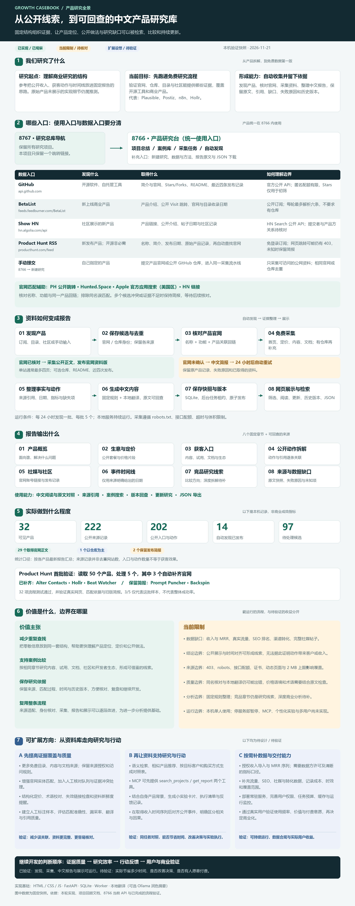

# 021 · 公开产品信息与获客研究库

研究免费公开来源怎样支撑产品与获客研究：从发现产品、核对官网、采集免费资料，走到带来源的中文报告与可检索案例库。价值在减少重复查找、支持结构化比较，并把零散收藏积累成可复核、可持续更新的研究资产。

对我们的意义，是为产品选题、竞品学习、小实验假设和后续投入判断提供依据，同时沉淀可复用的采集、身份核对与报告流程。实际节省多少时间、是否改善决策、是否有人愿意付费，仍需真实使用验证。

[在线研究与案例快照](https://yydshly.github.io/20261104_codex_project/021-growth-casebook/) · [本地版本与运行说明](../../growth-casebook/README.md) · [完整阶段回顾](../../growth-casebook/static/project-review.md)

## 已有引导图

沿用本轮已经生成的原图，保留其内容、日期、入口关系和“已实现 / 当前限制 / 待验证扩展”标注。图中 8767 与 8766 对应本机的总库导航和统一产品入口；线上页面以公开阅读快照呈现研究结果。

## 我们研究了什么

1. **信息如何变成研究材料**：统一章节、来源引用、日期、公开动作和数据缺口，帮助判断哪些资料支持哪些结论。
2. **免费数据的实际边界**：验证官网、代码仓库、产品目录与社区可以取得什么；收入、真实流量和渠道转化仍需额外数据。
3. **开源与商业产品的共同流程**：从 GitHub 产品扩展到不要求公开仓库的商业产品，避免用开源状态代替商业价值判断。
4. **产品身份与官网核对**：处理同名误匹配、目录被当官网、开发者域名下产品路径丢失和候选冲突。
5. **研究资产的保存与复用**：保留原文、中文译文、来源快照、失败原因和报告版本，为以后核对和继续开发提供起点。

研究起点来自[用户提供的 Bizpeel 相关原帖](https://x.com/yihui_indie/status/2119973315745812674)及对其流程的拆解。原产品未展示的实现细节仍属推测；本项目的能力以代码和本机验证为准。

## 数据入口与处理逻辑

| 入口 | 研究对象 | 当前取得的资料 |
| --- | --- | --- |
| GitHub | 开源软件、自托管工具 | 官网、简介、仓库指标、README 与最近四条发布记录 |
| BetaList | 新上线商业产品 | 产品介绍、公开官网跳转和目录日期 |
| Show HN | 社区展示产品 | 产品链接、公开介绍、帖子日期 |
| Product Hunt RSS | 新发布产品，开源非必需 | 名称、简介、发布日期与产品记录，再自动查找官网 |
| 手动提交 | 自己指定的产品 | 产品官网或公开仓库 |

官网查找使用 PH 公开跳转、Hunted.Space、Apple 官方应用搜索和 HN 链接作为线索，核对名称、功能与同一产品回链。官网确认后补采；未确认时保留简报并定时重试。Product Hunt 的 403 本身没有解除。

完整流程：发现与去重 → 官网身份核对 → 采集公开页面与可选仓库 → 整理事实和动作 → 固定结构生成报告与本地翻译 → 保存来源和版本 → 搜索、阅读与更新。

## 实现效果与验证范围

2026 年 11 月 21 日的阶段快照包含 32 个产品：29 个取得官网正文、1 个以仓库资料为主、2 个保留发布简报。最新报告汇总 222 条来源记录和 202 条公开入口与动作，其中 14 个产品通过自动发现入库，另有 97 个候选等待后续处理。

Product Hunt 首批读取 50 个产品、处理其中 5 个，Alter Contacts、Hollr 和 Beat Watcher 自动核对官网并生成新版报告；Prompt Puncher 和 Backspin 保留简报。3/5 只描述这批样本，不代表整体匹配准确率或后续成功率。

报告包含产品概览、生意与定价、获客入口、公开动作拆解、社媒与社区、事件时间线、竞品研究线索、来源与数据缺口八节。已实现中文阅读、案例搜索、来源回查、历史版本和 JSON 导出。

## 价值与对我们的意义

- **从收藏进入判断**：把不同产品的定位、定价、公开入口和做法放在同一结构里，减少只凭个别故事形成判断。
- **帮助选题与学习**：找到相近产品，核对目标客户、购买方式、内容与试用入口，为自己的产品研究提出更具体的问题。
- **为小实验提供假设**：从已观察的公开做法形成可尝试的方向；实验方案、指标和反馈闭环仍属于后续能力。
- **保留可继续工作的资产**：来源、身份核对和版本记录可以继续积累，采集与报告模块也能复用到后续研究。
- **理解信息产品的成本与上限**：通过免费来源的覆盖、误匹配、翻译和维护问题，判断数据质量和持续运营还需要哪些投入。

当前验证说明流程能运行，并保留了实际资料与报告。研究效率、决策改善、使用频率和付费价值仍需同任务对照和真实用户反馈。

## 当前限制与扩展方向

收入、已核验 MRR、真实流量、搜索排名、渠道转化和完整社媒讨论尚未取得。公开动作和时间对齐只能提供线索，不能证明因果。动态网页、robots.txt、接口配额、证书与翻译质量会影响完整性；竞品章节目前仍是研究线索。

可以先扩展来源和匹配评测、定价结构化、术语核对、链接失效与更新检测；再尝试语义检索、对照表、MCP 两个读取工具及结合自身产品的小实验；最后按需要补充授权收入、流量数据、常驻部署和多用户能力。上述扩展均待设计与验证。

## 公开网页与本地采集的分工

沿用研究总库 GitHub Pages 的 `main /docs` 发布源，在线路径为 `/20261104_codex_project/021-growth-casebook/`。公开页面复用同一套前端，提供总结、原引导图、案例、40 个报告版本、采集记录和发现来源的只读快照，不执行后台采集。

本地 `http://127.0.0.1:8766/` 保留新建研究、自动发现、采集与更新。公开版保留引用和短摘录；正式 SQLite、完整采集正文、模型、配置与凭据均留在本机。

构建命令：在 `growth-casebook/` 目录、服务运行时执行 `python publish_snapshot.py`。构建仅写入明确清单到 `docs/021-growth-casebook/`，不会自动提交或发布；引导图 PNG / SVG 按原文件复制，清单记录原图哈希。
