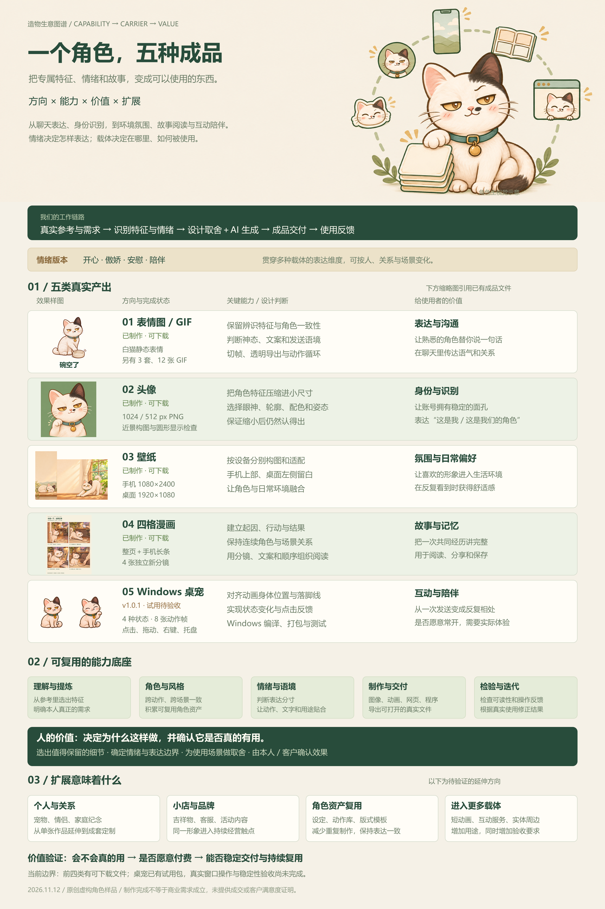

# 022 · 角色、情绪与多载体产品化研究

研究如何把宠物、情侣和小店的专属特征、情绪与故事，转成表情图／GIF、头像、壁纸、漫画和桌面宠物五类可以使用的成品。通过真实文件、模拟需求的前后对照与交互演示，说明角色一致性、情绪分寸、场景适配、制作交付和人的设计判断分别带来什么价值。

我们的理解是：需求确定方向，制作能力提供手段，具体载体承载结果。情绪版本是贯穿多种载体的表达变化；价值还包括身份识别、日常氛围、关系记忆、互动陪伴，以及知识和效率。是否真的有用，需要实际使用、付费意愿和稳定交付来验证。

[在线研究与成品](https://yydshly.github.io/20261104_codex_project/022-visual-business-atlas/) · [五类成品与下载](https://yydshly.github.io/20261104_codex_project/022-visual-business-atlas/#carrier-products-showcase) · [Windows 桌宠试用](https://yydshly.github.io/20261104_codex_project/022-visual-business-atlas/#windows-pet)

## 已有引导图

沿用本轮已经生成的 2400×3600 原图，原样复制，不重新生成。图为 2026-11-12 的阶段整理；2026-11-21 补充公开发布说明，桌宠仍保留试用待验收的边界。

## 我们研究了什么

1. **内容与载体的关系**：把“情绪、身份、知识、效率”等需求落实到可发送、可观看、可阅读、可互动的具体东西，而不只列抽象价值。
2. **从参考到表达的取舍**：宠物保留斑纹与傲娇性格，情侣从热闹拥抱转向安静陪伴，小店区分看到消息与确认有货。参考、需求和客户身份均为模拟案例。
3. **同一角色的五类用途**：表情承担聊天回应，头像建立身份识别，壁纸进入日常环境，漫画保存因果与经历，桌宠提供持续互动。
4. **生成与交付的差别**：角色图之外还需要尺寸、文字、透明通道、动作对齐、命名、文件包、程序状态和验收。
5. **人的价值如何被看见**：留下“发现了什么细节 → 为什么这样选 → 成品如何体现 → 本人是否认可”的过程。示例方案不代替真实使用者的确认。

研究起点是用户提供的 [AYi 原帖](https://x.com/AYi_AInotes/status/2120089714749263956)。我们的素材与程序为本地独立样品；原帖中的收益、制作效率和商业结论未作为本项目验证结果。

## 实际成果与当前边界

| 方向 | 已有成果 | 用户价值与验证边界 |
| --- | --- | --- |
| 表情图／GIF | 宠物、情侣、小店三套样品，12 张 GIF、12 张透明 PNG；另有三组参考定向静态图 | 表达语气与关系；未验证真实客户还原、成交或微信审核 |
| 头像 | 独立新画的 1024／512px PNG，小尺寸预览 | 稳定身份识别；未制作虚拟出镜模型 |
| 壁纸 | 独立手机、桌面画面，1080×2400 与 1920×1080 JPG | 氛围与日常偏好；源图经适配缩放，非原生 4K，动态屏保未制作 |
| 漫画 | 四个新分镜、1200×1560 整页、800×3510 手机长条和独立分镜 | 故事与记忆；没有印刷打样或真实纪念需求反馈 |
| Windows 桌宠 | v1.0.1 便携 EXE、四状态八帧、点击与拖动、菜单与托盘，提供源码 ZIP | 互动与陪伴；已编译并做状态规则、透明素材、帧对齐检查，真实窗口操作与持续稳定性尚未完整验收 |

网页另有九类载体地图、18 个视觉服务／产品方向、对比与起步建议、七天验证清单、交付成本计算器、知识检查卡和尺寸实验。立牌等实体周边为概念示意，不能当作已生产的成品。

桌宠首版存在两帧身体横向错位约 32px，v1.0.1 通过身体轮廓配准与共同落脚线修正；对齐检查记录仍保留。程序未签名，线上仅提供下载，网页不会运行本机 EXE。

## 方向、价值与可扩展意义

- **个人与关系**：宠物、情侣、家庭纪念，从单件作品延伸到成套定制；先验证本人辨识、偏好与实际使用。
- **小店与品牌**：吉祥物进入客服、包装、上新与活动素材；观察真实更新频率和按时交付需求。
- **角色资产复用**：积累设定、动作、模板和规格，把同一形象迁移到不同载体，减少重复制作并保持一致。
- **更多载体**：知识卡、功能网页、短动画、定制互动和实体周边。新增用途意味着新增能力与验收条件，均需分项验证。

对我们的意义，是把“会生成图”落实为可演示、可下载、可继续修改的交付链路，并以作品、取舍与检查记录积累研究资产。没有销量、真实客户满意度、复购或稳定盈利证据，18 个方向是产品假设，不是收入排名。

## 公开发布与复用

- 浏览器源码、实际素材、生成记录与下载包：[`docs/022-visual-business-atlas/`](../../docs/022-visual-business-atlas/)。
- Windows 桌宠可审阅源码：[`windows-pet/`](windows-pet/)，八帧素材在在线目录和源码 ZIP 内。
- `publish.mjs` 将本地 `visual-business-atlas/` 的公开文件按清单复制到编号目录，生成文件哈希与原图一致性记录。不会复制依赖、缓存、个人偏好或本机绝对路径字段。
- 发布流程：`node projects/022-visual-business-atlas/publish.mjs`，再运行 `node projects/022-visual-business-atlas/verify.mjs`。GitHub Pages 沿用仓库 `main` 分支的 `/docs`，没有创建新的付费服务。

本次只发布研究网页和现有文件，未新增生成任务、收款、客户照片收集、平台投稿或原生程序实机验收。
