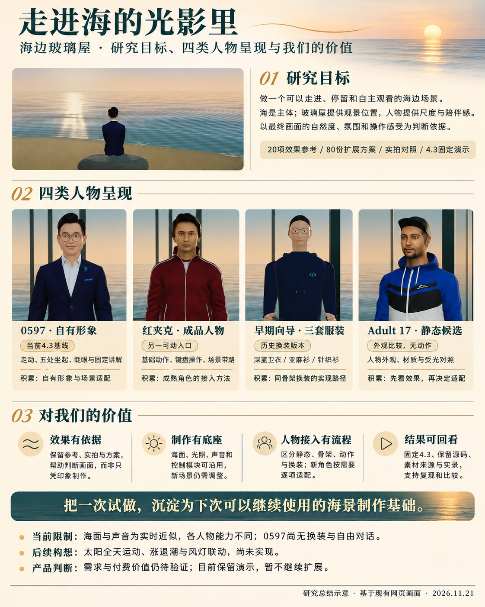

# 031 · 走进海的光影里：海景、人物与可复用场景研究

[在线研究与引导图](https://yydshly.github.io/20261104_codex_project/031-ocean-light-atlas/) · [4.3固定演示](https://yydshly.github.io/20261104_codex_project/031-ocean-light-atlas/study/glasshouse/releases/4.3-20261115/index.html) · [20项效果与扩展](https://yydshly.github.io/20261104_codex_project/031-ocean-light-atlas/study/) · [能力与接入档案](https://yydshly.github.io/20261104_codex_project/031-ocean-light-atlas/study/glasshouse/implementation.html)

从20项海面视觉参考与80份扩展方案出发，以实拍对照理解光照、海况、观看角度与镜头处理，再用海边玻璃屋验证可进入、可停留的观海体验。海面碎光、近岸浪、水光、0597自主走动坐起与环境声已形成4.3基线，另保留成品角色、旧版换装及静态候选。价值在效果依据、场景模块、人物适配流程和可回看版本；自然度、跨角色通用性与产品需求仍待验证。

## 研究方向与我们的理解

最初的目标是做一个海边场景，展示海上的风景。研究重点是怎样把特定环境、太阳位置和观看角度下的海面光影，组织成可以进入、移动和自主停留的网页3D画面。海是主体；玻璃屋提供观景位置、窗框和冷暖层次，人物提供尺度与观看体验。以实际画面的自然度、氛围、声画关系和操作感受推动制作。

参考中的特殊光影可能依赖海况、日照、视角、失焦或后期。资料按条件记录，区分自然现象、镜头效果与艺术化处理；有出处不等于原片未经处理，物理解释也不能认证某一图片的真实性。真实资料辅助判断，演示需要驱动实现。20项基础效果和80份方案是研究库，不是20种完整三维复现或80个成品。

## 已有结果与四类人物呈现

4.3固定版包含海面反光与近岸薄浪、残沫和湿沙、室内水光、日落/晚霞/蓝调三种天色，以及0597自主移动、台阶支撑、五处指定坐起、眨眼和约11秒固定中文讲解。海浪、风、脚步采用环境混音，近岸浪群与破浪/回落声层共用时间及相位。实际录屏和图片保留在网页中；程序近似和通过功能检查不等于真人级美术或真实海洋。

| 人物呈现 | 已有能力 | 对本研究的作用与边界 |
| --- | --- | --- |
| 0597自有形象 | 80关节、5段身体动作、21个面部形态；当前4.3的行走、五处坐起、眨眼与固定讲解 | 自有形象与场景接触的当前适配基线；无换装、独立手指抓握或自由对话。 |
| Rocketbox Adult10红夹克 | 独立可动入口，基础动作、键盘操作与场景带路 | 验证成熟成品资产的接入；未迁入0597全部最新坐姿和面部修正。 |
| 早期向导三服装 | 同一角色的卫衣、亚麻衫、针织衫；65关节、7段动作 | 保留同骨架换装路径；属于历史角色，不是给0597换装。 |
| Adult17静态候选代表 | 外观、材质、受光和服装结构对照；无动作 | 帮助先看效果再决定适配。候选库5个入口有身份重叠，原始四人体块也不是4名可控人物。 |

四张卡直接展示网页原生导出图片，可放大；早期向导可切换三张服装截图，并可进入旧版实际换装。各入口分别载入，没有统一到4.3内即时换人。

## 对我们的价值，如何复用

1. **效果有依据**：参考、80份方案和机构实拍供回查。先确定目标画面与条件，再比对实际帧，帮助减少凭印象堆效果。
2. **制作有底座**：海面、光照、水光、镜头、控制与混音模块已有可运行组合。新场景从独立开发副本开始，按岸线、光向、几何和操作范围适配。
3. **人物接入有流程**：先核对GLB网格、骨架、动作接口和尺寸，再匹配步速、脚底支撑、台阶、座位、手部和镜头。加载成功只完成了第一步；最新适配集中在0597。
4. **结果可回看**：固定4.3、源码、素材来源、哈希、过程记录和实际录屏建立比较依据。以后修改另设版本，沿用机位及操作路线复查。

可复用代码包括`water-system.js`、`surf-cycle.js`、`seaside-audio.js`、`movement-input.js`、`walk-surface.js`、`foot-placement.js`、`seated-pose.js`、`camera-guard.js`等，见`runtime/glasshouse/`。新人物/新场景步骤、输入条件及限制见公开能力档案。当前坐姿由网页运行时驱动，没有烘焙进下载GLB；重建模型仍需要本地Blender工程与输入资产，不宣称此静态发布包可独立重建全部美术。

## 仍待验证与后续方向

海面、水光、反射与声学为近似；手部、袖管、服装和姿态仍有不足。三种天色不是连续昼夜，近岸波浪不是潮汐，五处座位不是任意物体自动就座；其他人物也不能未经适配就共享全部能力。没有多设备性能保证或最终美术通过结论。

太阳东升西落、全天环境、涨退潮、海风和岸边风灯是围绕同一片海保留的构想，尚未实现。更多房间、活动和其他场景作为次要档案。当前决定是保留演示、暂不继续扩展，产品方向待定；持续使用、学习效果、节省工时和付费收益没有量化验证。

## 来源、引导图与发布范围

- 最初参考：[PEBIT的20片海](https://x.com/_pebit_/status/2121174301319831916)；补充参考：[海面色彩与场景](https://x.com/naturehealyou/status/2121228035932188844)。原图处理过程与补充账号的原作者身份未全部核实。
- 机构实拍来自[USF ClipVideo ETC](https://etc.usf.edu/clipvideo/)与[NPS](https://www.nps.gov/media/)，逐条摄影者、位置、处理未知和许可记录在效果库中。公开版使用机构媒体链接/嵌入，不发布本地USF视频副本作为素材包。
- Three.js、Microsoft/Rocketbox的许可随对应代码/资产保留；早期向导输入来源另有记录。0597的用户面貌与完整外观不因局部引用MIT几何而整体变为MIT，不承诺商业授权自动成立。
- 引导图使用此前内置imagegen已生成的原始PNG，无重新生成、裁切或美化，附[原提示词](assets/guide-prompt.txt)。它是研究总结示意，实际效果以网页与实录为准。
- 4.3清单列出53个运行/源码文件、32671090字节，另附`release.json`自身；清单SHA-256：`d6546b3cce001d0ecb8d04be364295f4722191adc5736434efcd43f012f85e1d`。目录内54个文件均与本地固定版逐字节核对，发布副本保持原样。
- 大模型与较大的历史录屏随仓库保存，公开开发入口通过同库raw地址加载；固定版运行资源位于自身目录。浏览器第一次加载仍需传输模型，不表示秒开。原始FBX、Blender工作文件、重复截图和本地依赖不随网页复制。

## 维护与复现

`python publish.py`从本目录已提交的`runtime`快照重建`docs/031-ocean-light-atlas/`。需要明确刷新本地研究时运行`python prepare-local.py`，再运行`python publish.py --import-local`；原研究在其他工作目录时，用环境变量`OCEAN_LOCAL_SOURCE`指定它。此流程不删除目录、不生成新图或修改固定4.3。`publication.json`保存完整摘要、研究方向、价值、复用步骤与边界，`publication-manifest.json`保存交付方式和文件哈希。

公开发布只新增本研究及总库索引，保留其他子项目与当前待定决定。部署检查另存`verification/`，不冒称本次重新验证全部历史人物动作和每项画面质量。

本次本地发布检查已通过：完整摘要与原样引导图、23个本地入口、四张人物图、截图切换/放大、历史海面录屏播放、390像素布局；实际从发布首页打开四类人物运行入口并核对资产，旧版三服装按钮切换通过。提交前的大资产请求映射到待上传文件的原始字节，线上访问需待推送部署后另行核对。F盘空间耗尽后，在C盘独立工作副本完成发布；原研究目录保留，未清理日常库或其他项目。
