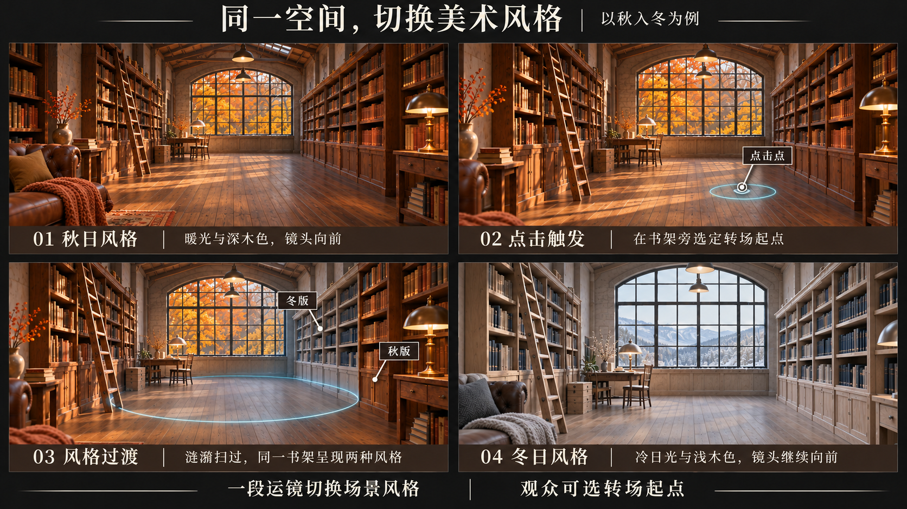

# 032 · 同一空间的美术风格转场

保持书架、窗户和过道的布局，让两套室内美术风格在一段连续运镜中完成切换。以秋入冬为例，室内用光线、木色和织物表现风格变化，窗外提供季节线索。

1. **秋日风格。** 镜头沿过道推进，暖光和深木色建立起始氛围。
2. **点击触发。** 观众点击书架旁的地板，确定转场起点。
3. **风格过渡。** 涟漪扫过同一排书架，经过的部分变为浅木色与冷日光下的冬版，边界外仍是秋版。
4. **冬日风格。** 新风格铺满室内，镜头继续沿原路线向前。

**创作价值。** 可在同一镜头里切换氛围、年代或美术方向，利用稳定的空间参照让观众看懂变化。交互版还可以让观众决定从哪里开始切换。

本图为概念分镜。灵感来自 Bihe Xi 的《Garage Library · Four Seasons》。[原帖](https://x.com/xbh_artist/status/2122661449554428020) · [参考作品源码](https://github.com/xibihe/garage-library-four-seasons)

[返回项目索引](../../README.md#研究索引)
