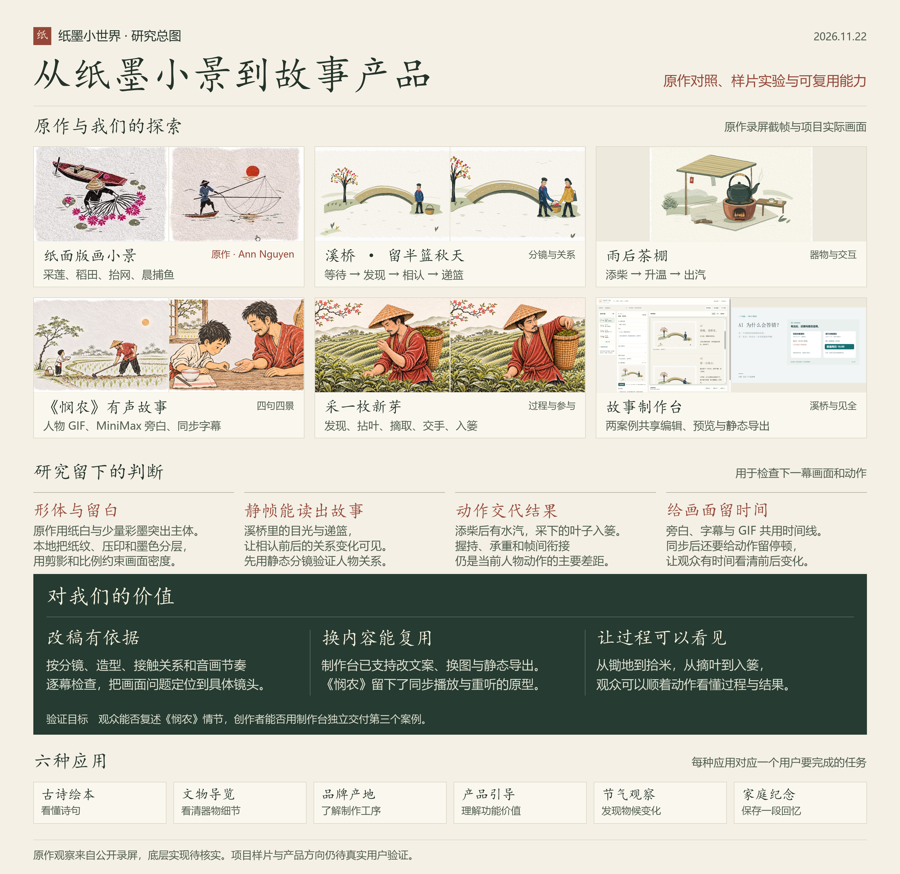

# 034 · 纸墨小世界 · 从纸墨小景到故事产品

[在线研究与引导图](https://yydshly.github.io/20261104_codex_project/034-paper-relief-lab/) · [信息获取与分析](https://yydshly.github.io/20261104_codex_project/034-paper-relief-lab/#method) · [评论引导与效果分析](https://yydshly.github.io/20261104_codex_project/034-paper-relief-lab/#comments) · [公开网页、配置与运行资源](../../docs/034-paper-relief-lab/)

我们研究纸墨小景怎样用画面与局部反馈讲清一个过程，以及这种表达怎样迁移到多幕故事和产品介绍。以 Ann Nguyen 的《Paper River》为参考，先拆解构图、纸面与操作变化，再实际制作溪桥、煮水、采叶和《悯农》。研究留下原作与样片的对照、按镜头审稿的方法、音画同步原型，以及由溪桥和“见全”案例共用的制作台。

## 怎样获取信息并分析

1. **追到可回查的来源。** 从原帖记录作者、说明和媒体；直接访问受限时读取公开帖文元数据。保存约 29.45 秒录屏及时间点，发布前从作者后续回复找到可打开的体验页，核对官方页面说明和采莲操作提示。 [原帖](https://x.com/ann_nnng/status/2120156122133004665) · [作者体验页](https://www.bubbbly.com/paper-river) · [来源记录](../../docs/034-paper-relief-lab/docs/source.json)
2. **把观感拆成可观察项。** 对录屏取 10 个观察帧，并为采莲、稻田、抬网、晨捕鱼各取一帧。比较纸白、彩墨、形体轮廓、主体占比和操作前后的状态。原作这一系列怎样生成、怎样分配运行逻辑以及对应开源许可仍待核实。 [逐段观察与机制](../../docs/034-paper-relief-lab/docs/research.md)
3. **用小样检验解释。** Canvas 版本将墨色与纸纹、浅压印高度分开，验证材质变化。创作中用溪桥静稿检查人物关系，用添柴出汽和摘叶入篓看输入与结果，再对照整个人物姿态、GIF 及手与道具连接。有声《悯农》用缓存的 MiniMax 旁白作为 GIF 和词级字幕的时间依据。 [实际样片与方法](https://yydshly.github.io/20261104_codex_project/034-paper-relief-lab/#exploration)

## 我们的理解与复用价值

纸面留白与有限墨色先建立画面的安静感，形体和分镜让观众读出关系，接触、承重和物件状态让动作可理解。溪桥的递篮、茶棚的出汽与采叶的入篓提供了具体检查点。GIF 解决交付与回看，同步解决声画对时，动作连续性和观看节奏仍需要逐幕判断。

| 对我们的价值 | 已有结果和可复用步骤 |
| --- | --- |
| 改稿有依据 | 按人物目的、静态分镜、造型、动作接触和音画节奏验收。看不清变化时，可以回到具体一幕调整构图或停顿。 |
| 换内容能复用 | 两个案例已共用单幕文案、换图、预览、静态网页、封面与长图导出。用第三份真实内容检验创作者能否独立交付。有声播放器和动态媒体流程仍需跨故事验证。 |
| 让过程能被看懂 | 把诗句、器物用途或制茶工序做成可听、可看、可参与的过程。已有古诗绘本、文物导览、品牌产地、产品引导、节气观察和家庭纪念六种样片方向。 |

[制作台](https://yydshly.github.io/20261104_codex_project/034-paper-relief-lab/studio.html) · [有声《悯农》](https://yydshly.github.io/20261104_codex_project/034-paper-relief-lab/minnong.html) · [六类应用](https://yydshly.github.io/20261104_codex_project/034-paper-relief-lab/#directions)

## 评论引导与效果分析

原作主帖用短录屏展示画面和操作，作者的后续回复给出体验链接，读者可以再去实际点按。已有材料可以复查这条路径，回复触达、链接点击与转化仍待数据验证。

我们的页面也让读者先看实际样片，再任选一个问题反馈：最记得哪个动作、哪一幕没看清，或者想用它讲什么内容。试看页支持读者自行保存反馈，便于保留原话。发布时真实用户反馈待收集。

收集后按来源、作品版本、参与者和观察窗口归档。用去重后的相关反馈为分母检查具体反馈的占比，用自由复述判断是否看懂故事，并按具体场景汇总使用需求。两位独立观众指出同一幕的问题时，回看画面、声音和节奏。加载或播放故障另记。有曝光数据时才计算回复率，对照两种引导需要使用条件相近的样本。 [网页上的引导文案与复盘表](https://yydshly.github.io/20261104_codex_project/034-paper-relief-lab/#comments) · [试看方案](../../docs/034-paper-relief-lab/docs/minnong-validation.md)

## 发布与复现

网页通过本库 GitHub Pages 的 `main:/docs` 发布。公开目录保留可运行的代表样片、研究记录、配置、原样引导图和试看入口。原作录屏使用帖文的媒体地址，作者体验页与原帖均有独立入口。公开站只使用已有的音画资产。试看反馈由读者手动导出。

从仓库根目录运行 `python projects/034-paper-relief-lab/publish.py <本地 paper-relief-lab 目录>` 可更新静态发布文件。[发布清单与引导图哈希](../../docs/034-paper-relief-lab/publication.json)
