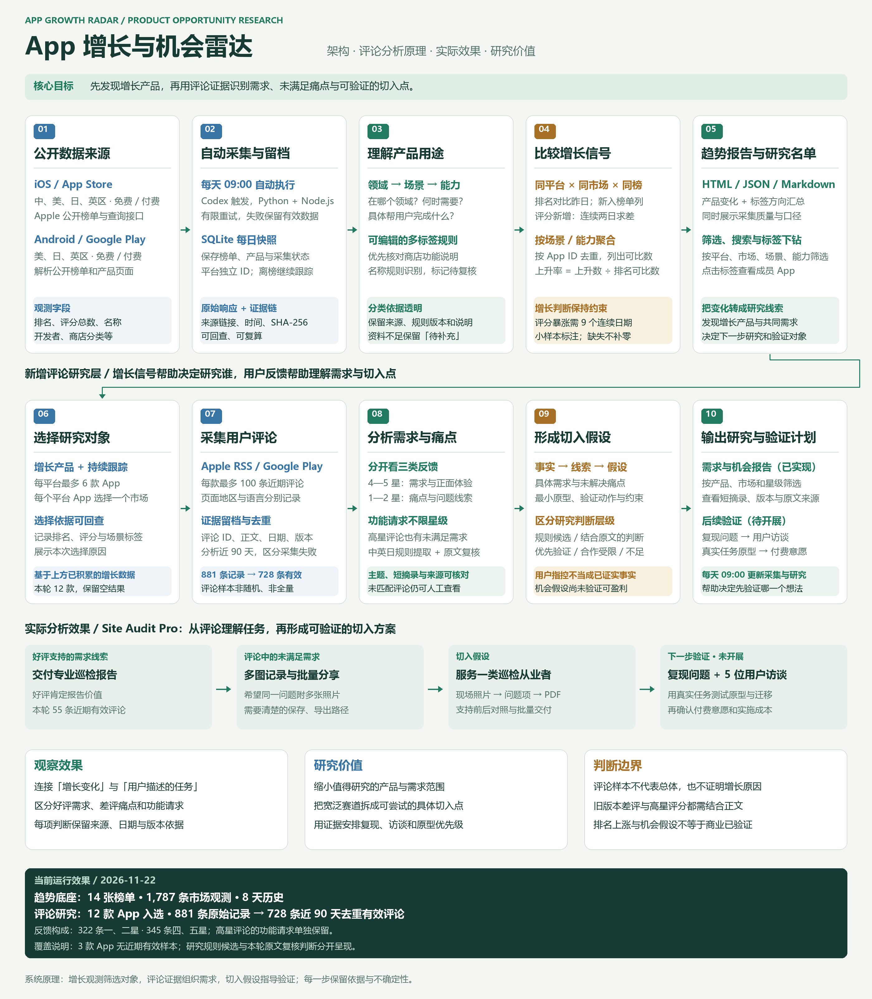

# 035 · App 数据统计与趋势观察

**阶段一归档｜2026-11-22**

我们研究的方向是：把 App Store 与 Google Play 的公开信息积累成可以回查的连续数据，用清楚的图表回答“看的是哪些产品、排名和评分怎样变化、评论样本里出现了哪些表达、数据是否足够完整”。系统负责获取、保存、统计与展示，需求解释、增长原因、产品价值和商业判断交给人。

[在线阶段说明与原引导图](https://yydshly.github.io/20261104_codex_project/035-app-opportunity-radar/) · [趋势看板固定快照](https://yydshly.github.io/20261104_codex_project/035-app-opportunity-radar/report/index.html#trends) · [评论统计](https://yydshly.github.io/20261104_codex_project/035-app-opportunity-radar/report/index.html#research) · [阶段记录](PHASE-1.md) · [返回总库](../../README.md)

## 这一阶段形成的理解

最初从[Stringers 的公开帖子](https://x.com/stringers_cn/status/2121445525006524627)出发，尝试用商店增长信号寻找产品机会。随后补充安卓、场景与能力标签、用户评论，发现：榜单是相对位置，评论是有选择的公开样本，这些信息本身不能证明增长原因、需求强度或商业价值。过早自动输出“值得做”“优先切入”会把数据整理与人的判断混在一起。

因此当前版本明确定位为**供人观察、比较和核对的数据系统**。范围仍是手机 App 的公开商店样本，不是覆盖 Web、桌面、插件及全量市场的产品情报系统。早期的机会判断属于探索历史，见[此前提交](https://github.com/yydshly/20261104_codex_project/commit/fe709ada89f9763c7049fc660ef7725d865efea5)；当前报告不加载或生成这些判断。

## 价值与已完成的能力

- 连续保存快照，减少反复查榜和手工整理；能回看变化，不只看某一天的榜单。
- 将“今天在榜”和“期间曾上过榜”分开，保留已离榜产品，避免只观察幸存者。
- 按同平台、同市场、同榜单比较，用日期、分母与覆盖说明限制误读。
- 领域、场景、核心能力多维检索；标签有来源、规则和待复核状态。
- 评论采样、去重、短摘录和主题匹配可回查，帮助人找到需要进一步阅读的材料。
- 图表为主、明细可查：先看整体，再选产品比较，最后核对具体日期。

上述价值是能力与资料沉淀。实际节约时间、理解速度、用户采用、留存、收费或盈利改善尚未量化，也没有做增长归因。

## 信息从哪里来，怎样保存

| 数据 | 来源与覆盖 | 保存与限制 |
| --- | --- | --- |
| iOS 榜单 | Apple 公开 RSS；中国、美国、日本、英国；免费榜/付费榜各最多100款 | 来源更新时间与本地观察时间分别保存；短榜保留真实数量 |
| iOS 详情 | Apple Lookup | 名称、开发者、分类、累计评分数、评分及商店链接；缺失单独记录 |
| Android 榜单/详情 | 锁定版本 google-play-scraper 10.1.2 解析 Google Play；美、日、英 | 非 Google 官方 API；页面变化可能导致失败；ID 使用 `play:包名` |
| iOS 评论 | 公开 customerreviews RSS，按最新排序 | 每款最多2页/100条，保留日期、星级、版本、ID、来源与原响应 |
| Android 评论 | 公开页面解析器 NEWEST 评论接口 | 每款最多100条；请求地区/语言不保证评论作者来自该国 |

本机既有 Codex 任务每天北京时间09:00调用采集。Python 与 Node.js 获取信息，SQLite 保存逐日观测，原始响应附来源、采集时间和 SHA-256。使用正常 TLS、节流与有限重试，不使用私人账号或付费情报。离榜产品默认继续追踪30天，每平台每市场存在刷新上限，超过上限记录覆盖缺口。

同日重跑更新当天报告，不新增一个“新日期”；后续失败不覆盖当天已有成功观测，评分缺失不抹掉已取得的有效值。报告重建只读现有数据，不为改页面重新采集。失败、空响应、没有近期评论、短榜分别记录。

本地保存 `data/radar.sqlite3`、`data/raw/`、`reports/日期.html/.json/.md` 及 `reports/latest.*`。日期文件用于逐日回看，同日允许更新，不能当作永不修改的事件日志；原始响应与哈希用于回查具体请求。

## 数据与统计口径

| 要看什么 | 计算方式 | 不作什么推断 |
| --- | --- | --- |
| 当前排名 | 报告日期、同平台/市场/榜单的真实名次 | 不用旧榜冒充今日，不跨市场混排 |
| 每日升降 | 与前一日同榜成功观测比较 | 首次收录不等于新产品上市 |
| 期间升降 | 所选实际日期首日排名减末日排名，二者都有值且至少两个日期才比较 | 缺失或离榜不补成0或第100名 |
| 期间上榜池 | 所选日期内真实成功榜单的 App ID 并集 | 包含已离榜和无当日详情的历史产品，不只看今天前N |
| 持榜天数 | 所选展示日期中有真实排名的天数；同时说明可判定天数与未知天数 | 短榜未返、缺失不当离榜；只有完整前100榜未出现才确认未入榜 |
| 每日新增评分 | 同平台同市场连续两日累计评分数之差，非负才有效 | 缺日不跨日计算；回退不当负增长；0与缺失分开 |
| 7日新增评分 | 报告日及此前6个日历日，有效日增量的合计，显示有效N/7天 | 不足7天为部分合计，与完整7天分开展示；不等于下载或新增用户 |
| 标签统计 | 领域、场景、能力按同平台同市场分组，标签内按 App ID 去重 | 多标签不能相加；规则改动不当市场增长；少于5个样本标记小样本 |

排名是相对位置。Google 评分可能是全球汇总，不跨国家相加；iOS/Android 同名产品也不自动合并。标签优先采用 App ID 对应的商店说明核对，其余名称规则注明待复核；商店说明不代表功能实测，未匹配不猜能力。

## 评论怎样整理，能说明什么

每轮每个平台最多6款、每款最多100条最新评论，分析近90天内日期可验证的样本。选取原因和跟踪名单透明展示；12款是评论采样预算，不是整个趋势系统只观察12款，也不保证每天都是新的12款。榜单趋势覆盖所有成功取得的榜单成员和跟踪对象。

按评论ID和重复正文去重，只关联本次研究运行成功归档的响应，防止同日重跑混入旧批次。显示星级、时间、版本、语言、短摘录和商店来源，完整正文留在本地。中英日规则统计正面表达、低星表达及不限星级的改进请求，保留规则与依据。

**主题匹配不代表确认用户需求或痛点**；高星也可能提出改进请求，低星也不一定有软件可解决的问题。评论量不同于累计评分数；样本非全量、非随机，不从差评比例推算总体不满意率，不把用户指控当事实，旧版本反馈需结合当前版本核对。

本阶段的评论引导效果是：让人按产品和主题查看相关表达、比较星级样本、追到日期版本与来源，降低查找材料的负担。没有自动确认痛点、生成切入建议或证明商业机会；`research.mode=statistics`，`briefs=[]`、`opportunities=[]`。历史字段 `needs/pains/requests` 为读取兼容保留，当前含义是关键词分组。

## 页面如何帮助人快速理解

1. **先识别范围与覆盖。** 默认中国 iOS 免费榜、近7天、期间曾上过榜全部产品。桌面显示平台/市场/榜单/时间4项常用筛选，其余收进更多筛选；手机默认收起筛选，先显示当前范围与核心数字。限制数量或状态时明确分母，可恢复默认范围。
2. **看整体和产品变化。** 4张数字卡对应产品数、名次上升数、每个日期都在榜的产品数、完整7日评分数；可点击跳图。状态占比、持榜分布、名次升降、新增评分每图先写一句真实数据描述，再写坐标与口径。
3. **比较每天走势。** 升降图可选全部/只看上升/只看下降，可一键把前5款带入曲线。候选产品总数与当前勾选线数分开，默认5款、最多10款，可搜索、勾选，颜色线型保持对应。横轴实际日期、纵轴排名，第1名在上，缺失断线。
4. **核对明细。** 表格按需展开，包含逐日数据、小折线、持榜和7日评分有效天数。点击产品进入详情，继承7/30天窗口、显示产品名称、不混入全市场卡；返回保留筛选。选择近30天而只有8天记录时直接说明。

快照中的中国 iOS 免费榜近7天：116款曾上榜，100款报告日仍在榜、16款已离榜；91款首尾可比，其中49上升、29下降、13持平；83款7天均有排名。81款有完整7日评分，33款是部分合计，2款无有效日。这些是样本描述，不是方向推荐。

## 阶段快照与真实覆盖

截至2026-11-22：8个历史日期，14张当日榜单返回数据，1,808条当日产品市场观测，1,440个不同平台商店ID。观测含离榜跟踪，不能把1,808当作当天上榜条数或独立跨平台产品数。趋势中另含历史成员，不能把趋势系列数当作当日采集量。

12款评论采样对象，728条近90天去重有效评论：1—2星364条、4—5星299条、3星65条。标签覆盖945/1,808条市场观测，863条待补充，14条经过商店说明核对。免费/付费榜存在来源短榜、部分详情和请求失败记录，必须一并看质量说明；14张成功响应不等于14张完整前100榜。

## 原引导图与当前执行范围



用户指定的原PNG与SVG按字节保留，PNG为2800×3210，SHA-256为 `41b07d0259335c76876e5138268ae71a7fc1f92df80aa5327fb7256c652bca62`。它记录了“趋势底座→评论研究→后续验证”的早期设计。**图中的机会判断与切入验证是历史设想，当前运行版本执行统计展示，不自动输出这些判断。** 原图中的旧快照数字不覆盖本文和当前报告的阶段数据；访谈、原型、付费等商业验证未开展。

## 本地每日更新与网页发布是两件事

每日任务继续按既有北京时间09:00运行。本次是阶段归档，没有暂停每日采集，也没有新增自动网站发布。

GitHub Pages 使用 `main /docs`。公开网页是本次手动发布的固定快照；浏览器不直接抓商店，本机后续采集不会自动更新公开网站。要发布新一期，需要重建公开包、检查并提交部署。页面明确显示快照日期。

公开包采用允许清单：源码、配置、锁文件、必要产品元数据、统计、评论短摘录与来源。数据库、完整响应、完整评论正文、头像、凭据和依赖目录不提交；公开快照剔除本地归档路径。发布清单记录每个文件的大小与SHA-256，原图另作固定哈希核对。

## 复现与检查

在仓库根目录：

```powershell
python projects/035-app-opportunity-radar/publish.py
python projects/035-app-opportunity-radar/verify.py
cd projects/035-app-opportunity-radar/collector
npm ci --ignore-scripts --no-audit --no-fund
python -m unittest discover -s tests -q
```

不重新采集也能用仓库中的固定JSON重建公开页面。需要自行建立每日数据时，在 `collector` 运行 `python -m app_radar collect`；它已经包括评论采样，不应同轮再运行 `research`。`python -m app_radar report` 只用现有数据库重建本地报告。新环境没有历史就重新建立基线，不能把公开快照冒充今天的新数据。

发布脚本可通过 `--source <采集项目目录>` 读取已有本地快照并复制允许的源码。运行DOM检查需要先安装依赖；主采集源码有75项Python单元测试，9组页面DOM检查共153项，另有桌面、手机、键盘和发布版检查记录。真实首次用户计时、屏幕阅读器、完整缩放和WCAG合规测试未完成，不能把截图当成理解速度或合规证明。

## 本阶段的边界与后续

没有真实下载、活跃、收入、广告投放、用户行为、增长归因或跨形态全量覆盖。没有自动商业判断、实测需求或盈利结论。下一阶段如继续，可由人提出更明确的观察问题，按需要增加历史、关注名单、来源覆盖和标签核对；不因某款排名上升就自动立项。阶段结束意味着当前可用版本及理解已归档，便于以后继续。
