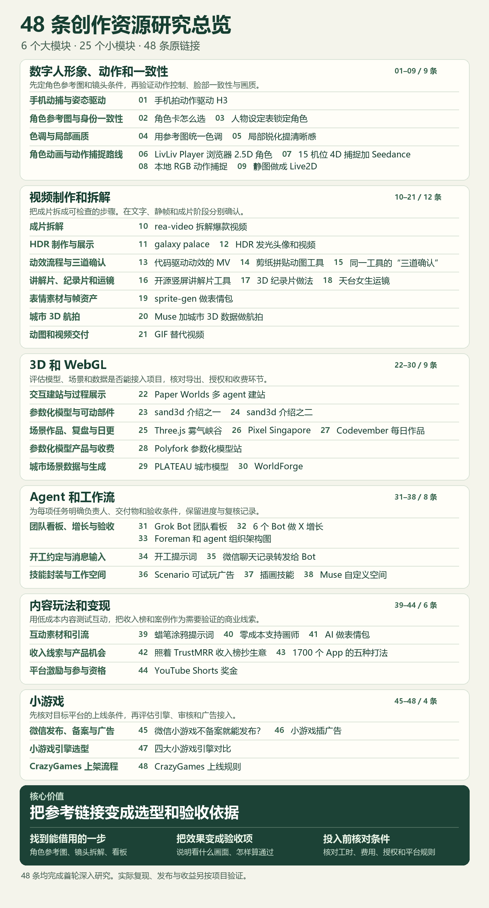

# 48 条创作资源研究

研究 48 条 X 原始链接，按数字人、视频制作、3D 与 WebGL、Agent 工作流、内容玩法与变现、小游戏划分为六大模块和 25 个小模块。逐条对照原作、技术做法和适用条件，把可以借用的步骤、效果验收和投入前要核对的条件沉淀为项目决策依据。

[打开在线研究总览](https://yydshly.github.io/20261104_codex_project/036-creative-resource-research/#overview) · [查看原尺寸引导图](https://yydshly.github.io/20261104_codex_project/036-creative-resource-research/summaries/research-overview.png) · [查看原始链接清单](https://yydshly.github.io/20261104_codex_project/036-creative-resource-research/source-list.tsv)

## 研究范围与划分

48 条来源按原顺序保留编号 01 至 48。每个大模块下设可展开的小模块，并链接到原作、逐条分析和总结图。两条 sand3d 帖文分别保留为第 23、24 条。

| 大模块 | 编号 | 小模块数 | 研究内容与可用做法 |
| --- | --- | ---: | --- |
| 数字人形象、动作和一致性 | 01–09 | 4 | 角色参考图、动作驱动、调色和局部画质。按镜头距离选参考，再逐项检查脸、动作和一致性。 |
| 视频制作和拆解 | 10–21 | 7 | 镜头拆解、HDR、代码动效、讲解片、表情素材、航拍与播放格式。把文字、静帧、成片分别确认。 |
| 3D 和 WebGL | 22–30 | 5 | 交互建站、可动模型、场景展示、模型收费与城市数据。核对导出格式、使用许可和生成费用。 |
| Agent 和工作流 | 31–38 | 3 | 团队看板、增长分工、验收角色、开工约定及技能封装。为每个任务记录产物和通过条件。 |
| 内容玩法和变现 | 39–44 | 3 | 互动素材、收入案例、产品机会和平台激励。将互动、转化和付费分别验证。 |
| 小游戏 | 45–48 | 3 | 微信发布、备案与广告、引擎对比、CrazyGames 上架。先核实目标平台条件再选引擎。 |

## 核心价值

- **选做法。** 从原作中定位能借用的一步，例如角色参考图、镜头拆解、动效确认或任务看板。
- **定验收。** 说明要看什么画面、核对哪些条件、怎样算通过，让效果可以复查。
- **核对投入。** 在制作、购买、上线前检查工时、费用、导出能力、授权和平台规则。

## 证据与范围

48 条均完成首轮深入研究。网页保留原始出处、原作展示、补充资料、分析结论和待验证项。原帖视频由官方嵌入或公开原始地址加载，能否播放取决于来源服务和访问环境。各案例是否复现、发布和取得收益按实际结果另记。

网页和公开研究材料位于 [docs/036-creative-resource-research](../../docs/036-creative-resource-research/index.html)。引导图沿用本轮生成的 1440 × 2670 原图。
